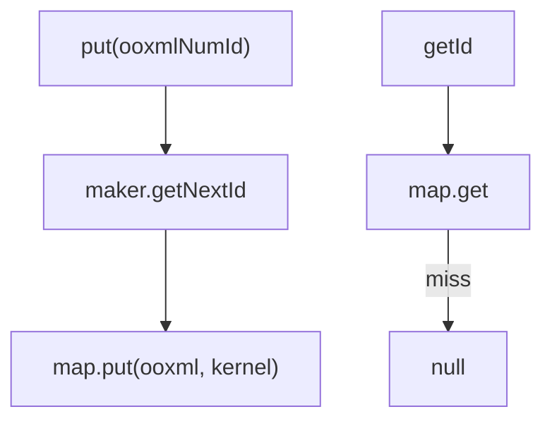

# 07_function_numid_redirection — OOXML numId → 内核 id

| 项 | 值 |
|----|----|
| feature | wc-02-document-model |
| order | 7 |
| crate | `libs/word-core/Cargo.toml` |
| 入口 | `NumIdRedirection::{put, getId}` / `TextDocument.UUNumberingId::{getNextId, getCurrentId}` |
| 独立性 | 叶子（HashMap + 计数器；不解析 numbering.xml） |
| 测试状态 | pass |

## 1. 功能说明

### 1.1 一句话

把 numbering.xml / 段落 `numId` 换成内核递增 id：`UUNumberingId` 从 0 起，`getNextId` 为 `++mId`，**第一个内核 id 是 1**。

### 1.2 输入

- 构造：`UUNumberingId`（Java 内嵌于 TextDocument，`mId=0`）
- `put(Integer numId)`：分配 `getNextId()` 写入 map，返回内核 id
- `getId(Integer numId)`：map get，miss=null

### 1.3 输出

内核 int；同一 OOXML numId 第二次 `put` **覆盖**为新 id（Java `map.put` 返回 previous 但忽略）。调用方应先 get 再 put；本层按 Java 字面：每次 put 都消耗一个 nextId。

### 1.4 上游

`TextDocument.getUUNumberingId()`。Split 可用独立 `UUNumberingId::new()`（Rust 已有 soft 结构）。

### 1.5 下游

NumberingImporter；ParaPropsConverterSimple。

## 2. 核心代码与流程

Java：`NumIdRedirection.java` 全文件；`TextDocument.UUNumberingId` 4217–4232  
Rust：`…/importer/NumIdRedirection.rs`



## 3. 测试方案

### 3.1 代码审计与测试面

| symbol | Java/Rust 路径 | 输入/状态 | 输出/副作用 | 关键分支/错误 |
|--------|----------------|-----------|-------------|---------------|
| 首个 getNextId | UUNumberingId:225 | mId=0 | 1 | 返回 0 |
| put 首次 | NumIdRedirection:23–28 | numId=10 | 返回 1；getId(10)==1 | |
| put 第二个不同 key | | numId=20 | 返回 2 | 复用 1 |
| getId miss | 17–20 | | null | 0 或 4095 |
| put 同 key 两次 | map.put 覆盖 | | 第二次返回 2；getId=2 | 仍 1 |
| ctor null maker | 12–14 | | Assert | |
| put/get null numId | assertNotNull | | Assert | |

### 3.2 覆盖矩阵

| coverage_id | 接口/代码路径 | 场景类别 | 必测? | test_id |
|-------------|---------------|----------|-------|---------|
| C-1 | 首个 nextId=1 | 常量 | 是 | NR1 |
| C-PUT | put(10)→1 且 get 命中 | 主路径 | 是 | NR2 |
| C-2 | 第二 key → 2 | 状态 | 是 | NR3 |
| C-MISS | getId 未注册 | 失败 | 是 | NR4 |
| C-OVR | 同 key 再 put 覆盖 | 状态 | 是 | NR5 |
| C-CUR | getCurrentId 随 next 变 | 状态 | 是 | NR6 |

### 3.3 可测试性

`NumIdRedirection(UUNumberingId::new())`。不构造 TextDocument、不读 numbering.xml。

### 3.4 用例表

| id | 覆盖项 | 前置状态 | 输入摘要 | 期望输出/副作用 | 失败语义 |
|----|--------|----------|----------|-----------------|----------|
| NR1 | C-1 | 新 maker | getNextId | 1 | 从 0 交出 |
| NR2 | C-PUT | 新 redirection | put(10) | 1；getId(10)=1 | |
| NR3 | C-2 | 已 put(10) | put(20) | 2；getId(10) 仍 1 | 冲掉 10 |
| NR4 | C-MISS | 空 | getId(99) | null | |
| NR5 | C-OVR | 已 put(10)→1 | 再 put(10) | 返回 2；getId(10)=2 | |
| NR6 | C-CUR | next 一次 | getCurrentId | 1 | 与 next 脱节 |

### 3.5 测试代码位置

crate: `libs/word-core/Cargo.toml`  
src:   `libs/word-core/src/cn/wps/moffice/writer/io/reader/docxReader/importer/NumIdRedirection.rs`  
test:  `libs/word-core/tests/cn/wps/moffice/writer/io/reader/docxReader/importer/NumIdRedirection.rs`

### 3.6 测试运行脚本

```bash
cargo test --manifest-path libs/word-core/Cargo.toml --test 07_function_numid_redirection

bash .cursor/skills/feature-function/scripts/function-coverage.sh \
  --crate libs/word-core --test 07_function_numid_redirection \
  --src src/cn/wps/moffice/writer/io/reader/docxReader/importer/NumIdRedirection.rs \
  --report libs/word-core/parser/features/wc-02-document-model/functions/07_function_numid_redirection/FUNCTION.md
```

### 3.7 覆盖率报告

<!-- coverage-report:begin -->
tool: cargo-llvm-cov (`cargo llvm-cov --test 07_function_numid_redirection --json`)
date: 2026-08-19 12:09

| src | lines covered | line % | regions covered | region % |
|-----|---------------|--------|-----------------|----------|
| `src/cn/wps/moffice/writer/io/reader/docxReader/importer/NumIdRedirection.rs` | 39/39 | 100.0% | 61/61 | 100.0% |
| **function total** | **39/39** | **100.0%** |  |  |
<!-- coverage-report:end -->
