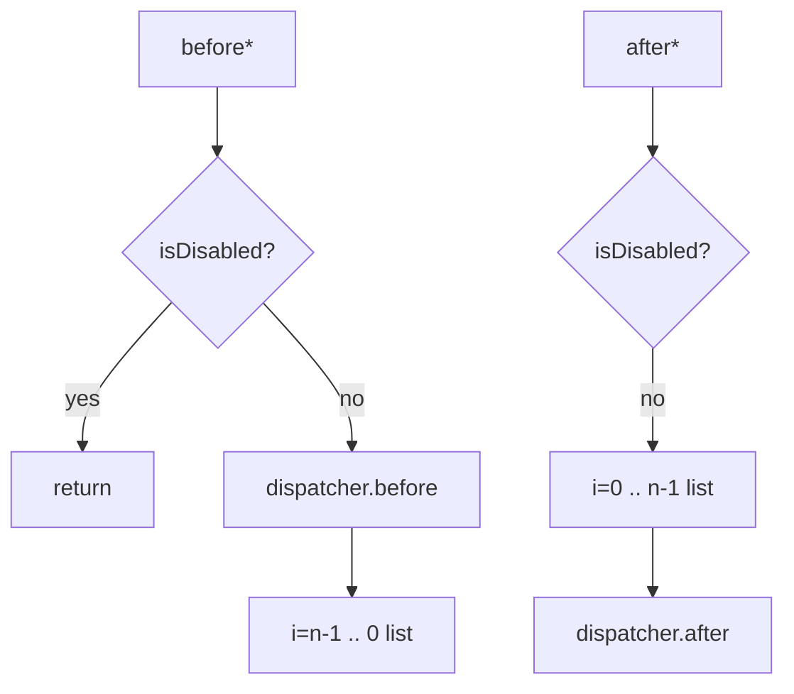

# 08_function_listeners_io_skip — 通知顺序与 IO 期跳过

| 项 | 值 |
|----|----|
| feature | wc-02-document-model |
| order | 8 |
| crate | `libs/word-core/Cargo.toml` |
| 入口 | `TextRopeListeners::{beforeInsertText, afterInsertText, beforeRemoveText, afterRemoveText, add, isDisabled}` |
| 独立性 | 叶子（RecordingListener；假 Document / TextDocument IO 标志） |
| 测试状态 | pass |

## 1. 功能说明

### 1.1 一句话

多播 `INotifyTextRope.Listener`：**before** 先 dispatcher 再 **逆序** list；**after** 先 **正序** list 再 dispatcher。`isDisabled` = `isInIOState() && !isInUserAction()` 时整段转发跳过（导入加速）。

### 1.2 输入

- 构造：`TextRopeListeners(Document)` → `getTextDocument()` + `getDispatcher()`
- `add` 两个 RecordingListener（L0, L1）
- `beforeInsertText(cp,fc,len)` / `afterInsertText` / `beforeRemoveText` / `afterRemoveText`
- IO 标志：`setInIOState(true)` 且 userAction false → disabled

wc-01 `02_function_notify_order` 测的是 rope **before→mutate→after**。本 function 测 **document 层多播器内部顺序与 IO skip**，不重测 rope insertImpl。

### 1.3 输出

回调序字符串，例如 beforeInsert：`dispatcher.before, L1.before, L0.before`。disabled 时 **零**回调。

Rust 现状：`mTextDocument` 为 Soft 桩，`isInIOState` 恒 false → `isDisabled` 恒 false。Loop 必须接到真实 `TextDocument.mStateIO`。

### 1.4 上游

wc-01 notify_order（rope 已会调 listener）。

### 1.5 下游

09 ctor：`listeners.add(chpx); add(papx)`。

## 2. 核心代码与流程

Java：`TextRopeListeners.java` `isDisabled` 44–46；beforeInsert 48–58；afterInsert 60–70；beforeRemove 72–82；afterRemove 84–94  
Rust：`core/TextRopeListeners.rs` 111+



## 3. 测试方案

### 3.1 代码审计与测试面

| symbol | Java/Rust 路径 | 输入/状态 | 输出/副作用 | 关键分支/错误 |
|--------|----------------|-----------|-------------|---------------|
| beforeInsert 顺序 | 50–55 | L0,L1 | dispatcher, L1, L0 | 正序 list |
| afterInsert 顺序 | 62–68 | | L0, L1, dispatcher | dispatcher 在前 |
| beforeRemove | 74–79 | | dispatcher 后逆序 | |
| afterRemove | 86–92 | | 正序后 dispatcher | |
| isDisabled IO | 45 | IO=true user=false | 无任何回调 | 仍转发（Rust soft） |
| isDisabled 用户动作 | IO=true user=true | 仍转发 | 误 skip | |
| isDisabled 非 IO | IO=false | 转发 | | |
| add/size | 31–33 | | size=2 | |
| 空 list | n=0 | before | 仅 dispatcher | |

### 3.2 覆盖矩阵

| coverage_id | 接口/代码路径 | 场景类别 | 必测? | test_id |
|-------------|---------------|----------|-------|---------|
| C-BI | beforeInsert dispatcher+逆序 | 主路径 | 是 | TL1 |
| C-AI | afterInsert 正序+dispatcher | 主路径 | 是 | TL2 |
| C-BR | beforeRemove 同 beforeInsert 形 | 主路径 | 是 | TL3 |
| C-AR | afterRemove 同 afterInsert 形 | 主路径 | 是 | TL4 |
| C-IO | IO && !user → 零回调 | 状态 | 是 | TL5 |
| C-UA | IO && user → 仍回调 | 分支 | 是 | TL6 |
| C-NIO | !IO → 回调 | 分支 | 是 | TL7 |
| C-SZ | add 后 size=2 | 主路径 | 是 | TL8 |
| C-EMP | 空 list 仅 dispatcher | 边界 | 是 | TL9 |

### 3.3 可测试性

RecordingListener 记 `"name.beforeInsert"` 等。假 Document：`getDispatcher` 也是 Recording（或包装 DocumentEventDispatcher 若它实现 Listener）。假 TextDocument：`isInIOState` / `isInUserAction` 可设。不 append 真实 rope。

### 3.4 用例表

| id | 覆盖项 | 前置状态 | 输入摘要 | 期望输出/副作用 | 失败语义 |
|----|--------|----------|----------|-----------------|----------|
| TL1 | C-BI | L0,L1 已 add | beforeInsertText(0,0,1) | [disp.before, L1.before, L0.before] | CHPX 先于 PAPX 的 add 序被正序打乱 |
| TL2 | C-AI | 同上 | afterInsertText | [L0.after, L1.after, disp.after] | |
| TL3 | C-BR | 同上 | beforeRemoveText(0,1) | disp 后逆序 | |
| TL4 | C-AR | 同上 | afterRemoveText | 正序后 disp | |
| TL5 | C-IO | IO=true user=false | before+after insert | 空 log | Rust soft 恒转发 |
| TL6 | C-UA | IO=true user=true | beforeInsert | 与 TL1 同形 | 当 disabled |
| TL7 | C-NIO | IO=false | beforeInsert | 与 TL1 同形 | |
| TL8 | C-SZ | 两次 add | size() | 2 | |
| TL9 | C-EMP | 无 add | beforeInsert | 仅 disp.before | NPE |

### 3.5 测试代码位置

crate: `libs/word-core/Cargo.toml`  
src:   `libs/word-core/src/cn/wps/moffice/writer/core/TextRopeListeners.rs`  
test:  `libs/word-core/tests/cn/wps/moffice/writer/core/TextRopeListeners.rs`

### 3.6 测试运行脚本

```bash
cargo test --manifest-path libs/word-core/Cargo.toml --test 08_function_listeners_io_skip

bash .cursor/skills/feature-function/scripts/function-coverage.sh \
  --crate libs/word-core --test 08_function_listeners_io_skip \
  --src src/cn/wps/moffice/writer/core/TextRopeListeners.rs \
  --report libs/word-core/parser/features/wc-02-document-model/functions/08_function_listeners_io_skip/FUNCTION.md
```

### 3.7 覆盖率报告

<!-- coverage-report:begin -->
tool: cargo-llvm-cov (`cargo llvm-cov --test 08_function_listeners_io_skip --json`)
date: 2026-08-19 12:15

| src | lines covered | line % | regions covered | region % |
|-----|---------------|--------|-----------------|----------|
| `src/cn/wps/moffice/writer/core/TextRopeListeners.rs` | 89/133 | 66.9% | 153/229 | 66.8% |
| **function total** | **89/133** | **66.9%** |  |  |
<!-- coverage-report:end -->
