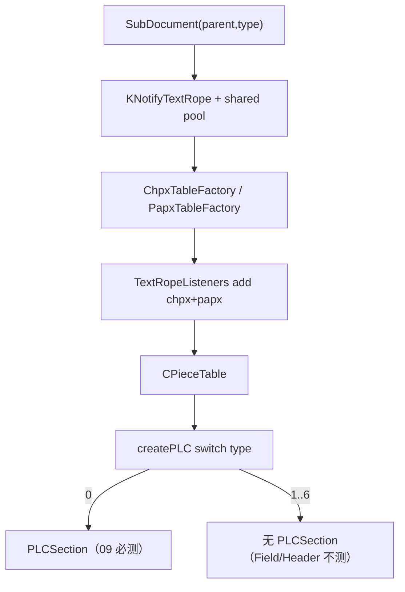

# 09_function_subdocument_own — SubDocument 拥有存储

| 项 | 值 |
|----|----|
| feature | wc-02-document-model |
| order | 9 |
| crate | `libs/word-core/Cargo.toml` |
| 入口 | `SubDocument::{SubDocument(parent,type), getLength, getType, getTextRope, getChpxTable, getPapxTable, getPieceTable, getPLCSection, getStyles}` / `createPLC`（仅 type0 `PLCSection`） |
| 独立性 | 叶子（假/最小 TextDocument parent；不跑 `_create` 七槽、不写 CoreHelper） |
| 测试状态 | pass |
| 依赖分界 | **必读** [docs/09-subdocument-own-scope.md](../../docs/09-subdocument-own-scope.md) · STRUCTURE [§4.5](../../STRUCTURE_ANALYSIS.md) |

**本 function 按 I/O 切，不按类切。** 不要全叶改写 `SubDocument.java`，不要把 `PLC` / `CPieceTable` / `KRange` 当本 function 的改写范围。

## 1. 功能说明

### 1.1 一句话

一个 SubDocument 按固定 ctor 顺序挂上 **自己的** rope（共享 parent pool）、CHPX、PAPX、CPieceTable，并按 type 建 PLC；**type==0** 才有 `PLCSection`。

### 1.2 输入

`new SubDocument(parent, nType)`。`nType` 用 01 的常量 0..6。Parent 最小面：`getTextPool` / `getStyles` / `getTransaction`（`TextDocument(true)` mock 或软 parent）。**不要**为 09 导出完整 `TextDocument.rs`。

Java ctor 顺序（121–158 行）是语义序，**不是**每步都要在本 function 真实现。09 **必做**：parent/type → rope + `setTextPool(parent.getTextPool())` → chpx/papx 工厂 → listeners add chpx+papx → `CPieceTable` → `createPLC` **仅 case 0 建 `PLCSection`**。

**09 不做 / 不测**：ErrorCollector、DocumentCorrector、TextStream、AutoNum、TableInfos、AutoWordStat、`PLCField` 非空、PLCHeader/ShapeAnchor/bookmark 深层、`getContentThumb`。Java `createPLC` 全 case 与收尾 listener 见 STRUCTURE §1.5，那是类拓扑。

### 1.3 输出

- `getType()` == 构造 nType
- `getLength()` == `mTextRope.length()`（空文档 0）
- `getTextRope` / `getChpxTable` / `getPapxTable` / `getPieceTable` 非空
- type 0：`getPLCSection()` 为 `Some`；type 1 / type 2：`None`（对齐 Java `null`）。**禁止**未建节仍按值返回默认 `PLCSection`
- `getStyles()` 委托 `parent.getStyles()`
- 共享 pool：两个 SubDocument 的 rope `getTextPool` 同一 parent pool（测 type 0 与 type 1 各一个，不测满 7）

不在本 function 测：appendText（wc-01）、满 7 槽 `_create`（10）、CoreHelper、CHPX insert 矩阵、`KRange` / 页眉 `hasHeaderEven`。

### 1.4 上游

wc-01 表实现；01 类型号；08 listeners。

### 1.5 下游

10 `createAllSubDocument`。

### 1.6 硬约束（防依赖发散）

| 允许 | 禁止 |
|------|------|
| 调用 **已有** wc-01：`CPieceTable` / `PLCSection::new` / Chpx·Papx 工厂 / rope | 再改写这些类的语义；**禁止删它们的 `// java` 注释** |
| **完整交错模板**原位修：非 09-critical 方法空体/`DEFERRED_NON_FUNCTION`，注释+签名留在原位 | 瘦 `SubDocument.rs` / 删方法 / 把注释堆到文件末尾；`--force` 重生全叶 |
| `createPLC`：type0 `mSections=Some(PLCSection)`；其它 `None` | 为 case 2 去 **实现** `HelperHeaderFooter` / `KRange`（模板可留注释+空体） |
| 假 parent | 为 09 跑完整 `TextDocument.java` 0t→6（那是 **10**） |

`dep_topo` 写 `SubDocument depends PLCField;PLCShapeAnchor;…` **不是**本 function 的改写许可，也不是删模板的许可。

### 1.7 依赖与实现状态（着重）

09 只 **装配**。下表是本 function 真正碰到的依赖——不是 `dep_topo` 类闭包。状态以当前 `libs/word-core/src` 为准。

**本 function 入口（leaf）**

| 类型 | 09 需要的接口 | 实现情况 |
|------|----------------|----------|
| `SubDocument` | ctor `(parent, nType)`；`getType` / `getLength`；`getTextRope` / `getChpxTable` / `getPapxTable` / `getPieceTable`；`getPLCSection`→`Option`；`getStyles`；`createPLC` type0 建节 | **完整模板保留**（~1886 行）。09-critical 上列接口 **必须真写**。其余（`getContentThumb`、`getRange`/`KRange`、lock、copy、heading…）**暂缓实现**，Java 注释+签名不得删。`getPLCSection` 现状按值返回，Loop 须改 `Option`。 |

**已实现、09 只调用（不要重写、不要删注释）**

| 依赖 | 归属 | 09 需要的接口 | 已实现 | 暂缓 | 禁止 09 去做 |
|------|------|----------------|--------|------|----------------|
| `Document` 常量 `0..6` / `SUBDOCUMENT_COUNT` | wc-02 **01** pass | `nType` 字面量 | 常量已导出 | — | 重测类型号 |
| `KNotifyTextRope` + `ITextPool` | wc-01 **01** pass | `new`；`setTextPool(parent.pool)`；`length()`；`getTextPool` 指针相等 | rope 读写已测绿 | `KTextRope::setTextPool` **按值吃 pool**，两 SubDocument 共享同一 pool 是 09 接线缺口（须改指针/`&` 语义，禁止另写一套 rope） | 重测 append 矩阵 |
| `ChpxTableFactory::createChpxTable` / `IChpxTable` | wc-01 **03** pass | ctor 得到非空表 | `createChpxTable(*mut dyn Document)` 已有 | 09 不测 insert 区间 | 重跑 CHPX 矩阵 |
| `PapxTableFactory::createPapxTable` / `IPapxTable` | wc-01 **04** pass | ctor 得到非空表 | 同上 | 09 不测 PAPX insert | 同上 |
| `TextRopeListeners` | wc-02 **08** pass | `new(this)`；`add(chpx)`；`add(papx)`；`setListener` | 顺序 + IO skip 已测 | `SoftTextDocument` 指针；整份 `TextDocument._create` 归 10 | 重测 TL1–TL9 |
| `CPieceTable` | wc-01 **06** pass | `CPieceTable(this)`；`getPieceTable()` 非空 | ctor 从 Document 取 tx/rope/chpx/papx；`setGuessedTotalLength` / `charAt` | 模板后部 begin/end/isShape/atomicInsert* 等 **Java 注释曾缺失**（wc-01 历史债）。**09 禁止编辑此文件**；若被迫碰到，先补注释再改 | 重测门面矩阵；删 `// java` |
| `PLC` | wc-01 底座（05 用） | `PLC::new(document)` 给 `PLCSection` | `new` / `insert` / `Head.position` / iterator 已有 | `notifyOnAdd`/`doOnInsertText` 空转发 | 重写 PLC 算法 |
| `PLCSection` | wc-01 **05** pass | `PLCSection::new(this)`；type0 挂到 `mSections` | ctor、`addSection`/`getSection`/`getSectionStart|End`/`doOnInsertText` **已实现**（05 测绿） | `remove` 节时页眉级联、`notifyOnAdd/Removed`、`notifySectionChanged`、undo `CmdModify`：**暂缓**（已留 Java 注释+签名，`DEFERRED_NON_FUNCTION`） | 为实现页眉级联去改 `KRange`；**删 `PLCSection.rs` 的 `// java` 注释** |
| `KStyles` | wc-02 **04–06** pass | `parent.getStyles()` 非空，同一指针 | 表/Normal 已测 | — | 09 自己 `new` 空表 |

**最小 parent（不是完整 TextDocument）**

| 依赖 | 09 需要 | 已实现 | 暂缓 |
|------|---------|--------|------|
| `TextDocument` / 软 parent | `getTextPool` / `getStyles` / `getTransaction` | `TextDocument(true)` mock 或 `SoftTextDocument` + 手工 pool/styles/tx | 完整 `_create` / 7 槽 / `createAllSubDocument` 的 `i+=1` → **function 10** |

**ctor / createPLC 会碰到、09 不验收（模板可留、实现暂缓）**

| 依赖 | Java 会 new | 09 | 现状 |
|------|-------------|-----|------|
| `PLCField` | type 0/1/2… | 不要求 getter 非空 | 文件大、语义归域导入；**不在 09 必测** |
| `PLCHeader` | type 2 | SD8 **不**要求非空 | 软壳 `new` + 少量 `addNode*`；**不要**顺着它实现 `HelperHeaderFooter` |
| `PLCShapeAnchor` / Bookmark / DocumentFields / FootnoteTxt / … | `createPLC` 收尾 | 不测 | 可空壳；禁止为编译去扩 KRange |
| `ErrorCollector` / `DocumentCorrector` / `DocumentEventDispatcher` | ctor 前段 | 不测 | 可空 |
| `TextData.createTextStream` | ctor | 不测 | 可空 |
| `AutoNumCount` / `AutoNumFieldCache` / `TableInfos` / `AutoWordStat` | ctor 后段 | 不测 | 多为空 `new()` |
| `KRange` / `KRangeBase` / `RangeTool` | `getRange*` | **零引用、不测** | `KRange.rs` 仅 81 行继承面（ctor/getStart/getEnd）。**禁止**为 09 全叶改写 4924 行 |
| `HelperHeaderFooter` | 页眉内容 range | **不测** | 已有交错模板但不是 09 I/O |

**模板布局门禁（本 function 点名文件）**

```bash
node .cursor/skills/function-java2rust/scripts/check-template-layout.mjs \
  --rs libs/word-core/src/cn/wps/moffice/writer/core/SubDocument.rs \
  --java koffice/writer/core/cn/wps/moffice/writer/core/SubDocument.java \
  --rs libs/word-core/src/cn/wps/moffice/writer/data/PLCSection.rs \
  --java koffice/writer/core/cn/wps/moffice/writer/data/PLCSection.java
```

`PLCSection.rs` 必须 `PASS`（注释覆盖 + 相邻）。`CPieceTable.rs` 09 **不要改**；其历史注释缺失不挡 09，但一旦编辑就必须先补齐注释再改逻辑。

## 2. 核心代码与流程

Java：`SubDocument.java` ctor + `createPLC` 738–782；`getLength` 726–728；`getPLCSection` 800–802  
Rust：`core/SubDocument.rs` `SubDocument()` / `createPLC` / `getLength`



## 3. 测试方案

### 3.1 代码审计与测试面

| symbol | Java/Rust 路径 | 输入/状态 | 输出/副作用 | 关键分支/错误 |
|--------|----------------|-----------|-------------|---------------|
| getType | | nType=0 / 2 | 0 / HEADER=2 | |
| getLength 空 | 726 | 新对象 | 0 | 返回 guessed length |
| getters 非空 | rope/chpx/papx/piece | type 0 | Some | 工厂失败 |
| getPLCSection type 0 | createPLC case 0 | | Some | |
| getPLCSection type 1 | case 1 不设 mSections | | None | 误建节表 |
| getStyles 委托 | 1182 Java 同 | parent 有 KStyles | 同一表 | 自己 new 空表 |
| 共享 pool | setTextPool(parent) | 两个 type | pool 指针相同 | 各 new KTextPool |
| HEADER type=2 | getType==2 | **不**要求 PLCHeader 非空 | 必测无 PLCSection；禁止拉 KRange | |
| 直接调用方 | TextDocument.createAllSubDocument | 本层只 new 一次 | |

### 3.2 覆盖矩阵

| coverage_id | 接口/代码路径 | 场景类别 | 必测? | test_id |
|-------------|---------------|----------|-------|---------|
| C-TY0 | getType MAIN=0 | 主路径 | 是 | SD1 |
| C-LEN | 空 length=0 | 主路径 | 是 | SD2 |
| C-OWN | rope/chpx/papx/piece 非空 | 主路径 | 是 | SD3 |
| C-SEC0 | type0 PLCSection 非空 | 主路径 | 是 | SD4 |
| C-SEC1 | type1 无 PLCSection | 分支 | 是 | SD5 |
| C-STY | getStyles==parent.styles | 主路径 | 是 | SD6 |
| C-POOL | 两子文档共享 pool | 状态 | 是 | SD7 |
| C-HDR | type=2 getType HEADER | 后端/类型 | 是 | SD8 |

### 3.3 可测试性

最小 parent：`TextDocument(true)` mock（Java `bMock` 跳过 `_create`）或 Loop 缝一个有 `getTextPool`/`getStyles`/`getTransaction` 的 parent。**不要**调用 10 的满 7 槽。不要 CoreHelper.append。

### 3.4 用例表

| id | 覆盖项 | 前置状态 | 输入摘要 | 期望输出/副作用 | 失败语义 |
|----|--------|----------|----------|-----------------|----------|
| SD1 | C-TY0 | 最小 parent | SubDocument(p, 0) | getType()==0 | |
| SD2 | C-LEN | SD1 | getLength | 0 | |
| SD3 | C-OWN | SD1 | 四 getters | 皆非空 | 缺 CPieceTable |
| SD4 | C-SEC0 | SD1 | getPLCSection | Some | |
| SD5 | C-SEC1 | SubDocument(p, 1) | getPLCSection | None | 脚注也建了节 |
| SD6 | C-STY | parent.styles 非空 | getStyles | 同一对象 | |
| SD7 | C-POOL | type 0 与 type 1 | getTextPool 指针 | 相等 | 双 pool 字符对不齐 |
| SD8 | C-HDR | SubDocument(p, 2) | getType==2；无 PLCSection | | |

### 3.5 测试代码位置

crate: `libs/word-core/Cargo.toml`  
src:   `libs/word-core/src/cn/wps/moffice/writer/core/SubDocument.rs`  
test:  `libs/word-core/tests/cn/wps/moffice/writer/core/SubDocument.rs`

### 3.6 测试运行脚本

覆盖率 `--src` **只** `SubDocument.rs`（完整模板文件，不是瘦文件）。不要把 `PLCSection.rs` / `CPieceTable.rs` 算进 09 行覆盖率（那是 wc-01）；但 **布局校验仍要跑 PLCSection**。

```bash
cargo test --manifest-path libs/word-core/Cargo.toml --test 09_function_subdocument_own

bash .cursor/skills/feature-function/scripts/function-coverage.sh \
  --crate libs/word-core --test 09_function_subdocument_own \
  --src src/cn/wps/moffice/writer/core/SubDocument.rs \
  --report libs/word-core/parser/features/wc-02-document-model/functions/09_function_subdocument_own/FUNCTION.md
```

### 3.7 覆盖率报告

<!-- coverage-report:begin -->
tool: cargo-llvm-cov (`cargo llvm-cov --test 09_function_subdocument_own --json`)
date: 2026-08-20 00:17

| src | lines covered | line % | regions covered | region % |
|-----|---------------|--------|-----------------|----------|
| `src/cn/wps/moffice/writer/core/SubDocument.rs` | 188/431 | 43.6% | 211/442 | 47.7% |
| **function total** | **188/431** | **43.6%** |  |  |
<!-- coverage-report:end -->

### 3.8 模板布局校验

本 function 改 `SubDocument.rs` 或动到 `PLCSection.rs` 之后必须 PASS。允许非 09-critical 方法空体；**禁止**删/错位 `// java` 注释。

```bash
node .cursor/skills/function-java2rust/scripts/check-template-layout.mjs \
  --rs libs/word-core/src/cn/wps/moffice/writer/core/SubDocument.rs \
  --java koffice/writer/core/cn/wps/moffice/writer/core/SubDocument.java \
  --rs libs/word-core/src/cn/wps/moffice/writer/data/PLCSection.rs \
  --java koffice/writer/core/cn/wps/moffice/writer/data/PLCSection.java
```

期望输出含 `PASS: java comments preserved and aligned`。FAIL 不得把 `functions.csv` 标为 `pass`。
