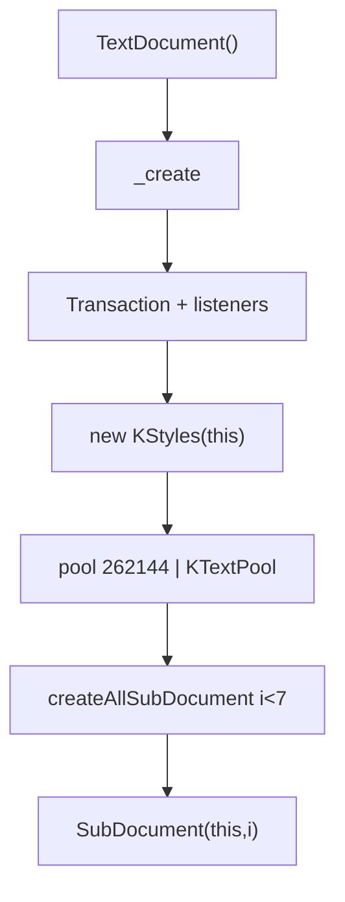

# 10_function_textdocument_create — 建成 7 槽对象图

| 项 | 值 |
|----|----|
| feature | wc-02-document-model |
| order | 10 |
| crate | `libs/word-core/Cargo.toml` |
| 入口 | `TextDocument::{_create, createAllSubDocument, createSubDocument, getMainDocument, getSubdocument, getStyles, getUUSti, getUUNumberingId, getTextPool}` |
| 独立性 | 编排（接线 05+09；不打开 docx、不跑 StylesImporter） |
| 测试状态 | pass |

## 1. 功能说明

### 1.1 一句话

`TextDocument()` / `_create()` 按序建 Transaction、KStyles、共享 TextPool、**7 个** SubDocument；`getUUSti().getUUSti()` 首值为 **4097**。

### 1.2 输入

- `TextDocument()` → `this(false)` → `_create()`
- `TextDocument(true)` mock：**不** `_create`（给 09 用）
- Java `_create` 351–370：Transaction → TransactionListeners → MergeListener → `new KStyles(this)` → pool 262144 / catch → `KTextPool` → `createAllSubDocument` → ShapeFactory（MVP 可 stub）
- `createAllSubDocument`：`for (int i = 0; i < 7; ++i)`  
  **Rust 现状 bug**（`TextDocument.rs` 1096–1102）：`while i < 7` **没有 `i += 1`**，一调即死循环。本 function Loop **必须修**，测试断言 7 槽且能结束。
- `createSubDocument(n)`：slot 非 null 不重建

### 1.3 输出

- `mSubdocuments.length==7`；`getMainDocument().getType()==0`
- `getSubdocument(i)` i=0..6 皆非 null，`getType()==i`
- `getStyles()` 非 null
- `getTextPool()` 非 null；各 SubDocument 共享该 pool（09 已测一对，10 抽查 0 与 6）
- 首个 `getUUSti().getUUSti()==4097`
- `getUUNumberingId().getNextId()==1`（与 07 同一计数器语义）
- `createSubDocument(0)` 返回已有 Main，不是第二个 type 0

不测 ShapeFactory / MediaLib / 全量 PLC 细节（09）。

### 1.4 上游

05 KStyles；09 SubDocument ctor。

### 1.5 下游

wc-04 写入目标；wc-05 DocumentImporter。

### 1.6 硬约束（防依赖发散）

| 允许 | 禁止 |
|------|------|
| 调用 **已有** 05 `KStyles::KStyles`、09 `SubDocument(parent, type)`、wc-01 `KTextPool` | 再改写这些类的语义；**禁止删它们的 `// java` 注释** |
| **完整交错模板**原位修 `TextDocument.rs`：10-critical 真写；其余空体/`DEFERRED_NON_FUNCTION`，注释+签名留在原位 | 瘦 `TextDocument.rs` / 删方法 / `--force` 重生 4k 行 Java |
| `createAllSubDocument`：`i < 7` **必须 `i += 1`**；`new SubDocument(this, i)` | 只建 slot 0；死循环 |
| `TextDocument(true)` 跳过 `_create` | mock 也跑 `createAllSubDocument` |
| ShapeFactory 空壳 | 为实现 ShapeFactory 去扩 drawing / `KRange` |

本 function 按 I/O 切：建成 7 槽对象图。不要把 `openDocument` / `dispose` 全图、页眉 Helper、docx 读取当本 function 的改写范围。

### 1.7 依赖与实现状态（着重）

10 只 **编排** 05+09。下表是本 function 真正碰到的依赖——不是 `dep_topo` 类闭包。

**本 function 入口（leaf）**

| 类型 | 10 需要的接口 | 实现情况 |
|------|----------------|----------|
| `TextDocument` | `new()` / `new__boolean(bMock)`；`_create`；`createAllSubDocument`（含 `i+=1`）；`createSubDocument`；`getSubdocument`→`Option`；`getMainDocument`；`getStyles`→`Option`；`getTextPool` 共享指针；`getUUSti` / `getUUNumberingId` | **完整模板保留**（~6672 行）。上列接口 **必须真写**。`openDocument` / `dispose` / 视图/媒体/保存加速器 **暂缓**，Java 注释+签名不得删。`getSubdocument` 不得按值移出槽位。`getUUNumberingId().getNextId()` 必须是 Java `++mId`（首值 1）。 |

**已实现、10 只调用（不要重写、不要删注释）**

| 依赖 | 归属 | 10 需要的接口 | 已实现 | 暂缓 | 禁止 10 去做 |
|------|------|----------------|--------|------|----------------|
| `SubDocument` ctor | wc-02 **09** pass | `SubDocument(parent, nType)`；槽 `getType()==i` | 假 parent + 存储装配已测绿 | 父类型仍是 09 的 `KStyle::TextDocument` 句柄（pool/styles/tx 指针）；10 在真实 `TextDocument` 上 **持有** 该 Box 句柄，避免改 09 签名 | 重测 SD1–SD8；全叶再写 SubDocument |
| `KStyles` | wc-02 **05** pass | `KStyles(this)` 非空 | add/getStyleById 已测 | `KStyles` 仍 clone 轻量 parent | 重跑 KT 矩阵 |
| `KTextPool` | wc-01 | `KTextPool()`；`getTextPool` 指针 | rope 读写已测 | `KSwappableTextPool(262144)` 不在本编译面 → 走 Java `catch` 的 `KTextPool` 回退（仍非 null） | 另写一套 pool |
| `UUSti` | wc-02 **03** 用 | 新文档首个 `getUUSti()==4097` | `mStiCustom` 从 4096 自增 | — | 重测 StyleId2Sti |
| `Document` 常量 0..6 / `SUBDOCUMENT_COUNT=7` | wc-02 **01** pass | 槽号 | 已导出 | — | 重测类型号 |
| `Transaction` | util | `_create` `new Transaction` + `setTransaction` | Atom 递归 set 已有 | MergeListener / TransactionListeners 可空壳 | 重写事务引擎 |

**ctor / `_create` 会碰到、10 不验收（模板可留、实现暂缓）**

| 依赖 | Java 会 new | 10 | 现状 |
|------|-------------|-----|------|
| `KSwappableTextPool` | try 262144 | 不要求；允许 fallback `KTextPool` | 可不在编译面 |
| `ShapeFactoryDoc` | `_create` 末 | 不测 | 空 `createShapeFactory()` |
| `FontTable` / `Metadata` / `Theme` / `FileManager` | `bMock` 字段初始化 | 不测 | 可空壳 |
| `openDocument*` / `dispose` | 打开/关闭文件 | **不测** | 注释+空体 |
| `KRange` / `HelperHeaderFooter` | 页眉路径 | **零引用、不测** | 禁止为 10 全叶改写 |

**模板布局门禁（本 function 点名文件）**

见 §3.8。`SubDocument.rs` / `KStyles.rs` 10 **不要改语义**；若被迫签名胶水，必须先布局 PASS。

## 2. 核心代码与流程

Java：`TextDocument.java` `_create` 351–370；`createSubDocument` 530–537；`createAllSubDocument` 539–542；`getUUSti` 2890  
Rust：`core/TextDocument.rs` `_create` / `createAllSubDocument`



## 3. 测试方案

### 3.1 代码审计与测试面

| symbol | Java/Rust 路径 | 输入/状态 | 输出/副作用 | 关键分支/错误 |
|--------|----------------|-----------|-------------|---------------|
| createAll 7 槽 | 539–542 | `_create` | 7 个非 null | Rust 死循环 / 只建 1 个 |
| getMainDocument | slot 0 | | type 0 | |
| getSubdocument(i) type | i=0..6 | | getType==i | 全是 Main |
| getStyles | `_create` 后 | | 非 null | |
| 共享 pool 0 与 6 | | | 同一 pool | |
| UUSti 首值 | UUSti ++ | 新文档 | 4097 | 4096 |
| UUNumberingId 首值 | | | 1 | |
| createSubDocument 已存在 | 532 | `_create` 后 create(0) | 同一 Main | new 第二个 |
| mock 不建槽 | `TextDocument(true)` | getMain 空 | 与 `_create` 对照 | mock 也死循环 |
| 直接调用方 | DocxReader 打开文档 | 本层只 ctor | |

### 3.2 覆盖矩阵

| coverage_id | 接口/代码路径 | 场景类别 | 必测? | test_id |
|-------------|---------------|----------|-------|---------|
| C-7 | 7 槽皆非 null | 主路径 | 是 | TD1 |
| C-MAIN | getMainDocument type 0 | 主路径 | 是 | TD2 |
| C-TY | slot i 的 getType==i | 主路径 | 是 | TD3 |
| C-STY | getStyles 非 null | 主路径 | 是 | TD4 |
| C-POOL | slot 0 与 6 同 pool | 状态 | 是 | TD5 |
| C-UU | 首个 getUUSti==4097 | 常量 | 是 | TD6 |
| C-NUM | 首个 numbering id==1 | 常量 | 是 | TD7 |
| C-DUP | createSubDocument(0) 不重建 | 状态 | 是 | TD8 |
| C-MOCK | bMock 不 _create | 分支 | 是 | TD9 |

### 3.3 可测试性

`TextDocument::new()` / Java 无参构造。超时（例如 2s）若 hung 即 C-7 失败（缺 `i+=1`）。不读 docx。TD9 用 mock 构造器。

### 3.4 用例表

| id | 覆盖项 | 前置状态 | 输入摘要 | 期望输出/副作用 | 失败语义 |
|----|--------|----------|----------|-----------------|----------|
| TD1 | C-7 | 新 TextDocument() | getSubdocument(0..6) | 7 个 Some | 死循环或只建 i=0 |
| TD2 | C-MAIN | TD1 | getMainDocument | type==0 且 == slot0 | |
| TD3 | C-TY | TD1 | 各 slot getType | 等于槽号 | 全 0 |
| TD4 | C-STY | TD1 | getStyles | 非 null | |
| TD5 | C-POOL | TD1 | slot0 vs slot6 pool | 同一指针 | |
| TD6 | C-UU | TD1 | getUUSti().getUUSti() | 4097 | |
| TD7 | C-NUM | TD1 | getUUNumberingId().getNextId() | 1 | |
| TD8 | C-DUP | TD1 | createSubDocument(0) | 与 getMain 同一对象 | 第二份 Main |
| TD9 | C-MOCK | TextDocument(true) | getMain / slot0 | 空；函数返回 | 也跑 _create |

### 3.5 测试代码位置

crate: `libs/word-core/Cargo.toml`  
src:   `libs/word-core/src/cn/wps/moffice/writer/core/TextDocument.rs`  
test:  `libs/word-core/tests/cn/wps/moffice/writer/core/TextDocument.rs`

### 3.6 测试运行脚本

```bash
cargo test --manifest-path libs/word-core/Cargo.toml --test 10_function_textdocument_create

bash .cursor/skills/feature-function/scripts/function-coverage.sh \
  --crate libs/word-core --test 10_function_textdocument_create \
  --src src/cn/wps/moffice/writer/core/TextDocument.rs \
  --report libs/word-core/parser/features/wc-02-document-model/functions/10_function_textdocument_create/FUNCTION.md
```

### 3.7 覆盖率报告

<!-- coverage-report:begin -->
tool: cargo-llvm-cov (`cargo llvm-cov --test 10_function_textdocument_create --json`)
date: 2026-08-20 00:48

| src | lines covered | line % | regions covered | region % |
|-----|---------------|--------|-----------------|----------|
| `src/cn/wps/moffice/writer/core/TextDocument.rs` | 209/952 | 22.0% | 268/1019 | 26.3% |
| **function total** | **209/952** | **22.0%** |  |  |
<!-- coverage-report:end -->

### 3.8 模板布局校验

本 function 改 `TextDocument.rs` 之后必须 PASS。允许非 10-critical 方法空体；**禁止**删/错位 `// java` 注释。

```bash
node .cursor/skills/function-java2rust/scripts/check-template-layout.mjs \
  --rs libs/word-core/src/cn/wps/moffice/writer/core/TextDocument.rs \
  --java koffice/writer/core/cn/wps/moffice/writer/core/TextDocument.java
```

期望输出含 `PASS: java comments preserved and aligned`。FAIL 不得把 `functions.csv` 标为 `pass`。

本轮结果：`PASS: java comments preserved and aligned`（2692 条 `// java` 注释，与 baseline 一致）。
