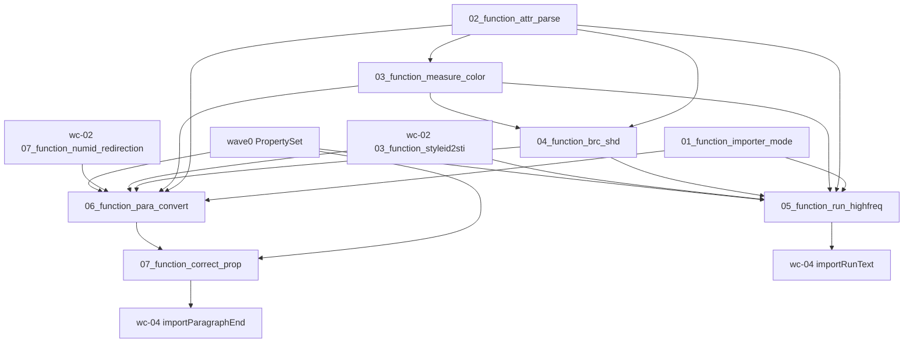

# wc-03-property-convert — Function 组合图

> 分析日期：2026-08-20
> 输入端点：wave0 handler 已凑齐的 `elementId`（本地名 Java `String.hashCode`）+ SAX `Attributes`；wave0 `PropertySet`；wc-02 `StyleId2Sti` / `NumIdRedirection`
> 对外输出：填好的 `MutablePropertySet`（run / para propId 桶）；段末 `correctProp` 后的同一桶
> 切分依据：I/O 边界（mode 开关 → attr 取值 → 度量/颜色 → BRC/SHD → run 高频落桶 → para 落桶 → correctProp 纠偏）
> 类级蓝皮书：[STRUCTURE_ANALYSIS.md](./STRUCTURE_ANALYSIS.md) · seeds：[SEEDS_ANALYSIS.md](./SEEDS_ANALYSIS.md) · 深读：[docs/README.md](./docs/README.md)

本文件只讲 **function 之间如何串联**。每个 function 的字段表、类图、**测试方案**在
`functions/<function_id>/FUNCTION.md`。可执行测试与 `src` 隔离，镜像落在 crate
`libs/word-core/tests/<relpath>/<Type>.rs`（见 §3）。

**本层不解析 docx、不写 rope/CHPX/PAPX。** 包/XML 是 wave0；落库是 wc-01；对象图是 wc-02；段/run 导入是 wc-04。本层验的是「attrs/elementId → 正确 propId 桶」。

---

## 0. 一句话管线

目录名 `{NN}_function_*` 的 `NN` 是依赖拓扑序号（就绪即编号）。属性桶已在 wave0 测绿；styleId/numId 映射已在 wc-02 测绿，本 feature **不重拆**。

```text
(wave0) 01_function_property_set            PropertySet 前置（util crate）
(wave0) 10_function_handler_props           pPr/rPr 事件 → 调用本层 converter
(wc-02) 03_function_styleid2sti             XML styleId → kernel sti
(wc-02) 07_function_numid_redirection       OOXML numId → kernel id
01_function_importer_mode                   mode+context → isDocx/isXml07/isXml03/isGVml
02_function_attr_parse                      Attributes → string / bool / int / hashCode
03_function_measure_color                   Attributes → twips / float / color / hex
04_function_brc_shd                         Attributes → BRC / SHD
05_function_run_highfreq                    (elementId, attrs, styleId2Sti) → run 桶
06_function_para_convert                    (elementId, attrs, styleId2Sti, numId) → para 桶
07_function_correct_prop                    PropertySet → 191=0（若缺）+ tabs→236
```

热路径（钉死，来自 STRUCTURE_ANALYSIS.md）：

```text
DocxReader: DocumentImporter(..., mode=0, xml07=null, xml03=null)
  → ImporterBase.isDocx()==true；isXml07/03==false

XWPF PropChildHandler.onStart
  → elementId = 本地名 Java-hash（w:b=98, w:sz=3687, w:jc=3385, w:pStyle=-1008274655, …）
  → RPR:  RunPropsConverterSimple.convertRunPropsBase(doc, dst, elementId, attrs, styleId2Sti)
  → PPR:  ParaPropsConverterSimple.convertProp(dst, elementId, attrs, styleId2Sti, numIdRedirection)

importParagraphEnd (wc-04)
  → 可能 setValue(282, paraId)          # 不在本 feature
  → ParaPropsConverterSimple.correctProp(dstParaProps)
  → CoreHelper.appendParagraph(..., freeze)
```

---

## 1. Function 清单

| order | function_id | 一句话 | 输入 | 输出 | 上游 | 下游 |
|------|-------------|--------|------|------|------|------|
| 1 | [01_function_importer_mode](./functions/01_function_importer_mode/FUNCTION.md) | 格式 mode 如何变成 isDocx/isXml07/isXml03 | mode + 可选 Xml07/Xml03 context | 四个布尔 + `mode()` | （无） | 05; 06 |
| 2 | [02_function_attr_parse](./functions/02_function_attr_parse/FUNCTION.md) | 如何从 Attributes 取出 string/bool/int/hash | SAX attrs（main ns） | `Option<String>` / bool / `Option<i32>` / hash 或 `-1` | （无 XML 树） | 03; 04; 05; 06 |
| 3 | [03_function_measure_color](./functions/03_function_measure_color/FUNCTION.md) | 如何把带单位的 attr 和颜色字面量变成内核数 | attrs：`12pt` / hex / `auto` | twips / float / color int | 02; WmlUnit | 04; 05; 06 |
| 4 | [04_function_brc_shd](./functions/04_function_brc_shd/FUNCTION.md) | 如何把边框/底纹 attrs 变成 BRC/SHD | `sz/val/color/space/shadow/frame` | `BRC` / `SHD` | 02; 03; ImporterHelper 子集 | 05; 06 |
| 5 | [05_function_run_highfreq](./functions/05_function_run_highfreq/FUNCTION.md) | 如何把 rPr 子元素写成字符 propId | elementId + attrs + StyleId2Sti | run `MutablePropertySet` | 01–04; wc-02 styleId2sti | wc-04 importRunText |
| 6 | [06_function_para_convert](./functions/06_function_para_convert/FUNCTION.md) | 如何把 pPr 子元素写成段落 propId | elementId + attrs + StyleId2Sti + NumIdRedirection | para `MutablePropertySet` | 01–04; wc-02 03/07 | 07; wc-04 |
| 7 | [07_function_correct_prop](./functions/07_function_correct_prop/FUNCTION.md) | 段末如何补 Normal 样式并合成 tabs | 已填的 para 桶（可空） | 缺 191→0；280/281→236 | 06 | wc-04 importParagraphEnd |

`ConvertHelper` 冷门（DropCap / toTextFlow / xmlNfc / FontInfo / 修订全套）不单独成 function，折进 02–04 的 defer 列。`convertIns/Del/rPrChange` 写桶，归 05。`correctProp` 四参修订重载归 07 defer。

---

## 2. 数据流



**串接规则：**

1. **不重测 wave0 PropertySet。** 本层只断言 converter **写入了哪些 propId**；`setInt/contains/freeze` 语义以 wave0 为准。
2. **不重测 wc-02。** `StyleId2Sti.getSti` miss = `None`（不是 4095）；`NumIdRedirection` 首个 id=1。05/06 用已测绿的真实 map，不重新实现。
3. **测 N 不打开 docx。** fixture 是内存 `Attributes`（main ns + local name）+ 字面量 elementId；编排不跑 XWPF。
4. **elementId 权威 = Java `String.hashCode()`。** 例如 `b→98`、`sz→3687`、`jc→3385`、`pStyle→-1008274655`。Rust 必须同算法，否则 switch 全错。
5. **propId 权威 = Java 字面量。** 粗体 **5**、字号 **10**、run 样式 **2**、pStyle **191**、对齐 **193**、ilvl **234**、numId **235**。禁止重编号。
6. **toBoolean：** `val` 缺失/空 → `true`；`"off"`/`"0"`/`"false"`/`"f"`（忽略大小写，`"0"` 精确）→ `false`；其余 → `true`。
7. **setStyle vs setRunStyle：** para `getSti==null → setInt(191, 0)`；run `getSti==null → 不写 2`。
8. **`correctProp` 不覆盖已有 191。** 只在 `!contains(191)` 时写 0。
9. **未知 elementId：** Run 返回 `isNormalProperty=false` 且不写桶；Para Java 是 `IOAssert.fail`，**Rust MVP 改为 log+ignore、不写错桶、不 panic**。
10. **失败停在本级。** 空 attrs 的 `getString` 应是 `None`，不得表现为「run 没写粗体」。
11. **Xml03 分支在 DOCX 主路径永远 false。** 01 钉死 `mode=0`；05/06 可保留签名，不把 xml03 当必测主路径。

---

## 3. 依赖与编译面

| 层级 | function | crate | 单独测 |
|------|----------|-------|--------|
| 叶子 | importer_mode | `libs/word-core` | `ImporterBase.rs` 已存在。ctor 须接受 **Option** context（Java `null`）；当前模板用 `&Context` 且未导出 |
| 叶子 | attr_parse, measure_color | word-core | `ConvertHelper.rs` **尚不存在**。fixture：main ns attrs，不跑 zip |
| 叶子 | brc_shd | word-core | ConvertHelper.toBRC/toSHD + `ImporterHelper` 四个 getter + `BorderConvertSimple` none/single |
| 叶子 | run_highfreq | word-core | instance `mode=0`；高频 case；`doc` 对 b/i/sz/rStyle/color 不读 |
| 叶子 | para_convert | word-core | instance `mode=0`；191/193/208–213/234/235；未知 id 不 panic |
| 叶子 | correct_prop | word-core | 静态 `correctProp(dst)`；不需要 Attributes / TextDocument |

每个 function 一条 `[[test]]`，`name` = `function_id`。02/03/04 同 `ConvertHelper.rs` src、测试分三个 path；06/07 同 `ParaPropsConverterSimple.rs` src、07 用 `*_correct.rs`。

| function_id | `[[test]]` path |
|-------------|-----------------|
| `01_function_importer_mode` | `tests/cn/wps/moffice/writer/io/reader/ImporterBase.rs` |
| `02_function_attr_parse` | `tests/.../helpers/ConvertHelper.rs` |
| `03_function_measure_color` | `tests/.../helpers/ConvertHelperMeasure.rs` |
| `04_function_brc_shd` | `tests/.../helpers/ConvertHelperBrc.rs` |
| `05_function_run_highfreq` | `tests/.../helpers/RunPropsConverterSimple.rs` |
| `06_function_para_convert` | `tests/.../helpers/ParaPropsConverterSimple.rs` |
| `07_function_correct_prop` | `tests/.../helpers/ParaPropsConverterSimpleCorrect.rs` |

```bash
# 单 function（loop 用这条）
cargo test --manifest-path libs/word-core/Cargo.toml --test 01_function_importer_mode
# … 02–07 同 crate、--test <function_id>

# 不要用 --lib 当 function 验收：src 内禁止 #[cfg(test)]
```

`ConvertHelper`（02–04）已从 `lib.rs` 导出；04 另导出 `ImporterHelper` 与 `BorderConvertSimple`。`RunPropsConverterSimple.rs` / `ParaPropsConverterSimple.rs` 已导出。Xml07/Xml03 与部分 value 类型在 `lib.rs` 内联为空壳，不编译 `xml07/` 编号树。BRC obtain/getters 在 `lib.rs` 内联，不加载损坏的 `data/value/BRC.rs`。`TBD` / `TxTabStops` 同样是 `lib.rs` 编译面胶水，不加载损坏的 disk 叶。

wc-01 / wc-02 的 `[[test]]` `name` 不与本表冲突（function_id 全局唯一）。

启动改写-测试-回归：对 agent 说 `loop 01_function_importer_mode` 或「开始 loop」（skill：`feature-function`）。每个 function 的 `FUNCTION.md` §3.6 / §3.7 含 `cargo test` 脚本与 `cargo-llvm-cov` 覆盖率报告。

---

## 4. Function 如何串联（逐步）

1. `DocxReader` 以 `mode=0, xml07=null, xml03=null` 构造 importer（01）。全链路 `isDocx()`。
2. XWPF handler 给出 `elementId` + `Attributes`（`WMap.MAIN_NAMESPACING` + local name）。
3. ConvertHelper 取 `w:val` / 具名 attr（02）；带 `pt` 的度量走 WmlUnit → twips（03）；颜色 `auto`/`hex`（03）。
4. 边框 `toBRC`：缺 `sz` → 线宽 `0.5` pt；`val=none→0`、`single→1`（04）。
5. `w:rPr` 子元素进 05：`b→5`、`i→6`、`sz→10`（半磅→pt）、`rStyle→2`、`color→11`、`rFonts→3/4/35/36/40`。
6. `w:pPr` 子元素进 06：`pStyle→191`、`jc→193`、`ind→208..213`、`ilvl→234`、`numId→235`。
7. 段末 07 `correctProp`：无 191 则写 0；有 280+281 则合成 236 并清空原始桶。
8. freeze 后交给 wc-04 / wc-01。`paraId` **282** 由 wc-04 写，不在本层。

---

## 5. 验收顺序

```text
01_function_importer_mode         （最快；Option context；DOCX 主路径）
02_function_attr_parse            （空 attrs / toBoolean 真值表 / hash=-1）
03_function_measure_color         （12pt→240 twips；auto→-16777216）
04_function_brc_shd               （缺 sz→0.5；none/single）
05_function_run_highfreq          （propId 5/6/10/2/11；未知 id 返回 false）
06_function_para_convert          （191/193/208/234/235；未知 id 不 panic）
07_function_correct_prop          （缺 191→0；已有不覆盖；tabs 236）
```

README / STRUCTURE MVP checklist 映射：

| 目标项 | function |
|--------|----------|
| `isDocx` / xml03 开关 | 01 |
| toBoolean / getString | 02 |
| 度量 twip / 半磅 / 颜色 | 03 |
| BRC 线宽 八分之一磅→pt | 04 |
| 粗体(5) / 字号(10) / rStyle(2) | 05 |
| 对齐(193) / pStyle(191) | 06 |
| `correctProp` 缺省 191=0 | 07 |
| 未知 elementId 不崩溃、不写错桶 | 05, 06 |
| elementId = Java hashCode | 05, 06（字面量钉死） |

---

## 6. 与类级分析的对照

| function | STRUCTURE_ANALYSIS 枢纽 | 深读 |
|----------|-------------------------|------|
| importer_mode | §1.1 ImporterBase | [docs/ImporterBase.md](./docs/ImporterBase.md) |
| attr_parse | §1.2 ConvertHelper Attr/布尔/整数 | [docs/ConvertHelper.md](./docs/ConvertHelper.md) |
| measure_color | §1.2 getLong/getFloat/toColor/hex2Int | 同上 |
| brc_shd | §1.2 toBRC/toSHD + ImporterHelper 连坐 | 同上 |
| run_highfreq | §1.3 / §4.1③ RunPropsConverterSimple subset-highfreq | [docs/RunPropsConverterSimple.md](./docs/RunPropsConverterSimple.md) |
| para_convert | §1.4 / §4.1④ convertProp | [docs/ParaPropsConverterSimple.md](./docs/ParaPropsConverterSimple.md) |
| correct_prop | §1.4 / §2.2 correctProp | 同上 |

类图仍以 `STRUCTURE_ANALYSIS.md` 为准；function 按 **I/O** 切，不按类切。`ConvertHelper` 一类拆成 02/03/04 三种输出；`ParaPropsConverterSimple` 拆成 convert（06）与 correct（07）。每个 `FUNCTION.md` 必须有 **§1.7 依赖实现状态** 和 **§3.8 模板布局校验**。
