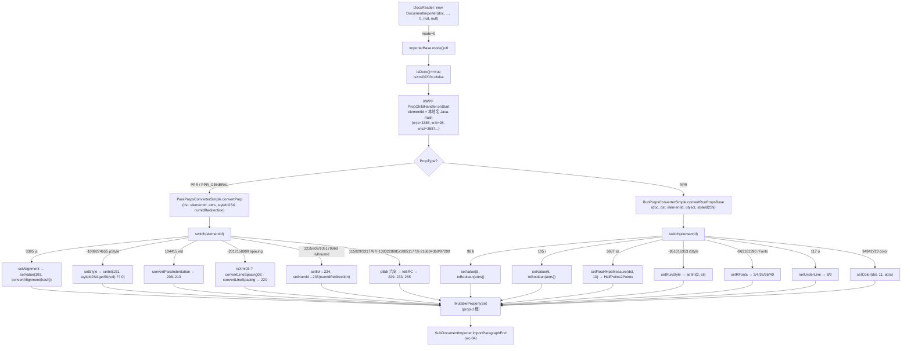
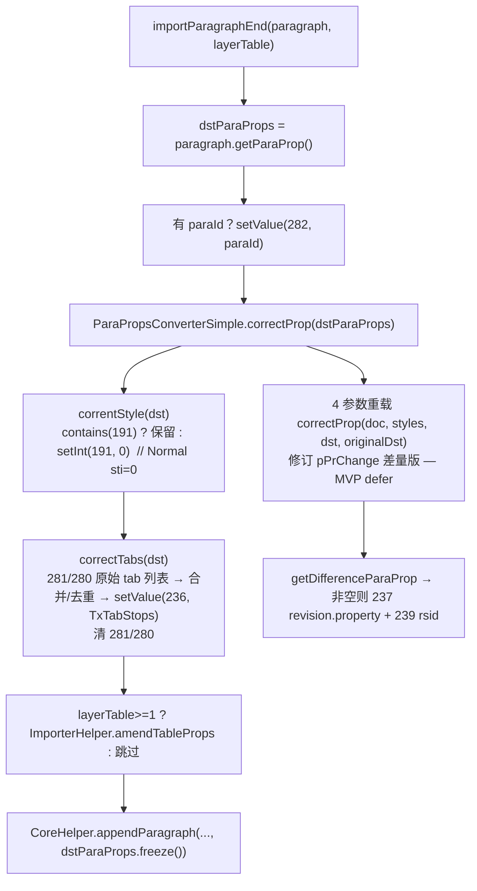

# wc-03-property-convert — OOXML→PropertySet 属性转换（类图/流程/依赖/最小改写范围）

> 分析基准：`koffice/writer/core`（Java）与 `libs/word-core`（Rust）双端源码通读。
> Feature 目录：`libs/word-core/parser/features/wc-03-property-convert/`（`depends_on: wc-02-document-model`）。

---

## 0. Feature 目标与管线位置

**目标**：把 SAX `Attributes` + `elementId`（OOXML 元素本地名哈希）转成内核扁平属性桶 `MutablePropertySet`。**只产 PropertySet，不写 rope**。

管线位置（Wave 3，batch `parse-03-property-convert`，order 400+）：

```text
wave0-xwpf（XWPF handler，凑齐 attrs / elementId）   ← 上游：属性来源
   ↓
wc-03 本层：ImporterBase / ConvertHelper / RunPropsConverterSimple / ParaPropsConverterSimple
   ↓ 产出 MutablePropertySet（propId 桶）
wc-04-paragraph-import（SubDocumentImporter.importParagraphEnd → correctProp → CoreHelper.appendParagraph）
   ↓
wc-01 CoreHelper（落库）
```

四个种子类在 4 个 CSV 中全部标记：`mvp-must`、`feature-seed`（ConvertHelper 另带 `subset-hotpath`，Run* 带 `subset-highfreq`，Para* 带 `subset-correctProp`）。

**当前进度（rewriting_queue.csv）**：`ImporterBase` / `ConvertHelper` / `RunPropsConverterSimple` / `ParaPropsConverterSimple` 全部 **blocked**（`rs_exists=no`），原因一致：依赖闭包含未完成的软壳模块（TextDocument、value 类型、Xml03Utils、IOHelper、Xml07/03Context）。`WmlUnit`、`Unit`、`MutablePropertySet`、`StyleId2Sti` 已 done；`NumIdRedirection` blocked（Rust 侧为软壳 stand-in）。

---

## 1. 类图

### 1.1 ImporterBase（order 400，44 行，MVP must，完整实现无 todo）

`koffice/.../io/reader/ImporterBase.java` → Rust `libs/word-core/src/cn/wps/moffice/writer/io/reader/ImporterBase.rs`（**已存在、可编译、逻辑完整**，dep 为 blocked 但本文件可先行验证）。

```
java: public abstract class ImporterBase
rust: #[derive(Default)] pub struct ImporterBase
```

| 字段 | 类型（Rust） | 含义 |
|---|---|---|
| `mMode` | `i32` | 0=DOCX，1=Xml07，2=GVml，3=Xml03 |
| `mXml07Cxt` | `Option<Xml07Context>` | Xml07 上下文（DOCX 路径为 None） |
| `mXml03Cxt` | `Option<Xml03Context>` | Xml03 上下文（DOCX 路径为 None） |

| 方法 | 签名 | 逻辑 |
|---|---|---|
| `mode()` | `pub fn mode(&self) -> i32` | 返回 mMode |
| `xml07Context()` / `xml03Context()` | 返回 `Option<&Context>` | 访问器 |
| `isXml03()` 🔥 | `pub fn isXml03(&self) -> bool` | `3 == mode && mXml03Cxt.is_some()` |
| `isXml07()` 🔥 | `pub fn isXml07(&self) -> bool` | `1 == mode && mXml07Cxt.is_some()` |
| `isDocx()` 🔥 | `pub fn isDocx(&self) -> bool` | `0 == mode` |
| `isGVml()` | `pub fn isGVml(&self) -> bool` | `2 == mode` |

**关键事实**：DocxReader（`DocxReader.java:50`）构造 `DocumentImporter(..., 0, null, null)` → 全链路 `isDocx()==true`、`isXml07/03==false`。isXml07 同时查 mode 与 context 非空，是为了区分「Xml07 模式但 context 未初始化」。Rust 现状已正确对齐。**构造参数 `&Xml07Context`/`&Xml03Context` 引用语义与 Java 指针语义一致；子类构造必须 `super(mode, xml07, xml03)`。**

### 1.2 ConvertHelper（order 402，1146 行，静态工具箱，MVP must subset-hotpath）

`koffice/.../helpers/ConvertHelper.java`，**全 static 无状态**（仅 `sRandom`/`sNfcMap` 惰性单例）。Rust 目标 `.../helpers/ConvertHelper.rs`（不存在）。依赖 `MutablePropertySet`(done)、`WmlUnit`(done)、`ImporterHelper`、`ShareConvertHelper`、`BorderConvertSimple`、`Xml03Utils`、`IOHelper`（后三者 blocked/soft）。

方法清单（按调用点收集，`*` = 热路径必须）：

| 类别 | 方法 | 签名 | 逻辑（1 行） |
|---|---|---|---|
| Attr 取值 | `getString(attrs)` * | `&Attributes → Option<String>` | `len==0→None`，否则取 `w:val` |
| | `getString(attrs, name)` * | 同上 | 取 `w:name` |
| | `getString(attrs, name, ns)` | 同上 | 指定命名空间取 attr |
| | `getStringHashCode(attrs[, name])` * | → `i32` | attr 值 **Java String.hashCode**，缺省 `-1` |
| 布尔 | `toBoolean(attrs)` * | → `bool` | `val` 缺失/空 → true；`"off"/"0"/"false"/"f"` → false，否则 true |
| | `getBoolean(attrs, name)` * | → `Option<bool>` | 缺失 → None；否则 isFalse 判断 |
| | `toBoolean4NotNull(attrs[, def])` | → `Option<bool>` | 缺失 → def（默认 true） |
| | `toBoolean4Math(attrs)` | → `bool` | 取 math 命名空间 `val`，缺失 → true |
| 数值 | `toInteger(attrs)` * | → `Option<i32>` | `w:val` → string2Integer |
| | `getLong(attrs, name)` * | → `Option<i64>` | **WmlUnit 解析**：带 `pt` 单位 → Points2Twips |
| | `getFloat(attrs, name)` / `toFloat(attrs)` | → `Option<f32>` | 同上，pt → Points2Twips |
| | `getInt(attrs, name)` | → `Option<i32>` | 同 getLong 但 int |
| | `hex2Int(attrs, name)` * | → `Option<i32>` | 十六进制串 → int |
| 边框 | `toBRC(attrs, isXml03)` * | → `BRC` | `ImporterHelper.getLineWidthBRC(getLong("sz"))` + `getBorderType` + `toColor("color")` + `getSpace` + `getBorderShadow` + `getBorderFrame` → `BRC.obtain` |
| 颜色 | `toColor(attrs, name)` * | → `i32` | `"auto"→-16777216`；hex → 整数；缺省 `-16777216` |
| | `convert2coreColor(src)`（Run* 用） | `String → i32` | 同上私有版，缺省 `-2` |
| 阴影 | `toSHD(attrs)` * | → `SHD` | `SHD.obtain(toColor("color"), toColor("fill"), toPat(attrs))` |
| 度量 | `convertPositionY/X(Long, String)` | → `i32` | 绝对优先；相对 `inline/left→0`，`top→-4`，`center→-8`，`bottom/right→-12`，`inside→-16`，`outside→-20` |
| 文本流 | `toTextFlow(textDirection, isXml03)` | → `i32` | `tb/rl/lr/tbV/...` 枚举 → 0/1/3/4/5；未知 fail |
| 修订 | `convertRPrChange(dst, attrs)` | → `Revision` | `setBoolean(47,true)` + `setValue(48, Revision(3))` |
| | `convertIns(doc, dst, attrs)` * | → `Revision` | `convertInsRevision` → `addInsRevision`（46/50/55） |
| | `convertDel(doc, dst, attrs)` * | → `Revision` | `convertDelRevision` → `addDelRevision`（45/49/54） |
| | `setRevision(revision, attrs)` | void | author + date2DateTime |
| | `addRsidToTextDocument(doc)` | → `i32` | Random().nextInt() 加入 doc.rsids |
| 编号 | `xmlNfc2MsoNfc(str, isXml03)` | → `Option<i32>` | sNfcMap：`decimal→0, upperRoman→1, ... bullet→23, none→255, ...` |
| 字体 | `getTextFont(attrs)` / `setPanose` / `getSupplementalFont` | 冷门 | charset/pitchFamily/panose/typeface → FontInfo |
| 表格 | `toCellSpacing` / `toTableLengthType` | 冷门 | type hash → 0..3 |
| 常量 | `VAL/TYPE/COLOR/SZ/ID/FONT/CHAR/...` | pub const | attr 名常量 |

**toBRC 依赖链**（改写必须连坐）：
```text
ImporterHelper.getLineWidthBRC: 缺省 0.5f；EighthPoints2Points(value)（assert 0<=value<=96）
ImporterHelper.getSpace: 缺省 0.0f
ImporterHelper.getBorderShadow/getBorderFrame: null → false
BorderConvertSimple.convertCoreBorder(borderStyle.hashCode()): "none"→0, "single"→1, ...（mvp-defer 可先只支持 none/single）
```

### 1.3 RunPropsConverterSimple（order 406，986 行，MVP must subset-highfreq）

`java: public final class RunPropsConverterSimple extends ImporterBase`
Rust 目标 `.../helpers/RunPropsConverterSimple.rs`（不存在）。字段：无（仅继承 ImporterBase）。依赖：ConvertHelper、StyleId2Sti(done)、data.value.*（Toggle/LID/FitText/EastAsianLayout/LBCOperand/Revision/GeoText — blocked soft）、ShareConvertHelper、ThemeFontTool、RunPropsConverter.conver2coreColor。

| 方法 | 签名 | 逻辑 |
|---|---|---|
| `convertRunPropsBase` 🔥🔥 | `(doc: &TextDocument, dst: &mut MutablePropertySet, elementId: i32, object: &dyn Any, styleId2Sti: &StyleId2Sti) -> bool` | **巨大 `switch(elementId)`**（见 §4.1 骨架表）；未知 case → `isNormalProperty=false` |
| `convertMathRunProps` | `(dst, elemenId, object)` | math 分支：152/153/154/155/156/157 |
| `setRFonts` 🔥 | `(doc, dst, attrs)` | 3/4/35/36 字体 + theme 分支 + hint→40 |
| `setRunStyle` 🔥 | `(dst, styleId2Sti, attrs)` | `styleId2Sti.getSti(val)` → `setInt(2, sti)` |
| `setStrike` / `setDstrike` 🔥 | `(dst, attrs)` | toBoolean → `setValue(7, 1|2)` |
| `setUnderLine` 🔥 | `(dst, attrs)` | hash → convertUnderline → `setValue(8, …)`；color→9 |
| `setVerticalAlign` 🔥 | `(dst, attrs)` | baseline/superscript/subscript → `setInt(13, 0/1/2)` |
| `setHighlight` | `(dst, attrs)` | 16 色 hash 表 → `setInt(15, …)` |
| `setCharScale` | `(dst, attrs)` | `ShareConvertHelper.getFloat4STTextScale` → `setFloat(23, Percent2Float)` |
| `setSpace` 🔥 | `(dst, attrs)` | `getLong4STSignedTwipsMeasure` → `setInt(24, …)` |
| `setPosition` | `(dst, attrs)` | 同上 → `setFloat(25, HalfPoints2Points)` |
| `setFloat4HpsMeasure` 🔥 | `(dst, propertyId, attrs)` | 字号：`setValue(propId, HalfPoints2Points(long))`（sz→10、kern→26、szCs→37） |
| `setLid` | `(dst, attrs)` | bidi/eastAsia/val → LID.BCP2LIDMAP → 43/42/41 |
| `setBorder` | `(dst, attrs)` | `setValue(68, toBRC(attrs, isXml03()))` |
| `setEastAsianLayout` / `toEastAsianLayout` | | combine/vert → `setValue(71, …)` |
| `setFitText` / `setTextEffect` / `setEmphasisMark` / `setLineBreakClearType` / `convertSymbolProp` / `correctRrop` | 冷门/修订 | 修订 `correctRrop` 依赖 originaldst.contains(48)，**defer** |

### 1.4 ParaPropsConverterSimple（order 407，947 行，MVP must subset-correctProp）

`java: public final class ParaPropsConverterSimple extends ImporterBase`；常量 `FIRSTLINE="firstLine"`、`FIRST_LINE="first-line"`。Rust 目标 `.../helpers/ParaPropsConverterSimple.rs`（不存在）。依赖：ConvertHelper、ImporterHelper.convertAlignment、ParaPropsConverter（gvml）、NumIdRedirection(blocked)、StyleId2Sti(done)、data.value.*（LineSpacing/TBD/TxTabStops/FrameTextFlow/WHeightAbs/DropCap/PositionCode）。

| 方法 | 签名 | 逻辑 |
|---|---|---|
| `convertProp` 🔥🔥 | `(dst, element, attributes, styleId2Sti, numIdRedirection)` | **switch(element)**（§4.2）；default → `IOAssert.fail` |
| `setStyle` 🔥 | static `(dst, attrs, styleId2Sti)` | `getSti(val)`，null→0 → **`setInt(191, sti)`** |
| `setAlignment` 🔥 | static `(dst, attrs)` | hash → `ImporterHelper.convertAlignment` → **`setValue(193, …)`** |
| `setIlvl` / `setNumId` 🔥 | static | ilvl → **234**；numId → NumIdRedirection.getId/put → **235** |
| `convertParaIndentation` 🔥 | static | firstLine(→208)/hanging(→208 取负)/left(→210)/right(→212)/chars(→209/211/213) |
| `convertLineSpacing[03]` 🔥 | static | before/after/lines/autospacing → ParaPropsConverter.* 系列；line+rule → **220** LineSpacing（exact/atLeast 65536 校正逻辑） |
| `setOutlineLvl` | static | `setInt(194, …)` |
| `correctProp` 🔥🔥 | `pub static (dst: &mut MutablePropertySet)` | `correntStyle(dst); correctTabs(dst);` |
| `correntStyle` 🔥🔥 | private static | **无 191 → `setInt(191, 0)`**（注意 Java 拼写 corrent） |
| `correctTabs` 🔥 | private static | 281/280 列表 → TxTabStops(236)，清 281/280 |
| `correctProp` 重载 | `(doc, styles, dst, originalDst)` | 修订差量版（237/239），**defer** |
| `getDifferenceParaProp` | `(styles, after, original)` | 4095/0 判定 + merge 差量，**defer（修订相关）** |
| `setTxTabStop` | private | tab 元素 → 281(TBD list)/280(pos list) |
| `convertFrameProperties` / `setWrap` / `setTextDirection` / `toTextFlow` / `setTextboxTightWrap` / `setTextAlignment` / `convertOMathParaPrJc` / `convertPPrChange` | 冷门 | frame(240-250)/textflow(246)/数学 jc(62)/修订(237/238) |

---

## 2. 流程图

### 2.1 主链：OOXML 属性 → PropertySet（mode 选择 → elementId switch → setter 落桶）



### 2.2 correctProp 段末纠偏链（MVP 必懂）



> 不变量：**无显式 pStyle 的段落也带 191=0**，保证样式解析链有根。`correctProp` 只在 `!contains(191)` 时写入，不会覆盖用户显式样式。

---

## 3. 依赖关系

### 3.1 类间依赖表

| 依赖方 | → 被依赖方 | 用途 | Rust 状态 |
|---|---|---|---|
| ConvertHelper | MutablePropertySet | 修订落桶 45-55 | done |
| ConvertHelper | WmlUnit → Unit | getLong/getFloat 度量解析 | done |
| ConvertHelper | ImporterHelper | toBRC：getLineWidthBRC/getSpace/getBorderShadow/getBorderFrame；date2DateTime | **Rust 不存在，需随行移植** |
| ConvertHelper | ShareConvertHelper | toCellSpacing | blocked |
| ConvertHelper | BorderConvertSimple | getBorderType → convertCoreBorder | defer（只支持 none/single） |
| ConvertHelper | Xml03Utils | xml03 连字符转换 | blocked（可先忽略 xml03） |
| ConvertHelper | IOHelper | convertDate | blocked |
| RunPropsConverterSimple | ImporterBase | isXml03 | **ImporterBase.rs 已存在** |
| RunPropsConverterSimple | ConvertHelper | 全部 attr 解析 | blocked |
| RunPropsConverterSimple | StyleId2Sti | setRunStyle → 2 | done |
| RunPropsConverterSimple | ShareConvertHelper | getFloat4STTextScale/getLong4STSignedTwipsMeasure/getLong4STHpsMeasure | blocked |
| RunPropsConverterSimple | data.value.* | Toggle/LID/FitText/EastAsianLayout/LBCOperand/Revision/GeoText | soft 壳 |
| ParaPropsConverterSimple | ImporterBase | isXml03 | **ImporterBase.rs 已存在** |
| ParaPropsConverterSimple | ConvertHelper | attr 解析/toBRC/toSHD/getLong | blocked |
| ParaPropsConverterSimple | ImporterHelper | convertAlignment → 193 | **Rust 不存在** |
| ParaPropsConverterSimple | NumIdRedirection | setNumId → 235 | **soft 壳（可先用）** |
| ParaPropsConverterSimple | StyleId2Sti | setStyle → 191 | done |
| ParaPropsConverterSimple | ParaPropsConverter（gvml） | 110226(gvml pPr)/LineSpacing 系列 | blocked |
| ParaPropsConverterSimple | data.value.* | LineSpacing/TBD/TxTabStops/FrameTextFlow/WHeightAbs/DropCap/PositionCode | soft 壳 |

### 3.2 外部依赖（波次外、feature-dep）

| 外部 | 角色 | Rust 状态 |
|---|---|---|
| `cn.wps.base.io.Unit`（抽象基类：mMagnitude + setValue + 抽象 setUnit） | WmlUnit 父类 | done（`core-libs/util/.../Unit.rs`，含 UnitTrait + Deref） |
| `WmlUnit extends Unit`（enum Unit{EMU,PT,MM,CM,IN,PC,PI}；setUnit 把 pt→PT 等） | ConvertHelper 度量解析 | **done**（WmlUnit.rs 已通过 java2rust PASS） |
| `MutablePropertySet`（PropertySet 门面） | 落桶对象 | done（Rust 侧 `setInt/setValue/setBoolean/setFloat/setString/contains/get*/freeze/remove` 齐备） |
| `StyleId2Sti`（styleId→sti map，UUSti 分配） | 样式引用（run→2，para→191） | done（StyleId2Sti.rs java2rust PASS） |
| `NumIdRedirection`（numId→内核 id map + UUNumberingId 计数器） | setNumId→235 | **blocked**（Rust 软壳：UUNumberingId 已 stand-in，逻辑可用） |
| `Xml07Context` / `Xml03Context` | ImporterBase 字段类型 | soft 壳（Xml03Context.rs / Xml07Context.rs 存在但 todo!） |
| `MetricUtility`（Points2Twips/HalfPoints2Points/EighthPoints2Points/Percent2Float） | 度量换算 | done（core-libs 已有，注意方法名 `Points2Twips_f32/_f64`、`Twips2Points_f32` 等后缀差异） |
| `TypeConversion`（string2Integer/hexString2Integer/string2Float/string2Long） | 字符串解析 | done |
| `TextDocument`（rsids、KParagraphsID） | convertIns/Del 的 rsid；paraId 282 | soft 壳 |

### 3.3 改写状态表（dep_topo.csv，9 行）

| order | class | rust_path | rewrite_status | rs_exists | is_seed | mvp_state | tags |
|---|---|---|---|---|---|---|---|
| 1 | ImporterBase | `.../io/reader/ImporterBase.rs` | **blocked** | yes | yes | blocked | 03-property-convert;mvp-must |
| 2 | Unit | `libs/core-libs/.../Unit.rs` | **done** | yes | no | done | — |
| 3 | MutablePropertySet | `libs/core-libs/.../MutablePropertySet.rs` | **done** | yes | no | done | — |
| 4 | WmlUnit | `.../helpers/WmlUnit.rs` | **done** | yes | no | done | — |
| 5 | ConvertHelper | `.../helpers/ConvertHelper.rs` | **blocked** | no | yes | blocked | mvp-must;subset-hotpath |
| 6 | NumIdRedirection | `.../importer/NumIdRedirection.rs` | **blocked** | yes | no | blocked | — |
| 7 | StyleId2Sti | `.../importer/StyleId2Sti.rs` | **done** | yes | no | done | — |
| 8 | RunPropsConverterSimple | `.../helpers/RunPropsConverterSimple.rs` | **blocked** | no | yes | blocked | mvp-must;subset-highfreq |
| 9 | ParaPropsConverterSimple | `.../helpers/ParaPropsConverterSimple.rs` | **blocked** | no | yes | blocked | mvp-must;subset-correctProp |

`rewriting_files.csv`：order 400/402/406/407 全部 state=`pending`（种子）；`rewriting_queue.csv` 标注 blocked 原因与重写顺序。

---

## 4. 最小 feature-critical 改写范围

### 4.1 Must-write 清单

**① ImporterBase（order 400）— 已存在、逻辑完整，需解除 blocked 或先行验编译**
- 完整实现无 `todo!()`；context 用 Option 空壳即可。当前 `ImporterBase.rs` 从 xml07/xml03 mod 引入 `*`（soft 壳），`cargo check` 受阻于依赖模块，而非自身代码。

**② ConvertHelper（subset-hotpath，~20 个方法）**
1. `getString`（无参/有 name 双变体）+ `getStringHashCode`
2. `getBoolean` / `toBoolean` / `toBoolean4NotNull` / `toBoolean4Math` / `isFalse`
3. `toInteger` / `getLong` / `getFloat` / `getInt` / `hex2Int`（WmlUnit + MetricUtility 度量）
4. `toColor` / `convert2coreColor` / `toSHD` / `toPat`（先支持 clear/solid/nil + PCT 系，xml03 双 hash 表可后补）
5. `toBRC` + 连坐 `ImporterHelper.getLineWidthBRC/getSpace/getBorderShadow/getBorderFrame`
6. `convertIns` / `convertDel` / `convertRPrChange` / `setRevision`（Revision 值类型若 soft，可先以 struct 直译）
7. 常量：`VAL/TYPE/COLOR/SZ/ID/FONT/CHAR/AUTHOR/DATE`

**③ RunPropsConverterSimple（subset-highfreq）— switch 骨架全移植，未知 case log+ignore 且 `isNormalProperty=false`**

必须实现的分支（elementId ← OOXML 本地名 **Java String.hashCode**，已逐一核对 ElementIds.java）：

| elementId | 元素 | 落桶 |
|---|---|---|
| 98 | b（粗体） | setValue(5, toBoolean) |
| 105 | i（斜体） | setValue(6, toBoolean) |
| 3687 | sz（字号） | setFloat4HpsMeasure(dst, **10**) |
| 3545399 / 109885846 | szCs | setFloat4HpsMeasure(dst, **37**) |
| -963181390 | rFonts | setRFonts → 3/4/35/36/40 |
| -951016353 | rStyle | setRunStyle → **setInt(2, sti)** |
| 94842723 | color | setColor(dst, **11**) |
| 117 | u（下划线） | setUnderLine → 8 + color→9 |
| -891985998 / 1959036182 | strike / dstrike | setValue(7, 1 / 2) |
| -1415507884 | vertAlign | setInt(13, 0/1/2) |
| 113839 | shd | setValue(14, toSHD) |
| -681210700 | highlight | setInt(15, hash→色表) |
| -2012158909 | spacing | setSpace → setInt(24) |
| 747804969 | position | setFloat(25, HalfPoints2Points) |
| 3288342 | kern | setFloat4HpsMeasure(dst, **26**) |
| -1623742328 / 3046113 | smallCaps / caps | setValue(16 / 17, toBoolean) |
| 3314158 | lang | setLid → 41/42/43 |
| -1996049205 | snapToGrid | setBoolean(27) |
| 96370 / 2965947 | bCs | setValue(38, toBoolean) |
| 103097 | iCs | setValue(39, toBoolean) |
| 3184 | cs | setBoolean(72) |
| 97392 | bdr | setValue(68, toBRC) |
| 113258 | rtl | setValue(57, Toggle.ON/OFF) |
| 104430 / -1068263892 | ins / w:ins 别名 | ConvertHelper.convertIns |
| 99339 / -104827109 | del / moveFrom 别名 | ConvertHelper.convertDel |
| -2087069980 | rPrChange | ConvertHelper.convertRPrChange（47/48） |
| 其余（em/br 清类型/fitText/textEffect/eastAsianLayout/emboss/imprint/noProof/vanish/specVanish/webHidden/cntxAlts/shadow/outline/charScale） | 高频偏冷 | 可按骨架直译或 `_ => isNormalProperty=false` |

**④ ParaPropsConverterSimple（subset-correctProp）**
- `convertProp` 骨架：**191**（pStyle）、**193**（jc 对齐）、**208-213**（缩进 6 桶）、**220**（行距 LineSpacing）、**234/235**（ilvl/numId，经 NumIdRedirection）、**229-233/255**（pBdr 六向 BRC）、196/195/199/197/198/200-206/251/252/262/249 等 boolean 桶、228(shd)、194(outlineLvl)、207(textAlignment)
- **`correctProp(dst)` + `correntStyle` + `correctTabs`（236 合成）——段末必经，缺一不可**
- `setStyle` 注意 Java 语义：`getSti==null → 0`，与 Run 侧不同（Run 侧 null 则不写）
- default case：Java 是 `IOAssert.fail`（panic）；**MVP 验收要求"未知 elementId 不崩溃、不写错桶"→ Rust 侧 log + ignore 并返回，不与 Java 崩溃语义对齐**

### 4.2 可延后清单（defer）

| 项 | 原因 |
|---|---|
| ConvertHelper 冷门 value 类型：toDropCap/DropCap、复杂 toPat 全表、toWHeightAbs、PositionCode、CellSpacing、toTextFlow | 无测试文档触发 |
| ConvertHelper 修订全套：convertTableRevision、addIns/DelRevision 差量逻辑、getDate/IOHelper.convertDate | 修订 feature 未排期 |
| ConvertHelper.getTextFont/setPanose/getSupplementalFont、xmlNfc2MsoNfc 全表 | 字体表/编号格式 feature |
| RunPropsConverterSimple：correctRrop（修订差量）、convertMathRunProps、setFitText/setEastAsianLayout/setTextEffect/setEmphasisMark/setLineBreakClearType、convertSymbolProp | 修订/特效/东亚版式/数学 |
| ParaPropsConverterSimple：correctProp 4 参重载、getDifferenceParaProp、convertPPrChange（237/238/239）、convertFrameProperties、setTextDirection、setTextboxTightWrap、convertOMathParaPrJc | 修订/框架/数学 |
| BorderConvertSimple 全表 | 只保证 none/single 走通 |
| Xml03 专属分支（isXml03 的连字符/属性名差异） | DOCX 主路径 mode=0 永远 false，保留分支签名即可 |

### 4.3 关键不变量

1. **propId 数字必须与 Java 字面量一致**（双端 JSON 对比硬约束）。已确认编号（来源：converter 源码中的硬编码字面量，**无集中常量类**，以 Java 代码为唯一权威）：

   - **10** = 字号（`setFloat4HpsMeasure(dst, 10, attrs)`，sz 分支，半磅→pt）
   - **191** = 段落样式 sti（`setStyle` / `correntStyle` 写 0）
   - **2** = run 样式 sti（`setRunStyle`）
   - **234** = ilvl、**235** = numId（`setIlvl`/`setNumId`，经 NumIdRedirection）
   - **282** = paraId（String，由 SubDocumentImporter/DocumentImporter 写入，**不在 4 个种子类内**，wc-04 段末用）
   - **292** = 表格样式引用（`TablePropertyBaseConverterSimple.java:220` 的 `setInt(292, tableStyleId)`；消费侧 `TableTool.getInt(292, 4095)`）——**属表格层，不在本 feature 种子类**
   - 其余关键编号：3/4/35/36 字体四槽、5/6 粗斜、7 删除线(1/2)、8/9 下划线类型/颜色、11 颜色、13 竖排、14 底纹、15 高亮、16/17 小型大写/全大写、24 字距、25 位置、26 字距 kern、37 szCs、41/42/43 语言、45-55 修订族、57 RTL、193 对齐、194 大纲、196-213 段落布尔/缩进、220 行距、228-233/255 底纹/边框、236 TxTabStops、237-239 段修订、280/281 tab 原始桶

2. **elementId 来源 = OOXML 元素本地名的 Java `String.hashCode()`**（`Token.addElementName` → `XmlStringBuilder.getNameHashCode()`；常量集中在 `wps-io/.../simple/ElementIds.java`，如 `RPR_B=98, RPR_I=105, RPR_SZ=3687, RPR_RFONTS=-963181390`）。两个特殊重映射：math 命名空间 `jc`(3385)→43（`Token.convertMElementId`）；w14 命名空间 → 14-21（`convertW14ElementId`）。Rust 侧必须实现**同算法 hashCode**（`h = h*31 + c`，i32 回绕）否则 switch 全错。
3. **度量单位**：getLong 走 WmlUnit（pt→Points2Twips）；字号/字距走 HalfPoints2Points；BRC sz 走 EighthPoints2Points；charScale 走 Percent2Float。
4. **toBoolean 语义**：val 缺失 → true；`off/0/false/f` → false；其余 → true。
5. `correctProp` 不覆盖已存在的 191；`contains(191)` 判定优先。
6. **未知 elementId**：Run 侧返回 `isNormalProperty=false`（随后转 convertMathRunProps）；Para 侧 Java 抛错 → Rust 改为 log+ignore（验收要求）。

### 4.4 当前进度

| 项 | 状态 |
|---|---|
| ImporterBase.rs | **in_progress 边缘**：代码完整，dep 软壳（Xml03/07Context）blocked 编译 |
| WmlUnit.rs / Unit.rs / MutablePropertySet.rs / StyleId2Sti.rs | **done** |
| NumIdRedirection.rs | **blocked**（soft 壳可用，缺 TextDocument 正式版） |
| ConvertHelper.rs / RunPropsConverterSimple.rs / ParaPropsConverterSimple.rs | **pending / blocked**（依赖上述，dependency-first 顺序：ConvertHelper → Run* → Para*） |

---

## 5. 验收口径

源自 `docs/README.md` §5 MVP 验收 + SEEDS_ANALYSIS：

- [ ] **propId 一致**：粗体(5)/字号(10)/对齐(193)/pStyle(191) 的 propId 与 Java 完全一致（JSON 双端对比）
- [ ] **correctProp**：无 pStyle 段落落库时自动写入 191=0（Normal）；有显式样式不覆盖
- [ ] **未知 elementId 不崩溃、不写错桶**：Run 侧 `isNormalProperty=false` 语义保留；Para 侧 log+ignore
- [ ] `elementId` 哈希算法与 Java `String.hashCode()` 逐字节一致（含 w14/math 重映射 14-21/43）
- [ ] 度量换算正确：字号 半磅→pt（10/37 槽）、字距 twip（24 槽）、BRC 线宽 八分之一磅→pt
- [ ] 4 个种子类 `mvp-must` 无 `todo!()`；编译 `cargo check` 通过；Java 注释基线完整保留
- [ ] 改写顺序：ImporterBase → ConvertHelper(hot 20 方法) → RunPropsConverterSimple(高频分支) → ParaPropsConverterSimple(+correctProp)
- [ ] `correctProp` 在 wc-04 `importParagraphEnd` 中段末必经（282 之后、freeze 之前）
