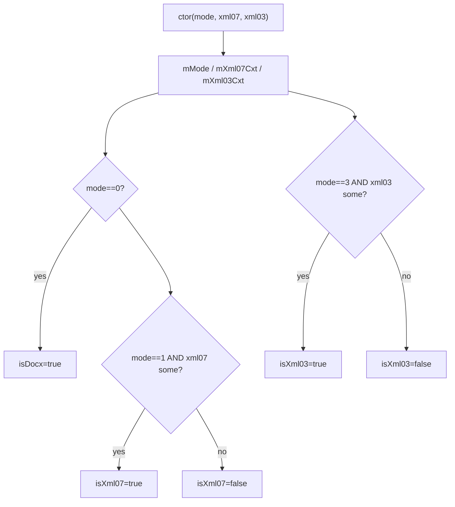

# 01_function_importer_mode — 格式 mode 开关

| 项 | 值 |
|----|----|
| feature | wc-03-property-convert |
| order | 1 |
| crate | `libs/word-core/Cargo.toml` |
| 入口 | `ImporterBase::{ImporterBase(mode, xml07, xml03), mode, xml07Context, xml03Context, isDocx, isXml07, isXml03, isGVml}` |
| 独立性 | 叶子（不跑 converter、不打开 docx） |
| 测试状态 | pass |

## 1. 功能说明

### 1.1 一句话

importer/converter 基类保存 **mode** 与可选 Xml07/Xml03 context，用四个谓词告诉下游走哪条 attr 分支。

### 1.2 输入

`new ImporterBase(mode, xml07Context, xml03Context)`。

| mode | 含义 | DocxReader |
|------|------|------------|
| 0 | DOCX | **默认**：`xml07=null, xml03=null` |
| 1 | Xml07 | 须同时持有非空 xml07 才 `isXml07()` |
| 2 | GVml | `isGVml()` 只看 mode |
| 3 | Xml03 | 须同时持有非空 xml03 才 `isXml03()` |

Java 指针可空。Rust ctor **必须**接受 `Option`（或等价 null）；当前模板 `ImporterBase(mode, &Xml07Context, &Xml03Context)` 无法表达 DOCX 主路径。

### 1.3 输出

| 谓词 | Java | 要点 |
|------|------|------|
| `mode()` | `mMode` | 原样返回 |
| `isDocx()` | `mode == 0` | **不**看 context |
| `isGVml()` | `mode == 2` | **不**看 context |
| `isXml07()` | `mode == 1 && xml07 != null` | mode 对但 context 空 → false |
| `isXml03()` | `mode == 3 && xml03 != null` | 同上 |
| `xml07Context()` / `xml03Context()` | 字段 | DOCX 路径为 null/`None` |

### 1.4 上游

无。`DocxReader.java:50` 构造 `DocumentImporter(..., 0, null, null)`。

### 1.5 下游

`RunPropsConverterSimple` / `ParaPropsConverterSimple` 的 `isXml03()`（spacing 属性名、BRC 连字符）。DOCX 主路径二者皆 false。

### 1.7 依赖与实现状态（必写，着重）

| 依赖 | 归属 | 本 function 需要的接口 | 已实现 | 暂缓（保留 Java 注释+签名） | 禁止本 function 去改 |
|------|------|------------------------|--------|-----------------------------|----------------------|
| `ImporterBase` | 本 function 入口 | ctor(`Option` context)；`mode/isDocx/isXml07/isXml03/isGVml`；context 访问器 | **已实现**：`ImporterBase(mode, Option<Xml07Context>, Option<Xml03Context>)`；从 `lib.rs` 导出；IM1–IM10 全绿 | — | 顺着去实现 Xml07/03 全 API |
| `Xml07Context` | 字段类型 | 非空/空即可；DOCX 路径不 `new` | **Class C 空壳**：`lib.rs` 内联 `Default` struct（不编译 `xml07/` stub 树） | 全部 numbering/path 方法 | 为 01 填满 Xml07Context |
| `Xml03Context` | 字段类型 | 同上 | **Class C 空壳**：同上 | 全部 | 同上 |

## 2. 核心代码与流程

Java：`koffice/writer/core/cn/wps/moffice/writer/io/reader/ImporterBase.java` 全文件 44 行  
Rust：`libs/word-core/src/cn/wps/moffice/writer/io/reader/ImporterBase.rs`



## 3. 测试方案

### 3.1 代码审计与测试面

| symbol | Java/Rust 路径 | 输入/状态 | 输出/副作用 | 关键分支/错误 |
|--------|----------------|-----------|-------------|---------------|
| ctor DOCX | ImporterBase.java:11–15 / .rs:20 | mode=0, both null | mode=0；两 context None | 拒绝 null / 要求 &Context |
| `isDocx` | :37–39 | mode=0，即使 context Some | true | 误要求 context 空 |
| `isDocx` | | mode=1, xml07 Some | false | |
| `isXml07` | :33–35 | mode=1, xml07 Some | true | 只看 mode |
| `isXml07` | | mode=1, xml07 null | **false** | 只看 mode==1 |
| `isXml07` | | mode=0, xml07 Some | false | |
| `isXml03` | :29–31 | mode=3 ± context | 同 isXml07 模式 | |
| `isGVml` | :41–43 | mode=2 | true，不看 context | |
| `xml07Context` | :21–23 | DOCX | null | |
| `mode()` | :17–19 | 任意 | 原值 | |

### 3.2 覆盖矩阵

| coverage_id | 接口/代码路径 | 场景类别 | 必测? | test_id / 未覆盖理由 |
|-------------|---------------|----------|-------|----------------------|
| C-DOCX | mode=0,null,null → isDocx && !xml07 && !xml03 | 主路径 | 是 | IM1 |
| C-DOCX-CTX | mode=0 + Some context 仍 isDocx | 分支 | 是 | IM2 |
| C-X7-BOTH | mode=1 + Some xml07 → isXml07 | 主路径 | 是 | IM3 |
| C-X7-MODE | mode=1 + None → !isXml07 | 分支 | 是 | IM4 |
| C-X3-BOTH | mode=3 + Some xml03 → isXml03 | 主路径 | 是 | IM5 |
| C-X3-MODE | mode=3 + None → !isXml03 | 分支 | 是 | IM6 |
| C-GVML | mode=2 → isGVml && !isDocx | 主路径 | 是 | IM7 |
| C-MODE | mode() 回传 | 主路径 | 是 | IM8 |
| C-CTX | xml07/xml03 访问器 None vs Some | 状态 | 是 | IM9 |
| C-CROSS | mode=1 不使 isXml03 | 边界 | 是 | IM10 |

### 3.3 可测试性

不构造 DocumentImporter / 不跑 DocxReader。Xml07/Xml03 用 **空壳实例**（`Default` 或零字段 struct）；不要调它们的 `todo!()` 方法。DOCX 用例必须能传 null/`None`。

### 3.4 用例表

| id | 覆盖项 | 前置状态 | 输入摘要 | 期望输出/副作用 | 失败语义 |
|----|--------|----------|----------|-----------------|----------|
| IM1 | C-DOCX | — | ctor(0, None, None) | isDocx；!isXml07；!isXml03；!isGVml | 无法表达 null |
| IM2 | C-DOCX-CTX | 空壳 context | ctor(0, Some, Some) | isDocx 仍 true；isXml07/03 false | 误用 context 否决 DOCX |
| IM3 | C-X7-BOTH | 空壳 xml07 | ctor(1, Some, None) | isXml07；!isDocx | |
| IM4 | C-X7-MODE | — | ctor(1, None, None) | !isXml07 | 只认 mode |
| IM5 | C-X3-BOTH | 空壳 xml03 | ctor(3, None, Some) | isXml03 | |
| IM6 | C-X3-MODE | — | ctor(3, None, None) | !isXml03 | |
| IM7 | C-GVML | — | ctor(2, None, None) | isGVml；!isDocx | |
| IM8 | C-MODE | IM1 | mode() | 0 | |
| IM9 | C-CTX | IM1 vs IM3 | xml07Context | None vs Some | |
| IM10 | C-CROSS | IM3 | isXml03() | false | mode 串台 |

### 3.5 测试代码位置

crate: `libs/word-core/Cargo.toml`  
src:   `libs/word-core/src/cn/wps/moffice/writer/io/reader/ImporterBase.rs`  
test:  `libs/word-core/tests/cn/wps/moffice/writer/io/reader/ImporterBase.rs`

### 3.6 测试运行脚本

```bash
cargo test --manifest-path libs/word-core/Cargo.toml --test 01_function_importer_mode

bash .cursor/skills/feature-function/scripts/function-coverage.sh \
  --crate libs/word-core --test 01_function_importer_mode \
  --src src/cn/wps/moffice/writer/io/reader/ImporterBase.rs \
  --report libs/word-core/parser/features/wc-03-property-convert/functions/01_function_importer_mode/FUNCTION.md
```

### 3.7 覆盖率报告

<!-- coverage-report:begin -->
tool: cargo-llvm-cov (`cargo llvm-cov --test 01_function_importer_mode --json`)
date: 2026-08-20 01:34

| src | lines covered | line % | regions covered | region % |
|-----|---------------|--------|-----------------|----------|
| `src/cn/wps/moffice/writer/io/reader/ImporterBase.rs` | 35/35 | 100.0% | 35/35 | 100.0% |
| **function total** | **35/35** | **100.0%** |  |  |
<!-- coverage-report:end -->

### 3.8 模板布局校验（必跑，PASS 才能标 pass）

```bash
node .cursor/skills/function-java2rust/scripts/check-template-layout.mjs \
  --rs libs/word-core/src/cn/wps/moffice/writer/io/reader/ImporterBase.rs \
  --java koffice/writer/core/cn/wps/moffice/writer/io/reader/ImporterBase.java
```

Loop L5b（2026-08-20）：**PASS** — `java comments preserved and aligned`（25 `// java` 行）。Xml07/Xml03 未编辑磁盘 stub 文件（Class E/C：`lib.rs` 内联空壳）。
