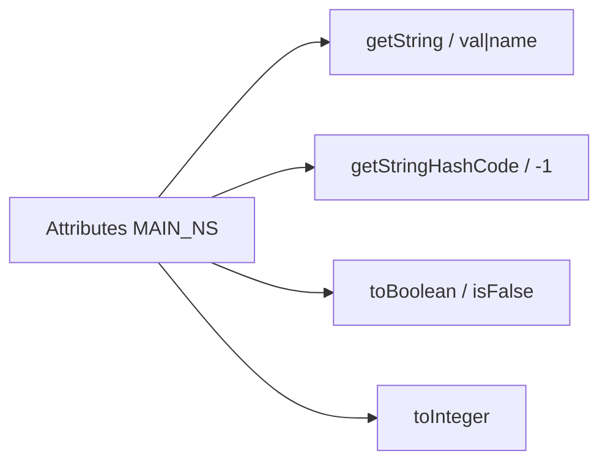

# 02_function_attr_parse — SAX Attributes → string / bool / int / hash

| 项 | 值 |
|----|----|
| feature | wc-03-property-convert |
| order | 2 |
| crate | `libs/word-core/Cargo.toml` |
| 入口 | `ConvertHelper::{getString, getStringHashCode, toBoolean, getBoolean, toInteger}` |
| 独立性 | 叶子（假 Attributes；**不**走 WmlUnit / toColor / toBRC） |
| 测试状态 | pass |

## 1. 功能说明

### 1.1 一句话

从 SAX `Attributes` 取出 `w:val` / 具名 attr 的 **字符串、布尔、整数、Java hashCode**；不写 PropertySet，也不做 pt→twip / 颜色。

### 1.2 输入

`org.xml.sax.Attributes`，命名空间 `WMap.MAIN_NAMESPACING` = `http://schemas.openxmlformats.org/wordprocessingml/2006/main`。  
Java：`ConvertHelper.java` `getString` 137–147、`getStringHashCode` 128–135 / 149–158、`toBoolean` 421–433、`isFalse` 459–461、`getBoolean` 400–403、`toInteger` 464–471。

### 1.3 输出

| 方法 | 缺省 / 特殊 | 值 |
|------|-------------|-----|
| `getString(attrs)` | length==0 | null |
| `getString(attrs)` | 有 length | `getValue(MAIN_NS, "val")` |
| `getString(attrs, name)` | length==0 或无该 name | null |
| `toBoolean(attrs)` | 无 val / 空串 | **true** |
| `toBoolean` | `off`/`false`/`f` ignoreCase 或精确 `"0"` | **false** |
| `toBoolean` | 其余非空 | true |
| `getBoolean(attrs, name)` | 缺 name | null |
| `toInteger(attrs)` | 缺 val | null；否则 `string2Integer` |
| `getStringHashCode(attrs)` | 无 val | **-1** |
| `getStringHashCode(attrs, name)` | 无该 name | **-1** |

度量（`getLong`/`getFloat`）与颜色（`toColor`/`hex2Int`）归 **03**。`toBRC`/`toSHD` 归 **04**。

### 1.4 上游

无 XML 树。`WMap::MAIN_NAMESPACING`（wave0 / wps-io）。`TypeConversion.string2Integer`（util done）。

### 1.5 下游

03 取带单位的同套 attrs；04 `getString("val")` / `getLong("sz")`；05/06 全部 `toBoolean` / hash。

### 1.6 硬约束

| 允许 | 禁止 |
|------|------|
| 上列热路径真写；完整交错模板 | 把 getLong/toColor/toBRC 当本 function 验收 |
| 测试用 map 假 Attributes | 打开 docx / XWPF |
| toBRC/toSHD/修订/nfc/字体 **暂缓**（留注释+签名） | 删 ConvertHelper 冷门方法的 `// java` |

### 1.7 依赖与实现状态（必写，着重）

| 依赖 | 归属 | 本 function 需要的接口 | 已实现 | 暂缓（保留 Java 注释+签名） | 禁止本 function 去改 |
|------|------|------------------------|--------|-----------------------------|----------------------|
| `ConvertHelper` | 本叶 | getString / hashCode / toBoolean / getBoolean / toInteger | **已实现**（AP1–AP12 全绿）；`lib.rs` 导出 | getLong/toColor/toBRC/toSHD/修订/nfc/字体（`DEFERRED_NON_FUNCTION`，865 条 `// java` 留在原位） | 为 02 填满度量/边框/修订 |
| `WMap::MAIN_NAMESPACING` | wps-io done | getValue uri | 常量已有 | — | 换一套 NS 字符串 |
| `TypeConversion` | util done | `string2Integer` | done | — | — |
| `Attributes` | SAX | getLength；getValue(uri,name) | **ConvertHelper 内 trait**；测试 `WordAttrs` 适配；未改 stubs | 生产 SAX | 在 stubs 写项目类型 |

## 2. 核心代码与流程

Java：`koffice/writer/core/cn/wps/moffice/writer/io/reader/docxReader/importer/helpers/ConvertHelper.java` 128–158、400–471  
Rust 目标：`libs/word-core/src/cn/wps/moffice/writer/io/reader/docxReader/importer/helpers/ConvertHelper.rs`



## 3. 测试方案

### 3.1 代码审计与测试面

| symbol | Java/Rust 路径 | 输入/状态 | 输出/副作用 | 关键分支/错误 |
|--------|----------------|-----------|-------------|---------------|
| getString empty | 137 | length 0 | null | 仍去 getValue |
| getString val | 137 | val="Normal" | "Normal" | 读错 attr 名 |
| getString named miss | 145 | 有 length、无 left | null | "" |
| toBoolean miss | 427 | 无 val | true | 当成 false |
| toBoolean empty str | 430–431 | val="" | true（toBoolean(str) null） | false |
| isFalse off/0/false/f | 459 | 各 token | false | `"0 "` 带空格不在表内 |
| toBoolean true/on/1 | 430 | "true"/"on"/"1" | true | `"1"` 当 false |
| getBoolean miss | 400 | 无该 name | null | 返回 false |
| toInteger miss | 470 | 无 val | null | 0 |
| toInteger 2 | 470 | val="2" | 2 | |
| getStringHashCode miss | 133 | 无 val | -1 | 用 0（与 jc left 混淆） |
| getStringHashCode left | 149 | val=left | **3317767** | Rust 默认 hasher |

### 3.2 覆盖矩阵

| coverage_id | 接口/代码路径 | 场景类别 | 必测? | test_id / 未覆盖理由 |
|-------------|---------------|----------|-------|----------------------|
| C-GS-EMPTY | getString length0 | 边界 | 是 | AP1 |
| C-GS-VAL | getString val | 主路径 | 是 | AP2 |
| C-GS-NAME | getString(name) 缺 left | 边界 | 是 | AP3 |
| C-TB-MISS | toBoolean 无 val | 主路径 | 是 | AP4 |
| C-TB-EMPTY | val="" | 分支 | 是 | AP5 |
| C-TB-OFF | off/0/false/f | 分支 | 是 | AP6 |
| C-TB-TRUE | true/on/1 | 分支 | 是 | AP7 |
| C-GB-MISS | getBoolean 缺名 | 边界 | 是 | AP8 |
| C-INT-MISS | toInteger 无 val | 边界 | 是 | AP9 |
| C-INT-2 | toInteger val=2 | 主路径 | 是 | AP10 |
| C-HASH-MISS | getStringHashCode 无 val | 边界 | 是 | AP11 |
| C-HASH-LEFT | val=left → 3317767 | 主路径 | 是 | AP12 |

### 3.3 可测试性

测试 crate 内最小 `FakeAttrs`：`getLength` + `getValue(uri, localName)`，uri 用 `WMap::MAIN_NAMESPACING`。不启动 XML 解析器。不调 `getLong`/`toColor`。

### 3.4 用例表

| id | 覆盖项 | 前置状态 | 输入摘要 | 期望输出/副作用 | 失败语义 |
|----|--------|----------|----------|-----------------|----------|
| AP1 | C-GS-EMPTY | 空 attrs | getString | None | 空当 "" |
| AP2 | C-GS-VAL | val=Normal | getString | Some("Normal") | 读了别的 attr |
| AP3 | C-GS-NAME | length>0 无 left | getString(...,"left") | None | Some("") |
| AP4 | C-TB-MISS | 空 / 无 val | toBoolean | true | 粗体默认关 |
| AP5 | C-TB-EMPTY | val="" | toBoolean | true | 空串当 off |
| AP6 | C-TB-OFF | val=off,0,false,f,FALSE | toBoolean | 皆 false | 大小写 / `"0"` 必须精确 |
| AP7 | C-TB-TRUE | val=true,on,1 | toBoolean | true | `"1"` 被当 false |
| AP8 | C-GB-MISS | 无 w | getBoolean("w") | None | Some(false) |
| AP9 | C-INT-MISS | 空 | toInteger | None | 0 |
| AP10 | C-INT-2 | val=2 | toInteger | Some(2) | |
| AP11 | C-HASH-MISS | 空 | getStringHashCode | -1 | 0 与 jc 缺省混淆 |
| AP12 | C-HASH-LEFT | val=left | getStringHashCode | 3317767 | 非 Java hash |

### 3.5 测试代码位置

crate: `libs/word-core/Cargo.toml`  
src:   `libs/word-core/src/cn/wps/moffice/writer/io/reader/docxReader/importer/helpers/ConvertHelper.rs`  
test:  `libs/word-core/tests/cn/wps/moffice/writer/io/reader/docxReader/importer/helpers/ConvertHelper.rs`

02/03/04 同 src 文件、不同 `[[test]]` path。

### 3.6 测试运行脚本

```bash
cargo test --manifest-path libs/word-core/Cargo.toml --test 02_function_attr_parse

bash .cursor/skills/feature-function/scripts/function-coverage.sh \
  --crate libs/word-core --test 02_function_attr_parse \
  --src src/cn/wps/moffice/writer/io/reader/docxReader/importer/helpers/ConvertHelper.rs \
  --report libs/word-core/parser/features/wc-03-property-convert/functions/02_function_attr_parse/FUNCTION.md
```

### 3.7 覆盖率报告

<!-- coverage-report:begin -->
tool: cargo-llvm-cov (`cargo llvm-cov --test 02_function_attr_parse --json`)
date: 2026-08-20 09:45

| src | lines covered | line % | regions covered | region % |
|-----|---------------|--------|-----------------|----------|
| `src/cn/wps/moffice/writer/io/reader/docxReader/importer/helpers/ConvertHelper.rs` | 56/194 | 28.9% | 99/266 | 37.2% |
| **function total** | **56/194** | **28.9%** |  |  |
<!-- coverage-report:end -->

### 3.8 模板布局校验（必跑，PASS 才能标 pass）

```bash
node .cursor/skills/function-java2rust/scripts/check-template-layout.mjs \
  --rs libs/word-core/src/cn/wps/moffice/writer/io/reader/docxReader/importer/helpers/ConvertHelper.rs \
  --java koffice/writer/core/cn/wps/moffice/writer/io/reader/docxReader/importer/helpers/ConvertHelper.java
```

冷门方法可 `DEFERRED_NON_FUNCTION`，注释不得删/错位。

Loop L5b（2026-08-20）：**PASS** — `java comments preserved and aligned`（865 `// java` 行）。getLong/toColor/toBRC 等未填语义。
