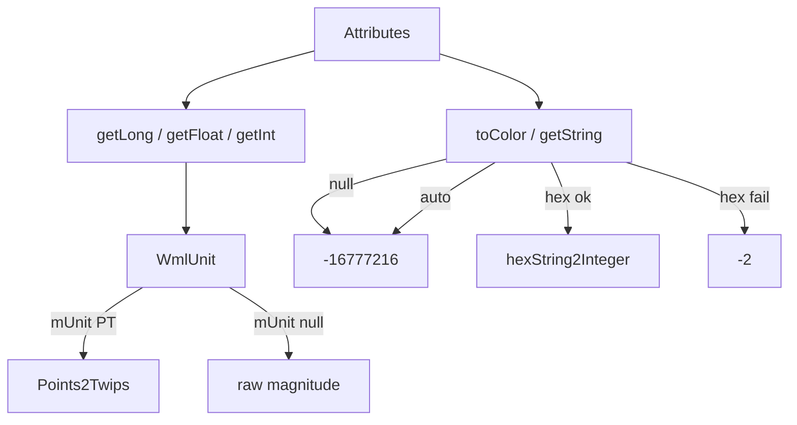

# 03_function_measure_color — attrs → twips / float / color

| 项 | 值 |
|----|----|
| feature | wc-03-property-convert |
| order | 3 |
| crate | `libs/word-core/Cargo.toml` |
| 入口 | `ConvertHelper::{getLong, getFloat, getInt, toColor, hex2Int}` |
| 独立性 | 叶子（假 Attributes + 已 PASS 的 WmlUnit；不写 PropertySet） |
| 测试状态 | pass |

## 1. 功能说明

### 1.1 一句话

把带单位的 attr（`72pt` / 无单位 `1440`）换成 twips/float，把颜色字面量（缺省 / `auto` / hex / 非法）换成内核 int。

### 1.2 输入

同一套 MAIN_NS `Attributes`。Java：`getLong` 378–397、`getFloat` 492–513、`getInt` 520–538、`toColor` 123–126、`convert2coreColor` 168–179、`hex2Int` 541–544。

### 1.3 输出

| 方法 | 输入 | 输出 |
|------|------|------|
| `getLong` 缺 name | — | null |
| `getLong` `"1440"` | 无单位 | 1440（**不** ×20） |
| `getLong` `"72pt"` | PT | `Points2Twips(72)` = **1440** |
| `getLong` `"12pt"` | PT | **240** |
| `getFloat` `"12pt"` | PT | **240.0**（同样 Points2Twips） |
| `getFloat` 缺 | — | null |
| `toColor` 缺 name | — | **-16777216**（不是私有 convert 缺省 -2） |
| `toColor` `auto` | ignoreCase | -16777216 |
| `toColor` `FF0000` | hex | `hexString2Integer` = **16711680** |
| `toColor` 非法 | 非 auto 且 hex 解析失败 | **-2** |
| `hex2Int` 缺 | — | **null**（与 toColor 缺省不同） |

`toBoolean` / `getStringHashCode` 归 **02**。`toBRC` 的 `getLong("sz")` 在 03 测 getLong 本身，BRC 组装归 **04**。

### 1.4 上游

02 的 getString 语义（toColor 内部调 getString）；`WmlUnit`（wc-03 dep_topo done）；`MetricUtility.Points2Twips`（×20）。

### 1.5 下游

04 线宽 `getLong("sz")`；05 `sz` 半磅走 ShareConvertHelper（**不是**本 function 的 getLong）；06 `ind left` 用 getLong。

### 1.6 硬约束

| 允许 | 禁止 |
|------|------|
| getLong/getFloat/getInt/toColor/hex2Int 真写 | 把 toBoolean / toBRC 当本 function 验收 |
| 非法 hex → -2 | 缺 color 写成 -2 |
| WmlUnit 已 PASS，只调用 | 重写 WmlUnit |

### 1.7 依赖与实现状态（必写，着重）

| 依赖 | 归属 | 本 function 需要的接口 | 已实现 | 暂缓（保留 Java 注释+签名） | 禁止本 function 去改 |
|------|------|------------------------|--------|-----------------------------|----------------------|
| `ConvertHelper` | 与 02 同文件 | getLong/getFloat/getInt/toColor/hex2Int | **已实现**（本 loop） | toBRC/修订仍 `DEFERRED_NON_FUNCTION` | 删 02 已测方法的注释 |
| `WmlUnit` | dep_topo done | `WmlUnit(str)`；`mMagnitude`/`mUnit` | PASS + ctor 调 `setUnit` 胶水（util `Unit.setValue` 不派发） | 非 PT 单位换算 | 全叶重写 WmlUnit |
| `MetricUtility` | util done | `Points2Twips` | `Points2Twips_f32` | EighthPoints2Points 归 04 | 改换算系数 |
| `TypeConversion` | util done | `hexString2Integer` | done | — | — |
| `WMap::MAIN_NAMESPACING` | wps-io | getValue uri | done | — | — |

## 2. 核心代码与流程

Java：`ConvertHelper.java` 123–179、378–397、492–544  
Rust：同 02 的 `ConvertHelper.rs`



## 3. 测试方案

### 3.1 代码审计与测试面

| symbol | Java/Rust 路径 | 输入/状态 | 输出/副作用 | 关键分支/错误 |
|--------|----------------|-----------|-------------|---------------|
| getLong miss | 381 | 无 left | null | 0 |
| getLong 无单位 | 388 | "1440" | 1440 | 误乘 20 |
| getLong 72pt | 391 | "72pt" | 1440 | 忘 Points2Twips |
| getLong 12pt | 391 | "12pt" | 240 | |
| getFloat 12pt | 507 | "12pt" | 240.0 | 返回 12.0 |
| getFloat miss | 493 | 无 | null | 0.0 |
| getInt 72pt | 533 | "72pt" | 1440 | |
| toColor miss | 125 | 无 color | -16777216 | -2 |
| toColor auto | 170 | auto / AUTO | -16777216 | |
| toColor hex | 173 | FF0000 | 16711680 | |
| toColor bad | 176 | xyz | -2 | 当成 auto |
| hex2Int miss | 543 | 无 | null | -16777216 |

### 3.2 覆盖矩阵

| coverage_id | 接口/代码路径 | 场景类别 | 必测? | test_id / 未覆盖理由 |
|-------------|---------------|----------|-------|----------------------|
| C-LONG-MISS | getLong 缺 | 边界 | 是 | MC1 |
| C-LONG-RAW | "1440" | 主路径 | 是 | MC2 |
| C-LONG-72PT | "72pt"→1440 | 主路径 | 是 | MC3 |
| C-LONG-12PT | "12pt"→240 | 主路径 | 是 | MC4 |
| C-FLT-12PT | getFloat 12pt | 主路径 | 是 | MC5 |
| C-FLT-MISS | getFloat 缺 | 边界 | 是 | MC6 |
| C-INT-72PT | getInt 72pt | 主路径 | 是 | MC7 |
| C-COL-MISS | toColor 缺 | 主路径 | 是 | MC8 |
| C-COL-AUTO | auto | 分支 | 是 | MC9 |
| C-COL-HEX | FF0000 | 主路径 | 是 | MC10 |
| C-COL-BAD | 非法 hex | 失败 | 是 | MC11 |
| C-HEX2-MISS | hex2Int 缺 | 边界 | 是 | MC12 |

### 3.3 可测试性

与 02 同一 FakeAttrs。不测 toBoolean。WmlUnit 已 pass，本层只断言 ConvertHelper 出口。

### 3.4 用例表

| id | 覆盖项 | 前置状态 | 输入摘要 | 期望输出/副作用 | 失败语义 |
|----|--------|----------|----------|-----------------|----------|
| MC1 | C-LONG-MISS | 无 left | getLong("left") | None | 0 |
| MC2 | C-LONG-RAW | left=1440 | getLong | Some(1440) | *20 |
| MC3 | C-LONG-72PT | left=72pt | getLong | Some(1440) | 没走 PT |
| MC4 | C-LONG-12PT | left=12pt | getLong | Some(240) | 240 vs 12 |
| MC5 | C-FLT-12PT | sz=12pt | getFloat("sz") | Some(240.0) | 12.0 |
| MC6 | C-FLT-MISS | 空 | getFloat("sz") | None | 0.0 |
| MC7 | C-INT-72PT | left=72pt | getInt("left") | Some(1440) | |
| MC8 | C-COL-MISS | 无 color | toColor(...,"color") | -16777216 | -2 |
| MC9 | C-COL-AUTO | color=auto | toColor | -16777216 | |
| MC10 | C-COL-HEX | color=FF0000 | toColor | 16711680 | |
| MC11 | C-COL-BAD | color=xyz | toColor | -2 | auto 黑 |
| MC12 | C-HEX2-MISS | 无 | hex2Int(...,"color") | None | -16777216 |

### 3.5 测试代码位置

crate: `libs/word-core/Cargo.toml`  
src:   `libs/word-core/src/cn/wps/moffice/writer/io/reader/docxReader/importer/helpers/ConvertHelper.rs`  
test:  `libs/word-core/tests/cn/wps/moffice/writer/io/reader/docxReader/importer/helpers/ConvertHelperMeasure.rs`

### 3.6 测试运行脚本

```bash
cargo test --manifest-path libs/word-core/Cargo.toml --test 03_function_measure_color

bash .cursor/skills/feature-function/scripts/function-coverage.sh \
  --crate libs/word-core --test 03_function_measure_color \
  --src src/cn/wps/moffice/writer/io/reader/docxReader/importer/helpers/ConvertHelper.rs \
  --report libs/word-core/parser/features/wc-03-property-convert/functions/03_function_measure_color/FUNCTION.md
```

### 3.7 覆盖率报告

<!-- coverage-report:begin -->
tool: cargo-llvm-cov (`cargo llvm-cov --test 03_function_measure_color --json`)
date: 2026-08-20 10:53

| src | lines covered | line % | regions covered | region % |
|-----|---------------|--------|-----------------|----------|
| `src/cn/wps/moffice/writer/io/reader/docxReader/importer/helpers/ConvertHelper.rs` | 63/250 | 25.2% | 112/372 | 30.1% |
| **function total** | **63/250** | **25.2%** |  |  |
<!-- coverage-report:end -->

### 3.8 模板布局校验（必跑，PASS 才能标 pass）

```bash
node .cursor/skills/function-java2rust/scripts/check-template-layout.mjs \
  --rs libs/word-core/src/cn/wps/moffice/writer/io/reader/docxReader/importer/helpers/ConvertHelper.rs \
  --java koffice/writer/core/cn/wps/moffice/writer/io/reader/docxReader/importer/helpers/ConvertHelper.java

node .cursor/skills/function-java2rust/scripts/check-template-layout.mjs \
  --rs libs/word-core/src/cn/wps/moffice/writer/io/reader/docxReader/importer/helpers/WmlUnit.rs \
  --java koffice/writer/core/cn/wps/moffice/writer/io/reader/docxReader/importer/helpers/WmlUnit.java
```

冷门方法可 `DEFERRED_NON_FUNCTION`，注释不得删/错位。

Loop L5b（2026-08-20）：**PASS** — ConvertHelper `java comments preserved and aligned`（865 `// java` 行）；WmlUnit 33 行同样 PASS。
