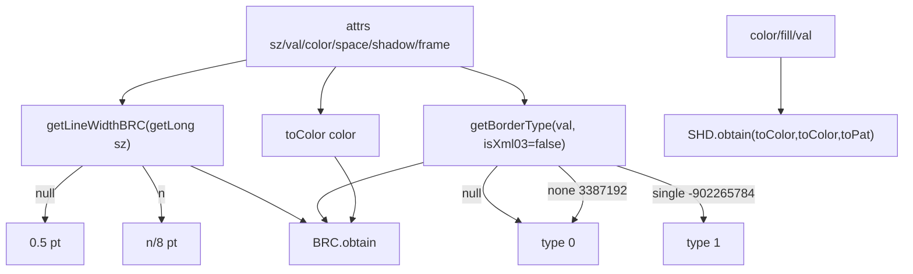

# 04_function_brc_shd — attrs → BRC / SHD

| 项 | 值 |
|----|----|
| feature | wc-03-property-convert |
| order | 4 |
| crate | `libs/word-core/Cargo.toml` |
| 入口 | `ConvertHelper::{toBRC, toSHD}` + `ImporterHelper::{getLineWidthBRC, getSpace, getBorderShadow, getBorderFrame}` + `BorderConvertSimple.convertCoreBorder`（none/single） |
| 独立性 | 叶子（假 Attributes；DOCX `isXml03=false`） |
| 测试状态 | pass |

## 1. 功能说明

### 1.1 一句话

把边框/底纹 SAX attrs 组装成 `BRC` / `SHD`。缺 `sz` 时线宽 **0.5 pt**；`val=none→type 0`、`single→type 1`。

### 1.2 输入

Java `ConvertHelper.toBRC` 546–554、`getBorderType` 556–566、`toSHD` 119–120、`toPat` 182–375。  
`ImporterHelper.getLineWidthBRC` 525–533：null → **0.5F**；否则 `EighthPoints2Points((float)value)`（value/8），且 0≤value≤96。  
`getSpace` 缺 → 0.0；`getBorderShadow`/`getBorderFrame` 缺 → false。

`BorderConvertSimple`：`"none".hashCode()=3387192` → **0**；`"single".hashCode()=-902265784` → **1**。

STRUCTURE MVP 可 defer 全量边框表；本 function **必测** none/single + 缺 sz。

### 1.3 输出

| 场景 | BRC / SHD |
|------|-----------|
| 全缺 attrs，`isXml03=false` | lineWidth **0.5**；type **0**；color **-16777216**；space **0**；shadow/frame **false** |
| `sz=8` | lineWidth **1.0**（8/8） |
| `val=none` | brcType **0** |
| `val=single` | brcType **1** |
| 缺 val | type **0**（DEFAULT_BORDER_TYPE） |
| toSHD 全缺 | colorFore/Back **-16777216**；ipat **-2**（toPat hash -1） |
| `val=solid`（hash 109618859） | ipat **1** |
| `val=clear`（hash 94746189） | ipat **0** |
| `fill=FF0000` | colorBack **16711680** |

### 1.4 上游

02 getString/getBoolean；03 getLong/toColor。DOCX 主路径 `isXml03=false`（不跑 Xml03Utils 连字符改写）。

### 1.5 下游

05/06 的 border/shd case（本矩阵不测 converter switch）。

### 1.6 硬约束

| 允许 | 禁止 |
|------|------|
| toBRC/toSHD + 四个 getter + none/single | 把 BorderConvertSimple 200+ 种花边当本 function 全测 |
| 全量表留在模板（注释+签名） | 删未测 case 的 `// java` |
| isXml03=true 连字符 **暂缓** | 打开 docx |

### 1.7 依赖与实现状态（必写，着重）

| 依赖 | 归属 | 本 function 需要的接口 | 已实现 | 暂缓（保留 Java 注释+签名） | 禁止本 function 去改 |
|------|------|------------------------|--------|-----------------------------|----------------------|
| `ConvertHelper.toBRC/toSHD` | 与 02 同文件 | 组装 | **已实现**（本 loop） | 修订/nfc | 拆出第二套 ConvertHelper |
| `ImporterHelper` 四 getter | 连坐 | getLineWidthBRC/getSpace/shadow/frame | **已实现**；其余方法 `DEFERRED_NON_FUNCTION` | setTableLook 等 | 顺着写完整 ImporterHelper |
| `BorderConvertSimple.convertCoreBorder` | 连坐 | none→0 single→1（全表在模板） | **已实现** convertCoreBorder | 其余 hash 不当验收 | 为 04 手填全表当验收 |
| `BRC` | word-core 已有 | obtain + getLineWidth/getType | lib.rs 内联 obtain/getters（不加载损坏的 `BRC.rs` 池模板） | 池 intern | 改 BRC 字段布局 |
| `SHD` | drawing | obtain(fore,back,ipat) + getters | `SHD.rs` | — | 改 drawing 池 |
| `MetricUtility.EighthPoints2Points` | util | /8 | done | — | — |

## 2. 核心代码与流程

Java：`ConvertHelper.java` 119–120、546–566；`ImporterHelper.java` 498–533；`BorderConvertSimple.java` `convertCoreBorder`  
Rust 目标：`ConvertHelper.rs`（+ 若本轮生成：`ImporterHelper.rs`、`BorderConvertSimple.rs`）



## 3. 测试方案

### 3.1 代码审计与测试面

| symbol | Java/Rust 路径 | 输入/状态 | 输出/副作用 | 关键分支/错误 |
|--------|----------------|-----------|-------------|---------------|
| 缺 sz | ImporterHelper 526 | getLong sz null | 0.5 | 0.0 或 EighthPoints(0) |
| sz=8 | 532 | 8 | 1.0 | 忘 /8 |
| val none | BorderConvert 3387192 | none | type 0 | |
| val single | -902265784 | single | type 1 | |
| 缺 val | getBorderType 564 | null | 0 | panic |
| 缺 color | toColor miss | — | -16777216 | |
| 缺 space | getSpace 520 | null | 0.0 | |
| 缺 shadow/frame | 507/498 | null | false | |
| toSHD 缺 | toPat -1 | — | ipat -2 | 0 |
| val=solid | 109618859 | solid | ipat 1 | |
| val=clear | 94746189 | clear | ipat 0 | |
| fill hex | toColor fill | FF0000 | colorBack 16711680 | 写到 fore |

### 3.2 覆盖矩阵

| coverage_id | 接口/代码路径 | 场景类别 | 必测? | test_id / 未覆盖理由 |
|-------------|---------------|----------|-------|----------------------|
| C-SZ-MISS | 缺 sz→0.5 | 主路径 | 是 | BS1 |
| C-SZ-8 | sz=8→1.0 | 主路径 | 是 | BS2 |
| C-NONE | val=none→0 | 主路径 | 是 | BS3 |
| C-SINGLE | val=single→1 | 主路径 | 是 | BS4 |
| C-VAL-MISS | 缺 val→0 | 边界 | 是 | BS5 |
| C-COL | 缺 color→-16777216 | 主路径 | 是 | BS6 |
| C-SPACE | 缺 space→0 | 边界 | 是 | BS7 |
| C-FLAGS | 缺 shadow/frame | 边界 | 是 | BS8 |
| C-SHD-MISS | toSHD 全缺 ipat -2 | 主路径 | 是 | BS9 |
| C-SHD-SOLID | val=solid ipat 1 | 主路径 | 是 | BS10 |
| C-SHD-CLEAR | val=clear ipat 0 | 分支 | 是 | BS11 |
| C-SHD-FILL | fill=FF0000 | 主路径 | 是 | BS12 |

Xml03 连字符：DOCX 主路径永远 false，不作为本 function 必测（见 FUNCTIONS.md 串接规则 11）。

### 3.3 可测试性

`toBRC(attrs, false)`。不构造 converter。断言走 `BRC.getLineWidth` / type / `SHD.getColorFore` 等公开 getter；Split 阶段测试不 `use` 未导出类型。

### 3.4 用例表

| id | 覆盖项 | 前置状态 | 输入摘要 | 期望输出/副作用 | 失败语义 |
|----|--------|----------|----------|-----------------|----------|
| BS1 | C-SZ-MISS | 空 attrs | toBRC(..., false) | getLineWidth()==0.5 | 写成 0 |
| BS2 | C-SZ-8 | sz=8 | toBRC | getLineWidth()==1.0 | 写成 8 |
| BS3 | C-NONE | val=none | toBRC | brcType==0 | |
| BS4 | C-SINGLE | val=single | toBRC | brcType==1 | hash 算法错 |
| BS5 | C-VAL-MISS | 无 val | toBRC | brcType==0 | |
| BS6 | C-COL | 无 color | toBRC | color==-16777216 | |
| BS7 | C-SPACE | 无 space | toBRC | dptSpace==0.0 | |
| BS8 | C-FLAGS | 无 shadow/frame | toBRC | 皆 false | |
| BS9 | C-SHD-MISS | 空 | toSHD | fore/back -16777216；ipat -2 | |
| BS10 | C-SHD-SOLID | val=solid | toSHD | ipat==1 | |
| BS11 | C-SHD-CLEAR | val=clear | toSHD | ipat==0 | |
| BS12 | C-SHD-FILL | fill=FF0000 | toSHD | getColorBack()==16711680 | 写到 fore |

### 3.5 测试代码位置

crate: `libs/word-core/Cargo.toml`  
src:   `libs/word-core/src/cn/wps/moffice/writer/io/reader/docxReader/importer/helpers/ConvertHelper.rs`  
test:  `libs/word-core/tests/cn/wps/moffice/writer/io/reader/docxReader/importer/helpers/ConvertHelperBrc.rs`

若 Loop 生成 `ImporterHelper.rs` / `BorderConvertSimple.rs`，覆盖率脚本再加 `--src`。

### 3.6 测试运行脚本

```bash
cargo test --manifest-path libs/word-core/Cargo.toml --test 04_function_brc_shd

bash .cursor/skills/feature-function/scripts/function-coverage.sh \
  --crate libs/word-core --test 04_function_brc_shd \
  --src src/cn/wps/moffice/writer/io/reader/docxReader/importer/helpers/ConvertHelper.rs \
  --src src/cn/wps/moffice/writer/io/reader/docxReader/importer/helpers/ImporterHelper.rs \
  --src src/cn/wps/moffice/writer/io/reader/docxReader/importer/helpers/BorderConvertSimple.rs \
  --report libs/word-core/parser/features/wc-03-property-convert/functions/04_function_brc_shd/FUNCTION.md
```

### 3.7 覆盖率报告

<!-- coverage-report:begin -->
tool: cargo-llvm-cov (`cargo llvm-cov --test 04_function_brc_shd --json`)
date: 2026-08-20 11:21

| src | lines covered | line % | regions covered | region % |
|-----|---------------|--------|-----------------|----------|
| `src/cn/wps/moffice/writer/io/reader/docxReader/importer/helpers/BorderConvertSimple.rs` | 5/196 | 2.6% | 5/196 | 2.6% |
| `src/cn/wps/moffice/writer/io/reader/docxReader/importer/helpers/ConvertHelper.rs` | 156/384 | 40.6% | 458/767 | 59.7% |
| `src/cn/wps/moffice/writer/io/reader/docxReader/importer/helpers/ImporterHelper.rs` | 27/59 | 45.8% | 42/106 | 39.6% |
| **function total** | **188/639** | **29.4%** |  |  |
<!-- coverage-report:end -->

### 3.8 模板布局校验（必跑，PASS 才能标 pass）

```bash
node .cursor/skills/function-java2rust/scripts/check-template-layout.mjs \
  --rs libs/word-core/src/cn/wps/moffice/writer/io/reader/docxReader/importer/helpers/ConvertHelper.rs \
  --java koffice/writer/core/cn/wps/moffice/writer/io/reader/docxReader/importer/helpers/ConvertHelper.java

node .cursor/skills/function-java2rust/scripts/check-template-layout.mjs \
  --rs libs/word-core/src/cn/wps/moffice/writer/io/reader/docxReader/importer/helpers/ImporterHelper.rs \
  --java koffice/writer/core/cn/wps/moffice/writer/io/reader/docxReader/importer/helpers/ImporterHelper.java

node .cursor/skills/function-java2rust/scripts/check-template-layout.mjs \
  --rs libs/word-core/src/cn/wps/moffice/writer/io/reader/docxReader/importer/helpers/BorderConvertSimple.rs \
  --java koffice/writer/core/cn/wps/moffice/writer/io/reader/docxReader/importer/helpers/BorderConvertSimple.java
```

Loop L5b（2026-08-20）：**PASS** — ConvertHelper 865 行；ImporterHelper 110 行；BorderConvertSimple 582 行。
