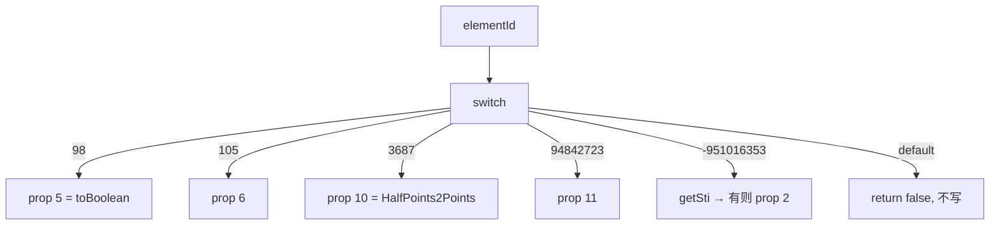

# 05_function_run_highfreq — w:rPr → 字符 PropertySet

| 项 | 值 |
|----|----|
| feature | wc-03-property-convert |
| order | 5 |
| crate | `libs/word-core/Cargo.toml` |
| 入口 | `RunPropsConverterSimple::convertRunPropsBase`（高频：b/i/sz/color/rStyle + 未知） |
| 独立性 | 叶子（假 Attributes + 已 PASS 的 StyleId2Sti；不写 CHPX） |
| 测试状态 | pass |

## 1. 功能说明

### 1.1 一句话

`convertRunPropsBase(doc, dst, elementId, attrs, styleId2Sti)` 按 **Java String.hashCode** 的 elementId 把 run 子元素写入 `MutablePropertySet`；未知 id **不写桶** 且返回 false。

### 1.2 输入

Java `RunPropsConverterSimple.java` `convertRunPropsBase` 28–194。  
MVP 必测 case（hash 来自 Java switch / ElementIds）：

| elementId | 元素 | 写入 |
|-----------|------|------|
| 98 | b | `setValue(5, toBoolean)` |
| 105 | i | `setValue(6, toBoolean)` |
| 3687 | sz | `setFloat4HpsMeasure(dst, 10)` → `HalfPoints2Points` |
| 94842723 | color | `setColor(dst, 11)` |
| -951016353 | rStyle | `setRunStyle` → **有 sti 才** `setInt(2, sti)` |

`object` 为 `Attributes`。`TextDocument` 高频路径除 rFonts/修订外可不用。instance `mode=0`（01）。

### 1.3 输出

- 粗体缺 val → prop **5** = true  
- `sz val="24"` → prop **10** = `12.0`（半磅→pt）  
- rStyle miss `getSti` → **不写 2**（与 para setStyle 不同）  
- default → `isNormalProperty=false`，dst 不变

### 1.4 上游

01 mode（ctor）；02 toBoolean/getString；03 toColor；04 BRC 本矩阵不测；wc-02 StyleId2Sti；`ShareConvertHelper.getLong4STHpsMeasure`（sz）。

### 1.5 下游

wc-04 `importRunText` 的 chpx。

### 1.6 硬约束

| 允许 | 禁止 |
|------|------|
| switch **骨架**全留；高频真写；未知 log/false | 删未实现 case 的 `// java` |
| rFonts/下划线/strike **暂缓**（本矩阵不测） | 为 rFonts 去扩 ThemeFontTool |
| 假 Attributes + 已测绿 StyleId2Sti | 打开 docx；重测 SI* |
| convertIns/Del/rPrChange 写桶可留签名 | 把修订当本 function 必测 |

### 1.7 依赖与实现状态（必写，着重）

| 依赖 | 归属 | 本 function 需要的接口 | 已实现 | 暂缓（保留 Java 注释+签名） | 禁止本 function 去改 |
|------|------|------------------------|--------|-----------------------------|----------------------|
| `RunPropsConverterSimple` | 本叶 | ctor(mode,ctx)；`convertRunPropsBase` 高频 | **done** | rFonts/u/strike/vertAlign/修订/math | 全 986 行当本 function 验收 |
| `ImporterBase` | 01 | super ctor；isXml03 | **done**（01 pass；只调用） | — | 重写 mode |
| `ConvertHelper` | 02/03 | toBoolean/getString | **done**（02/03 pass；只调用） | convertIns/Del | 重写 SI 矩阵 / toColor 缺省路径 |
| `ShareConvertHelper.getLong4STHpsMeasure` | 连坐 | sz val → Long | **done**（val="24" unsigned decimal） | 其余 Share* | 全叶 ShareConvertHelper 当验收 |
| `RunPropsConverter.conver2coreColor` | 连坐 | color hex / auto | **done** | — | 扩成完整 run converter |
| `StyleId2Sti` | wc-02 **03** pass | `getSti` | done | — | 重测 SI 矩阵 |
| `MetricUtility.HalfPoints2Points` | util | 24→12.0 | done | — | — |
| `MutablePropertySet` | wave0 | setValue/setInt/setFloat/contains/get* | done | — | 改 PropertySet |
| `TextDocument` | wc-02 10 | 签名占位 | 已导出 | rFonts 用 doc | 为 05 再改 _create |

## 2. 核心代码与流程

Java：`koffice/writer/core/cn/wps/moffice/writer/io/reader/docxReader/importer/helpers/RunPropsConverterSimple.java` 28–194、338–345、696–700  
Rust 目标：`libs/word-core/src/cn/wps/moffice/writer/io/reader/docxReader/importer/helpers/RunPropsConverterSimple.rs`



## 3. 测试方案

### 3.1 代码审计与测试面

| symbol | Java/Rust 路径 | 输入/状态 | 输出/副作用 | 关键分支/错误 |
|--------|----------------|-----------|-------------|---------------|
| b 缺 val | 121 | elementId=98, 无 val | 5=true；return true | 写成其它 id |
| b off | 121 | val=off | 5=false | |
| i | 124 | 105 | 6=toBoolean | 与 5 写反 |
| sz 24 | 142 / 696 | val=24 | 10=12.0 | 忘 /2 |
| color hex | 174 | val=FF0000 | 11=16711680 | 用了 toColor 缺省 -16777216 |
| rStyle hit | 338 | 已 put styleId | 2=sti | 写成 191 |
| rStyle miss | 341 | 未注册 | **不 contains(2)** | 写成 0（那是 para） |
| unknown | 189 | elementId=1 | return false；dst 空 | panic 或写桶 |
| unknown 不覆盖 | 189 | dst 已有 5=true | 5 仍在 | 清空 dst |

### 3.2 覆盖矩阵

| coverage_id | 接口/代码路径 | 场景类别 | 必测? | test_id / 未覆盖理由 |
|-------------|---------------|----------|-------|----------------------|
| C-B-DEF | b 缺 val → 5 true | 主路径 | 是 | RP1 |
| C-B-OFF | b off → 5 false | 分支 | 是 | RP2 |
| C-I | i → 6 | 主路径 | 是 | RP3 |
| C-SZ | sz 24 → 10=12.0 | 主路径 | 是 | RP4 |
| C-COL | color hex → 11 | 主路径 | 是 | RP5 |
| C-RS-HIT | rStyle 已映射 | 主路径 | 是 | RP6 |
| C-RS-MISS | rStyle getSti None | 边界 | 是 | RP7 |
| C-UNK | default false 空桶 | 失败 | 是 | RP8 |
| C-UNK-KEEP | default 不擦已有 | 状态 | 是 | RP9 |

### 3.3 可测试性

`RunPropsConverterSimple(0, None, None)`。`StyleId2Sti` + `put`。`TextDocument::TextDocument__boolean(true)` 仅占位。不调 CoreHelper。不打开 docx。

### 3.4 用例表

| id | 覆盖项 | 前置状态 | 输入摘要 | 期望输出/副作用 | 失败语义 |
|----|--------|----------|----------|-----------------|----------|
| RP1 | C-B-DEF | 空 dst | 98, 无 val | return true；getBoolean(5)==true | 默认关 |
| RP2 | C-B-OFF | 空 dst | 98, val=off | 5==false | |
| RP3 | C-I | 空 dst | 105, 无 val | 6==true | 写到 5 |
| RP4 | C-SZ | 空 dst | 3687, val=24 | getFloat(10)==12.0 | 写成 24 |
| RP5 | C-COL | 空 dst | 94842723, val=FF0000 | getInt(11)==16711680 | |
| RP6 | C-RS-HIT | put styleId→sti | -951016353, 该 val | getInt(2)==sti | 写 191 |
| RP7 | C-RS-MISS | 空 map | val=missing | !contains(2) | setInt(2,0) |
| RP8 | C-UNK | 空 dst | elementId=1 | return false；dst 无 5/6/10 | panic |
| RP9 | C-UNK-KEEP | 先 RP1 | elementId=1 | 5 仍 true | 被清空 |

### 3.5 测试代码位置

crate: `libs/word-core/Cargo.toml`  
src:   `libs/word-core/src/cn/wps/moffice/writer/io/reader/docxReader/importer/helpers/RunPropsConverterSimple.rs`  
test:  `libs/word-core/tests/cn/wps/moffice/writer/io/reader/docxReader/importer/helpers/RunPropsConverterSimple.rs`

### 3.6 测试运行脚本

```bash
cargo test --manifest-path libs/word-core/Cargo.toml --test 05_function_run_highfreq

bash .cursor/skills/feature-function/scripts/function-coverage.sh \
  --crate libs/word-core --test 05_function_run_highfreq \
  --src src/cn/wps/moffice/writer/io/reader/docxReader/importer/helpers/RunPropsConverterSimple.rs \
  --src src/cn/wps/moffice/writer/io/reader/docxReader/importer/helpers/ShareConvertHelper.rs \
  --src src/cn/wps/moffice/writer/io/reader/docxReader/importer/helpers/RunPropsConverter.rs \
  --report libs/word-core/parser/features/wc-03-property-convert/functions/05_function_run_highfreq/FUNCTION.md
```

### 3.7 覆盖率报告

<!-- coverage-report:begin -->
tool: cargo-llvm-cov (`cargo llvm-cov --test 05_function_run_highfreq --json`)
date: 2026-08-27 09:45

| src | lines covered | line % | regions covered | region % |
|-----|---------------|--------|-----------------|----------|
| `src/cn/wps/moffice/writer/io/reader/docxReader/importer/helpers/RunPropsConverter.rs` | 10/13 | 76.9% | 15/17 | 88.2% |
| `src/cn/wps/moffice/writer/io/reader/docxReader/importer/helpers/RunPropsConverterSimple.rs` | 59/373 | 15.8% | 74/353 | 21.0% |
| `src/cn/wps/moffice/writer/io/reader/docxReader/importer/helpers/ShareConvertHelper.rs` | 10/75 | 13.3% | 22/98 | 22.4% |
| **function total** | **79/461** | **17.1%** |  |  |
<!-- coverage-report:end -->

### 3.8 模板布局校验（必跑，PASS 才能标 pass）

```bash
node .cursor/skills/function-java2rust/scripts/check-template-layout.mjs \
  --rs libs/word-core/src/cn/wps/moffice/writer/io/reader/docxReader/importer/helpers/RunPropsConverterSimple.rs \
  --java koffice/writer/core/cn/wps/moffice/writer/io/reader/docxReader/importer/helpers/RunPropsConverterSimple.java

node .cursor/skills/function-java2rust/scripts/check-template-layout.mjs \
  --rs libs/word-core/src/cn/wps/moffice/writer/io/reader/docxReader/importer/helpers/ShareConvertHelper.rs \
  --java koffice/writer/core/cn/wps/moffice/writer/io/reader/docxReader/importer/helpers/ShareConvertHelper.java

node .cursor/skills/function-java2rust/scripts/check-template-layout.mjs \
  --rs libs/word-core/src/cn/wps/moffice/writer/io/reader/docxReader/importer/helpers/RunPropsConverter.rs \
  --java koffice/writer/core/cn/wps/moffice/writer/io/reader/docxReader/importer/helpers/RunPropsConverter.java
```

本轮未改 `ConvertHelper.rs` / `ImporterBase.rs`。三组布局均为 PASS。

### 3.9 Java↔Rust 结构对齐报告（必跑，overall PASS 才能标 pass）

```bash
node .cursor/skills/feature-function/scripts/java-rust-align-report.mjs \
  --java koffice/writer/core/cn/wps/moffice/writer/io/reader/docxReader/importer/helpers/RunPropsConverterSimple.java \
  --rs libs/word-core/src/cn/wps/moffice/writer/io/reader/docxReader/importer/helpers/RunPropsConverterSimple.rs \
  --java koffice/writer/core/cn/wps/moffice/writer/io/reader/docxReader/importer/helpers/ShareConvertHelper.java \
  --rs libs/word-core/src/cn/wps/moffice/writer/io/reader/docxReader/importer/helpers/ShareConvertHelper.rs \
  --java koffice/writer/core/cn/wps/moffice/writer/io/reader/docxReader/importer/helpers/RunPropsConverter.java \
  --rs libs/word-core/src/cn/wps/moffice/writer/io/reader/docxReader/importer/helpers/RunPropsConverter.rs \
  --report libs/word-core/parser/features/wc-03-property-convert/functions/05_function_run_highfreq/FUNCTION.md
```

<!-- java-rust-align:begin -->
tool: java-rust-align-report.mjs
date: 2026-08-27 01:44

| Java class | Java file | Rust file | layout (`// java`) | implemented | `todo!("DEFERRED_NON_FUNCTION")` | missing in Rust | result |
|---|---|---|---|---|---|---|---|
| `RunPropsConverterSimple` | `koffice/writer/core/cn/wps/moffice/writer/io/reader/docxReader/importer/helpers/RunPropsConverterSimple.java` | `libs/word-core/src/cn/wps/moffice/writer/io/reader/docxReader/importer/helpers/RunPropsConverterSimple.rs` | **PASS** | `RunPropsConverterSimple`, `convertRunPropsBase`, `convertMathRunProps`, `setMathBrk`, `convertMathStyle`, `convertMathScript`, `setLineBreakClearType`, `convertLineBreakClearType`, `setStrike`, `setDstrike`, `setRunBidi`, `setRunStyle`, `correctRrop`, `convertGeoTextRevision`, `checkProp`, `convertRprChange`, `setBorder`, `setEastAsianLayout`, `toEastAsianLayout`, `toCombineBracket`, `setLid`, `setFitText`, `setTextEffect`, `convertTextEffect`, `setCharScale`, `setHighlight`, `convertHighlight`, `setSpace`, `setPosition`, `setVerticalAlign`, `convertVertical`, `setFloat4HpsMeasure`, `setEmphasisMark`, `convertEmphasisMark`, `setColor`, `setUnderLine`, `convertUnderline`, `setRFonts`, `toHint`, `convertSymbolProp`, `convertGeoText`, `convertFormatChange` | — | — | **PASS** |
| `ShareConvertHelper` | `koffice/writer/core/cn/wps/moffice/writer/io/reader/docxReader/importer/helpers/ShareConvertHelper.java` | `libs/word-core/src/cn/wps/moffice/writer/io/reader/docxReader/importer/helpers/ShareConvertHelper.rs` | **PASS** | `getLong4STUnsignedDecimalNumber`, `getLong4STPositiveUniversalMeasure`, `getLong4STDecimalNumber`, `getLong4STHpsMeasure` | `convertSTLongHexNumber`, `getLong4STLongHexNumber`, `getFloat4STTwipsMeasure`, `getLong4STTwipsMeasure`, `getLong4STSignedTwipsMeasure`, `getInteger4STDecimalNumberOrPercent`, `getInteger4STShortHexNumber`, `getLong4STPixelsMeasure`, `getShort4STUcharHexNumber`, `getLong4STUniversalMeasure`, `getFloat4STTextScale`, `getFloat4STPercentage`, `getInteger4STDecimalNumber`, `getDigitString`, `getDigitString4Percentage`, `findLastDigitChar`, `getMeasureString`, `convertDate`, `getFloatSTMeasurementOrPercent`, `getFloatSTDecimalNumberOrPercent` | — | **PASS** |
| `RunPropsConverter` | `koffice/writer/core/cn/wps/moffice/writer/io/reader/docxReader/importer/helpers/RunPropsConverter.java` | `libs/word-core/src/cn/wps/moffice/writer/io/reader/docxReader/importer/helpers/RunPropsConverter.rs` | **PASS** | `conver2coreColor` | — | — | **PASS** |

**overall: PASS** — every Java class has layout PASS and a Rust counterpart for each method.
<!-- java-rust-align:end -->

