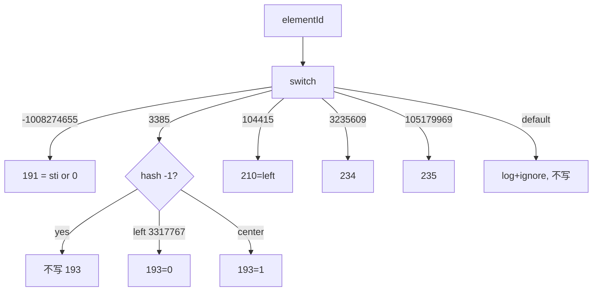

# 06_function_para_convert — w:pPr → 段落 PropertySet

| 项 | 值 |
|----|----|
| feature | wc-03-property-convert |
| order | 6 |
| crate | `libs/word-core/Cargo.toml` |
| 入口 | `ParaPropsConverterSimple::convertProp`（pStyle/jc/ind/ilvl/numId + 未知） |
| 独立性 | 叶子（假 Attributes + StyleId2Sti + NumIdRedirection；**不**调 correctProp） |
| 测试状态 | pass |

## 1. 功能说明

### 1.1 一句话

`convertProp(dst, elementId, attrs, styleId2Sti, numIdRedirection)` 按 Java hash 的 elementId 把 pPr 子元素写入 para 桶。未知 id：**Rust MVP log+ignore、不 panic、不写错桶**（Java 是 `IOAssert.fail`）。

### 1.2 输入

Java `ParaPropsConverterSimple.java` `convertProp` 热路径：

| elementId | 元素 | 写入 |
|-----------|------|------|
| -1008274655 | pStyle | `setStyle` → **miss 也** `setInt(191, 0)` |
| 3385 | jc | `ImporterHelper.convertAlignment` → prop **193**；无 val（hash -1）**不写** |
| 104415 | ind | `left` → prop **210** |
| 3235609 | ilvl | prop **234** |
| 105179969 | numId | prop **235**；val 0 → 0 且 **不 put**；新 id 首次 put=**1** |

`left`.hashCode()=**3317767** → alignment 0；`center`.hashCode()=**-1364013995** → 1。

instance `mode=0`。不测 spacing 全套 / 边框 switch（归 03/04 或 defer）。

### 1.3 输出

- pStyle hit → 191=sti；miss → **191=0**（与 run rStyle 不同）  
- jc left → 193=0；center → 193=1；无 val → !contains(193)  
- ind left=1440 → 210=1440  
- ilvl=2 → 234=2  
- numId 0 → 235=0；numId 10 空表 → 235=1  
- 未知 → 返回、桶无 191/193

### 1.4 上游

01 mode；02 hash/toInteger；03 getLong；wc-02 StyleId2Sti / NumIdRedirection。

### 1.5 下游

07 `correctProp`；wc-04 importParagraphEnd。

### 1.6 硬约束

| 允许 | 禁止 |
|------|------|
| switch 骨架全留；上列真写 | 删未实现 case 的 `// java` |
| 未知不 panic | 照搬 IOAssert.fail 使测试进程崩 |
| 不调用 correctProp | 把 07 的 191 补默认当本 function |

### 1.7 依赖与实现状态（必写，着重）

| 依赖 | 归属 | 本 function 需要的接口 | 已实现 | 暂缓（保留 Java 注释+签名） | 禁止本 function 去改 |
|------|------|------------------------|--------|-----------------------------|----------------------|
| `ParaPropsConverterSimple.convertProp` | 本叶 | 高频 case | **done**（PP1–PP10） | spacing 全套/边框/tabs 收集/修订/`correctProp*` | 全 948 行当验收 |
| `ImporterBase` | 01 | ctor Option | done | — | — |
| `ConvertHelper` | 02/03 | hash/getLong/toInteger | done | — | — |
| `ImporterHelper.convertAlignment` | 连坐 | left→0 center→1 | **done**（in-place） | 其余对齐枚举已按 Java switch 写完 | 重写整份 ImporterHelper |
| `StyleId2Sti` | wc-02 03 pass | getSti | done | — | 重测 SI |
| `NumIdRedirection` | wc-02 07 pass | getId/put；0 不分配 | done | — | 重测 NR |
| `MutablePropertySet` | wave0 | setInt/contains/getInt | done | — | — |

## 2. 核心代码与流程

Java：`ParaPropsConverterSimple.java` convertProp / setStyle / jc / ind / ilvl / numId  
Rust：`.../helpers/ParaPropsConverterSimple.rs`



## 3. 测试方案

### 3.1 代码审计与测试面

| symbol | Java/Rust 路径 | 输入/状态 | 输出/副作用 | 关键分支/错误 |
|--------|----------------|-----------|-------------|---------------|
| pStyle hit | setStyle | 已 put | 191=sti | 写 2 |
| pStyle miss | getSti null | 未注册 | **191=0** | 不写（run 语义） |
| jc left | convertAlignment | val=left | 193=0 | hash 算法错 |
| jc center | | val=center | 193=1 | |
| jc 无 val | hash -1 | | !contains(193) | 写 0 |
| ind left | | left=1440 | 210=1440 | 写 208 |
| ilvl | | val=2 | 234=2 | |
| numId 0 | | val=0 | 235=0 不 put | 分配了 1 |
| numId 新 | | val=10 | 235=1 | |
| unknown | default | id=1 | 不 panic；空桶 | Java fail vs MVP |

### 3.2 覆盖矩阵

| coverage_id | 接口/代码路径 | 场景类别 | 必测? | test_id / 未覆盖理由 |
|-------------|---------------|----------|-------|----------------------|
| C-PS-HIT | pStyle 已映射 | 主路径 | 是 | PP1 |
| C-PS-MISS | pStyle miss→191=0 | 边界 | 是 | PP2 |
| C-JC-LEFT | left→193=0 | 主路径 | 是 | PP3 |
| C-JC-CENTER | center→193=1 | 主路径 | 是 | PP4 |
| C-JC-MISS | 无 val 不写 193 | 边界 | 是 | PP5 |
| C-IND | left=1440→210 | 主路径 | 是 | PP6 |
| C-ILVL | ilvl=2→234 | 主路径 | 是 | PP7 |
| C-NUM0 | numId=0→235=0 | 分支 | 是 | PP8 |
| C-NUM-PUT | numId=10→235=1 | 主路径 | 是 | PP9 |
| C-UNK | 未知不 panic 不写 | 失败 | 是 | PP10 |

### 3.3 可测试性

假 Attributes；已测绿 `StyleId2Sti` + `NumIdRedirection`。不调用 `correctProp`。不打开 docx。

### 3.4 用例表

| id | 覆盖项 | 前置状态 | 输入摘要 | 期望输出/副作用 | 失败语义 |
|----|--------|----------|----------|-----------------|----------|
| PP1 | C-PS-HIT | put→sti | -1008274655 该 val | getInt(191)==sti | 写到 2 |
| PP2 | C-PS-MISS | 空 map | val=missing | contains(191) && getInt==0 | 不写 191 |
| PP3 | C-JC-LEFT | — | 3385 val=left | getInt(193)==0 | hash 非 3317767 |
| PP4 | C-JC-CENTER | — | val=center | 193==1 | |
| PP5 | C-JC-MISS | — | 3385 无 val | !contains(193) | 默认 left |
| PP6 | C-IND | — | 104415 left=1440 | getInt(210)==1440 | 写 208 |
| PP7 | C-ILVL | — | 3235609 val=2 | 234==2 | |
| PP8 | C-NUM0 | 空 redirection | 105179969 val=0 | 235==0；getId(0) 仍 miss | put(0) |
| PP9 | C-NUM-PUT | 空 redirection | val=10 | 235==1 | |
| PP10 | C-UNK | 空 dst | elementId=1 | 返回且 dst 无 191/193 | panic |

### 3.5 测试代码位置

crate: `libs/word-core/Cargo.toml`  
src:   `libs/word-core/src/cn/wps/moffice/writer/io/reader/docxReader/importer/helpers/ParaPropsConverterSimple.rs`  
test:  `libs/word-core/tests/cn/wps/moffice/writer/io/reader/docxReader/importer/helpers/ParaPropsConverterSimple.rs`

06 与 07 同 src、不同 `[[test]]` path。

### 3.6 测试运行脚本

```bash
cargo test --manifest-path libs/word-core/Cargo.toml --test 06_function_para_convert

bash .cursor/skills/feature-function/scripts/function-coverage.sh \
  --crate libs/word-core --test 06_function_para_convert \
  --src src/cn/wps/moffice/writer/io/reader/docxReader/importer/helpers/ParaPropsConverterSimple.rs \
  --src src/cn/wps/moffice/writer/io/reader/docxReader/importer/helpers/ImporterHelper.rs \
  --report libs/word-core/parser/features/wc-03-property-convert/functions/06_function_para_convert/FUNCTION.md
```

### 3.7 覆盖率报告

<!-- coverage-report:begin -->
tool: cargo-llvm-cov (`cargo llvm-cov --test 06_function_para_convert --json`)
date: 2026-08-20 12:17

| src | lines covered | line % | regions covered | region % |
|-----|---------------|--------|-----------------|----------|
| `src/cn/wps/moffice/writer/io/reader/docxReader/importer/helpers/ImporterHelper.rs` | 29/98 | 29.6% | 53/168 | 31.5% |
| `src/cn/wps/moffice/writer/io/reader/docxReader/importer/helpers/ParaPropsConverterSimple.rs` | 172/413 | 41.6% | 257/493 | 52.1% |
| **function total** | **201/511** | **39.3%** |  |  |
<!-- coverage-report:end -->

### 3.8 模板布局校验（必跑，PASS 才能标 pass）

```bash
node .cursor/skills/function-java2rust/scripts/check-template-layout.mjs \
  --rs libs/word-core/src/cn/wps/moffice/writer/io/reader/docxReader/importer/helpers/ParaPropsConverterSimple.rs \
  --java koffice/writer/core/cn/wps/moffice/writer/io/reader/docxReader/importer/helpers/ParaPropsConverterSimple.java

node .cursor/skills/function-java2rust/scripts/check-template-layout.mjs \
  --rs libs/word-core/src/cn/wps/moffice/writer/io/reader/docxReader/importer/helpers/ImporterHelper.rs \
  --java koffice/writer/core/cn/wps/moffice/writer/io/reader/docxReader/importer/helpers/ImporterHelper.java
```

两组布局均为 PASS。本轮未改 `ConvertHelper.rs`。
