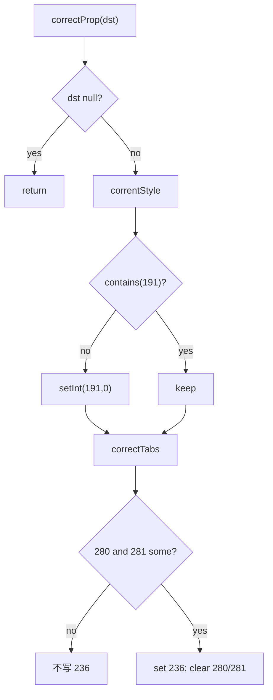

# 07_function_correct_prop — 段末补 Normal sti + tabs 合成

| 项 | 值 |
|----|----|
| feature | wc-03-property-convert |
| order | 7 |
| crate | `libs/word-core/Cargo.toml` |
| 入口 | `ParaPropsConverterSimple::{correctProp, correntStyle, correctTabs}`（Java 拼写 corrent） |
| 独立性 | 叶子（只 MutablePropertySet；不 SAX、不 convertProp） |
| 测试状态 | pass |

## 1. 功能说明

### 1.1 一句话

`correctProp(dst)` 在落 PAPX 前纠偏：没有 prop **191** 则 `setInt(191, 0)`（Normal）；**已有 191 不覆盖**。若 280 与 281 都非 null，合成 **236** 并清空 280/281。

### 1.2 输入

Java `ParaPropsConverterSimple.java` 240–259、312–351：

```text
correctProp(dst):
  if dst != null:
    correntStyle(dst)
    correctTabs(dst)

correntStyle:
  if !dst.contains(191):
    dst.setInt(191, 0)

correctTabs:
  if getValue(281) != null && getValue(280) != null:
    build TxTabStops → setValue(236)
    setValue(281, null); setValue(280, null)
```

wc-04 `importParagraphEnd` 在 freeze 前调用单参 `correctProp`。4 参修订重载 **暂缓**。

### 1.3 输出

- 空桶 → contains(191) 且 getInt(191)==0  
- 已 setInt(191, 5) → 仍为 5  
- dst==null → 不 panic  
- 无 280/281 时不发明 236  
- 同时有 280+281 → contains(236)，280/281 被置 null

### 1.4 上游

06 可能已写 191；wave0 MutablePropertySet.contains/setInt。测 07 **不跑** convertProp。

### 1.5 下游

wc-04 CoreHelper.appendParagraph。

### 1.6 硬约束

| 允许 | 禁止 |
|------|------|
| 单参 `correctProp` + `correntStyle` + `correctTabs` 门闩真写 | 把 convertProp switch 当本 function |
| 4 参修订重载 / getDifferenceParaProp **暂缓** | 覆盖已有非 0 的 191 |
| tabs 合成可对 236 只断言 contains + 清空 280/281 | 为 TxTabStops 去写 value 全叶当本 function 验收 |

### 1.7 依赖与实现状态（必写，着重）

| 依赖 | 归属 | 本 function 需要的接口 | 已实现 | 暂缓（保留 Java 注释+签名） | 禁止本 function 去改 |
|------|------|------------------------|--------|-----------------------------|----------------------|
| `ParaPropsConverterSimple.correctProp` | 本叶（与 06 同文件） | 单参 + correntStyle + correctTabs 门闩 | **done**（CP1–CP6） | 4 参修订；TxTabStops 字段细节/排序 | 重写 06 的 convertProp 语义 |
| `MutablePropertySet` | wave0 | contains / setInt / setValue / getInt | done | — | — |
| `TxTabStops` / `TBD` | value 类型 | 236 载荷 | lib.rs 编译面胶水 | 排序/insertAdd 细节 | 为 07 扩全量 tab 模型 |
| `TextDocument` / `KStyles` | 4 参重载 | — | — | 整条修订差量 | 为 07 打开修订 |

06 与 07 同 `ParaPropsConverterSimple.rs`：07 只验收 correctProp；布局校验仍对该文件跑一次。

## 2. 核心代码与流程

Java：240–259、312–351  
调用方：`SubDocumentImporter.importParagraphEnd`（wc-04，本层不测）



## 3. 测试方案

### 3.1 代码审计与测试面

| symbol | Java/Rust 路径 | 输入/状态 | 输出/副作用 | 关键分支/错误 |
|--------|----------------|-----------|-------------|---------------|
| 空桶 | 257 | new MPS | 191=0 | 不写 |
| 已有 191 | 257 | 191=5 | 仍 5 | 被打成 0 |
| null | 241 | dst null | 不 panic | unwrap |
| tabs no-op | 315 | 无 280/281 | !contains(236) | 清空 191 |
| 已有 191=0 | 257 | 再 correct | 仍 0 | |
| tabs 合成 | 348–350 | 280+281 非 null | contains(236)；280/281 null | 不合成 |

### 3.2 覆盖矩阵

| coverage_id | 接口/代码路径 | 场景类别 | 必测? | test_id / 未覆盖理由 |
|-------------|---------------|----------|-------|----------------------|
| C-EMPTY | 空桶 → 191=0 | 主路径 | 是 | CP1 |
| C-KEEP | 已有 191=5 | 状态 | 是 | CP2 |
| C-NULL | dst null | 失败 | 是 | CP3 |
| C-TABS-NOP | 无 tab 原始桶 | 边界 | 是 | CP4 |
| C-IDEM | 已 191=0 再 correct | 状态 | 是 | CP5 |
| C-TABS-SYN | 280+281 → 236 | 主路径 | 是 | CP6 |

TxTabStops 内部 rgdxa* 排序：本 function 只钉「写出 236 并清空原始桶」；字段布局暂缓。

### 3.3 可测试性

`MutablePropertySet::new()`。不构造 converter 实例（Java `correctProp` 为 static）。CP5 用手工 `setInt(191,0)` 模拟 06 输出。CP6 用最小 280/281 列表（或 Loop 时 crate 内假 ArrayList），不断言 TBD 字段。

### 3.4 用例表

| id | 覆盖项 | 前置状态 | 输入摘要 | 期望输出/副作用 | 失败语义 |
|----|--------|----------|----------|-----------------|----------|
| CP1 | C-EMPTY | new | correctProp | contains(191) && getInt==0 | 样式链无根 |
| CP2 | C-KEEP | setInt(191,5) | correctProp | getInt(191)==5 | 用户 pStyle 被抹成 Normal |
| CP3 | C-NULL | — | correctProp(None) | 返回 | panic |
| CP4 | C-TABS-NOP | 空桶 + CP1 | 无 280/281 | !contains(236) | 空段被加 tab |
| CP5 | C-IDEM | 已 191=0 | 再 correct | 仍 0 | 第二次写成别的 |
| CP6 | C-TABS-SYN | setValue 280+281 | correctProp | contains(236)；280/281 为 null | 只补 191 不合成 |

### 3.5 测试代码位置

crate: `libs/word-core/Cargo.toml`  
src:   `libs/word-core/src/cn/wps/moffice/writer/io/reader/docxReader/importer/helpers/ParaPropsConverterSimple.rs`  
test:  `libs/word-core/tests/cn/wps/moffice/writer/io/reader/docxReader/importer/helpers/ParaPropsConverterSimpleCorrect.rs`

07 与 06 同 src、不同 `[[test]]` path。

### 3.6 测试运行脚本

```bash
cargo test --manifest-path libs/word-core/Cargo.toml --test 07_function_correct_prop

bash .cursor/skills/feature-function/scripts/function-coverage.sh \
  --crate libs/word-core --test 07_function_correct_prop \
  --src src/cn/wps/moffice/writer/io/reader/docxReader/importer/helpers/ParaPropsConverterSimple.rs \
  --report libs/word-core/parser/features/wc-03-property-convert/functions/07_function_correct_prop/FUNCTION.md
```

### 3.7 覆盖率报告

<!-- coverage-report:begin -->
tool: cargo-llvm-cov (`cargo llvm-cov --test 07_function_correct_prop --json`)
date: 2026-08-20 16:34

| src | lines covered | line % | regions covered | region % |
|-----|---------------|--------|-----------------|----------|
| `src/cn/wps/moffice/writer/io/reader/docxReader/importer/helpers/ParaPropsConverterSimple.rs` | 83/490 | 16.9% | 81/568 | 14.3% |
| **function total** | **83/490** | **16.9%** |  |  |
<!-- coverage-report:end -->

### 3.8 模板布局校验（必跑，PASS 才能标 pass）

```bash
node .cursor/skills/function-java2rust/scripts/check-template-layout.mjs \
  --rs libs/word-core/src/cn/wps/moffice/writer/io/reader/docxReader/importer/helpers/ParaPropsConverterSimple.rs \
  --java koffice/writer/core/cn/wps/moffice/writer/io/reader/docxReader/importer/helpers/ParaPropsConverterSimple.java
```

与 06 同一对 `--rs` / `--java`（同文件）。本轮布局 PASS。
