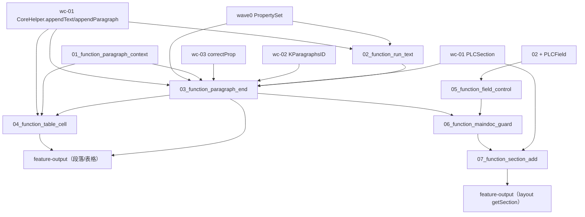

# wc-04-paragraph-import — Function 组合图

> 分析日期：2026-08-20
> 输入端点：XWPF/DocumentImporter 抛出的段落事件 `importParagraphStart / importRunText* / importParagraphEnd`，及可选 Table/Cell/Section 副作用
> 对外输出：对 `SubDocument` 的有序落库——rope 字符、CHPX@run 首 CP、PAPX@段首 cp0、PLCSection 节节点（经 `CoreHelper` 编排）
> 切分依据：I/O 边界（段会话 → run 文本 → 段末落库 → 表格 cell/row → 域控制字符 → 主文档 guard → 节属性建节）
> 类级蓝皮书：[STRUCTURE_ANALYSIS.md](./STRUCTURE_ANALYSIS.md) · seeds：[SEEDS_ANALYSIS.md](./SEEDS_ANALYSIS.md) · 深读：[docs/README.md](./docs/README.md)

本文件只讲 **function 之间如何串联**。每个 function 的字段表、类图、**测试方案**在
`functions/<function_id>/FUNCTION.md`。可执行测试与 `src` 隔离，镜像落在 crate
`libs/word-core/tests/<relpath>/<Type>.rs`（见 §3）。

**本层不解析 docx / 不做属性转换 / 不实现低层 rope·表。** 包/XML 是 wave0；属性桶是 wc-03；rope/CHPX/PAPX/PLCSection 落库是 wc-01；对象图是 wc-02。本层验的是「段落事件如何变成对 CoreHelper / PLCSection 的**有序调用**，且 CP 语义与 Java 同构」。

---

## 0. 一句话管线

目录名 `{NN}_function_*` 的 `NN` 是依赖拓扑序号（就绪即编号）。低层三件套（rope/CHPX/PAPX）已在 wc-01 测绿，属性桶已在 wc-03 测绿，本 feature **不重拆**。

```text
(wc-01) CoreHelper.appendText / appendParagraph   低层落库前置（不重测）
(wc-02) SubDocument / KParagraphsID / KStyle      对象图前置（不重测）
(wc-03) ParaPropsConverterSimple.correctProp      段末纠偏前置（不重测）

01_function_paragraph_context                     段会话三字段（cp0 / paraId / entry）
02_function_run_text                               run 文本 → rope + CHPX
03_function_paragraph_end                          Start 抓 cp0 + End 落 PAPX@cp0
04_function_table_cell                             表格 cell/row → PAPX 223/224/226 + cellMark
05_function_field_control                           域 13/14/15 → PLCField + lock/unlock
06_function_maindoc_guard                           checkQuit + \f 记节 CP + lock/unlock
07_function_section_add                             sectPr → PLCSection.addSection + sepx
```

热路径（钉死，来自 STRUCTURE_ANALYSIS.md）：

```text
importParagraphStart(paraId)
  → mCurrentParagraph = new ParagraphContext(document.getLength())   # ★ 段首 cp0

importRunTextSimple(text, chpx)
  → CoreHelper.appendText(document, text, chpx)                       # CHPX@append前length

importParagraphEnd(paragraph, layerTable)
  → endMark = getEndMark()                                          # '\r' / '\f'
  → dstParaProps = getParaProp()（null→new）
  → paraId≠null → setValue(282, paraId) + addParaphId(paraId)
  → correctProp(dstParaProps)                                       # 缺191→0
  → layerTable≥1 → amendTableProps(dstParaProps, layerTable)        # 223/224
  → CoreHelper.appendParagraph(doc, endMark, mPositionInserted, runProps|empty, paraProps|empty)
      # ★ PAPX insert CP = 段首 mPositionInserted，不是段末 length
  → paraId≠null → putId(paraId, doc.getType(), entry)
  → endMark=='\f' → PLCSection.setLastSectionEndCP(doc.getLength())
  → isContainNumbering(entry) → 懒解析 numbering.xml（xml07/xml03）

MainDocumentImporter:
  importParagraphStart → checkQuit() → fieldsHaveEnded()→lock() → super
  importParagraphEnd   → super → endMark=='\f' → mCpLastSectionEnd = getLength()-1 → unlock()
  doImportSectionPropertiesSimple → 首节判定 → addSection(mCpLastSectionEnd) + sepx=freeze
```

**钉死规则（与 wc-01/STRUCTURE_ANALYSIS 一致）：**
1. `mPositionInserted = document.getLength()` 在 **Start** 时刻抓取；`appendParagraph(ch, cp, …)` 第二参用它，**不是** End 时 length。
2. `appendText` 的 CHPX insert CP 用**当次** `getLength()`（run 首字符 CP）。
3. 特殊字符：`\r`=0x0D 段标、`\f`=0x0C 分节段标、`\u0007`=0x07 单元格标记（layerTable==1）、`\u0013/14/15`=19/20/21 域 begin/separate/end。
4. propId：**282**=paraId、**191**=pStyle、**223**=inTable、**224**=tableLevel、**225**=cellEnd 判断、**226**=cellEnd、**234/235**=numPr、**28**=特殊字符。
5. `\f` 段：父类 `setLastSectionEndCP(getLength())`；主文档 `mCpLastSectionEnd = getLength()-1`；真正 `addSection` 在收到 sectPr 时；首节（`mCpLastSectionEnd==null && plcSection.isEmpty()`）跳过 addSection。

---

## 1. Function 清单

| order | function_id | 一句话 | 输入 | 输出 | 上游 | 下游 |
|------|-------------|--------|------|------|------|------|
| 1 | [01_function_paragraph_context](./functions/01_function_paragraph_context/FUNCTION.md) | 如何记住段首 CP、paraId 与段末 Entry | cp0 / 已有 `IPapxTable.Entry` | `ParagraphContext` | （无） | 03; 04 |
| 2 | [02_function_run_text](./functions/02_function_run_text/FUNCTION.md) | 如何把 run 文本写进 rope 并在 run 首 CP 插 CHPX | `text`/`buffer` + `PropertySet` | `length` 增量 + CHPX@append前length | wave0 property_set; wc-01 CoreHelper | 03; feature-output |
| 3 | [03_function_paragraph_end](./functions/03_function_paragraph_end/FUNCTION.md) | 如何在 Start 抓 cp0、在 End 把 PAPX 挂回 cp0 | `paraId` + `ParagraphSimple` + `layerTable` | endMark rope + PAPX@cp0 + paraId(282) + `\f` 锚点 | 01; wc-01 CoreHelper; wc-03 correctProp | 04; 06; feature-output |
| 4 | [04_function_table_cell](./functions/04_function_table_cell/FUNCTION.md) | 如何写单元格/行段标并补 223/224/226 | `layerTable` + `cellMark` + `tableProps` + `rowMark` | PAPX 223/224/226 + cellMark 字节 | 03; wc-01 CoreHelper | feature-output |
| 5 | [05_function_field_control](./functions/05_function_field_control/FUNCTION.md) | 如何写域控制字符并维护未闭合域计数/写锁 | `fieldChar`(19/20/21) + cp + lock | PLCField 节点 + appendText + `mFieldsNotEnded` | 02; PLCField | 06 |
| 6 | [06_function_maindoc_guard](./functions/06_function_maindoc_guard/FUNCTION.md) | 如何在主文档段落前后做 quit 检查、锁与节 CP 记忆 | `IDLProvider` + `ParagraphSimple` + length | ForceQuit/ReadingLimit 异常 + lock/unlock + `mCpLastSectionEnd` | 03; 05; ImporterHelper | 07 |
| 7 | [07_function_section_add](./functions/07_function_section_add/FUNCTION.md) | 如何收到 sectPr 后建节并写 sepx | `sectionProps` + 6 个 header/footer 节点 | `PLCSection.SectionNode` + sepx | 06; wc-01 PLCSection | feature-output |

## 2. 数据流



**串接规则：**

1. **不重测 wc-01/wc-02/wc-03。** `appendText/appendParagraph`、`SubDocument` 访问器、`KParagraphsID`、`correctProp` 已测绿，本层只断言 **importer 调用了它们且参数/CP 正确**。
2. **测 N 不跑完整 feature 管线。** fixture 是内存 `Document`/`SubDocument` + 假 `ParagraphSimple`（`getEndMark/getParaProp/getRunProp` 返回固定值），不打开 docx。
3. **Start 的输出通过 End 观察。** `importParagraphStart` 只写私有 `mCurrentParagraph`；其 cp0 语义由 End 的 PAPX insert CP 钉死（间接覆盖，见 03 §3.2）。
4. **run 文本独立可观察。** 02 只断言 rope 字符、length 增量、CHPX 挂点，不碰 PAPX。
5. **表格依赖段会话。** 04 的 `importTableCellStartSimple` 只清 `mEntry` 不清 `mPositionInserted`，End 的 cp0 仍可用。
6. **域控制字符是 05 的输出、06 的输入。** `lock/unlock` 与 `mFieldsNotEnded` 计数让主文档能判断 `fieldsHaveEnded()`。
7. **`\f` 分节拆两半。** 父类 03 在 `\f` 时 `setLastSectionEndCP(getLength())`；主文档 06 记 `mCpLastSectionEnd=getLength()-1`；真正 `addSection` 在 07 收到 sectPr 时。
8. **失败停在本级。** 空 run 文本不应表现为「没写 CHPX」；应在 `CoreHelper.appendText` 的 `text.length()>0` 断言红（但 Java 在 `importRunText` 先判 `len>0` 跳过空串，所以 importer 级不红——这是契约：空串 no-op）。

---

## 3. 依赖与编译面

| 层级 | function | crate | 单独测 |
|------|----------|-------|--------|
| 叶子 | paragraph_context | `libs/word-core` | 是：纯 struct，无 Document/rope |
| 叶子 | run_text | word-core | 需 `SubDocumentImporter` 实例 + `dyn Document`（rope+chpx 可读） |
| 叶子 | paragraph_end | word-core | 需 `SubDocumentImporter` 实例 + `dyn Document`（rope+chpx+papx+plcsection） |
| 叶子 | table_cell | word-core | 需 03 的会话 + `dyn Document`（papx+textPool） |
| 叶子 | field_control | word-core | 需 `PLCField`（若未改写则 defer 到 stub） |
| 叶子 | maindoc_guard | word-core | 需 `MainDocumentImporter` 实例 + 假 `IDLProvider`/`IOListener` |
| 叶子 | section_add | word-core | 需 `MainDocumentImporter` 实例 + `PLCSection` |

每个 function 一条 `[[test]]`，`name` = `function_id`，`path` = `tests/` 下与 `src` 同相对路径的入口类型文件（多 function 共用同一 src 类型时，用同目录加后缀的镜像文件）。

| function_id | `[[test]]` path |
|-------------|-----------------|
| `01_function_paragraph_context` | `tests/cn/wps/moffice/writer/io/reader/helper/ParagraphContext.rs` |
| `02_function_run_text` | `tests/cn/wps/moffice/writer/io/reader/docxReader/importer/document/SubDocumentImporter.rs` |
| `03_function_paragraph_end` | `tests/cn/wps/moffice/writer/io/reader/docxReader/importer/document/SubDocumentImporterEnd.rs` |
| `04_function_table_cell` | `tests/cn/wps/moffice/writer/io/reader/docxReader/importer/document/SubDocumentImporterTable.rs` |
| `05_function_field_control` | `tests/cn/wps/moffice/writer/io/reader/docxReader/importer/document/SubDocumentImporterField.rs` |
| `06_function_maindoc_guard` | `tests/cn/wps/moffice/writer/io/reader/docxReader/importer/document/MainDocumentImporter.rs` |
| `07_function_section_add` | `tests/cn/wps/moffice/writer/io/reader/docxReader/importer/document/MainDocumentImporterSection.rs` |

```bash
# 单 function（loop 用这条）
cargo test --manifest-path libs/word-core/Cargo.toml --test 01_function_paragraph_context
# … 02–07 同 crate、--test <function_id>

# 不要用 --lib 当 function 验收：src 内禁止 #[cfg(test)]
```

**编译面（Split 时）：** 三个种子 `.rs` 均 `rs_exists=no`，`src/.../importer/document/` 目录与 `reader/helper/ParagraphContext.rs` 尚不存在。Loop L5 需先建模板并做 3 处接线：

```text
src/cn/wps/moffice/writer/io/reader/helper/mod.rs
  + pub mod ParagraphContext;

src/cn/wps/moffice/writer/io/reader/docxReader/importer/mod.rs
  + pub mod document;

src/cn/wps/moffice/writer/io/reader/docxReader/importer/document/mod.rs  （新文件）
  + pub mod SubDocumentImporter;
  + pub mod MainDocumentImporter;
```

Split 阶段**不**创建 `[[test]]`（src 不存在，测试无法编译）；`[[test]]` 与镜像测试在 loop L2 随 src 落地一起写。所有 function `status=spec`，不得用空测试或 `assert!(true)` 假装绿。

启动改写-测试-回归：对 agent 说 `loop 01_function_paragraph_context` 或「开始 loop」（skill：`feature-function`）。每个 function 的 `FUNCTION.md` §3.6 / §3.7 含 `cargo test` 脚本与 `cargo-llvm-cov` 覆盖率报告。

---

## 4. Function 如何串联（逐步）

1. XWPF 到段首：`DocumentImporter`（wc-05）转发 `importParagraphStart(paraId)` → 03 用 01 建 `ParagraphContext(cp0=document.getLength())`。
2. 每个 `w:r/w:t`：`importRunTextSimple(text, chpx)` → 02 调 `CoreHelper.appendText`，rope append + CHPX@append前length。
3. 段结束：03 取 `ParagraphSimple` 的 endMark/paraProp/runProp → `correctProp` → `amendTableProps`（layer≥1）→ `CoreHelper.appendParagraph(endMark, mPositionInserted, chpx, papx)`。
4. 若有 paraId：03 先 `setValue(282)` + `addParaphId`，appendParagraph 后 `putId(paraId, type, entry)`。
5. 若 endMark==`\f`：03 `PLCSection.setLastSectionEndCP(length)`；主文档 06 再记 `mCpLastSectionEnd=length-1` 并 unlock。
6. 表格：04 `importTableCellStartSimple` 清 `mEntry`（保留 cp0）；`importTableCellEndSimple` 无 entry 则补空段，写 223/224/226 + `setCellMark`。
7. 域：05 写 19/20/21 控制字符到 rope+CHPX，登记 `PLCField`，维护 `mFieldsNotEnded`。
8. 主文档 Start/End：06 `checkQuit()`（ForceQuit/ReadingLimit），`fieldsHaveEnded()==true` 时 lock/unlock 成对。
9. 收到 sectPr：07 `doImportSectionPropertiesSimple`，首节判定后 `addSection(mCpLastSectionEnd)` 并写 `sepx=freeze(sectionProps)`。

---

## 5. 验收顺序

```text
01_function_paragraph_context       （最快；纯 struct；null entry 断言）
02_function_run_text                （空串 no-op；String/char[] 两重载；CHPX@run首CP）
03_function_paragraph_end           （PAPX@cp0；282；\f→setLastSectionEndCP；191=0）
04_function_table_cell              （223/224/226；cellMark；只清 entry 不清 cp0）
05_function_field_control           （19/20/21 计数；lock/unlock 回调）
06_function_maindoc_guard           （ForceQuit/ReadingLimit；\f→mCpLastSectionEnd=length-1）
07_function_section_add             （首节跳过/非首节 addSection；sepx）
```

README / STRUCTURE MVP checklist 映射：

| 目标项 | function |
|--------|----------|
| 单段多 run 文本与 CHPX 正确 | 02, 03 |
| PAPX 使用段首 CP（mPositionInserted） | 01, 03 |
| paraId → 282 + addParaphId + putId | 03 |
| `\f` → setLastSectionEndCP → mCpLastSectionEnd → addSection | 03, 06, 07 |
| 表格 223/224/226 + `\u0007`/`\r` + setCellMark | 04 |
| stub 方法族不抛 NPE | 05（域）、06（comment/footnote 为 defer） |
| checkQuit ForceQuit/ReadingLimit | 06 |

---

## 6. 与类级分析的对照

| function | STRUCTURE_ANALYSIS 枢纽 | 深读 |
|----------|-------------------------|------|
| paragraph_context | §1.1 ParagraphContext | [docs/ParagraphContext.md](./docs/ParagraphContext.md) |
| run_text | §1.2 SubDocumentImporter 构造+Run | [docs/SubDocumentImporter.md](./docs/SubDocumentImporter.md) |
| paragraph_end | §1.2 热路径三件套 + §2.1 | 同上 |
| table_cell | §1.2 Table + §2.3 | 同上 |
| field_control | §1.2 Field/lock + §4.2 stub 族 | 同上 |
| maindoc_guard | §1.3 MainDocumentImporter + §2.2 | [docs/MainDocumentImporter.md](./docs/MainDocumentImporter.md) |
| section_add | §1.3 节属性 + §2.2 | 同上 |

类图仍以 `STRUCTURE_ANALYSIS.md` 为准；function 按 **I/O** 切，不按类切。`SubDocumentImporter` 一类拆成 02/03/04/05 四个 I/O 单元；`MainDocumentImporter` 拆成 guard（06）与建节（07）。每个 `FUNCTION.md` 必须有 **§1.7 依赖实现状态** 和 **§3.8 模板布局校验**。
