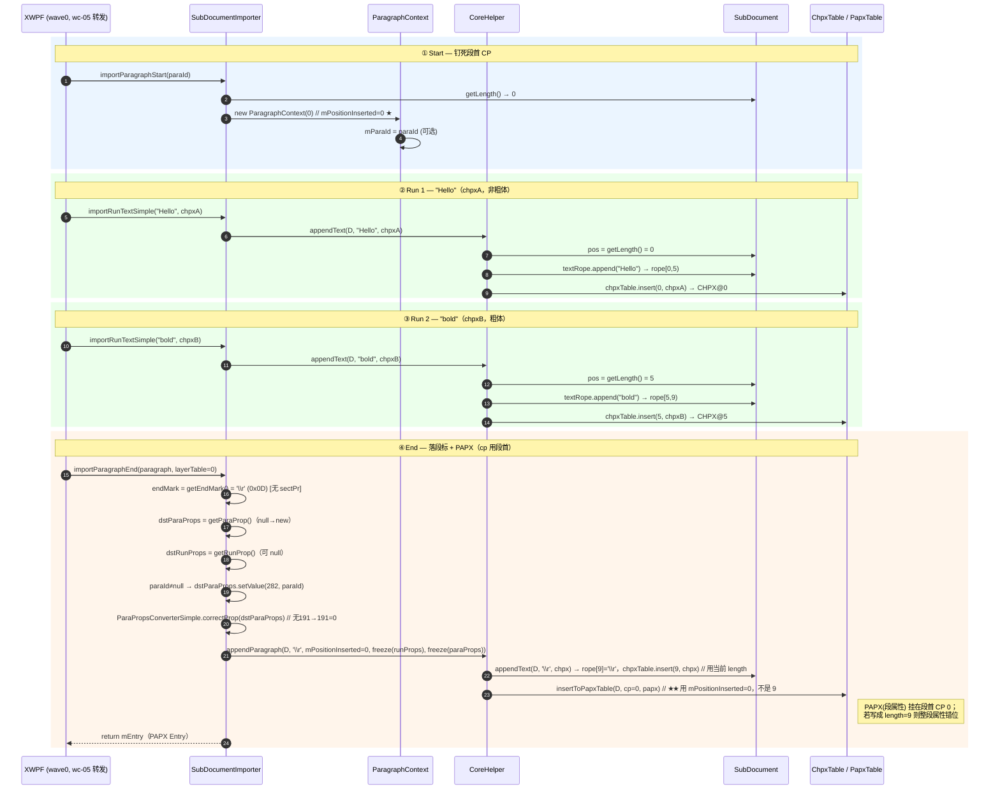
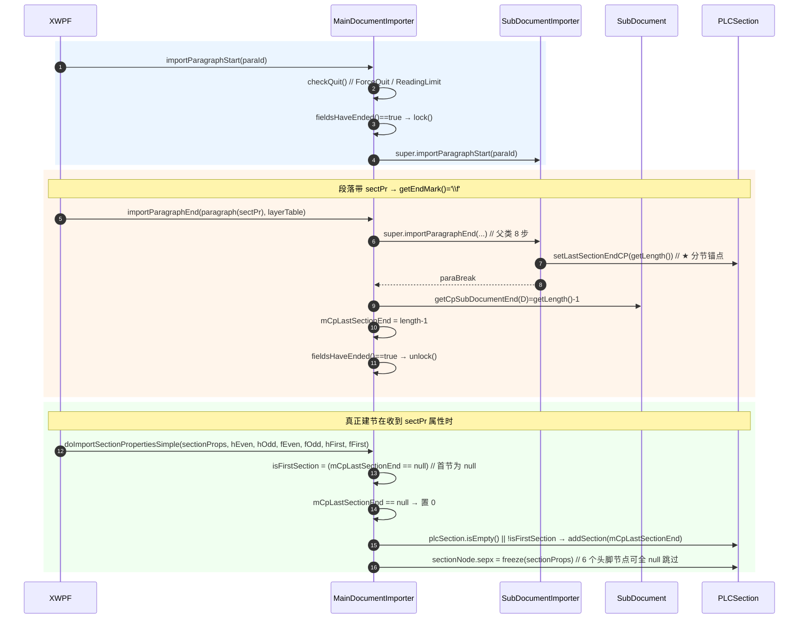
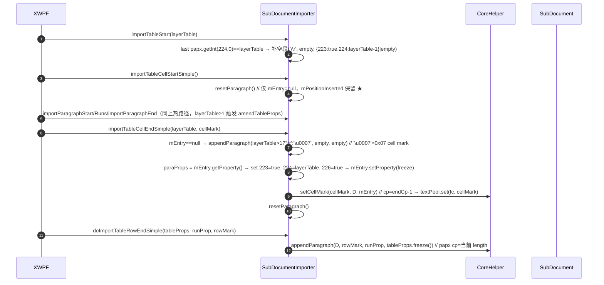

# wc-04-paragraph-import — 段落写入状态机（类图/流程/依赖/最小改写范围）

> 结构分析基线：Java 源码（`koffice/writer/core/...` 与 `koffice/core-libs/...`）＋ feature 文档（`libs/word-core/parser/features/wc-04-paragraph-import/`）＋ Rust 现状（`libs/word-core/src/...`）。
> 结论一句话：**三个种子类全部 `pending`，Rust 侧尚未落盘任何一行的 `document/` 目录；上游依赖（CoreHelper/IPapxTable/PLCSection/SubDocument）已 done，唯一硬性缺口是 wc-03 的 `ParaPropsConverterSimple`（blocked）与 `ImporterHelper`（未改写）两个支撑点。**

---

## 0. Feature 目标与管线位置

| 项 | 值 |
|---|---|
| feature id | `wc-04-paragraph-import`（batch `parse-04-paragraph-import`，order 500–502） |
| depends_on | `wc-03-property-convert`（属性转换） |
| 下游 | `wc-05-orchestration`（DocxReader/DocumentImporter 把 XWPF 回调转发进本层） |
| 目标 | 把「一个段落」的生命周期变成对 `CoreHelper` 的有序调用：`importParagraphStart → (importRunTextSimple)* → importParagraphEnd`，可选 Table/Cell/Section 副作用 |
| 种子 | `ParagraphContext`(500) / `SubDocumentImporter`(501) / `MainDocumentImporter`(502)，三者均 `is_seed=yes, mvp_state=pending, mvp-must` |
| 业务地位 | parse MVP 的**业务热路径**——XWPF 抛出的每个 `w:p`/`w:r`/`w:t` 都在这里落成 rope + CHPX + PAPX |

**管线位置**（上游已 done 的依赖链）：

```
wc-01-storage-write(done)  → CoreHelper / IPapxTable / PapxTable / PLCSection / ITable
wc-02-document-model(done) → SubDocument / TextDocument / KParagraphsID / StyleId2Sti / NumIdRedirection(partial)
wc-03-property-convert     → ParaPropsConverterSimple / RunPropsConverterSimple  → ⚠ blocked
wc-04-paragraph-import     → ★ 本 feature（全部 pending）
wc-05-orchestration        → DocumentImporter 接 XWPF 回调（依赖 wc-04）
```

**Java → Rust 路径映射（dep_topo.csv / seeds.csv 三行）：**

| Java | Rust 路径（待创建） | mvp_state |
|---|---|---|
| `…/reader/helper/ParagraphContext.java` | `libs/word-core/src/cn/wps/moffice/writer/io/reader/helper/ParagraphContext.rs` | pending |
| `…/docxReader/importer/document/SubDocumentImporter.java` | `libs/word-core/src/.../docxReader/importer/document/SubDocumentImporter.rs` | pending |
| `…/docxReader/importer/document/MainDocumentImporter.java` | `libs/word-core/src/.../docxReader/importer/document/MainDocumentImporter.rs` | pending |

Rust 侧 `docxReader/importer/document/` 目录**尚不存在**；`reader/helper/` 下无 `ParagraphContext.rs`；`importer/mod.rs` 只有 `pub mod helpers/NumIdRedirection/StyleId2Sti`，`reader/helper/mod.rs` 只有 `Border/IOHelper/Shapes2Core`——**本 feature 需要新建 3 个文件 + 2 处 mod 接线**。

---

## 1. 类图

### 1.1 `ParagraphContext` — 段会话（3 字段，纯数据载体，无业务方法）

```java
public final class ParagraphContext {
   public Integer mPositionInserted;   // 段开始时 document.getLength()（段首 CP，PAPX 挂点）
   public String  mParaId;             // OOXML w:paraId → prop 282
   public IPapxTable.Entry mEntry;     // 段结束后 appendParagraph 返回的 PAPX Entry（表格路径 reset）
}
```

| 方法 | 签名 | 生命周期 | 逻辑（1 行） |
|---|---|---|---|
| 构造① | `ParagraphContext(int position)` | **Start** | `mPositionInserted = position`（`importParagraphStart` 用，MVP 必写） |
| 构造② | `ParagraphContext(IPapxTable.Entry entry)` | 辅助 | `IOAssert.assertNotNull(entry)`；`mEntry = entry`（「从已有段继续」，MVP 可 defer） |

Rust 形态建议：`pub struct ParagraphContext { pub mPositionInserted: i32, pub mParaId: Option<String>, pub mEntry: Option<Box<dyn IPapxEntry>> }`。

**MVP 关键不变量**：PAPX insert 用 Start 时抓取的 `mPositionInserted`，**禁止**事后用「当前 length」替代。

---

### 1.2 `SubDocumentImporter`（abstract，~717 行）— 段落写入状态机核心

**继承**：`ImporterBase`（Rust 已 done：`mode()/xml07Context()/xml03Context()/isXml03()/isXml07()/isDocx()/isGVml()`）
**实现**：`ISubDocumentImporter`（Java 空接口 extends `IImporterBase`；Rust 侧现为空 trait，需补 `: IImporterBase` supertrait）

#### 字段表

| 字段 | Java 类型 | 含义 | MVP |
|---|---|---|---|
| `mDocument` | `SubDocument` | 目标子文档（rope/表都挂在它下面） | must |
| `mCharBuffer` | `ITextPool` | 字符池（本类未用满，保留） | carry |
| `mStyleId2Sti` | `StyleId2Sti` | 样式 id→sti 重定向（getter） | must(引用) |
| `mNumIdRedirection` | `NumIdRedirection` | 编号 id 重定向（getter） | must(引用) |
| `mDrawingImporter` | `DrawingImporter` | 绘图（含 DML） | stub |
| `mMathImporter` | `MathImporter` | 公式（懒创建） | stub |
| `mComplexFieldNodeBegin` | `PLCField.FieldNode` | 复杂域 begin 节点（FieldEmpty→猜类型） | stub |
| `mFieldsNotEnded` | `int` | 未闭合域计数（lock/unlock 依据） | carry |
| `mShouldBeRecalculated` | `boolean` | 域需重算标记（fieldFlags bit16） | stub |
| `mCurrentParagraph` | `ParagraphContext` | **当前段会话**（`@Deprecated` 但热路径仍用） | must |
| `mBookmarkImporter` | `BookmarkImporter` | 书签（懒创建） | stub |
| `mDocFieldImporter` | `DocFieldImporter` | 文档域（懒创建） | stub |
| `mWriteLock` | `RangeWriteLock` | 写锁（主文档域 lock/unlock） | carry |
| `mIoListener` | `IOListener` | 进度回调（onFirstLock/onFirstUnLock） | carry |
| `mDmlImporter` | `DmlImporter` | DML 导入器（懒创建） | stub |
| `MINLAYERTABLE` | `final int = 1` | 表格最小层 | const |
| `mIsFirstUnlock` | `boolean = true` | 首次 unlock 才 onFirstUnLock | carry |

#### 方法表（按热路径/生命周期分组）

**生命周期标注**：`[构造] [Start] [Run] [End] [Table] [Field] [Stub]`

| 方法 | 签名（Java） | 生命周期 | 逻辑（1 行） |
|---|---|---|---|
| 构造 | `SubDocumentImporter(SubDocument, StyleId2Sti, NumIdRedirection, IOListener, boolean initDrawingContainer, int mode, Xml07Context, Xml03Context)` | **[构造]** | `super(mode,…)`；assert 非空；`initDrawingContainer→document.getDrawingContainer().beginRead()`；域计数清零 |
| `importParagraphStart` | `void (String paraId)` | **[Start]** ★ | `mCurrentParagraph = new ParagraphContext(mDocument.getLength())`；paraId≠null → 记入 `mParaId` |
| `importRunText` | `void (String runText, PropertySet runProps)` | **[Run]** ★ | `len>0 → CoreHelper.appendText(mDocument, runText, runProps)`；FieldEmpty 时猜域类型 |
| `importRunTextSimple` | `void (String runText, PropertySet runProps)` | **[Run]** ★ | 同 `importRunText`（XWPF 主回调） |
| `importRunTextSimple` | `void (char[] buffer, int start, int len, PropertySet runProps)` | **[Run]** ★ | `len>0 → appendText(mDocument, buffer, start, start+len, runProps)` |
| `importRunText4InlineChart` | `void (String, MutablePropertySet)` | Run | 拷 props → `importRunText`（MVP 可 stub） |
| `importParagraphEnd` | `IPapxTable.Entry (ParagraphSimple paragraph, int layerTable)` | **[End]** ★ | 8 步分解见 §2.1；返回 `mCurrentParagraph.mEntry` |
| `importSpecialChar` | `void (MutablePropertySet dst, char speChar)` | Run | 无 dst 则 new；`setBoolean(28,true)` → `appendText(speChar)` |
| `importTableStart` | `void (int layerTable)` | **[Table]** | `layerTable == last papx.getInt(224,0)` 时补空段（`\r` + 223/224 或 `PropertySet.empty`） |
| `importTableCellStartSimple` | `void ()` | **[Table]** | `resetParagraph()`（仅清 `mEntry`，**不清 mPositionInserted**） |
| `importTableCellEndSimple` | `void (int layerTable, char cellMark)` | **[Table]** | `mEntry==null` → append 空段（`layerTable>1?'\r':'\u0007'`）；PAPX 设 223=true/224=layerTable/226=true；`CoreHelper.setCellMark(cellMark,…)`；resetParagraph |
| `doImportTableRowEndSimple` | `IPapxTable.Entry (MutablePropertySet tableProps, PropertySet runProp, char rowMark)` | **[Table]** | `appendParagraph(mDocument, rowMark, runProp, tableProps.freeze())`（用当前 length 做 papx cp） |
| `resetParagraph` | `void ()`（private） | Table | `mEntry=null`（会话保留） |
| `isContainNumbering` | `boolean (IPapxTable.Entry paraBreak)`（private） | End 辅助 | PAPX 含 234/235 → true；含 191 样式→查 KStyle.property 再判 |
| `lock` | `void ()` | Field | 懒建 `mWriteLock = mDocument.writeLock(len)`；len==0 → `onFirstLock` |
| `unlock` | `void ()` | Field | 有锁→unlock 置 null；首次 → `onFirstUnLock` |
| `getSubDocument/getStyleId2Sti/getNumIdRedirection` | getters | 辅助 | 返回字段 |
| `importHyperlinkBegin/End` | `void (String)` / `void ()` | **[Stub Field]** | 转 `importFldSimpleBeginOrHyperLinkBegin/End`（13/14/15 控制符 + PLCField） |
| `importFldSimpleBeginSimple/importFldSimpleEnd` | `void (Attributes)` / `void ()` | **[Stub Field]** | instr→域 begin；end |
| `importFldCharSimple` | `void (Attributes, MutablePropertySet)` | **[Stub Field]** | `getFldChar`（13/14/15）→ appendControlCharFieldSimple + appendToPLCField；begin→记 `mComplexFieldNodeBegin` |
| `appendControlCharField(Simple)` ×3 重载 | `int (char[, boolean[, Shape]])` | Field | 构造 runProps（28=true、可选 758/56/30/29）→ `appendText` |
| `appendToPLCField` | `PLCField.FieldNode (char, int cp)` | Field | `plcField.addFieldChar(cp)`；19→`mFieldsNotEnded++`，21→`--`+setFieldFlags |
| `importRuby` + 8 个 ruby 私有辅助 | `void (RubyPr, RubyContent, RubyContent)` | **[Stub]** | EQ 域合成（appendEQField_Code 等） |
| `importOMathStart/End/MathObject…/MathArgment…/MathElementsProp/MatrixRowEnd` | 一组 | **[Stub Math]** | 委托 `MathImporter`（懒创建） |
| `importBookmarkStart1/importBookmarkEndSimple` | `void (Attributes)` | **[Stub Bookmark]** | 委托 `BookmarkImporter`（懒创建） |
| `importDocFieldStart/importDocumentFieldEnd` | `void (Attributes)` | **[Stub Field]** | 委托 `DocFieldImporter` |
| `importCharacterRunSymbolSimple` | `void (Attributes, MutablePropertySet, RunPropsConverterSimple)` | Run | `convertSymbolProp` 后 `importRunText("(", …)` |
| `importFootnoteReference` 等 | — | — | 不在本类（MainDocumentImporter） |
| `getVmlImporter/getDmlImporter` | `IVmlImporter/IDmlImporter (...)` | **[Stub Drawing]** | 懒建 Shapes2Core→Vml/DmlImporter |

**MVP stub 方法族**（签名完整、no-op/委托懒对象，防 NPE）：**Hyperlink / FldSimple / ComplexField（appendControlCharField、appendToPLCField、importFldCharSimple、ruby EQ）/ Drawing（getVmlImporter、getDmlImporter、importTableStart 的绘图分支）/ Math（OMath 全族）/ Bookmark（getBookmarkImporter、importBookmarkStart1、importBookmarkEndSimple）/ DocField / importCharacterRunSymbolSimple 依赖 RunPropsConverterSimple（wc-03 blocked）**。

---

### 1.3 `MainDocumentImporter`（final，~216 行）— 主文档增量

**继承**：`SubDocumentImporter`（正文段落下库全部走父类）

#### 字段表

| 字段 | Java 类型 | 含义 | MVP |
|---|---|---|---|
| `mCommentImporter` | `CommentStartEndRefImporter` | 批注引用（构造时 newCommentImporter） | stub |
| `mParaId2CmtRefNode` | `HashMap<String, PLCCommentRef.CommentRefNode>` | paraId→批注引用 | stub |
| `mMcdName2CmtRefNode` | `HashMap<String, PLCCommentRef.CommentRefNode>` | mcd 名→批注引用 | stub |
| `mDlProvider` | `IDLProvider` | ForceQuit/ReadingLimit | must(引用) |
| `mCpLastSectionEnd` | `Integer` | 上一节结束 CP；**null=尚未分节**（首节判定） | **must** |
| `mSectionPropsImporter` | `SectionPropsImporter` | 节属性转换器（懒创建） | carry |

#### 方法表

| 方法 | 签名 | 生命周期 | 逻辑（1 行） |
|---|---|---|---|
| 构造 | `MainDocumentImporter(SubDocument, StyleId2Sti, NumIdRedirection, IOListener, IDLProvider, boolean initDrawingContainer, int mode, Xml07Context, Xml03Context)` | **[构造]** | `super(...)`；newCommentImporter；两 HashMap；记 mDlProvider |
| `importParagraphStart` | `void (String paraId)` (override) | **[Start]** ★ | `checkQuit()`；`fieldsHaveEnded()→lock()`；`super.importParagraphStart(paraId)` |
| `checkQuit` | `void ()` (private) | Start | ForceQuit→`ForceQuitException`；`getLength()>getReadingLimit()`→`ReadingLimitException` |
| `importParagraphEnd` | `IPapxTable.Entry (ParagraphSimple, int)` (override) | **[End]** ★ | `super.importParagraphEnd`；`endMark=='\f'` → `mCpLastSectionEnd = ImporterHelper.getCpSubDocumentEnd(mDocument)`（=length-1）；`fieldsHaveEnded()→unlock()` |
| `fieldsHaveEnded` | `boolean ()` | Field | `return mFieldsNotEnded == 0`（无域恒 true） |
| `doImportSectionPropertiesSimple` | `void (MutablePropertySet sectionProps, PLC.Node headerEven/Odd, footerEven/Odd, headerFirst, footerFirst)` | **[Section]** ★ | `isFirstSection = (mCpLastSectionEnd==null)`；null→置 0；`plcSection.isEmpty()\|\|!isFirstSection` → `addSection(mCpLastSectionEnd)` + 挂 6 头脚（可全 null 跳过） + `sectionNode.sepx = freeze(sectionProps)` |
| `convertSectPr` | `void (MutablePropertySet, int elementId, Attributes)` | Section | `elementId==1827547294` → `convertDocumentGrid`（按 Normal 字号）；否则 `convertSectionPrContents` |
| `getSectionPropsImporter` | `SectionPropsImporter ()` | Section | 懒创建 |
| `dispose` | `void ()` | 构造对偶 | `mCommentImporter.dispose()` |
| `getMcdName2CmtRefNode/getCommentRefNode/importLastCommentRef/getMcdVersion` | getters/委托 | Comment | stub |
| `importCommentRangeSimple` | `void (Attributes, int elementId)` | Comment | 1466661092→start，2066314717→end（委托 mCommentImporter） |
| `importCommentReference1` | `void (MutablePropertySet, CommentsDocumentImporter, Attributes, HashMap<Integer,String>)` | Comment | `mCommentImporter.importCommentReference(length,…)`；`setBoolean(28,true)`；`appendText('\u0005', freeze)` |
| `importFootnoteReference/importEndnoteReference` | `void (MutablePropertySet, FootnoteEndnoteDocumentImporter, Attributes)` | Footnote | `ImporterHelper.addFootnoteEndnote`；非 customMark → `IOHelper.appendControlChar('\u0002', dst)` |
| `getFontSize4Section` | `float (KStyle)` (private static) | Section | `normalStyle.getFinalProperty().getFloat(10, 10.0f)` |

---

## 2. 流程图

### 2.1 热路径：「Hello」+ 粗体 run 全生命周期（PAPX cp 钉死说明）



**CoreHelper.appendParagraph 参数一一对应**：

```java
// Java 调用（SubDocumentImporter.importParagraphEnd 内）:
CoreHelper.appendParagraph( mDocument,            // document
                           endMark,               // ch = '\r' | '\f'
                           mPositionInserted,     // cp ★ 段首 CP（非当前 length）
                           freeze(dstRunProps),   // chpx 段标字符属性（null→PropertySet.empty）
                           freeze(dstParaProps)); // papx 段属性（null→PropertySet.empty）
// Rust 对应:
CoreHelper::appendParagraph__char_int_ps_ps(Some(doc), endMark, mPositionInserted, Some(&chpx), Some(&papx))
// 内部: appendText__char_ps_doc(ch, chpx)  [rope.append + chpxTable.insert(getLength(), chpx)]
//       insertToPapxTable(cp, papx)        [papxTable.insert(cp, papx)]
```

**importParagraphEnd 8 步分解**（Java 源码 370–417 行）：
1. **取 endMark**：`paragraph.getEndMark()` → 有 sectPr 为 `'\f'`(0x0C)，否则 `'\r'`(0x0D)
2. **取/建 props**：`dstParaProps = paragraph.getParaProp()`（null→`new MutablePropertySet()`）；`dstRunProps = paragraph.getRunProp()`（可 null）
3. **paraId 落 props**：`mCurrentParagraph.mParaId != null` → `dstParaProps.setValue(282, paraId)`；`textDocument.getKParagraphsID().addParaphId(paraId)`
4. **correctProp**：`ParaPropsConverterSimple.correctProp(dstParaProps)`（缺 191 → `setInt(191,0)` Normal；纠 tabs）
5. **amendTableProps**：`layerTable >= 1` → `ImporterHelper.amendTableProps(dstParaProps, layerTable)`（`setBoolean(223,true)` + `setInt(224,layerTable)`）
6. **落库**：`mCurrentParagraph.mEntry = CoreHelper.appendParagraph(mDocument, endMark, mCurrentParagraph.mPositionInserted, freeze(runProps|empty), freeze(paraProps|empty))`（见上表）
7. **paraId 建档**：`mParaId != null` → `getKParagraphsID().putId(mParaId, mDocument.getType(), mEntry)`
8. **收尾副作用**：`endMark=='\f'` → `getPLCSection().setLastSectionEndCP(getLength())`；`isContainNumbering(mEntry)` → 懒解析 numbering.xml（xml07/xml03 分支）

### 2.2 分节路径（`\f` + `addSection`，MainDocumentImporter）



**关键点**：`setLastSectionEndCP` 在**父类** `\f` 时发生（cp=getLength()）；真正 `addSection` 在**本类**收到 `sectPr` 时发生（cp=mCpLastSectionEnd=length-1）。首节时 `mCpLastSectionEnd` 为 null 且 `plcSection` 为空 → **不 addSection**（首个隐式节由「置 0」补位）。

### 2.3 表格层路径（MVP 次优先）



---

## 3. 依赖关系

### 3.1 类间依赖表

| 依赖方 | 被依赖方 | 用途（调用点） | Rust 状态 |
|---|---|---|---|
| SubDocumentImporter | `SubDocument` | `getLength/getTextRope/getChpxTable/getPapxTable/getPLCSection/getStyles/getTextDocument/getType/getDrawingContainer/writeLock` | ✅ done（SubDocument.rs 1886 行，访问器齐全） |
| SubDocumentImporter | `ParagraphContext` | Start 建会话 / End 读 `mPositionInserted`、写 `mEntry` | ❌ 本 feature 新建 |
| SubDocumentImporter | `CoreHelper` | `appendText`(3 重载) / `appendParagraph`(char,cp,chpx,papx) / `setCellMark` | ✅ done（CoreHelper.rs 774 行，热路径函数已实现且与 Java 同构） |
| SubDocumentImporter | `ParaPropsConverterSimple` | End 步 4 `correctProp` | ❌ **blocked**（wc-03, rs_exists=no） |
| SubDocumentImporter | `ImporterHelper` | End 步 5 `amendTableProps`；Field `getFldChar` | ❌ 未改写（rs_exists=no） |
| SubDocumentImporter | `StyleId2Sti` | 字段/getter | ✅ done（wc-03） |
| SubDocumentImporter | `NumIdRedirection` | 字段/getter | ⚠ partial（wc-03 blocked 但 rs 存在 93 行） |
| SubDocumentImporter | `PLCSection` | End 步 8 `setLastSectionEndCP` | ✅ done（addSection/setLastSectionEndCP 均存在） |
| SubDocumentImporter | `ISubDocumentImporter` / `IImporterBase` | trait 实现 | ⚠ core-libs：`ISubDocumentImporter` 空 trait 缺 `: IImporterBase` supertrait；`IImporterBase` 有 `mode()` |
| SubDocumentImporter | `ImporterBase` | 基类 `mode()/isXml07()/xml07Context()` | ✅ done |
| SubDocumentImporter | `KParagraphsID` | End 步 3/7 `addParaphId/putId` | ✅ done（addParaphId/putId/createId 存在） |
| SubDocumentImporter | `ParagraphSimple` / `PprHandler` | `getEndMark/getParaProp/getRunProp/isParseNumbering/parseNumbering` | ⚠ core-libs：存在但 **getParaProp/getRunProp 返回 `Option<&dyn Any>`（类型擦除）**，且 PprHandler.getRunProp/getSectProp 现返回 None——需 downcast + 上游填充 |
| SubDocumentImporter | `IOListener` / `RangeWriteLock` | lock/unlock 回调 | ⚠ RangeWriteLock.unlock() 为空 stub |
| SubDocumentImporter | PLCField / BookmarkImporter / DocFieldImporter / MathImporter / DrawingImporter / DmlImporter / VmlImporter | 域/书签/公式/绘图（stub 族） | stub 即可 |
| MainDocumentImporter | `SubDocumentImporter` | 继承（Start/End override + super） | ❌ 本 feature 新建 |
| MainDocumentImporter | `ImporterHelper` | End 后 `getCpSubDocumentEnd`(=length-1) | ❌ 未改写 |
| MainDocumentImporter | `PLCSection` | `addSection`/`setLastSectionEndCP`（经 mDocument.getMainDocument().getPLCSection()） | ✅ done |
| MainDocumentImporter | `IDLProvider` | `checkQuit` 的 `isOpenForceQuit/getReadingLimit` | ✅ done（core-libs adapter，trait 齐全） |
| MainDocumentImporter | `ForceQuitException` / `ReadingLimitException` | checkQuit 抛出 | ✅ done（wps-io + adapter 两处均存在） |
| MainDocumentImporter | `SectionPropsImporter` | `convertSectPr`（懒创建） | ⚠ 未在 dep_topo 标 done（wc-05 范围，可先 stub） |
| MainDocumentImporter | `CommentStartEndRefImporter` / PLCCommentRef / IOHelper | 批注/脚注（stub 族） | stub |
| MainDocumentImporter | `TextDocument` | `getKParagraphsID` / `createSubDocument(3)` | ✅ done |

### 3.2 外部依赖（core-libs 接口边界）

```
ISubDocumentImporter (空接口, extends IImporterBase{mode()})   — core-libs/io/wps-io
ParagraphSimple / PprHandler / RubyPr / RubyContent             — core-libs XWPF element_handler（已存在，类型擦除 ⚠）
IDLProvider / ForceQuitException / ReadingLimitException        — core-libs util/adapter + wps-io
PropertySet / MutablePropertySet / PropertyValue                — core-libs util（contains/freeze/getInt/setValue/setBoolean + empty LazyLock 均就绪）
ITextRope / IChpxTable / IPapxTable / ITable / RangeWriteLock   — word-core data/io（done，unlock 为 stub）
```

### 3.3 改写状态表（dep_topo.csv，wc-04 相关行）

| order | class | rewrite_status | rs_exists | is_seed | mvp_state | 备注 |
|---|---|---|---|---|---|---|
| 14 | ParagraphContext | 未改写 | **no** | **yes** | pending (500) | must 新建 |
| 26 | SubDocumentImporter | 未改写 | **no** | **yes** | pending (501) | must 新建（depends: CoreHelper;ISubDocumentImporter;ImporterBase;ImporterHelper;NumIdRedirection;PLCSection;ParaPropsConverterSimple;ParagraphContext;RunPropsConverterSimple;StyleId2Sti;SubDocument） |
| 27 | MainDocumentImporter | 未改写 | **no** | **yes** | pending (502) | must 新建（depends: PLCSection;SubDocumentImporter） |
| 18 | ImporterHelper | 未改写 | no | no | （空） | ⚠ 支撑缺口：`amendTableProps`/`getCpSubDocumentEnd`/`getFldChar` 无 Rust 实现 |
| 19 | NumIdRedirection | （空） | yes | no | （空） | wc-03 blocked，rs 93 行 partial |
| 20 | StyleId2Sti | （空） | yes | no | （空） | wc-03 done |
| 17 | CoreHelper | 已生成 | yes | no | （空） | 热路径函数已实现（appendText×3/appendParagraph×2/insertToPapxTable/setCellMark/supplyEndPara） |
| 22/23 | ParaPropsConverterSimple / RunPropsConverterSimple | （wc-03）blocked | no | (wc-03) yes | blocked (406/407) | ⚠ `correctProp` 无 Rust 实现——wc-04 End 步 4 的硬依赖 |
| 21 | ImporterBase | 已生成 | yes | no | — | done |
| 25 | SubDocument | 已生成 | yes | no | — | done |
| 16 | PLCSection | 已生成 | yes | no | — | done |

---

## 4. 最小 feature-critical 改写范围

### 4.1 Must-write（按顺序）

1. **`ParagraphContext.rs`**（helper/，新建 + `reader/helper/mod.rs` 接线）
   - 三字段：`mPositionInserted: i32`、`mParaId: Option<String>`、`mEntry: Option<Box<dyn IPapxEntry>>`
   - 构造 `ParagraphContext(int position)`（Start 用）；构造 `ParagraphContext(entry)` 可 defer
   - 不变量：PAPX insert 永远用 `mPositionInserted`

2. **`SubDocumentImporter.rs`**（document/，新建目录 + `importer/mod.rs` 加 `pub mod document;`）
   - 热路径：构造、`importParagraphStart`、`importRunText`+`importRunTextSimple`(String 与 char[] 两重载)、`importParagraphEnd`（8 步分解，严格对标 §2.1）、`importSpecialChar`
   - Table 次优先：`importTableCellStartSimple/EndSimple`、`doImportTableRowEndSimple`、`importTableStart`（223/224 补空段）
   - 支撑：`lock/unlock`、`isContainNumbering`（234/235/191→KStyle 链）、`getSubDocument/getStyleId2Sti/getNumIdRedirection`
   - `impl ISubDocumentImporter for SubDocumentImporter`；`impl IImporterBase`（`mode()` 委托）

3. **`MainDocumentImporter.rs`**
   - `checkQuit`（ForceQuit/ReadingLimit → 抛异常或 Result）
   - Start/End override（lock/unlock 对、`mCpLastSectionEnd = getLength()-1`）
   - `doImportSectionPropertiesSimple`（首节判定 + `addSection` + `sepx=freeze`）+ `fieldsHaveEnded`
   - `convertSectPr` 骨架可 defer（依赖 SectionPropsImporter，wc-05 边界）

4. **两处 mod 接线**：`importer/mod.rs` 加 `pub mod document;`；`reader/helper/mod.rs` 加 `pub mod ParagraphContext;`

### 4.2 可 stub（签名完整 no-op，防 NPE）

- Drawing/DML：`getDmlImporter/getVmlImporter`（懒建即可，或返回 None）
- Math：`importOMath*` 全族 → 委托懒 `MathImporter`
- Field/Hyperlink：`importHyperlinkBegin/End`、`importFldSimpleBeginSimple/End`、`importFldCharSimple`、`appendControlCharField*`、`appendToPLCField`、ruby EQ 族 → 可先 no-op（若 PLCField 可用可浅实现 13/14/15 控制符）
- Bookmark/DocField/Comment：`importBookmarkStart1/EndSimple`、`importDocFieldStart/End`、`importCommentRangeSimple`、`importCommentReference1`、`importFootnoteReference/EndnoteReference` → no-op 委托
- 首节/页眉页脚节点挂接：6 个 `PLC.Node` 参数全 null 时跳过（Java 本就有此分支）

### 4.3 关键不变量（测试/对照锚点）

| # | 不变量 | 来源 |
|---|---|---|
| 1 | `mPositionInserted = document.getLength()` 在 **Start** 时刻抓取；PAPX insert cp 用它，**不是** End 时 length | `importParagraphStart` + `appendParagraph(ch, cp, …)` |
| 2 | `appendText` 的 CHPX insert cp 用**当次** `getLength()`（run 首字符 CP）；PAPX insert cp 用段首 | CoreHelper.java 152–168/136–141 |
| 3 | 特殊字符：`\r`=0x0D 段标、`\f`=0x0C 分节段标、`\u0007`=0x07 单元格标记（layerTable==1 时）、`\u0013/14/15` 域 begin/separate/end、`\u0002` 脚注引用、`\u0005` 批注引用 | getEndMark/TableCellEnd/appendControlCharField |
| 4 | propId 语义：**282**=paraId、**191**=pStyle(sti)、**223**=inTable、**224**=tableLevel、**225**=cellEnd 判断（supplyEndPara）、**226**=cellEnd、**234/235**=numPr、**28**=特殊字符、**758**=ignoredField、**56/30/29**=shape、**10**=fontSize | importParagraphEnd/isContainNumbering/TableCellEnd |
| 5 | `correctProp`：缺 191 → `setInt(191,0)`（Normal 兜底），**不可省略** | ParaPropsConverterSimple.correctProp |
| 6 | `amendTableProps` 仅在 `layerTable>=1` 时调用（223=true, 224=layerTable） | importParagraphEnd 步 5 |
| 7 | `\f` 段：父类 `setLastSectionEndCP(getLength())`；本类 `mCpLastSectionEnd = getLength()-1`；`addSection` 在收到 sectPr 时、首节（`mCpLastSectionEnd==null && plcSection.isEmpty()`）跳过 | MainDocumentImporter 116–163 |
| 8 | `freeze()` 语义：`MutablePropertySet→PropertySet` 不可变；`PropertySet.empty` 兜底 null props | appendParagraph 参数 |
| 9 | 表格：`importTableCellStartSimple` 只清 `mEntry`，**不清** `mPositionInserted` | resetParagraph |
| 10 | `putId` 的 documentType = `mDocument.getType()`（MAIN=0） | importParagraphEnd 步 7 |

### 4.4 当前进度

| 项 | 状态 |
|---|---|
| ParagraphContext (500) | **pending**（rs_exists=no） |
| SubDocumentImporter (501) | **pending**（rs_exists=no） |
| MainDocumentImporter (502) | **pending**（rs_exists=no） |
| CoreHelper / SubDocument / PLCSection / IPapxTable / ImporterBase / StyleId2Sti / KParagraphsID / PropertySet | **done**（可直接调用） |
| ParaPropsConverterSimple（correctProp）/ RunPropsConverterSimple | **blocked**（wc-03）——End 步 4 与 Run 属性源，需先解锁或降级：无样式段 correctProp 仅「缺 191→0」，可先行内联最小实现并标注 |
| ImporterHelper（amendTableProps/getCpSubDocumentEnd） | **未改写**——建议本 feature 内写 2 个最小 static 函数（223/224 与 length-1），其余方法不迁移 |
| NumIdRedirection | partial（getter 引用即可） |
| ISubDocumentImporter（core-libs） | 空 trait 需补 `: IImporterBase`；`impl` 侧补 `mode()` |
| RangeWriteLock.unlock | 空 stub（lock/unlock 对 IOListener 回调无实义，可接受） |
| ParagraphSimple/PprHandler（core-libs） | getParaProp/getRunProp 返回 `Option<&dyn Any>` —— SubDocumentImporter 需 `downcast_ref::<MutablePropertySet>()`；PprHandler.getRunProp/getSectProp 现返回 None（上游 wave0 未填），验收「粗体 run」需上游先填值 |

**改写顺序**（README/SEEDS_ANALYSIS 一致）：ParagraphContext → SubDocumentImporter 热路径 → MainDocumentImporter 节增量 →（可选）表格路径。

---

## 5. 验收口径

**MVP 硬性验收**（docs/README.md §5 + SEEDS_ANALYSIS）：
- [ ] 单段多 run 文本与 CHPX 正确：`"Hello"`+`"bold"` 两 run → rope `[0,9)` + `\r`@9，CHPX@0、@5、@9 与 Java 对照一致
- [ ] PAPX 使用段首 CP：`appendParagraph(ch, mPositionInserted, …)` 使 PAPX@0（段末是 9）；`mEntry.getProperty()` 含 191=0（correctProp 生效）
- [ ] paraId 路径：`setValue(282, paraId)` + `addParaphId` + `putId(paraId, type, entry)` 全链路
- [ ] 分节链路可跑通（可无 header）：`\f` → `setLastSectionEndCP` → `mCpLastSectionEnd=length-1` → `addSection` 且 `sepx` 写入；首节不重复 addSection
- [ ] 表格路径（次优先）：单元格 223/224/226 + `\u0007`/`\r` 段标 + `setCellMark` 字节改写

**编译/一致性**：
- [ ] `cargo check` 通过；`// Java:` 注释 100% 保留（pipeline_continue 一致性检查）
- [ ] `document/` 模块接入 `importer/mod.rs`；helper 模块接入 `ParagraphContext`
- [ ] stub 方法族不抛 NPE（无域/无表格/无公式文档走通热路径）

**对照基准**：Java `MainDocumentImporter.importParagraphEnd` 第 392 行有 `android.util.Log.d("WPS_PIPE", …)` 打点（phase=parse, para_end_mark, doc_len）——Rust 侧可对应 trace 级别输出，作为 rope/CHPX/PAPX 与 Java 逐 CP 对照的调试锚点。
