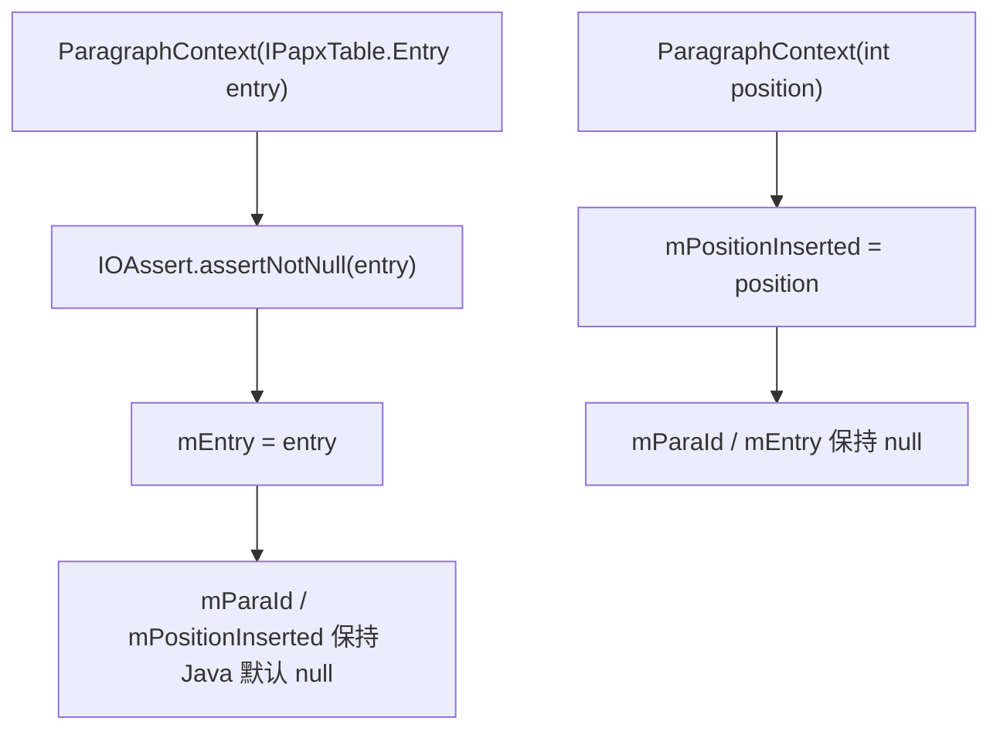

# 01_function_paragraph_context — 拆分理由 / 当前代码现状 / 实现级分析

## 0. 结论（先读这个）

- **本 function 自身 src 未实现**：`libs/word-core/src/.../reader/helper/ParagraphContext.rs` 不存在（`rs_exists=no`）。
- **已实现的上游依赖**：`IPapxTable::Entry`（wc-01）、`IOAssert`（util base）。
- **硬缺口**：无——本 function 是纯数据载体，只要把 Java 19 行直译成 struct + 两个构造即可。
- **下一步**：`loop 01_function_paragraph_context` → L5 建模板、实现两个构造，L2 写镜像测试。

## 1. 为什么拆成这个 function（I/O 边界）

`ParagraphContext` 是 03/04 两个 function 共享的**最小会话状态**，输入是「段首 CP」或「已有 PAPX Entry」，输出是三个字段。它没有 rope/表/文档副作用，是唯一可以完全不构造 `SubDocument` 就测的叶子。把它单独拆出来，03 的 PAPX@cp0 不变量才能先钉死。

再往下拆没有意义：三字段中任何单独一个都不构成独立 I/O。

## 2. 当前代码现状

### 2.1 Java 现状（完整 19 行）

```java
// koffice/writer/core/.../reader/helper/ParagraphContext.java
public final class ParagraphContext {
   public Integer mPositionInserted;   // 段首 CP
   public String  mParaId;             // w:paraId → prop 282
   public IPapxTable.Entry mEntry;     // 段末 PAPX Entry

   public ParagraphContext(int position) {           // :11–13
      this.mPositionInserted = position;
   }

   public ParagraphContext(IPapxTable.Entry entry) { // :15–18
      IOAssert.assertNotNull("entry should not be null!", entry);
      this.mEntry = entry;
   }
}
```

### 2.2 Rust 本 function src 现状

`libs/word-core/src/cn/wps/moffice/writer/io/reader/helper/ParagraphContext.rs`：**不存在**。
`reader/helper/mod.rs` 现在只有：

```rust
pub mod Border;
pub mod IOHelper;
pub mod Shapes2Core;
```

loop L5 需加 `pub mod ParagraphContext;`。

### 2.3 上游依赖 Rust 现状

`IPapxTable::Entry`（已实现，wc-01）：

```rust
// libs/word-core/src/cn/wps/moffice/writer/data/IPapxTable.rs:37–50
pub trait Entry: ITableEntry {
    fn getPrev(&self) -> Option<Box<dyn Entry>>;
    fn getNext(&self) -> Option<Box<dyn Entry>>;
    fn getProperty(&self) -> Option<&PropertySet>;
    fn setProperty(&mut self, var1: Option<&PropertySet>);
}
```

本 function 只用 `Entry` 作为 `mEntry` 字段类型，不调用其方法，所以没有任何编译风险。

`IOAssert`（已实现，util base assertion）可满足构造②的非空断言。

## 3. 实现级分析

### 3.1 Java → Rust 映射

| Java | Rust 建议（loop 用 type-oracle 定稿） |
|------|--------------------------------------|
| `Integer mPositionInserted`（可 null） | `mPositionInserted: i32` 或 `Option<i32>`；构造①必有值 |
| `String mParaId`（可 null） | `mParaId: Option<String>` |
| `IPapxTable.Entry mEntry`（可 null） | `mEntry: Option<Box<dyn IPapxEntry>>` |
| 构造① `ParagraphContext(int)` | 只设 `mPositionInserted` |
| 构造② `ParagraphContext(Entry)` | 先 `assertNotNull`，再设 `mEntry` |

### 3.2 流程图



### 3.3 关键不变量

1. `mPositionInserted` 必须在构造①之后保持段首 CP，**不得**被「当前 document length」覆盖——否则 03 的 PAPX 挂点错位。
2. 构造②的 `entry==null` 必须红（`IOAssert.assertNotNull`），不能静默接受 null。

### 3.4 失败语义

- 构造②传 null：断言失败（panic/assert error），测试用 `#[should_panic]` 或等价机制钉死。
- 字段初值错误（构造①下 `mParaId`/`mEntry` 非空）：PC4 红。

> 测试方案与用例表见 [FUNCTION.md](./FUNCTION.md) §3。
