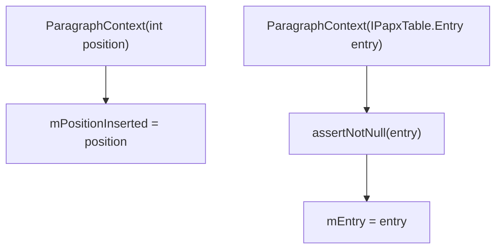

# 01_function_paragraph_context — 段会话三字段

| 项 | 值 |
|----|----|
| feature | wc-04-paragraph-import |
| order | 1 |
| crate | `libs/word-core/Cargo.toml` |
| 入口 | `ParagraphContext(int position)` / `ParagraphContext(IPapxTable.Entry entry)` |
| 独立性 | 叶子（纯数据载体，不碰 rope/CHPX/PAPX/SubDocument） |
| 测试状态 | pass |

## 1. 功能说明

### 1.1 一句话

单个段落导入期间的**会话对象**：在段开始时记住 `document.getLength()` 作为段首 CP，可选记 `paraId`，段结束后记返回的 PAPX Entry。无业务方法。

### 1.2 输入

| 构造 | 输入 | Java 路径 |
|------|------|-----------|
| 构造① | `position: int`（= `importParagraphStart` 时 `mDocument.getLength()`） | ParagraphContext.java:11–13 |
| 构造② | `entry: IPapxTable.Entry`（「从已有段继续」，MVP 可 defer 但签名必须保留） | :15–18 |

### 1.3 输出

| 字段 | Java 类型 | 含义 |
|------|-----------|------|
| `mPositionInserted` | `Integer`（可 null） | 段首 CP；**PAPX insert 的唯一合法 cp 来源** |
| `mParaId` | `String`（可 null） | OOXML `w:paraId` → prop **282** |
| `mEntry` | `IPapxTable.Entry`（可 null） | 段末 `appendParagraph` 返回的 PAPX Entry；表格路径会 reset |

Rust 表示在 loop 用 type-oracle 钉死（`Option<String>` / `Option<Box<dyn IPapxEntry>>` 等）；本 function 不发明第二套类型名。

### 1.4 上游

无。由 `SubDocumentImporter.importParagraphStart`（03）用构造①创建；表格「继续段」用构造②（04 可 defer）。

### 1.5 下游

- 03 `importParagraphEnd`：读 `mPositionInserted`/`mParaId`，写 `mEntry`。
- 04 `importTableCellStartSimple`：只清 `mEntry`，**不清** `mPositionInserted`。

### 1.7 依赖与实现状态（必写，着重）

| 依赖 | 归属 | 本 function 需要的接口 | 已实现 | 暂缓（保留 Java 注释+签名） | 禁止本 function 去改 |
|------|------|------------------------|--------|-----------------------------|----------------------|
| `IPapxTable.Entry`（Rust `IPapxEntry`） | word-core data | 仅作 `mEntry` 字段类型引用；本 function 不调用其方法 | **已实现**（wc-01 `IPapxTable::Entry` trait） | 其 get/set/endCp 全部方法 | 不去改 IPapxTable/Entry |
| `IOAssert` | util base assertion | 构造② `assertNotNull("entry should not be null!", entry)` | **已实现**（`util::base::assertion::IOAssert`） | — | 不去改 IOAssert |

## 2. 核心代码与流程

Java：`koffice/writer/core/cn/wps/moffice/writer/io/reader/helper/ParagraphContext.java`（全文件 19 行）  
Rust：`libs/word-core/src/cn/wps/moffice/writer/io/reader/helper/ParagraphContext.rs`（loop 新建）



**关键不变量**：`mPositionInserted` 在构造①之后**不得**被「当前 document length」覆盖；它必须保持段首 CP，直到 03 用它做 PAPX insert。

## 3. 测试方案

### 3.1 代码审计与测试面

| symbol | Java/Rust 路径 | 输入/状态 | 输出/副作用 | 关键分支/错误 |
|--------|----------------|-----------|-------------|---------------|
| 构造① | ParagraphContext.java:11–13 | `position=cp0` | `mPositionInserted=cp0`；`mParaId`/`mEntry` 保持 Java 默认 null | 无分支 |
| 构造② | :15–18 | `entry` | `mEntry=entry` | `entry==null` → IOAssert 红 |
| 字段语义 | 全类 | — | 三个 pub 字段可读 | 构造①下 `mParaId`/`mEntry` 应为 null/`None` |

### 3.2 覆盖矩阵

| coverage_id | 接口/代码路径 | 场景类别 | 必测? | test_id / 未覆盖理由 |
|-------------|---------------|----------|-------|----------------------|
| PC-CTOR1 | 构造①记录段首 CP | 主路径 | 是 | PC1 |
| PC-CTOR2 | 构造②记录已有 Entry | 主路径 | 是 | PC2 |
| PC-NULL-ENTRY | 构造② null entry → 断言 | 失败 | 是 | PC3 |
| PC-FIELDS | 构造①下 mParaId/mEntry 初值 | 边界 | 是 | PC4 |
| PC-CP-STABLE | mPositionInserted 构造后不变 | 状态 | 是 | PC5 |

### 3.3 可测试性

不构造 `SubDocumentImporter` / 不打开 docx。测试只 new struct 与读字段。构造②的 null 断言用 `#[should_panic]`（或等价 assert 错误）验证——具体 panic 语义以 Rust `IOAssert` 为准。

### 3.4 用例表

| id | 覆盖项 | 前置状态 | 输入摘要 | 期望输出/副作用 | 失败语义 |
|----|--------|----------|----------|-----------------|----------|
| PC1 | PC-CTOR1 | — | `ParagraphContext(0)` | `mPositionInserted==0` | 段首 CP 记错 |
| PC2 | PC-CTOR2 | 已有一个 `IPapxEntry` | `ParagraphContext(entry)` | `mEntry==Some(entry)` | 构造②路径缺失 |
| PC3 | PC-NULL-ENTRY | — | `ParagraphContext(null)` | 断言失败/panic | 未拒绝 null |
| PC4 | PC-FIELDS | PC1 | 读 `mParaId`/`mEntry` | `None`/`None`（Java null） | 初值错误 |
| PC5 | PC-CP-STABLE | `ParagraphContext(42)` | 反复读 `mPositionInserted` | 始终 `42` | 被误改写为当前 length |

### 3.5 测试代码位置

crate: `libs/word-core/Cargo.toml`  
src:   `libs/word-core/src/cn/wps/moffice/writer/io/reader/helper/ParagraphContext.rs`  
test:  `libs/word-core/tests/cn/wps/moffice/writer/io/reader/helper/ParagraphContext.rs`

Split 阶段不落 `[[test]]`（src 未生成）；loop L2 已落地镜像测试并在 `Cargo.toml` 加 `[[test]]`（`name = "01_function_paragraph_context"`）。

### 3.6 测试运行脚本

```bash
cargo test --manifest-path libs/word-core/Cargo.toml --test 01_function_paragraph_context

bash .cursor/skills/feature-function/scripts/function-coverage.sh \
  --crate libs/word-core --test 01_function_paragraph_context \
  --src src/cn/wps/moffice/writer/io/reader/helper/ParagraphContext.rs \
  --report libs/word-core/parser/features/wc-04-paragraph-import/functions/01_function_paragraph_context/FUNCTION.md
```

### 3.7 覆盖率报告

<!-- coverage-report:begin -->
tool: cargo-llvm-cov (`cargo llvm-cov --test 01_function_paragraph_context --json`)
date: 2026-08-20 20:13

| src | lines covered | line % | regions covered | region % |
|-----|---------------|--------|-----------------|----------|
| `src/cn/wps/moffice/writer/io/reader/helper/ParagraphContext.rs` | 8/8 | 100.0% | 13/13 | 100.0% |
| **function total** | **8/8** | **100.0%** |  |  |
<!-- coverage-report:end -->

### 3.8 模板布局校验（必跑，PASS 才能标 pass）

```bash
node .cursor/skills/function-java2rust/scripts/check-template-layout.mjs \
  --rs libs/word-core/src/cn/wps/moffice/writer/io/reader/helper/ParagraphContext.rs \
  --java koffice/writer/core/cn/wps/moffice/writer/io/reader/helper/ParagraphContext.java
```

校验：`// java` 行数不降；两个构造的 `// java` 注释与 Rust 签名相邻；无对应 Rust 语句处标 `// rust: no-stmt`，禁止 dummy `let X = ()`。

Loop L5b（2026-08-20）：**PASS** — `java comments preserved and aligned`（13 `// java` 行，`check-template-layout.mjs` 与 `check-function-layout.mjs` 均 PASS）。
