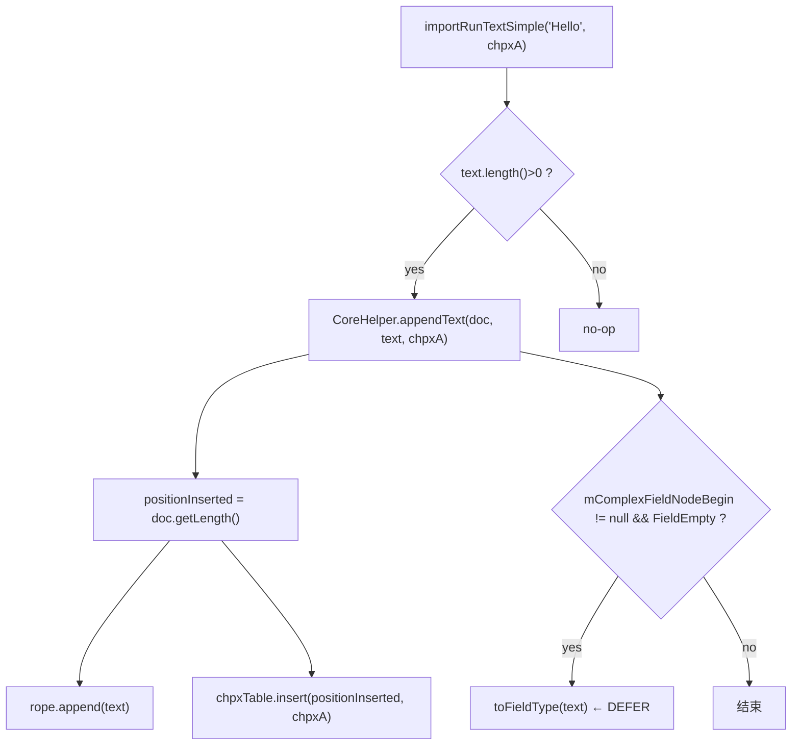

# 02_function_run_text — 拆分理由 / 当前代码现状 / 实现级分析

## 0. 结论（先读这个）

- **本 function 自身 src 未实现**：`SubDocumentImporter.rs` 不存在，`importer/document/` 目录不存在。
- **已实现的上游依赖**：`CoreHelper.appendText__string_ps / appendText__chararr_int_int_ps / appendText__char_ps`、`SubDocument::getLength/getTextRope/getChpxTable`、`PropertySet`、wc-03 `RunPropsConverterSimple`。
- **硬缺口**：`SubDocumentImporterUtils.toFieldType` 与 `KFieldType.FieldEmpty` 未改写——`importRunText` 的复杂域猜类型分支 defer。
- **下一步**：loop L5 建 `SubDocumentImporter.rs` 模板，只实现本 function 列出的 Run 方法。

## 1. 为什么拆成这个 function（I/O 边界）

Run 文本是段落热路径里的**独立 I/O 事件**：输入 `text/buffer + runProps`，输出 rope 字符 + CHPX@run 首 CP。它与 Start/End 没有数据依赖（`CoreHelper.appendText` 只读 `document.getLength()`，不读 `mCurrentParagraph`），可以单独断言「CHPX 挂在 append 前 length」，这是 wc-01 `appendText` 的 importer 级复验点。

## 2. 当前代码现状

### 2.1 Java 现状

`SubDocumentImporter.java` 的 Run 方法族：

```java
// :151–162
public void importRunText(String runText, PropertySet runProps) {
   IOAssert.assertNotNull("runText should not be null", runText);
   IOAssert.assertNotNull("runProps should not be null", runProps);
   if (runText.length() > 0) {
      CoreHelper.appendText(this.mDocument, runText, runProps);
   }
   if (null != this.mComplexFieldNodeBegin && KFieldType.FieldEmpty.getFlt() == this.mComplexFieldNodeBegin.mData) {
      this.mComplexFieldNodeBegin.mData = SubDocumentImporterUtils.toFieldType(runText);
   }
}

// :420–428
public void importRunTextSimple(char[] buffer, int start, int len, PropertySet runProps) {
   if (len > 0) {
      CoreHelper.appendText(this.mDocument, buffer, start, start + len, runProps);
   }
   // 同上 FieldEmpty 分支
}

// :296–301
public void importSpecialChar(MutablePropertySet dst, char speChar) {
   if (null == dst) dst = new MutablePropertySet();
   dst.setBoolean(28, true);
   CoreHelper.appendText(this.mDocument, speChar, dst.freeze());
}
```

### 2.2 Rust 本 function src 现状

`libs/word-core/src/.../docxReader/importer/document/` 目录不存在；`importer/mod.rs` 无 `pub mod document;`。

### 2.3 上游依赖 Rust 现状（已实现，可直接调用）

`SubDocument` 的读入口：

```rust
// SubDocument.rs:979–984
pub fn getLength(&self) -> i32 {
   match self.mNotifyTextRope.as_ref() {
      Some(notify) => ITextRope::length(notify),
      None => 0,
   }
}
// SubDocument.rs:851–858
pub fn getTextRope(&self) -> Option<*mut dyn ITextRope> { ... }
// SubDocument.rs:860–862
pub fn getChpxTable(&self) -> Option<&dyn IChpxTable> { self.mChpxTable.as_deref() }
```

`CoreHelper.appendText__string_ps`（wc-01，已实现）：

```rust
// CoreHelper.rs:117–155（节选）
pub fn appendText__string_ps(document, text, props) -> i32 {
   match document {
      Some(d) => Self::appendText__string_ps_doc(d, text, props),
      None => 0,
   }
}
fn appendText__string_ps_doc(document, text, props) -> i32 {
   Assert::assertNotNull_msg("text should not be null", &text);
   let nonempty = text.map(|t| !t.is_empty()).unwrap_or(false);
   Assert::assertTrue_msg("text.length() > 0 should be true!", nonempty);
   // ...
   let positionInserted: i32 = document.getLength();   // ★ CHPX 挂点 = append 前 length
   // textRope.append(...)
   // IChpxTable::insert(&mut *t, positionInserted, props)
   positionInserted
}
```

## 3. 实现级分析

### 3.1 数据流



### 3.2 关键不变量

1. **空串 no-op**：Java 先判 `len>0`，所以 importer 级不触发 `CoreHelper` 的 `text.length()>0` 断言。Rust 实现必须保留这个前置判断，否则 RT2 会红。
2. **CHPX CP = run 首字符 CP**：由 `CoreHelper` 内部 `document.getLength()` 决定，importer 不传 CP。
3. **`importSpecialChar` 必须写 prop 28=true**：dst 可 null，null 时新建 `MutablePropertySet`。

### 3.3 依赖实现状态缺口

- `mComplexFieldNodeBegin` / `SubDocumentImporterUtils.toFieldType` / `KFieldType.FieldEmpty`：**未改写**。本 function 的 FieldEmpty 分支按 skill 规则停车（`todo!("DEFERRED_NON_FUNCTION")` + `/** DEFERRED_NON_FUNCTION … **/`），MVP 不测。
- `importCharacterRunSymbolSimple` 依赖 wc-03 `RunPropsConverterSimple.convertSymbolProp`（已 pass），符号路径可测 RT9。

### 3.4 失败语义

- 空串不应表现为「没写 CHPX」——应为 no-op 且 rope/CHPX 都不变。
- runProps null：`CoreHelper` 的 `assertNotNull("props")` 红。

> 测试方案与用例表见 [FUNCTION.md](./FUNCTION.md) §3。
