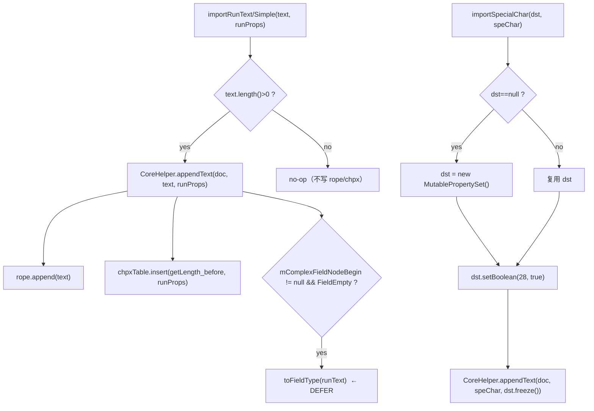

# 02_function_run_text — run 文本落 rope+CHPX

| 项 | 值 |
|----|----|
| feature | wc-04-paragraph-import |
| order | 2 |
| crate | `libs/word-core/Cargo.toml` |
| 入口 | `SubDocumentImporter::{importRunText(String,PropertySet), importRunTextSimple(String,PropertySet), importRunTextSimple(char[],int,int,PropertySet), importSpecialChar(MutablePropertySet,char), importRunText4InlineChart(String,MutablePropertySet), importCharacterRunSymbolSimple(Attributes,MutablePropertySet,RunPropsConverterSimple)}` |
| 独立性 | 依赖 CoreHelper.appendText（wc-01 done）+ `dyn Document`（rope/chpx 可读）；不碰 PAPX |
| 测试状态 | pass |

## 1. 功能说明

### 1.1 一句话

把 XWPF 抛出的 run 文本/特殊字符按 Java 调用点写入 `SubDocument` 的 rope，并在 **append 前 length** 处插 CHPX（由 `CoreHelper.appendText` 内部完成）。

### 1.2 输入

| 入口 | 输入 | Java 路径 |
|------|------|-----------|
| `importRunText` | `runText: String` + `runProps: PropertySet`（均非空断言） | SubDocumentImporter.java:151–162 |
| `importRunTextSimple(String)` | 同上 | :430–441 |
| `importRunTextSimple(char[])` | `buffer: char[]` + `start:int` + `len:int` + `runProps` | :420–428 |
| `importSpecialChar` | `dst: MutablePropertySet`（可 null→new）+ `speChar: char` | :296–301 |
| `importRunText4InlineChart` | `runText` + `runProps: MutablePropertySet`（拷贝后 freeze 调 importRunText） | :145–149 |
| `importCharacterRunSymbolSimple` | `attributes` + `runProps` + `RunPropsConverterSimple`（convertSymbolProp 后写 `"("`） | :558–568 |

### 1.3 输出

| 输出 | 语义 |
|------|------|
| rope 字符 | 文本追加到 `document.getTextRope()` |
| CHPX | `chpxTable.insert(positionInserted, props)`，`positionInserted = append 前 getLength()` |
| 返回 | `importRunText/Simple/SpecialChar` 均 void；特殊字符入口给 `dst` 加 prop **28=true** |

### 1.4 上游

- wave0 `PropertySet`：已 freeze 的 runProps。
- wc-01 `CoreHelper.appendText__string_ps` / `appendText__chararr_int_int_ps` / `appendText__char_ps`。
- wc-03 `RunPropsConverterSimple.convertSymbolProp`（仅 `importCharacterRunSymbolSimple`）。

### 1.5 下游

- 03 `importParagraphEnd`：段末 `\r` 前的字符即本 function 写出的 rope。
- feature-output：rope/CHPX 最终形态。

### 1.7 依赖与实现状态（必写，着重）

| 依赖 | 归属 | 本 function 需要的接口 | 已实现 | 暂缓（保留 Java 注释+签名） | 禁止本 function 去改 |
|------|------|------------------------|--------|-----------------------------|----------------------|
| `CoreHelper.appendText*` | word-core helper | `appendText__string_ps` / `appendText__chararr_int_int_ps` / `appendText__char_ps` | **已实现**（wc-01 pass） | — | 不重写 CoreHelper |
| `SubDocument`（经 `dyn Document`） | word-core core | `getLength/getTextRope/getChpxTable` | **已实现** | — | 不去改 SubDocument |
| `PropertySet` / `MutablePropertySet` | util | `freeze/setBoolean/contains` | **已实现**（wave0） | — | 不去改 PropertySet |
| `RunPropsConverterSimple.convertSymbolProp` | word-core（wc-03） | 符号→run 桶 | **已实现**（wc-03 pass） | — | 不去改 converter |
| `SubDocumentImporterUtils.toFieldType` | word-core | 复杂域 FieldEmpty 时猜类型 | **未改写** | 本 function 的 `mComplexFieldNodeBegin` 分支 defer（`todo!("DEFERRED_NON_FUNCTION")`） | 不实现 toFieldType |
| `KFieldType.FieldEmpty` | word-core data field | `getFlt()` | **未改写** | 同上 defer | 不实现 KFieldType |

## 2. 核心代码与流程

Java：`SubDocumentImporter.java:145–162 / 296–301 / 420–441 / 558–568`  
Rust：`libs/word-core/src/.../docxReader/importer/document/SubDocumentImporter.rs`（loop 新建）



**关键点**：`importRunText` 先判 `len>0` 再调 `appendText`，所以空串在 importer 级是 no-op，不会触发 `CoreHelper` 的 `text.length()>0` 断言。CHPX insert CP 由 `CoreHelper` 用 append 前 `getLength()` 决定，importer 不传 CP。

## 3. 测试方案

### 3.1 代码审计与测试面

| symbol | Java/Rust 路径 | 输入/状态 | 输出/副作用 | 关键分支/错误 |
|--------|----------------|-----------|-------------|---------------|
| `importRunText` | :151–162 | String+props | rope append + CHPX@append前length | 空串 no-op；非空断言 |
| `importRunTextSimple(String)` | :430–441 | 同上 | 同上 | 同上 |
| `importRunTextSimple(char[])` | :420–428 | buffer+start+len | rope append 指定区间 + CHPX | `len>0` 才写 |
| `importSpecialChar` | :296–301 | dst 可 null + char | `dst.setBoolean(28,true)` + appendText | dst null→new |
| `importRunText4InlineChart` | :145–149 | runText + Mutable runProps | 拷贝 props → freeze → importRunText | props 拷贝不共享 |
| `importCharacterRunSymbolSimple` | :558–568 | attrs+props+converter | convertSymbolProp + 写 `"("` | 依赖 wc-03 符号转换 |

### 3.2 覆盖矩阵

| coverage_id | 接口/代码路径 | 场景类别 | 必测? | test_id / 未覆盖理由 |
|-------------|---------------|----------|-------|----------------------|
| RT-STRING | String 主路径写 rope+CHPX | 主路径 | 是 | RT1 |
| RT-EMPTY | 空串 no-op | 边界 | 是 | RT2 |
| RT-BUFFER | char[] 重载写指定区间 | 主路径 | 是 | RT3 |
| RT-BUFFER-EMPTY | char[] len=0 no-op | 边界 | 是 | RT4 |
| RT-CHPX-CP | CHPX insert CP = append 前 length | 主路径 | 是 | RT5 |
| RT-SPECIAL | importSpecialChar 写 28=true | 主路径 | 是 | RT6 |
| RT-SPECIAL-NULL | dst null → new | 分支 | 是 | RT7 |
| RT-INLINE-CHART | 拷贝 props 不共享原桶 | 分支 | 是 | RT8 |
| RT-SYMBOL | 符号 run 写 `"("` | 主路径 | 是 | RT9（wc-03 convertSymbolProp 可用） |

### 3.3 可测试性

不打开 docx。fixture 用最小 `dyn Document`（rope+chpx 可读；可复用 wc-01 的 Document 缝）。`ParagraphSimple` 不参与。`importCharacterRunSymbolSimple` 需要一个真实 `RunPropsConverterSimple`（wc-03 已导出）与假 `Attributes`。

### 3.4 用例表

| id | 覆盖项 | 前置状态 | 输入摘要 | 期望输出/副作用 | 失败语义 |
|----|--------|----------|----------|-----------------|----------|
| RT1 | RT-STRING | 空 doc | `importRunText("Hello", chpxA)` | rope=`Hello`；length=5；CHPX@0 | 文本或 CHPX 未落 |
| RT2 | RT-EMPTY | 空 doc | `importRunText("", chpx)` | rope 空；length=0；无 CHPX | 空串被误写/断言红 |
| RT3 | RT-BUFFER | 空 doc | buffer=`['a','b','c']`, start=1, len=2 | rope=`bc`；CHPX@0 | char[] 区间错 |
| RT4 | RT-BUFFER-EMPTY | 空 doc | len=0 | rope 空；无 CHPX | 空区间被写 |
| RT5 | RT-CHPX-CP | 已有 rope=5 | `importRunText("bold", chpxB)` | CHPX@5；length=9 | CHPX 挂在段末而非 run 首 |
| RT6 | RT-SPECIAL | 空 doc + 已有 dst | `importSpecialChar(dst, '\u0005')` | dst.getBoolean(28)==true；rope=批注引用 | 特殊字符 prop 未写 |
| RT7 | RT-SPECIAL-NULL | 空 doc | `importSpecialChar(null, '\u0005')` | 不 panic；新建 dst 并写 28 | null dst 崩溃 |
| RT8 | RT-INLINE-CHART | 原 runProps 有 prop X | `importRunText4InlineChart("t", src)` | rope=`t`；原 src 未被 freeze 改变 | 拷贝共享/原桶被冻 |
| RT9 | RT-SYMBOL | wc-03 converter | symbol attrs | rope=`(`；props 经 convertSymbolProp | 符号路径未接线 |

### 3.5 测试代码位置

crate: `libs/word-core/Cargo.toml`  
src:   `libs/word-core/src/cn/wps/moffice/writer/io/reader/docxReader/importer/document/SubDocumentImporter.rs`  
test:  `libs/word-core/tests/cn/wps/moffice/writer/io/reader/docxReader/importer/document/SubDocumentImporter.rs`

Split 阶段不落 `[[test]]`（src 未生成）；loop L2 已落地镜像测试并在 `Cargo.toml` 加 `[[test]]`（`name = "02_function_run_text"`）。

### 3.6 测试运行脚本

```bash
cargo test --manifest-path libs/word-core/Cargo.toml --test 02_function_run_text

bash .cursor/skills/feature-function/scripts/function-coverage.sh \
  --crate libs/word-core --test 02_function_run_text \
  --src src/cn/wps/moffice/writer/io/reader/docxReader/importer/document/SubDocumentImporter.rs \
  --report libs/word-core/parser/features/wc-04-paragraph-import/functions/02_function_run_text/FUNCTION.md
```

### 3.7 覆盖率报告

<!-- coverage-report:begin -->
tool: cargo-llvm-cov (`cargo llvm-cov --test 02_function_run_text --json`)
date: 2026-08-21 10:26

| src | lines covered | line % | regions covered | region % |
|-----|---------------|--------|-----------------|----------|
| `src/cn/wps/moffice/writer/io/reader/docxReader/importer/document/SubDocumentImporter.rs` | 43/241 | 17.8% | 99/353 | 28.0% |
| **function total** | **43/241** | **17.8%** |  |  |
<!-- coverage-report:end -->

### 3.8 模板布局校验（必跑，PASS 才能标 pass）

```bash
node .cursor/skills/function-java2rust/scripts/check-template-layout.mjs \
  --rs libs/word-core/src/cn/wps/moffice/writer/io/reader/docxReader/importer/document/SubDocumentImporter.rs \
  --java koffice/writer/core/cn/wps/moffice/writer/io/reader/docxReader/importer/document/SubDocumentImporter.java
```

校验：本 function 改写列表外的 `mComplexFieldNodeBegin` 分支 `todo!("DEFERRED_NON_FUNCTION")` + `/** DEFERRED_NON_FUNCTION … **/` 停车原模版体；`// java` 注释不删、不错位；无对应 Rust 语句只标 `// rust: no-stmt`。

Loop L5b（2026-08-21）：**PASS** — `java comments preserved and aligned`（472 `// java` 行）。
