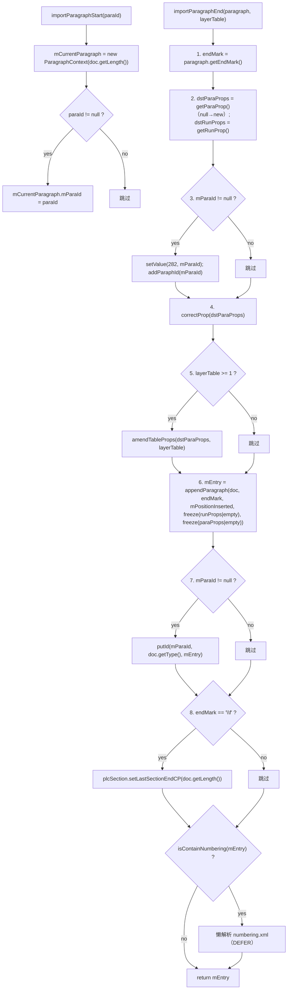

# 03_function_paragraph_end — Start+End 段落生命周期

| 项 | 值 |
|----|----|
| feature | wc-04-paragraph-import |
| order | 3 |
| crate | `libs/word-core/Cargo.toml` |
| 入口 | `SubDocumentImporter::{importParagraphStart(String), importParagraphEnd(ParagraphSimple,int), isContainNumbering(IPapxTable.Entry), resetParagraph()}` |
| 独立性 | 依赖 01（ParagraphContext）、CoreHelper.appendParagraph、wc-03 correctProp、ImporterHelper.amendTableProps、KParagraphsID、PLCSection |
| 测试状态 | pass |

## 1. 功能说明

### 1.1 一句话

段开始抓 `document.getLength()` 建会话；段结束把 endMark + PAPX 挂在**段首 cp0**（不是段末 length），并完成 paraId / 分节 / 编号探测副作用。

### 1.2 输入

| 入口 | 输入 | Java 路径 |
|------|------|-----------|
| `importParagraphStart` | `paraId: String`（可 null） | SubDocumentImporter.java:92–98 |
| `importParagraphEnd` | `paragraph: ParagraphSimple` + `layerTable: int` | :370–417 |
| `isContainNumbering`（private） | `paraBreak: IPapxTable.Entry`（非空断言） | :100–121 |
| `resetParagraph`（private） | 当前 `mCurrentParagraph` | :451–456 |

### 1.3 输出

| 输出 | 语义 |
|------|------|
| 会话 | `mCurrentParagraph = new ParagraphContext(mDocument.getLength())` |
| paraId | 若非 null：`setValue(282, paraId)` + `addParaphId(paraId)` + End 后 `putId(paraId, type, entry)` |
| rope/CHPX | endMark 字符（`\r` 或 `\f`）经 `CoreHelper.appendParagraph` 写入 |
| PAPX | `mEntry = appendParagraph(..., mPositionInserted, runProps|empty, paraProps|empty)` → PAPX@cp0 |
| 分节锚点 | `endMark=='\f'` → `PLCSection.setLastSectionEndCP(doc.getLength())` |
| 编号探测 | `isContainNumbering(entry)` → 懒解析 numbering.xml（xml07/xml03 分支） |
| 返回 | `IPapxTable.Entry` |

### 1.4 上游

- 01 `ParagraphContext`：Start 建会话、End 读 cp0。
- wc-01 `CoreHelper.appendParagraph__char_int_ps_ps`。
- wc-03 `ParaPropsConverterSimple.correctProp`。
- `ImporterHelper.amendTableProps`（layerTable≥1 时）。
- wc-02 `KParagraphsID.addParaphId/putId`。
- wc-01 `PLCSection.setLastSectionEndCP`。

### 1.5 下游

- 04 表格：复用 `mEntry`/`mPositionInserted`。
- 06 `MainDocumentImporter`：super 调用后做 guard/节 CP 记忆。
- feature-output：段落最终落库形态。

### 1.7 依赖与实现状态（必写，着重）

| 依赖 | 归属 | 本 function 需要的接口 | 已实现 | 暂缓（保留 Java 注释+签名） | 禁止本 function 去改 |
|------|------|------------------------|--------|-----------------------------|----------------------|
| `ParagraphContext` | 本 feature 01 | 构造①；`mPositionInserted/mParaId/mEntry` 读写 | **已实现**（01） | 构造② defer | 不绕过 01 改字段语义 |
| `CoreHelper.appendParagraph__char_int_ps_ps` | word-core helper | endMark + cp0 + chpx + papx → PAPX Entry | **已实现**（wc-01 pass） | — | 不重写 appendParagraph |
| `ParaPropsConverterSimple.correctProp` | word-core（wc-03） | `dst`→缺191写0 + tabs | **已实现**（wc-03 pass） | 4 参修订重载 defer | 不内联 correctProp |
| `ImporterHelper.amendTableProps` | word-core helpers | `layerTable≥1`→setBoolean(223)+setInt(224) | **已实现** | — | 不绕过 amend 直接写 223/224 |
| `KParagraphsID.addParaphId/putId` | wc-02 core | paraId 建档 | **已实现** | — | 不重写 |
| `PLCSection.setLastSectionEndCP` | wc-01 data | `\f` 锚点 | **已实现** | — | 不重写 |
| `ParagraphSimple` | core-libs | `getEndMark/getParaProp/getRunProp/isParseNumbering/parseNumbering` | **部分**：`getParaProp/getRunProp` 返回 `Option<&dyn Any>`（需 downcast） | `parseNumbering` 分支可 defer | 不去改 core-libs 类型 |
| `KStyle.getProperty` | wc-02 core | `isContainNumbering` 的 191→样式链 | **已实现** | — | 不重写 |
| `PropertySet/MutablePropertySet` | util | `setValue(282)/freeze/contains/getInt/getValue` | **已实现** | — | 不重写 |
| `PartInfo/Xml07Context`（编号懒解析） | word-core xml07 | `getPartInfoByContentType/getPartReader/getRawData/haveParsedNumbering` | **未改写** | numbering 懒解析 defer | 不实现 xml07 编号树 |

## 2. 核心代码与流程

Java：`SubDocumentImporter.java:92–121 / 370–417 / 451–456`  
Rust：`libs/word-core/src/.../docxReader/importer/document/SubDocumentImporter.rs`（loop 新建）

`importParagraphEnd` 8 步分解（Java 370–417）：



**PAPX cp 不变量**：第 6 步第二参是 `mCurrentParagraph.mPositionInserted`（Start 时抓取），**不是** `doc.getLength()`。

## 3. 测试方案

### 3.1 代码审计与测试面

| symbol | Java/Rust 路径 | 输入/状态 | 输出/副作用 | 关键分支/错误 |
|--------|----------------|-----------|-------------|---------------|
| `importParagraphStart` | :92–98 | paraId 可 null | 建会话；`mParaId` 记入 | paraId null 分支 |
| `importParagraphEnd` | :370–417 | paragraph+layerTable | endMark rope + PAPX@cp0 + paraId/PLC | 8 步、\f、编号 |
| `isContainNumbering` | :100–121 | PAPX Entry | boolean | 234/235 直查；191→样式链 |
| `resetParagraph` | :451–456 | mCurrentParagraph | 清 mEntry（保留 mPositionInserted） | mEntry null 时不动 |

### 3.2 覆盖矩阵

| coverage_id | 接口/代码路径 | 场景类别 | 必测? | test_id / 未覆盖理由 |
|-------------|---------------|----------|-------|----------------------|
| PE-CP0 | PAPX insert CP = Start 时 length | 主路径 | 是 | PE1 |
| PE-ENDMARK-R | endMark `\r` 写入 rope+CHPX | 主路径 | 是 | PE2 |
| PE-PARAID | paraId→282+addParaphId+putId | 主路径 | 是 | PE3 |
| PE-NO-PARAID | paraId null 跳过 282/putId | 分支 | 是 | PE4 |
| PE-CORRECT | correctProp 后 191=0（无样式段） | 主路径 | 是 | PE5 |
| PE-TABLE-AMEND | layerTable≥1 → 223/224 | 分支 | 是 | PE6 |
| PE-FORMFEED | endMark `\f` → setLastSectionEndCP(length) | 分支 | 是 | PE7 |
| PE-NUMBERING-DIRECT | PAPX 含 234/235 → true | 分支 | 是 | PE8 |
| PE-NUMBERING-STYLE | 191→样式链 234/235 | 分支 | 是 | PE9 |
| PE-RESET | resetParagraph 只清 mEntry | 状态 | 是 | PE10 |
| PE-NULL-PARA | paragraph null 断言 | 失败 | 是 | PE11 |

### 3.3 可测试性

不打开 docx。fixture：内存 `dyn Document`（rope/chpx/papx/plcsection 可读）+ 假 `ParagraphSimple`（固定 `getEndMark/getParaProp/getRunProp`）。`correctProp` 用 wc-03 真实现；`amendTableProps` 在 loop 中先修签名。`parseNumbering` 分支 defer，不进入 MVP 断言。

### 3.4 用例表

| id | 覆盖项 | 前置状态 | 输入摘要 | 期望输出/副作用 | 失败语义 |
|----|--------|----------|----------|-----------------|----------|
| PE1 | PE-CP0 | 先 `importRunText("Hi", chpx)` 至 length=2，再 Start | `importParagraphStart(null)` + End `\r` | PAPX@2（段首 CP），不是段末 | PAPX 错位 |
| PE2 | PE-ENDMARK-R | PE1 | End `\r` | rope 末尾=`\r`；CHPX@段末 CP | 段标未写 |
| PE3 | PE-PARAID | Start(paraId="p1") + End | prop 282=="p1"；putId 被调；返回 entry | paraId 链路缺失 |
| PE4 | PE-NO-PARAID | Start(null) + End | 无 282；无 putId | 误建档 |
| PE5 | PE-CORRECT | 无样式段 props | End | entry.getProperty() 含 191=0 | correctProp 被跳过 |
| PE6 | PE-TABLE-AMEND | layerTable=1 | End | paraProps 含 223=true、224=1 | amend 未调 |
| PE7 | PE-FORMFEED | sectPr 段落 | End `\f` | PLCSection.lastSectionEndCP==length | 分节锚点未记 |
| PE8 | PE-NUMBERING-DIRECT | papx 含 234 | isContainNumbering(entry) | true | 直查分支错 |
| PE9 | PE-NUMBERING-STYLE | papx 含 191→样式含 235 | isContainNumbering | true | 样式链错 |
| PE10 | PE-RESET | 有 entry 且 cp0=5 | resetParagraph | mEntry=None；mPositionInserted 仍 5 | 清错字段 |
| PE11 | PE-NULL-PARA | — | End(null, 0) | 断言失败/panic | 未拒绝 null |

### 3.5 测试代码位置

crate: `libs/word-core/Cargo.toml`  
src:   `libs/word-core/src/cn/wps/moffice/writer/io/reader/docxReader/importer/document/SubDocumentImporter.rs`  
test:  `libs/word-core/tests/cn/wps/moffice/writer/io/reader/docxReader/importer/document/SubDocumentImporterEnd.rs`

crate `[[test]] name = "03_function_paragraph_end"`；path = `tests/.../SubDocumentImporterEnd.rs`。

### 3.6 测试运行脚本

```bash
cargo test --manifest-path libs/word-core/Cargo.toml --test 03_function_paragraph_end

bash .cursor/skills/feature-function/scripts/function-coverage.sh \
  --crate libs/word-core --test 03_function_paragraph_end \
  --src src/cn/wps/moffice/writer/io/reader/docxReader/importer/document/SubDocumentImporter.rs \
  --report libs/word-core/parser/features/wc-04-paragraph-import/functions/03_function_paragraph_end/FUNCTION.md
```

### 3.7 覆盖率报告

<!-- coverage-report:begin -->
tool: cargo-llvm-cov (`cargo llvm-cov --test 03_function_paragraph_end --json`)
date: 2026-08-21 10:39

| src | lines covered | line % | regions covered | region % |
|-----|---------------|--------|-----------------|----------|
| `src/cn/wps/moffice/writer/io/reader/docxReader/importer/document/SubDocumentImporter.rs` | 95/275 | 34.5% | 172/388 | 44.3% |
| **function total** | **95/275** | **34.5%** |  |  |
<!-- coverage-report:end -->

### 3.8 模板布局校验（必跑，PASS 才能标 pass）

```bash
node .cursor/skills/function-java2rust/scripts/check-template-layout.mjs \
  --rs libs/word-core/src/cn/wps/moffice/writer/io/reader/docxReader/importer/document/SubDocumentImporter.rs \
  --java koffice/writer/core/cn/wps/moffice/writer/io/reader/docxReader/importer/document/SubDocumentImporter.java
```

校验：numbering.xml 懒解析分支 `// rust: no-stmt`（不 `todo!`，避免 PAPX 含 234/235 时 End 崩）；其它改写列表外方法 `todo!("DEFERRED_NON_FUNCTION")` + `/** DEFERRED_NON_FUNCTION … **/`；`// java` 注释不删、不错位。

Loop L5b（2026-08-21）：**PASS** — `java comments preserved and aligned`（471 `// java` 行）。
