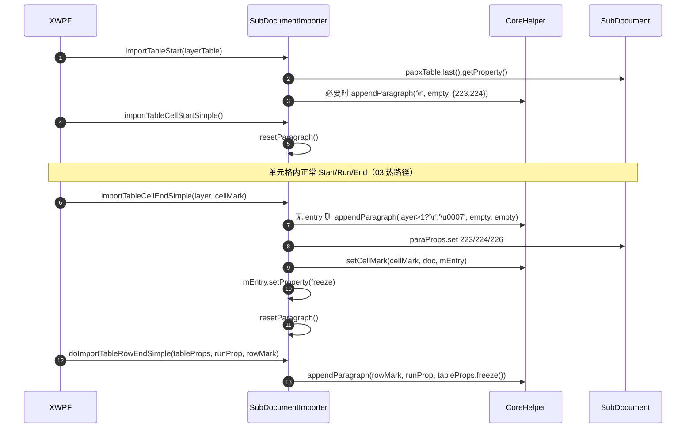

# 04_function_table_cell — 拆分理由 / 当前代码现状 / 实现级分析

## 0. 结论（先读这个）

- **本 function 自身 src 未实现**：`SubDocumentImporter.rs` 不存在。
- **已实现的上游依赖**：`CoreHelper.appendParagraph__char_ps_ps`、`CoreHelper.setCellMark`、`IPapxEntry::getProperty/setProperty`、`MutablePropertySet`、03 的 `resetParagraph`（待 loop）。
- **硬缺口**：无新增；依赖 03 完成 `mCurrentParagraph` 会话与 `resetParagraph`。
- **下一步**：loop L5 实现 4 个表格方法；MVP 次优先，但仍是独立 I/O 单元。

## 1. 为什么拆成这个 function（I/O 边界）

表格是独立回调族：`importTableStart / importTableCellStartSimple / importTableCellEndSimple / doImportTableRowEndSimple`，输入 `layerTable/cellMark/tableProps/rowMark`，输出 PAPX 223/224/226 + cellMark 字节改写。它和段落热路径共享 `mEntry/mPositionInserted`，但输入输出不同，需要单独断言「只清 mEntry、不清 cp0」这一关键不变量，因此拆开。

## 2. 当前代码现状

### 2.1 Java 现状

```java
// SubDocumentImporter.java:123–143（节选）
public void importTableStart(int layerTable) {
   if (null != this.mCurrentParagraph) {
      PropertySet props = this.mDocument.getPapxTable().last().getProperty();
      if (layerTable == props.getInt(224, 0)) {
         PropertySet prop = PropertySet.empty;
         if (layerTable > 1) {
            MutablePropertySet dst = new MutablePropertySet();
            dst.setValue(224, layerTable - 1);
            dst.setBoolean(223, true);
            prop = dst.freeze();
         }
         CoreHelper.appendParagraph(this.mDocument, '\r', PropertySet.empty, prop);
      }
   }
}

// :447–449
public void importTableCellStartSimple() { this.resetParagraph(); }

// :451–456
private void resetParagraph() {
   if (this.mCurrentParagraph != null && this.mCurrentParagraph.mEntry != null) {
      this.mCurrentParagraph.mEntry = null;   // ★ 不清 mPositionInserted
   }
}

// :458–474（节选）
public void importTableCellEndSimple(int layerTable, char cellMark) {
   if (this.mCurrentParagraph != null) {
      if (this.mCurrentParagraph.mEntry == null) {
         this.mCurrentParagraph.mEntry = CoreHelper.appendParagraph(
            this.mDocument, (char)(layerTable > 1 ? '\r' : '\u0007'),
            PropertySet.empty, PropertySet.empty);
      }
      MutablePropertySet paraProps = new MutablePropertySet(this.mCurrentParagraph.mEntry.getProperty());
      paraProps.setBoolean(223, true);
      paraProps.setInt(224, layerTable);
      paraProps.setBoolean(226, true);
      CoreHelper.setCellMark(cellMark, this.mDocument, this.mCurrentParagraph.mEntry);
      this.mCurrentParagraph.mEntry.setProperty(paraProps.freeze());
      this.resetParagraph();
   }
}
```

### 2.2 Rust 本 function src 现状

同 02/03：`SubDocumentImporter.rs` 不存在。

### 2.3 上游依赖 Rust 现状（已实现，可直接调用）

`CoreHelper.setCellMark`（wc-01）：

```rust
// CoreHelper.rs:28–50（节选）
pub fn setCellMark(cellMark, document, entry) {
   let cp = entry.map(|e| e.endCp()).unwrap_or(0) - 1;
   let textTope = document.and_then(|d| d.getTextRope());
   let fc = match textTope { Some(r) => unsafe { (*r).cp2fc(cp) }, _ => 0 };
   let textPool = ...;
   if let Some(tp) = textPool { unsafe { (*tp).set(fc, cellMark) }; }
}
```

`IPapxEntry`（wc-01）：

```rust
// IPapxTable.rs:44–48
fn getProperty(&self) -> Option<&PropertySet>;
fn setProperty(&mut self, var1: Option<&PropertySet>);
```

`CoreHelper.appendParagraph__char_ps_ps`（wc-01，行 53–66）用于补空段/行末（无 cp 重载，PAPX 挂刚写入的 endMark）。

## 3. 实现级分析

### 3.1 数据流 / 时序图



### 3.2 关键不变量

1. `importTableCellStartSimple` 只清 `mEntry`，**不清** `mPositionInserted`——单元格内段落的 PAPX 仍挂段首 CP。
2. `importTableCellEndSimple` 无 entry 时补 `\u0007`（layer==1）或 `\r`（layer>1）。
3. PAPX 必须写 223=true / 224=layer / 226=true，且 `setCellMark` 在 `setProperty` 之前（先改字节再冻结属性）。

### 3.3 失败语义

- 清错字段（TB4）：`mPositionInserted` 被误清 → 后续段落 PAPX 挂点丢失。
- flags 错（TB6）：223/224/226 缺一 → 表格属性错位。

> 测试方案与用例表见 [FUNCTION.md](./FUNCTION.md) §3。
