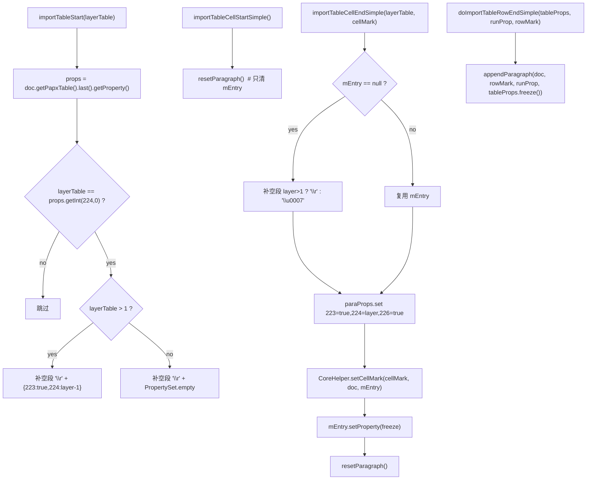

# 04_function_table_cell — 表格 cell/row 落库

| 项 | 值 |
|----|----|
| feature | wc-04-paragraph-import |
| order | 4 |
| crate | `libs/word-core/Cargo.toml` |
| 入口 | `SubDocumentImporter::{importTableStart(int), importTableCellStartSimple(), importTableCellEndSimple(int,char), doImportTableRowEndSimple(MutablePropertySet,PropertySet,char)}` |
| 独立性 | 依赖 03（mCurrentParagraph/mEntry）+ CoreHelper；MVP 次优先 |
| 测试状态 | pass |

## 1. 功能说明

### 1.1 一句话

把表格嵌套层、单元格起止、行结束变成有序的段落落库：空段补齐、PAPX 写 **223/224/226**、`CoreHelper.setCellMark` 改写单元格标记字节、行末写 rowMark。

### 1.2 输入

| 入口 | 输入 | Java 路径 |
|------|------|-----------|
| `importTableStart` | `layerTable: int` | SubDocumentImporter.java:123–143 |
| `importTableCellStartSimple` | 无（用当前 `mCurrentParagraph`） | :447–449 |
| `importTableCellEndSimple` | `layerTable: int` + `cellMark: char` | :458–474 |
| `doImportTableRowEndSimple` | `tableProps: MutablePropertySet` + `runProp: PropertySet` + `rowMark: char` | :443–445 |

### 1.3 输出

| 输出 | 语义 |
|------|------|
| 空段补齐 | `importTableStart`：当前层 == last papx 224 时补 `\r`（layer>1 时 223/224-1，否则 empty） |
| 单元格标记 | `importTableCellEndSimple`：无 entry 则补 `\u0007`(layer==1) 或 `\r`(layer>1)；写 223=true/224=layer/226=true；`setCellMark` |
| 行末 | `doImportTableRowEndSimple`：`appendParagraph(rowMark, runProp, tableProps.freeze())`（PAPX cp=当前 length） |

### 1.4 上游

- 03：`mCurrentParagraph`/`mEntry`（Start/End 生命周期）。
- wc-01 `CoreHelper.appendParagraph` / `setCellMark`。

### 1.5 下游

- feature-output：表格最终落库形态。

### 1.7 依赖与实现状态（必写，着重）

| 依赖 | 归属 | 本 function 需要的接口 | 已实现 | 暂缓（保留 Java 注释+签名） | 禁止本 function 去改 |
|------|------|------------------------|--------|-----------------------------|----------------------|
| `ParagraphContext` | 本 feature 01 | `mEntry` 读/清、`mPositionInserted` 保留 | **已实现**（01） | — | 不清 mPositionInserted |
| `CoreHelper.appendParagraph__char_ps_ps` / `appendParagraph__char_int_ps_ps` | word-core helper | 空段/行末落库 | **已实现**（wc-01 pass） | — | 不重写 |
| `CoreHelper.setCellMark` | word-core helper | cellMark 字节改写 | **已实现**（wc-01 pass） | — | 不重写 |
| `IPapxEntry.getProperty/setProperty` | word-core data | 读改写 PAPX 属性 | **已实现**（wc-01） | — | 不重写 Entry trait |
| `MutablePropertySet.setBoolean/setInt/freeze` | util | 223/224/226 | **已实现**（wave0） | — | 不重写 |

## 2. 核心代码与流程

Java：`SubDocumentImporter.java:123–143 / 443–474`  
Rust：`libs/word-core/src/.../docxReader/importer/document/SubDocumentImporter.rs`（loop 新建）



**关键点**：`resetParagraph`（03 提供）只清 `mEntry`，**不清** `mPositionInserted`——单元格内段落的 PAPX 仍挂在段首 CP。

## 3. 测试方案

### 3.1 代码审计与测试面

| symbol | Java/Rust 路径 | 输入/状态 | 输出/副作用 | 关键分支/错误 |
|--------|----------------|-----------|-------------|---------------|
| `importTableStart` | :123–143 | layerTable | 必要时补空段 | 层相同才补；layer>1 分支 |
| `importTableCellStartSimple` | :447–449 | 无 | 清 mEntry | 不清 mPositionInserted |
| `importTableCellEndSimple` | :458–474 | layer+cellMark | 空段/属性/字节改写 | mEntry null 分支；layer>1 段标 |
| `doImportTableRowEndSimple` | :443–445 | tableProps+runProp+rowMark | 行末段落 | 直接 appendParagraph |

### 3.2 覆盖矩阵

| coverage_id | 接口/代码路径 | 场景类别 | 必测? | test_id / 未覆盖理由 |
|-------------|---------------|----------|-------|----------------------|
| TB-START-SAME | 层相同补空段 | 分支 | 是 | TB1 |
| TB-START-DIFF | 层不同不补 | 分支 | 是 | TB2 |
| TB-START-NESTED | layer>1 补 223/224-1 | 分支 | 是 | TB3 |
| TB-CELL-START | 只清 mEntry | 状态 | 是 | TB4 |
| TB-CELL-END-EMPTY | 无 entry 补 `\u0007`/`\r` | 分支 | 是 | TB5 |
| TB-CELL-FLAGS | 223/224/226 写入 | 主路径 | 是 | TB6 |
| TB-CELL-MARK | setCellMark 字节改写 | 主路径 | 是 | TB7 |
| TB-ROW-END | 行末 appendParagraph | 主路径 | 是 | TB8 |

### 3.3 可测试性

不打开 docx。fixture 用内存 `dyn Document`（papx 可读、textPool 可改），先经 03 建立段会话（Start+End 或直接构造 `ParagraphContext`）。`setCellMark` 的字节改写从 rope/textPool 读回验证。

### 3.4 用例表

| id | 覆盖项 | 前置状态 | 输入摘要 | 期望输出/副作用 | 失败语义 |
|----|--------|----------|----------|-----------------|----------|
| TB1 | TB-START-SAME | last papx 224=1 | `importTableStart(1)` | 补空段 `\r` | 未补 |
| TB2 | TB-START-DIFF | last papx 224=2 | `importTableStart(1)` | 不补 | 误补 |
| TB3 | TB-START-NESTED | last papx 224=2 | `importTableStart(2)` | 补 `\r` + 223=true/224=1 | 嵌套 props 错 |
| TB4 | TB-CELL-START | 有 mEntry、cp0=5 | `importTableCellStartSimple()` | mEntry=None；mPositionInserted 仍 5 | 清错字段 |
| TB5 | TB-CELL-END-EMPTY | 无 mEntry、layer=1 | `importTableCellEndSimple(1,'x')` | 补 `\u0007` 段 | 空段缺失 |
| TB6 | TB-CELL-FLAGS | TB5 | 读 entry 属性 | 223=true、224=1、226=true | flags 错 |
| TB7 | TB-CELL-MARK | TB5 + textPool 可读 | 读 cell 位置字节 | 字节==cellMark | setCellMark 未生效 |
| TB8 | TB-ROW-END | 空 doc | `doImportTableRowEndSimple(tableProps, runProp, '\r')` | rope=`\r`；PAPX=tableProps | 行末未落 |

### 3.5 测试代码位置

crate: `libs/word-core/Cargo.toml`  
src:   `libs/word-core/src/cn/wps/moffice/writer/io/reader/docxReader/importer/document/SubDocumentImporter.rs`  
test:  `libs/word-core/tests/cn/wps/moffice/writer/io/reader/docxReader/importer/document/SubDocumentImporterTable.rs`

crate `[[test]] name = "04_function_table_cell"`；path = `tests/.../SubDocumentImporterTable.rs`。

### 3.6 测试运行脚本

```bash
cargo test --manifest-path libs/word-core/Cargo.toml --test 04_function_table_cell

bash .cursor/skills/feature-function/scripts/function-coverage.sh \
  --crate libs/word-core --test 04_function_table_cell \
  --src src/cn/wps/moffice/writer/io/reader/docxReader/importer/document/SubDocumentImporter.rs \
  --report libs/word-core/parser/features/wc-04-paragraph-import/functions/04_function_table_cell/FUNCTION.md
```

### 3.7 覆盖率报告

<!-- coverage-report:begin -->
tool: cargo-llvm-cov (`cargo llvm-cov --test 04_function_table_cell --json`)
date: 2026-08-21 10:51

| src | lines covered | line % | regions covered | region % |
|-----|---------------|--------|-----------------|----------|
| `src/cn/wps/moffice/writer/io/reader/docxReader/importer/document/SubDocumentImporter.rs` | 146/340 | 42.9% | 274/515 | 53.2% |
| **function total** | **146/340** | **42.9%** |  |  |
<!-- coverage-report:end -->

### 3.8 模板布局校验（必跑，PASS 才能标 pass）

```bash
node .cursor/skills/function-java2rust/scripts/check-template-layout.mjs \
  --rs libs/word-core/src/cn/wps/moffice/writer/io/reader/docxReader/importer/document/SubDocumentImporter.rs \
  --java koffice/writer/core/cn/wps/moffice/writer/io/reader/docxReader/importer/document/SubDocumentImporter.java
```

校验：`// java` 注释不删、不错位；无对应 Rust 语句只标 `// rust: no-stmt`；本 function 改写列表外的方法 `todo!` + `/** DEFERRED_NON_FUNCTION **/` 停车。

Loop L5b（2026-08-21）：**PASS** — `java comments preserved and aligned`（471 `// java` 行）。
