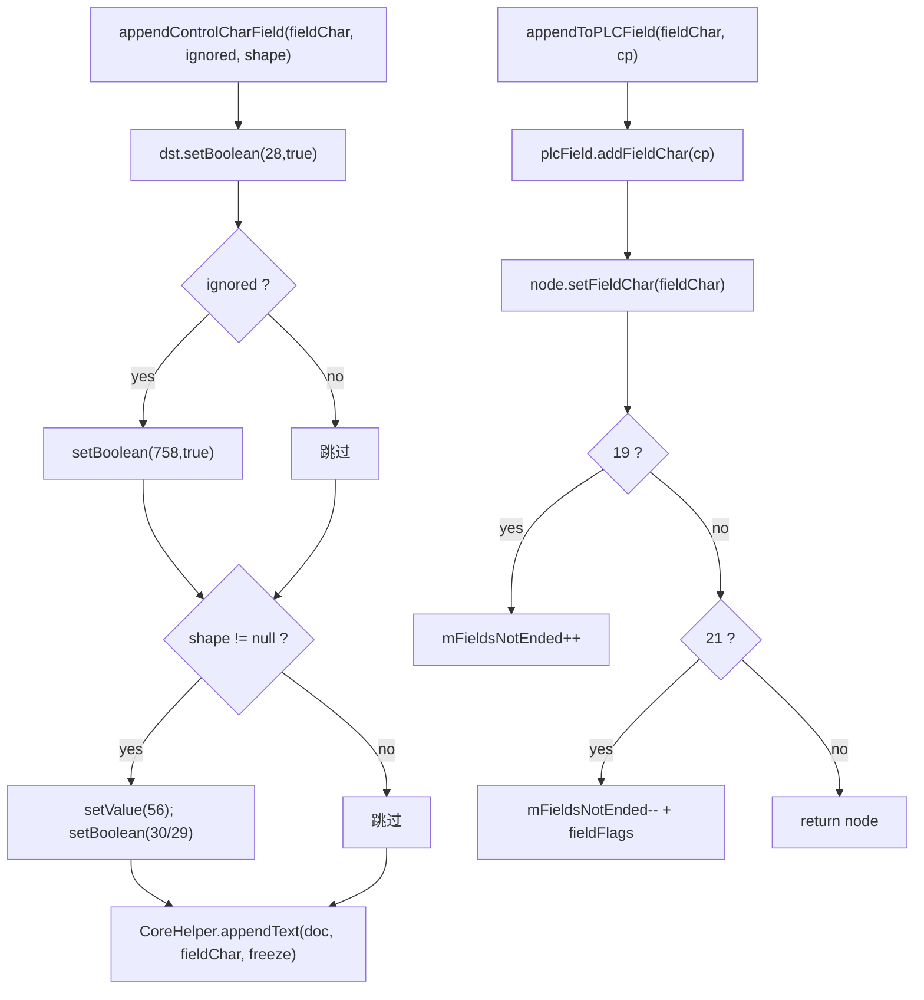

# 05_function_field_control — 拆分理由 / 当前代码现状 / 实现级分析

## 0. 结论（先读这个）

- **本 function 自身 src 未实现**：`SubDocumentImporter.rs` 不存在。
- **已实现的上游依赖**：`CoreHelper.appendText__char_ps`、`PLCField.addFieldChar`（已生成）、`IOListener`。
- **硬缺口**：`SubDocument.writeLock` / `writeLock__int` 是 `todo!("DEFERRED_NON_FUNCTION")`——`lock()` 的建锁路径依赖它；`ImporterHelper.getFldChar`、`SubDocumentImporterUtils.toFieldType`、`RubyPr/RubyContent` 未改写。
- **MVP 定位**：主路径只验 `lock/unlock` 与 28/758 控制字符；PLCField 树遍历与 ruby EQ 族 defer。
- **下一步**：loop L5 实现本 function 方法；若 `writeLock` 仍 todo，则 lock 测试用 `#[ignore = "spec: SubDocument.writeLock"]`。

## 1. 为什么拆成这个 function（I/O 边界）

域 begin/separate/end（19/20/21）是独立 I/O：输入 fieldChar+cp，输出 rope/CHPX + `PLCField` 节点 + `mFieldsNotEnded` 计数。`lock/unlock` 是主文档 guard（06）的输入，也是域状态的一部分。两者放在同一 function 是因为 `mFieldsNotEnded` 由域控制字符维护、由 `fieldsHaveEnded()`（06）消费。

## 2. 当前代码现状

### 2.1 Java 现状

```java
// SubDocumentImporter.java:184–199（节选）
public int appendControlCharField(char fieldChar, boolean isIgnoredField, Shape shape) {
   MutablePropertySet dstRunProp = new MutablePropertySet();
   dstRunProp.setBoolean(28, true);
   if (isIgnoredField) { dstRunProp.setBoolean(758, isIgnoredField); }
   if (null != shape) {
      dstRunProp.setValue(56, shape);
      dstRunProp.setBoolean(30, true);
      dstRunProp.setBoolean(29, true);
   }
   return CoreHelper.appendText(this.mDocument, fieldChar, dstRunProp.freeze());
}

// :201–216（节选）
public PLCField.FieldNode appendToPLCField(char fieldChar, int cpFieldChar) {
   // assert fieldChar ∈ {19,20,21}; assert cpFieldChar >= 0
   PLCField.FieldNode fieldNode = this.mDocument.getPLCField().addFieldChar(cpFieldChar);
   fieldNode.setFieldChar(fieldChar);
   if (19 == fieldChar) { ++this.mFieldsNotEnded; }
   else if (21 == fieldChar) { --this.mFieldsNotEnded; fieldNode.setFieldFlags(this.fieldFlags(fieldNode)); }
   return fieldNode;
}

// :303–324（节选）
void lock() {
   if (null == this.mWriteLock) {
      int len = this.mDocument.getLength();
      this.mWriteLock = this.mDocument.writeLock(len);
      if (0 == len && null != this.mIoListener) { this.mIoListener.onFirstLock(); }
   }
}
public void unlock() {
   if (null != this.mWriteLock) {
      this.mWriteLock.unlock();
      this.mWriteLock = null;
      if (this.mIsFirstUnlock && null != this.mIoListener) {
         this.mIoListener.onFirstUnLock();
         this.mIsFirstUnlock = false;
      }
   }
}
```

### 2.2 Rust 本 function src 现状

同 02/03/04：`SubDocumentImporter.rs` 不存在。

### 2.3 上游依赖 Rust 现状

`PLCField.addFieldChar`（已生成）：

```rust
// PLCField.rs:428–434（节选）
pub fn addFieldChar(&mut self, cp: i32) -> FieldNode { ... }
```

`CoreHelper.appendText__char_ps`（已实现）：

```rust
// CoreHelper.rs:96–106
pub fn appendText__char_ps(document, ch, props) -> i32 {
   match document { Some(d) => Self::appendText__char_ps_doc(d, ch, props), None => 0 }
}
```

**缺口** `SubDocument.writeLock`（本 function `lock()` 的直接依赖）：

```rust
// SubDocument.rs:1258–1266
pub fn writeLock__int(&self, start: i32) -> RangeWriteLock {
   todo!("DEFERRED_NON_FUNCTION");
   // java if (start < 0) throw new IllegalArgumentException();
   // java ... backupAndForbiddenAutoSave ...
   // java return this.getRangeLock().writeLock(start);
}
// SubDocument.rs:1290–1293
pub fn writeLock(&mut self) -> RangeWriteLock { todo!("DEFERRED_NON_FUNCTION"); }
```

这意味着 `lock()` 的「真正建锁」在 loop 里要么先解锁 `SubDocument.writeLock`，要么把建锁调用 defer、只测 `mWriteLock==null` 分支与首次回调。

## 3. 实现级分析

### 3.1 数据流



### 3.2 关键不变量

1. `lock()` 只在 `mWriteLock==null` 时建锁；`unlock()` 无锁 no-op。
2. 首次回调 `onFirstUnLock` 用 `mIsFirstUnlock` 保证只发一次。
3. `appendControlCharField` 三个重载都必须写 28=true。

### 3.3 失败语义

- 重复 lock 建第二把锁（FLD7 红）。
- 无锁 unlock 误回调（FLD9 红）。
- 19/21 计数错（FLD4/FLD5 红）。

> 测试方案与用例表见 [FUNCTION.md](./FUNCTION.md) §3。
