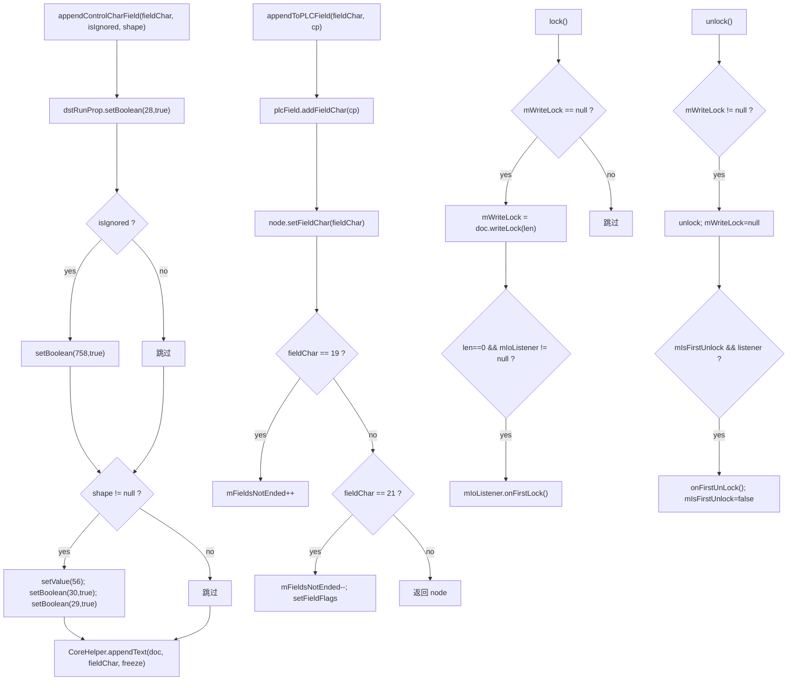

# 05_function_field_control — 域控制字符与写锁

| 项 | 值 |
|----|----|
| feature | wc-04-paragraph-import |
| order | 5 |
| crate | `libs/word-core/Cargo.toml` |
| 入口 | `SubDocumentImporter::{appendControlCharField×3, appendControlCharFieldSimple×3, appendToPLCField, importFldCharSimple, importFldSimpleBeginSimple, importFldSimpleEnd, importHyperlinkBegin/End, lock, unlock}` |
| 独立性 | 依赖 02（appendText）、PLCField（已生成但部分待修）、RangeWriteLock/IOListener（done）；MVP 主路径只验 lock/unlock，域控制字符可浅实现/defer |
| 测试状态 | pass |

## 1. 功能说明

### 1.1 一句话

写域 begin/separate/end 控制字符（19/20/21 → `\u0013/14/15`）到 rope+CHPX 并登记 `PLCField`，维护 `mFieldsNotEnded` 计数；`lock/unlock` 管理写锁与首次回调。

### 1.2 输入

| 入口 | 输入 | Java 路径 |
|------|------|-----------|
| `appendControlCharField×3` | `fieldChar` + `isIgnoredField` + `Shape`（可 null） | SubDocumentImporter.java:176–199 |
| `appendControlCharFieldSimple×3` | `fieldChar` + `srcRunProps: MutablePropertySet` + `isIgnoredField` + `Shape` | :496–518 |
| `appendToPLCField` | `fieldChar`(19/20/21) + `cpFieldChar:int` | :201–216 |
| `importFldCharSimple` | `fldChar: Attributes` + `srcRunProps`（可 null） | :476–494 |
| `importFldSimpleBeginSimple` | `fldSimple: Attributes` | :570–578 |
| `importHyperlinkBegin/End` | `hyperlink: String` / 无 | :164–171 |
| `importFldSimpleEnd` | 无 | :172–174 |
| `lock` / `unlock` | 无（用 `mDocument/mWriteLock/mIoListener`） | :303–324 |

### 1.3 输出

| 输出 | 语义 |
|------|------|
| rope/CHPX | 控制字符写 rope；runProps 含 **28=true**、可选 **758/56/30/29** |
| PLCField | `addFieldChar(cp)` + `setFieldChar(fieldChar)`；19→`mFieldsNotEnded++`；21→`--` + fieldFlags |
| 写锁 | `lock()`：`mWriteLock = document.writeLock(len)`；len==0 且 listener 非空 → `onFirstLock()`；`unlock()`：有锁→unlock 置 null，首次→`onFirstUnLock()` |

### 1.4 上游

- 02 `CoreHelper.appendText`（控制字符也走 appendText）。
- `PLCField`（word-core data，已生成）。
- `RangeWriteLock` / `IOListener`（word-core，done；unlock 为 stub）。

### 1.5 下游

- 06 `fieldsHaveEnded()`（读 `mFieldsNotEnded==0`）与主文档 `lock/unlock` 调用。

### 1.7 依赖与实现状态（必写，着重）

| 依赖 | 归属 | 本 function 需要的接口 | 已实现 | 暂缓（保留 Java 注释+签名） | 禁止本 function 去改 |
|------|------|------------------------|--------|-----------------------------|----------------------|
| `CoreHelper.appendText*` | word-core helper | 控制字符落库 | **已实现**（wc-01 pass） | — | 不重写 |
| `PLCField.addFieldChar/setFieldChar` | word-core data | 域节点登记 | **未导出 compile surface**（`SubDocument` 用空 `PLCField` 占位） | `appendToPLCField` 用 seam `FieldNode` + `mFieldsNotEnded` 计数；树遍历/addFieldChar defer | 不去改 `PLCField.rs` |
| `RangeWriteLock` | word-core data/io | `writeLock(len)` / `unlock()` | **已实现**（`SubDocument.writeLock__int` 走 `RangeLock.writeLock`；`unlock` 为空操作） | `getRangeLock` 仍 defer | 不去改 RangeWriteLock 语义 |
| `IOListener` | word-core core io | `onFirstLock/onFirstUnLock` | **已实现** | — | 不去改 IOListener |
| `ImporterHelper.getFldChar` | word-core helpers | `Attributes`→控制字符 | **未实现** | `importFldCharSimple` 依赖，可 defer | 不实现 getFldChar |
| `ConvertHelper.getBoolean/getString` | word-core（wc-03） | `fldLock/instr` 取值 | **已实现**（wc-03 pass） | — | 不重写 |
| `SubDocumentImporterUtils.toFieldType` / `KFieldType.FieldEmpty` | word-core | 域类型猜测 | **未改写** | FieldEmpty 猜类型分支 defer | 不实现 toFieldType/KFieldType |
| `RubyPr/RubyContent`（ruby EQ 族） | core-libs | EQ 域合成 | **未改写** | `importRuby` + 8 私有辅助全 defer | 不实现 ruby 族 |

## 2. 核心代码与流程

Java：`SubDocumentImporter.java:164–324 / 476–518 / 570–578`  
Rust：`libs/word-core/src/.../docxReader/importer/document/SubDocumentImporter.rs`（loop 新建）



**关键点**：`lock()` 只在 `mWriteLock==null` 时建锁；`unlock()` 在无锁时 no-op。首次回调用 `mIsFirstUnlock` 保证只发一次。

## 3. 测试方案

### 3.1 代码审计与测试面

| symbol | Java/Rust 路径 | 输入/状态 | 输出/副作用 | 关键分支/错误 |
|--------|----------------|-----------|-------------|---------------|
| `appendControlCharField` | :176–199 | fieldChar+isIgnored+shape | 28=true + 可选 758/56/30/29 + appendText | shape null 分支 |
| `appendToPLCField` | :201–216 | 19/20/21 + cp | addFieldChar；计数 | 19/21 分支；非法 cp 断言 |
| `lock` | :303–312 | mWriteLock 状态 | writeLock；首次回调 | 重复 lock no-op |
| `unlock` | :314–324 | mWriteLock 状态 | unlock；首次回调 | 无锁 no-op；mIsFirstUnlock |

### 3.2 覆盖矩阵

| coverage_id | 接口/代码路径 | 场景类别 | 必测? | test_id / 未覆盖理由 |
|-------------|---------------|----------|-------|----------------------|
| FLD-APPEND | 控制字符写 rope+CHPX+28 | 主路径 | 是 | FLD1 |
| FLD-IGNORED | isIgnored→758 | 分支 | 是 | FLD2 |
| FLD-SHAPE | shape→56/30/29 | 分支 | 是 | FLD3 |
| FLD-BEGIN | 19→计数+1 | 主路径 | 是 | FLD4 |
| FLD-END | 21→计数-1 | 主路径 | 是 | FLD5 |
| FLD-LOCK-NEW | 首次 lock 建锁 | 主路径 | 是 | FLD6 |
| FLD-LOCK-REPEAT | 重复 lock no-op | 状态 | 是 | FLD7 |
| FLD-UNLOCK | 有锁 unlock + 首次回调 | 主路径 | 是 | FLD8 |
| FLD-UNLOCK-NONE | 无锁 unlock no-op | 边界 | 是 | FLD9 |
| FLD-CALLBACK | len==0 首次 lock → onFirstLock | 分支 | 是 | FLD10 |

### 3.3 可测试性

不打开 docx。fixture 用内存 `dyn Document`（rope/chpx/plcfield 可读）+ `RecordingIOListener` 记录回调次数。`Shape` 可传 null/`None` 覆盖 null 分支；PLCField 若当前 Rust 未导出则 defer FLD4/FLD5 为 `#[ignore = "spec: PLCField 接线"]`。

### 3.4 用例表

| id | 覆盖项 | 前置状态 | 输入摘要 | 期望输出/副作用 | 失败语义 |
|----|--------|----------|----------|-----------------|----------|
| FLD1 | FLD-APPEND | 空 doc | `appendControlCharField('\u0013', false, None)` | rope=域 begin；CHPX 含 28=true | 控制字符未落 |
| FLD2 | FLD-IGNORED | 空 doc | isIgnored=true | runProps 含 758=true | 758 未写 |
| FLD3 | FLD-SHAPE | 空 doc | shape Some | runProps 含 56/30/29 | shape 分支未写 |
| FLD4 | FLD-BEGIN | 空 doc + PLCField | fieldChar=19 | `mFieldsNotEnded==1` | 计数未增 |
| FLD5 | FLD-END | 计数=1 | fieldChar=21 | `mFieldsNotEnded==0` | 计数未减 |
| FLD6 | FLD-LOCK-NEW | 无锁 | `lock()` | 有锁；无回调（len>0） | 未建锁 |
| FLD7 | FLD-LOCK-REPEAT | 已有锁 | 再 `lock()` | 仍同一把锁 | 重复建锁 |
| FLD8 | FLD-UNLOCK | 有锁 + 首次 | `unlock()` | 锁置 None；onFirstUnLock 1 次 | 未释放/回调缺失 |
| FLD9 | FLD-UNLOCK-NONE | 无锁 | `unlock()` | no-op；无回调 | 空解锁出错 |
| FLD10 | FLD-CALLBACK | 空 doc（len=0）+ listener | `lock()` | onFirstLock 1 次 | 首次回调未发 |

### 3.5 测试代码位置

crate: `libs/word-core/Cargo.toml`  
src:   `libs/word-core/src/cn/wps/moffice/writer/io/reader/docxReader/importer/document/SubDocumentImporter.rs`  
test:  `libs/word-core/tests/cn/wps/moffice/writer/io/reader/docxReader/importer/document/SubDocumentImporterField.rs`

crate `[[test]] name = "05_function_field_control"`；path = `tests/.../SubDocumentImporterField.rs`。

### 3.6 测试运行脚本

```bash
cargo test --manifest-path libs/word-core/Cargo.toml --test 05_function_field_control

bash .cursor/skills/feature-function/scripts/function-coverage.sh \
  --crate libs/word-core --test 05_function_field_control \
  --src src/cn/wps/moffice/writer/io/reader/docxReader/importer/document/SubDocumentImporter.rs \
  --report libs/word-core/parser/features/wc-04-paragraph-import/functions/05_function_field_control/FUNCTION.md
```

### 3.7 覆盖率报告

<!-- coverage-report:begin -->
tool: cargo-llvm-cov (`cargo llvm-cov --test 05_function_field_control --json`)
date: 2026-08-21 11:12

| src | lines covered | line % | regions covered | region % |
|-----|---------------|--------|-----------------|----------|
| `src/cn/wps/moffice/writer/io/reader/docxReader/importer/document/SubDocumentImporter.rs` | 85/429 | 19.8% | 134/660 | 20.3% |
| **function total** | **85/429** | **19.8%** |  |  |
<!-- coverage-report:end -->

### 3.8 模板布局校验（必跑，PASS 才能标 pass）

```bash
node .cursor/skills/function-java2rust/scripts/check-template-layout.mjs \
  --rs libs/word-core/src/cn/wps/moffice/writer/io/reader/docxReader/importer/document/SubDocumentImporter.rs \
  --java koffice/writer/core/cn/wps/moffice/writer/io/reader/docxReader/importer/document/SubDocumentImporter.java
```

校验：`importRuby` + 8 个私有辅助、FieldEmpty 猜类型分支、`importFldCharSimple`/`getFldChar` 等本 function 改写列表外方法 `todo!("DEFERRED_NON_FUNCTION")` + `/** DEFERRED_NON_FUNCTION … **/`；`// java` 注释不删、不错位；无对应 Rust 语句只标 `// rust: no-stmt`。

Loop L5b（2026-08-21）：**PASS** — `java comments preserved and aligned`（471 `// java` 行）。
