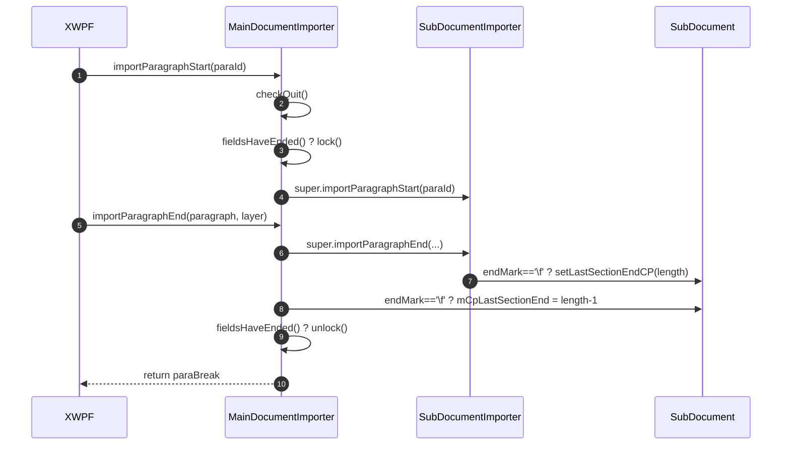

# 06_function_maindoc_guard — 拆分理由 / 当前代码现状 / 实现级分析

## 0. 结论（先读这个）

- **本 function 自身 src 未实现**：`MainDocumentImporter.rs` 不存在。
- **已实现的上游依赖**：`ImporterBase`（mode/isDocx/isXml07/03）、`SubDocument::getLength/getType/getTextDocument`、`IDLProvider`、`ForceQuitException/ReadingLimitException`、03/05 的父类热路径与锁（待 loop）。
- **硬缺口**：`ImporterHelper.getCpSubDocumentEnd`（空 todo 签名）——`\f` 记节 CP 依赖它；`SubDocument.getMainDocument` 也是 todo（但 06 本身不用，07 才用）。
- **下一步**：loop L5 实现 `checkQuit/importParagraphStart/importParagraphEnd/fieldsHaveEnded`，并在 loop 内修 `getCpSubDocumentEnd` 签名。

## 1. 为什么拆成这个 function（I/O 边界）

主文档导入器的护栏（quit 检查、锁、节 CP 记忆）是**段前后包装逻辑**，不产生 rope/PAPX 本身。它输入 `IDLProvider + ParagraphSimple`，输出异常/锁/`mCpLastSectionEnd`。与 07（收到 sectPr 建节）分开，因为 guard 在 Start/End 触发，而建节在 sectPr 事件触发，是两次独立 I/O。

## 2. 当前代码现状

### 2.1 Java 现状

```java
// MainDocumentImporter.java:63–78
public void importParagraphStart(String paraId) throws SAXException {
   this.checkQuit();
   if (this.fieldsHaveEnded()) { this.lock(); }
   super.importParagraphStart(paraId);
}
private void checkQuit() throws SAXException {
   if (null != this.mDlProvider && this.mDlProvider.isOpenForceQuit()) {
      throw new ForceQuitException();
   } else if (null != this.mDlProvider && null != this.mDlProvider.getReadingLimit()
              && this.mDocument.getLength() > this.mDlProvider.getReadingLimit()) {
      throw new ReadingLimitException();
   }
}

// :101–103
public boolean fieldsHaveEnded() { return 0 == this.mFieldsNotEnded; }

// :125–135
public IPapxTable.Entry importParagraphEnd(ParagraphSimple paragraph, int layerTable) {
   IPapxTable.Entry paraBreak = super.importParagraphEnd(paragraph, layerTable);
   if ('\f' == paragraph.getEndMark()) {
      this.mCpLastSectionEnd = ImporterHelper.getCpSubDocumentEnd(this.mDocument);
   }
   if (this.fieldsHaveEnded()) { this.unlock(); }
   return paraBreak;
}
```

### 2.2 Rust 本 function src 现状

`MainDocumentImporter.rs` 不存在；`importer/document/` 目录不存在。

### 2.3 上游依赖 Rust 现状

`ImporterBase`（已实现，wc-03）：

```rust
// ImporterBase.rs:38–79
pub fn mode(&self) -> i32 { self.mMode }
pub fn isDocx(&self) -> bool { 0 == self.mMode }
pub fn isXml07(&self) -> bool { 1 == self.mMode && self.mXml07Cxt.is_some() }
pub fn isXml03(&self) -> bool { 3 == self.mMode && self.mXml03Cxt.is_some() }
```

`SubDocument.getLength`（已实现）：

```rust
// SubDocument.rs:979–984
pub fn getLength(&self) -> i32 {
   match self.mNotifyTextRope.as_ref() {
      Some(notify) => ITextRope::length(notify),
      None => 0,
   }
}
```

**缺口** `ImporterHelper.getCpSubDocumentEnd`：

```rust
// ImporterHelper.rs:67（当前空签名 todo）
pub fn getCpSubDocumentEnd() { todo!("DEFERRED_NON_FUNCTION"); }
```

loop 内必须先改成 `pub fn getCpSubDocumentEnd(doc: &SubDocument) -> i32` 并实现 `doc.getLength() - 1`，否则 GD6 无法测。

## 3. 实现级分析

### 3.1 数据流 / 时序图



### 3.2 关键不变量

1. `checkQuit` 在 `super.importParagraphStart` **之前**；ForceQuit 优先级高于 ReadingLimit。
2. `fieldsHaveEnded()==true` 时 lock/unlock 成对出现（无域文档恒 true）。
3. `mCpLastSectionEnd = getLength()-1`（父类已 `setLastSectionEndCP(length)`）。

### 3.3 失败语义

- 未强制退出（GD1）/ 未超限拦截（GD2）红。
- `\f` 未记节 CP（GD6）→ 07 建节错位。

> 测试方案与用例表见 [FUNCTION.md](./FUNCTION.md) §3。
