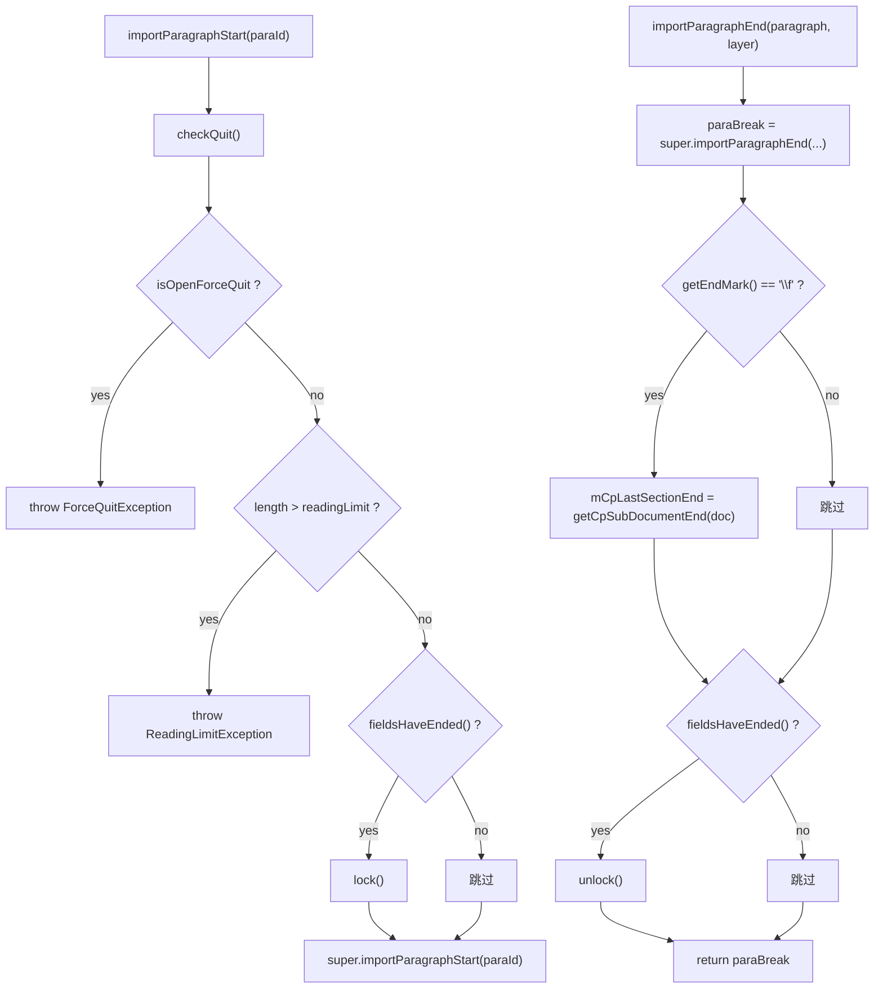

# 06_function_maindoc_guard — 主文档 guard + 节 CP 记忆

| 项 | 值 |
|----|----|
| feature | wc-04-paragraph-import |
| order | 6 |
| crate | `libs/word-core/Cargo.toml` |
| 入口 | `MainDocumentImporter::{ctor, importParagraphStart(override), importParagraphEnd(override), checkQuit(private), fieldsHaveEnded()}` |
| 独立性 | 依赖 03（super Start/End）、05（lock/unlock/fieldsHaveEnded 计数）、ImporterHelper.getCpSubDocumentEnd、IDLProvider |
| 测试状态 | pass |

## 1. 功能说明

### 1.1 一句话

主文档导入的护栏：Start 前 `checkQuit()`（ForceQuit/ReadingLimit），无未闭合域时 `lock()`；End 后若 endMark==`\f` 记 `mCpLastSectionEnd = getLength()-1` 并 `unlock()`。

### 1.2 输入

| 入口 | 输入 | Java 路径 |
|------|------|-----------|
| ctor | `document/styleId2Sti/numIdRedirection/ioListener/dlProvider/initDrawingContainer/mode/xml07/xml03` | MainDocumentImporter.java:42–49 |
| `importParagraphStart` | `paraId: String` | :63–70 |
| `checkQuit`（private） | 无（读 `mDlProvider`/`mDocument.getLength()`） | :72–78 |
| `importParagraphEnd` | `paragraph: ParagraphSimple` + `layerTable: int` | :125–135 |
| `fieldsHaveEnded` | 无（读 `mFieldsNotEnded`） | :101–103 |

### 1.3 输出

| 输出 | 语义 |
|------|------|
| 异常 | `isOpenForceQuit()`→`ForceQuitException`；`length > getReadingLimit()`→`ReadingLimitException` |
| 锁 | `fieldsHaveEnded()==true` → Start 前 `lock()`、End 后 `unlock()` |
| 节 CP | `endMark=='\f'` → `mCpLastSectionEnd = ImporterHelper.getCpSubDocumentEnd(doc)`（=length-1） |
| 委托 | `super.importParagraphStart/End` 完成段落落库 |

### 1.4 上游

- 03 `SubDocumentImporter.importParagraphStart/End`（super）。
- 05 `lock/unlock` + `mFieldsNotEnded` 计数。
- `ImporterHelper.getCpSubDocumentEnd`（未实现，需 loop 修签名）。
- `IDLProvider`（adapter，done）。

### 1.5 下游

- 07 `doImportSectionPropertiesSimple`：用 `mCpLastSectionEnd` 建节。

### 1.7 依赖与实现状态（必写，着重）

| 依赖 | 归属 | 本 function 需要的接口 | 已实现 | 暂缓（保留 Java 注释+签名） | 禁止本 function 去改 |
|------|------|------------------------|--------|-----------------------------|----------------------|
| `SubDocumentImporter`（03/05） | 本 feature | super Start/End；lock/unlock；mFieldsNotEnded | **已实现**（03/05 pass） | — | 不重写父类热路径 |
| `IDLProvider` | core-libs adapter | `isOpenForceQuit/getReadingLimit` | **已实现** | — | 不去改 IDLProvider |
| `ForceQuitException` / `ReadingLimitException` | wps-io | checkQuit 抛出 | **已实现**（`importParagraphStart` → `Result`） | — | 不去改异常类型 |
| `ImporterHelper.getCpSubDocumentEnd` | word-core helpers | `\f` → length-1 | **已实现** `getCpSubDocumentEnd(&SubDocument) -> i32` | — | 不绕过语义 |
| `ParagraphSimple.getEndMark` | core-libs | End 后判断 `\f` | **已实现**（PprHandler+sectPr → `\f`） | — | 不去改 core-libs |
| `CommentStartEndRefImporter` / `PLCCommentRef` / `IOHelper` | word-core | comment/footnote stub 族 | **未改写** | 本 function 的 comment/footnote 方法 defer | 不实现 comment/footnote |

## 2. 核心代码与流程

Java：`MainDocumentImporter.java:42–135`  
Rust：`libs/word-core/src/.../docxReader/importer/document/MainDocumentImporter.rs`（loop 新建）



**关键点**：`fieldsHaveEnded()` 无未闭合域时恒 true → 无域文档 lock/unlock 成对出现；`mCpLastSectionEnd` 只在本类记（父类已在 `\f` 时 `setLastSectionEndCP(length)`）。

## 3. 测试方案

### 3.1 代码审计与测试面

| symbol | Java/Rust 路径 | 输入/状态 | 输出/副作用 | 关键分支/错误 |
|--------|----------------|-----------|-------------|---------------|
| `checkQuit` | :72–78 | mDlProvider 状态 | 异常 | 两 if 分支 |
| `importParagraphStart` | :63–70 | paraId | lock + super | fieldsHaveEnded 分支 |
| `importParagraphEnd` | :125–135 | paragraph+layer | super + 节 CP + unlock | `\f` 分支 |
| `fieldsHaveEnded` | :101–103 | mFieldsNotEnded | boolean | 恒 true（无域） |

### 3.2 覆盖矩阵

| coverage_id | 接口/代码路径 | 场景类别 | 必测? | test_id / 未覆盖理由 |
|-------------|---------------|----------|-------|----------------------|
| GD-QUIT-FORCE | ForceQuit → 异常 | 主路径 | 是 | GD1 |
| GD-QUIT-LIMIT | length>limit → 异常 | 主路径 | 是 | GD2 |
| GD-QUIT-OK | 正常 Start 不抛 | 主路径 | 是 | GD3 |
| GD-LOCK | fieldsHaveEnded → lock | 状态 | 是 | GD4 |
| GD-UNLOCK | End 后 unlock | 状态 | 是 | GD5 |
| GD-SECTION-CP | `\f` → mCpLastSectionEnd=length-1 | 主路径 | 是 | GD6 |
| GD-NO-SECTION | `\r` 不记节 CP | 分支 | 是 | GD7 |
| GD-FIELDS-ENDED | 无域恒 true | 主路径 | 是 | GD8 |

### 3.3 可测试性

不打开 docx。fixture：`MainDocumentImporter` 实例 + 假 `IDLProvider`（可设 ForceQuit/limit）+ `RecordingIOListener` 观察锁回调 + 假 `ParagraphSimple`（`getEndMark` 可设 `\r`/`\f`）。`mCpLastSectionEnd` 通过 07 的 `doImportSectionPropertiesSimple` 间接观察，或经测试 seam 读回（loop 决定）。`ImporterHelper.getCpSubDocumentEnd` 在 loop 中修签名后使用。

### 3.4 用例表

| id | 覆盖项 | 前置状态 | 输入摘要 | 期望输出/副作用 | 失败语义 |
|----|--------|----------|----------|-----------------|----------|
| GD1 | GD-QUIT-FORCE | dlProvider.forceQuit=true | `importParagraphStart` | 抛 ForceQuitException | 未强制退出 |
| GD2 | GD-QUIT-LIMIT | length=11, limit=10 | `importParagraphStart` | 抛 ReadingLimitException | 未超限拦截 |
| GD3 | GD-QUIT-OK | 正常 dlProvider | `importParagraphStart(null)` | 不抛；走 super | 正常路径被拦 |
| GD4 | GD-LOCK | 无未闭合域 | `importParagraphStart` | 建锁（listener 可观察） | 未 lock |
| GD5 | GD-UNLOCK | GD4 后 | `importParagraphEnd(\r段)` | 锁释放 | 未 unlock |
| GD6 | GD-SECTION-CP | 段 `\f`、length=5 | `importParagraphEnd` | `mCpLastSectionEnd==4` | 节 CP 记错 |
| GD7 | GD-NO-SECTION | 段 `\r`、length=5 | `importParagraphEnd` | `mCpLastSectionEnd` 不变 | 误记节 CP |
| GD8 | GD-FIELDS-ENDED | 无域 | `fieldsHaveEnded()` | true | 计数初始化错 |

### 3.5 测试代码位置

crate: `libs/word-core/Cargo.toml`  
src:   `libs/word-core/src/cn/wps/moffice/writer/io/reader/docxReader/importer/document/MainDocumentImporter.rs`  
test:  `libs/word-core/tests/cn/wps/moffice/writer/io/reader/docxReader/importer/document/MainDocumentImporter.rs`

Split 阶段不落 `[[test]]`（src 未生成）；loop L2 随 src 落地写镜像测试并加 `[[test]]`。

### 3.6 测试运行脚本

```bash
cargo test --manifest-path libs/word-core/Cargo.toml --test 06_function_maindoc_guard

bash .cursor/skills/feature-function/scripts/function-coverage.sh \
  --crate libs/word-core --test 06_function_maindoc_guard \
  --src src/cn/wps/moffice/writer/io/reader/docxReader/importer/document/MainDocumentImporter.rs \
  --report libs/word-core/parser/features/wc-04-paragraph-import/functions/06_function_maindoc_guard/FUNCTION.md
```

### 3.7 覆盖率报告

<!-- coverage-report:begin -->
tool: cargo-llvm-cov (`cargo llvm-cov --test 06_function_maindoc_guard --json`)
date: 2026-08-21 11:28

| src | lines covered | line % | regions covered | region % |
|-----|---------------|--------|-----------------|----------|
| `src/cn/wps/moffice/writer/io/reader/docxReader/importer/document/MainDocumentImporter.rs` | 52/84 | 61.9% | 85/120 | 70.8% |
| **function total** | **52/84** | **61.9%** |  |  |
<!-- coverage-report:end -->

### 3.8 模板布局校验（必跑，PASS 才能标 pass）

```bash
node .cursor/skills/function-java2rust/scripts/check-template-layout.mjs \
  --rs libs/word-core/src/cn/wps/moffice/writer/io/reader/docxReader/importer/document/MainDocumentImporter.rs \
  --java koffice/writer/core/cn/wps/moffice/writer/io/reader/docxReader/importer/document/MainDocumentImporter.java
```

校验：comment/footnote stub 族（`importCommentRangeSimple/importCommentReference1/importFootnoteReference/importEndnoteReference` 等）本 function 改写列表外 `todo!("DEFERRED_NON_FUNCTION")` + `/** DEFERRED_NON_FUNCTION … **/`；`// java` 注释不删、不错位；无对应 Rust 语句只标 `// rust: no-stmt`。

**L5b 结果（2026-08-21）：** `MainDocumentImporter.rs` layout **PASS**（154 `// java` 行）；`ImporterHelper.rs` layout **PASS**（`getCpSubDocumentEnd` 已填）。改写列表：`MainDocumentImporter` ctor、`importParagraphStart`、`checkQuit`、`fieldsHaveEnded`、`importParagraphEnd`。
