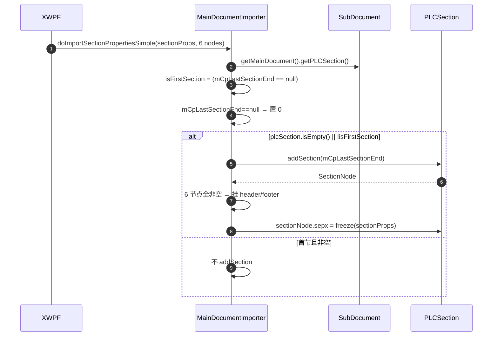

# 07_function_section_add — 拆分理由 / 当前代码现状 / 实现级分析

## 0. 结论（先读这个）

- **本 function 自身 src 未实现**：`MainDocumentImporter.rs` 不存在。
- **已实现的上游依赖**：`PLCSection.addSection`、`PLCSection.setLastSectionEndCP`、`PLCSection.isEmpty`（经 `PLC`）、`PropertySet.empty/freeze`、06 的 `mCpLastSectionEnd`（待 loop）。
- **硬缺口**：`SubDocument.getMainDocument()` 是 `todo!("DEFERRED_NON_FUNCTION")`——本 function 取 `mainDocument.getPLCSection()` 依赖它；`SectionPropsImporter`（wc-05 范围）未改写。
- **下一步**：loop L5 实现 `doImportSectionPropertiesSimple` 最小路径；`getMainDocument` 未实现时该测试用 `#[ignore = "spec: SubDocument.getMainDocument"]`，或 loop 内先补 `getMainDocument`。

## 1. 为什么拆成这个 function（I/O 边界）

`sectPr` 属性是**独立 I/O 事件**：输入 `sectionProps + 6 个 header/footer 节点`，输出 `PLCSection.SectionNode + sepx`。它与 06 的 guard 触发时机不同（guard 在 Start/End，建节在收到 sectPr），且首节/非首节分支必须单独测，所以拆开。

## 2. 当前代码现状

### 2.1 Java 现状

```java
// MainDocumentImporter.java:137–163（节选）
public void doImportSectionPropertiesSimple(MutablePropertySet sectionProps,
      PLC.Node headerEven, PLC.Node headerOdd, PLC.Node footerEven,
      PLC.Node footerOdd, PLC.Node headerFirst, PLC.Node footerFirst) {
   PLCSection plcSection = this.mDocument.getMainDocument().getPLCSection();
   PLCSection.SectionNode sectionNode = null;
   boolean isFirstSection = this.mCpLastSectionEnd == null;
   if (null == this.mCpLastSectionEnd) { this.mCpLastSectionEnd = 0; }
   if (plcSection.isEmpty() || !isFirstSection) {
      sectionNode = plcSection.addSection(this.mCpLastSectionEnd);
      if (null != headerEven && ... && null != footerFirst) {
         sectionNode.setEvenHeader(headerEven);
         sectionNode.setOddHeader(headerOdd);
         sectionNode.setEvenFooter(footerEven);
         sectionNode.setOddFooter(footerOdd);
         sectionNode.setFirstHeader(headerFirst);
         sectionNode.setFirstFooter(footerFirst);
      }
      sectionNode.sepx = null == sectionProps ? PropertySet.empty : sectionProps.freeze();
   }
}
```

### 2.2 Rust 本 function src 现状

`MainDocumentImporter.rs` 不存在。

### 2.3 上游依赖 Rust 现状

`PLCSection.addSection / setLastSectionEndCP`（已实现，wc-01）：

```rust
// PLCSection.rs:117–122
pub fn addSection(&mut self, cp: i32) -> SectionNode {
   let heap = alloc_section(self as *mut PLCSection);
   let pNode = Node { ptr: heap as *mut HeapNode };
   self.insert(cp, pNode);
   SectionNode { ptr: heap }
}
// PLCSection.rs:125–127
pub fn setLastSectionEndCP(&mut self, cp: i32) { self.mLastSecEndCP = cp; }
```

`PLC.isEmpty`（已实现，wc-01）：

```rust
// PLC.rs:150–152
pub fn isEmpty(&self) -> bool { self.super_.isEmpty() }
```

**缺口** `SubDocument.getMainDocument`（本 function 取节表的第一跳）：

```rust
// SubDocument.rs:712–715
pub fn getMainDocument(&self) -> Option<&dyn Document> {
   todo!("DEFERRED_NON_FUNCTION");
   // java return this.mParent.getMainDocument();
}
```

loop 内需先补 `getMainDocument`（或把 `doImportSectionPropertiesSimple` 的节表获取改为直接 `mDocument.getPLCSection()` 作为临时 seam，但最终须与 Java 对齐）。

## 3. 实现级分析

### 3.1 数据流 / 时序图



### 3.2 关键不变量

1. **首节 + 空表**：`mCpLastSectionEnd==null` → 置 0，且 `plcSection.isEmpty()==true` → **会** addSection(0)？——注意 Java 条件 `isEmpty() || !isFirstSection`，首节且空表时 `isEmpty()` 为 true，所以会 addSection(0)。只有**首节且非空**才跳过。这条要严格按 Java 分支翻译，SC1/SC2 断言不同。
2. `sepx = null==sectionProps ? empty : freeze(sectionProps)`。
3. 6 个头脚节点**全非空**才挂载，部分空整体跳过。

### 3.3 失败语义

- 首节且非空误 addSection（SC2 红）。
- 非首节未 addSection（SC3 红）。
- sepx 未写或 null 未兜底（SC4/SC5 红）。

> 测试方案与用例表见 [FUNCTION.md](./FUNCTION.md) §3。
