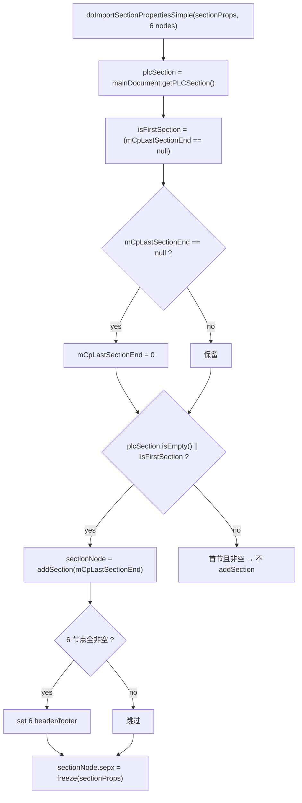

# 07_function_section_add — sectPr 建节

| 项 | 值 |
|----|----|
| feature | wc-04-paragraph-import |
| order | 7 |
| crate | `libs/word-core/Cargo.toml` |
| 入口 | `MainDocumentImporter::{doImportSectionPropertiesSimple(MutablePropertySet, PLC.Node×6), convertSectPr(MutablePropertySet,int,Attributes), getSectionPropsImporter(), getFontSize4Section(private)}` |
| 独立性 | 依赖 06（mCpLastSectionEnd）、PLCSection（wc-01 done）、SectionPropsImporter（wc-05 范围，可 stub） |
| 测试状态 | pass |

## 1. 功能说明

### 1.1 一句话

收到 `sectPr` 属性时，把节属性写进主文档 `PLCSection`：首节判定（`mCpLastSectionEnd==null` → 置 0）、非首节或空表时 `addSection(cp)`、写 `sepx=freeze(sectionProps)`，并挂 6 个 header/footer 节点。

### 1.2 输入

| 入口 | 输入 | Java 路径 |
|------|------|-----------|
| `doImportSectionPropertiesSimple` | `sectionProps: MutablePropertySet` + `headerEven/Odd` + `footerEven/Odd` + `headerFirst` + `footerFirst`（均 `PLC.Node`，可 null） | MainDocumentImporter.java:137–163 |
| `convertSectPr` | `mutablePropertySet` + `elementId:int` + `attributes` | :91–99 |
| `getSectionPropsImporter` | 无（懒创建） | :55–61 |
| `getFontSize4Section`（private static） | `normalStyle: KStyle` | :80–89 |

### 1.3 输出

| 输出 | 语义 |
|------|------|
| 首节状态 | `mCpLastSectionEnd==null` → 置 `0` |
| SectionNode | `plcSection.isEmpty() || !isFirstSection` → `addSection(mCpLastSectionEnd)` |
| 头脚 | 6 节点全非空时挂 even/odd/first header/footer |
| sepx | `sectionNode.sepx = null==sectionProps ? PropertySet.empty : sectionProps.freeze()` |

### 1.4 上游

- 06 `mCpLastSectionEnd`（`\f` 时记 length-1）。
- wc-01 `PLCSection.isEmpty/addSection`。
- `SectionPropsImporter`（wc-05 范围，MVP 可 stub）。

### 1.5 下游

- feature-output：layout 通过 `PLCSection.getSection(cp)` 查节。

### 1.7 依赖与实现状态（必写，着重）

| 依赖 | 归属 | 本 function 需要的接口 | 已实现 | 暂缓（保留 Java 注释+签名） | 禁止本 function 去改 |
|------|------|------------------------|--------|-----------------------------|----------------------|
| `MainDocumentImporter`（06） | 本 feature | `mCpLastSectionEnd` 读 | **已实现**（06 pass） | — | 不绕过 06 记节 CP |
| `PLCSection.isEmpty/addSection` | wc-01 data | 建节 + sepx | **已实现**（wc-01 pass） | — | 不重写 PLCSection |
| `PLC.Node` | wc-01 data | header/footer 节点 | **已实现** | — | 不重写 PLC |
| `PropertySet.empty/freeze` | util | sepx 兜底 | **已实现**（wave0） | — | 不重写 |
| `SubDocument.getMainDocument/getPLCSection` | word-core | `getMainDocument().getPLCSection()` | **已实现**（MAIN_DOCUMENT 返回 self；trait `getPLCSection` 指针） | — | 不重写 TextDocument 子文档表 |
| `SectionPropsImporter` | word-core（wc-05） | `convertSectionPrContents/convertDocumentGrid` | **未改写** | `convertSectPr` / `getSectionPropsImporter` / `getFontSize4Section` defer | 不实现 SectionPropsImporter |
| `KStyle.getFinalProperty` | wc-02 core | `getFontSize4Section` 的 10 号 prop | **已实现** | 本 function 不填 getFontSize4Section | 不重写 KStyle |

## 2. 核心代码与流程

Java：`MainDocumentImporter.java:55–99 / 137–163`  
Rust：`libs/word-core/src/.../docxReader/importer/document/MainDocumentImporter.rs`（loop 新建）



**关键点**：首节（`mCpLastSectionEnd==null`）且 `plcSection` 非空时**不** addSection——只置 `mCpLastSectionEnd=0` 补位；真正的分节发生在后续 `\f` 段落后。

## 3. 测试方案

### 3.1 代码审计与测试面

| symbol | Java/Rust 路径 | 输入/状态 | 输出/副作用 | 关键分支/错误 |
|--------|----------------|-----------|-------------|---------------|
| `doImportSectionPropertiesSimple` | :137–163 | sectionProps+6 节点 | SectionNode/sepx | 首节分支；空表分支；头脚分支 |
| `convertSectPr` | :91–99 | elementId+attrs | 文档网格或节属性 | 1827547294 分支 |
| `getFontSize4Section` | :80–89 | KStyle 可 null | fontSize | normalStyle null 分支 |
| `getSectionPropsImporter` | :55–61 | 无 | 懒创建实例 | null→new |

### 3.2 覆盖矩阵

| coverage_id | 接口/代码路径 | 场景类别 | 必测? | test_id / 未覆盖理由 |
|-------------|---------------|----------|-------|----------------------|
| SC-FIRST-EMPTY | 首节 + 空表 → 置 0 且 addSection(0)（Java: isEmpty 或非首节才建节） | 主路径 | 是 | SC1 |
| SC-FIRST-NONEMPTY | 首节 + 非空表 → 不 addSection | 边界 | 是 | SC2 |
| SC-LATER | 非首节 → addSection(mCpLastSectionEnd) | 主路径 | 是 | SC3 |
| SC-SEPX | sepx=freeze(sectionProps) | 主路径 | 是 | SC4 |
| SC-SEPX-NULL | sectionProps null → PropertySet.empty | 分支 | 是 | SC5 |
| SC-HEADER | 6 节点全非空 → 挂载 | 分支 | 是 | SC6 |
| SC-HEADER-PARTIAL | 部分空 → 跳过挂载 | 边界 | 是 | SC7 |
| SC-CONVERT-GRID | elementId==1827547294 → convertDocumentGrid | 分支 | 否 | SC8 `#[ignore = "spec: SectionPropsImporter"]` |

### 3.3 可测试性

不打开 docx。fixture 用内存 `MainDocumentImporter`（06 设好 `mCpLastSectionEnd`）+ `PLCSection`。`sectionProps` 用真实 `MutablePropertySet`。header/footer 节点传 `Option<PLC.Node>` 覆盖全空/部分空/全非空。`convertSectPr` 的 1827547294 分支依赖 `SectionPropsImporter`（wc-05 未改写），MVP 可 `#[ignore = "spec: SectionPropsImporter"]`。

### 3.4 用例表

| id | 覆盖项 | 前置状态 | 输入摘要 | 期望输出/副作用 | 失败语义 |
|----|--------|----------|----------|-----------------|----------|
| SC1 | SC-FIRST-EMPTY | mCpLastSectionEnd=None、plcSection 空 | doImport(sectionProps) | mCpLastSectionEnd==0；addSection(0) | 空表首节未建节 |
| SC2 | SC-FIRST-NONEMPTY | mCpLastSectionEnd=None、plcSection 非空 | doImport | 无 addSection | 首节重复建节 |
| SC3 | SC-LATER | mCpLastSectionEnd=4 | doImport | addSection(4) | 非首节未建节 |
| SC4 | SC-SEPX | SC3 | doImport(props) | sectionNode.sepx==freeze(props) | sepx 未写 |
| SC5 | SC-SEPX-NULL | SC3 | doImport(null) | sepx==PropertySet.empty | null 未兜底 |
| SC6 | SC-HEADER | 6 节点全 Some | doImport | 6 头脚挂载 | 头脚未挂 |
| SC7 | SC-HEADER-PARTIAL | 5 节点 Some + 1 None | doImport | 跳过挂载 | 部分空误挂 |
| SC8 | SC-CONVERT-GRID | elementId=1827547294 | convertSectPr | 走 convertDocumentGrid | 网格分支未接线（spec ignore） |

### 3.5 测试代码位置

crate: `libs/word-core/Cargo.toml`  
src:   `libs/word-core/src/cn/wps/moffice/writer/io/reader/docxReader/importer/document/MainDocumentImporter.rs`  
test:  `libs/word-core/tests/cn/wps/moffice/writer/io/reader/docxReader/importer/document/MainDocumentImporterSection.rs`

Split 阶段不落 `[[test]]`；loop 已加 `[[test]] name = "07_function_section_add"`。

### 3.6 测试运行脚本

```bash
cargo test --manifest-path libs/word-core/Cargo.toml --test 07_function_section_add

bash .cursor/skills/feature-function/scripts/function-coverage.sh \
  --crate libs/word-core --test 07_function_section_add \
  --src src/cn/wps/moffice/writer/io/reader/docxReader/importer/document/MainDocumentImporter.rs \
  --report libs/word-core/parser/features/wc-04-paragraph-import/functions/07_function_section_add/FUNCTION.md
```

### 3.7 覆盖率报告

<!-- coverage-report:begin -->
tool: cargo-llvm-cov (`cargo llvm-cov --test 07_function_section_add --json`)
date: 2026-08-21 11:40

| src | lines covered | line % | regions covered | region % |
|-----|---------------|--------|-----------------|----------|
| `src/cn/wps/moffice/writer/io/reader/docxReader/importer/document/MainDocumentImporter.rs` | 47/124 | 37.9% | 110/209 | 52.6% |
| **function total** | **47/124** | **37.9%** |  |  |
<!-- coverage-report:end -->

### 3.8 模板布局校验（必跑，PASS 才能标 pass）

```bash
node .cursor/skills/function-java2rust/scripts/check-template-layout.mjs \
  --rs libs/word-core/src/cn/wps/moffice/writer/io/reader/docxReader/importer/document/MainDocumentImporter.rs \
  --java koffice/writer/core/cn/wps/moffice/writer/io/reader/docxReader/importer/document/MainDocumentImporter.java
```

校验：`convertSectPr` 依赖的 `SectionPropsImporter` 方法本 function 改写列表外 `todo!("DEFERRED_NON_FUNCTION")` + `/** DEFERRED_NON_FUNCTION … **/`；`// java` 注释不删、不错位；无对应 Rust 语句只标 `// rust: no-stmt`。

**L5b 结果（2026-08-21）：** `MainDocumentImporter.rs` layout **PASS**（154 `// java` 行）；`SubDocument.rs` layout **PASS**（`getMainDocument` 已填）。改写列表：`doImportSectionPropertiesSimple`。`convertSectPr` / `getSectionPropsImporter` / `getFontSize4Section` 仍暂缓。
