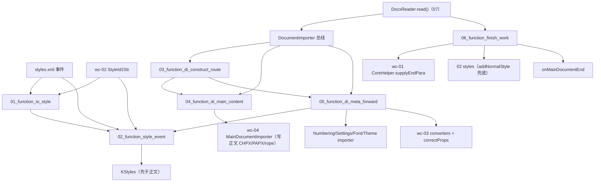

# wc-05-orchestration — Function 组合图

> 分析日期：2026-08-21
> 输入端点：`DocxReader.read()` + `XWPFDocument` 抛出的全部解析事件（styles / 主文档段落 / numbering / settings / fonts / theme 回调），经 `DocumentImporter`（`IDocumentImporter` 总线）路由
> 对外输出：① 正文段落事件落到 `MainDocumentImporter`（wc-04）写 rope/CHPX/PAPX；② `KStyles` 在正文消费 styleId **之前**落入（styles 两阶段收集）；③ `FinishReadingWork.go()` 的收尾不变量（supplyEndPara / 默认节 / addNormalStyle / onMainDocumentEnd）
> 切分依据：I/O 边界（styles 草稿 → styles 事件收集 → 总线装配/路由 → 主文档内容转发 → 非正文族转发+转换 → parse 后收尾 → 最外层 read 编排）
> 类级蓝皮书：[STRUCTURE_ANALYSIS.md](./STRUCTURE_ANALYSIS.md) · seeds：[SEEDS_ANALYSIS.md](./SEEDS_ANALYSIS.md) · 深读：[docs/README.md](./docs/README.md)

本文件只讲 **function 之间如何串联**。每个 function 的字段表、类图、**测试方案**在
`functions/<function_id>/FUNCTION.md`。可执行测试与 `src` 隔离，镜像落在 crate
`libs/word-core/tests/<relpath>/<Type>.rs`（见 §3）。

**本层不写低层 rope/CHPX/PAPX / 不做属性转换 / 不新建子文档对象图。** 属性桶是 wc-03；rope/CHPX/PAPX/PLCSection 落库是 wc-01；对象图是 wc-02；段级落库（MainDocumentImporter/SubDocumentImporter）是 wc-04。本层验的是「解析事件如何被**编排和路由**：styles 何时进 KStyles、MAIN 段落事件经哪条路落到 wc-04、parse 后收尾的调用顺序」。

---

## 0. 一句话管线

目录名 `{NN}_function_*` 的 `NN` 是依赖拓扑序号（就绪即编号）。wc-04 段级落库已测绿，本 feature **依赖但重不拆 wc-04 的 MainDocumentImporter/SubDocumentImporter**。

```text
(wc-04) MainDocumentImporter / SubDocumentImporter   段级落库前置（不重测，测试里当假上游输出用）
(wc-03) ParaPropsConverterSimple / RunPropsConverterSimple   属性纠偏前置（不重测）
(wc-02) KStyles / KStyle / TextDocument              对象图 + StyleId2Sti（rs 已实现）

01_function_io_style                  styles 单条样式草稿（IOStyle）
02_function_style_event               styles.xml 事件 → KStyles（两阶段收集）
03_function_di_construct_route        DocumentImporter 构造装配 + SubDocType 路由 + stub 安全
04_function_di_main_content           DocumentImporter 主文档内容转发 → wc-04（MAIN）
05_function_di_meta_forward           DocumentImporter 样式/编号/设置/字体/主题族转发 + 属性转换 + 进度
06_function_finish_work               FinishReadingWork.go() parse 后收尾
07_function_docx_read                 DocxReader.read() 最外层编排
```

热路径（钉死，来自 STRUCTURE_ANALYSIS.md §2 / §4.3）：

```text
DocxReader.read()
  → ShapeIDTool.reset() / TextboxInfoTool.reset()
  → Default* setMaxPoolSize
  → readExtendedProperties()                                   # 元数据（可 stub，保位次）
  → mainDocument.getPieceTable().setGuessedTotalLength(guess)   # 缺省 100，parse 前
  → doc.setInIOState(true) + ioListener.onLoadParas(0)
  → xwpf.setDocumentImporter(mImporter)                        # 挂总线
  → xwpf.parse()                                               # ★ 事件风暴（跨 crate，见 §3）
  → importMetaData()                                           # package/custom props + customXmlInfos
  → (new FinishReadingWork(doc, importer)).go()                # supplyEndPara / addNormalStyle / onMainDocumentEnd
  → mImporter.importCustomXmls()

styles 两阶段收集（钉死）：
  importStyleStart/Child/End → 只累积 IOStyle 进 mIOStyleList（不入 KStyles）
  importStylesEnd            → 遍历 createKStyle + mStyles.add         # sti 映射此时已全 put
  importDocDefaults(rPr,pPr) → KStyles.setRPrDefault/setPPrDefault(freeze)（单条、非两阶段）

Main 路由（钉死）：
  onImportParagraphStart(attrs) → getSub(MAIN).importParagraphStart(ConvertHelper.getString(attrs,"paraId"))
  onImportRun(String) / (char[],start,len) → mergeRevisionRunProp → getSub(MAIN).importRunTextSimple
  onImportParagraphEnd(paragraph,layerTable) → getSub(MAIN).importParagraphEnd → callback4Progress(每3段)

收尾（钉死）：
  correctCoreData() 首步 CoreHelper.supplyEndPara(mainDocument)
  correctSectionData() → mainDocument.getPLCSection().get(0) 非 SectionNode → addSection(0) + 默认节 PropertySet
  go() 末两钩子：IOHelper.addNormalStyle(styles) + mImporter.onMainDocumentEnd()
```

**钉死规则（与 STRUCTURE_ANALYSIS §4.3 一致）：**
1. styles 先于正文：`importStylesEnd` 的 `createKStyle+mStyles.add` 必须发生在任何段落消费 styleId 之前（与 Java parse 顺序对齐）。
2. 单条样式不入 KStyles：只有 `importStylesEnd` 才提交（保证 basedOn/next/link 的 sti 已全部 put 完毕）。
3. `toSti(null)→4095`；`toBaseSti` base==self→4095、**coreSti==0→4095**；`IOStyle.convertTypeAndId` 断言 `mCoreId != 4095`。
4. 样式内核 type：paragraph=1、character=2、table=3、numbering=4（否则 `IOAssert.fail`）。
5. SubDocType ordinal = subdoc 编号：MAIN=0、FOOTNOTE=1、HEADER=2、COMMENT=3、ENDNOTE=4、TEXTBOX=5、HEADERTEXTBOX=6。
6. `getSubDocumentImporter` 对未知 ordinal `IOAssert.fail`（不静默返回 null）。
7. `correctProps` 按 elementId dispatch：-906275931→sectPr、112148→correctRrop、110226→ParaProps correctProp/correctPPrBase、110154336→TablePropCorrector、3553489→null。
8. `callback4Progress` 每 3 段（`++mCountParagraph/3>=1`）调 `ioListener.onLoadParas(entry.position())` 并清零。
9. guessLength：`ExtendedProperties.getNumberCharacters()`，null → **100**；必须在 `parse()` 前设置。
10. `addNormalStyle` 双调用：`onMainDocumentStart`（正文前）+ `FinishReadingWork.go()`（parse 后兜底）；`getStyleById(0)==null` 才 add。

---

## 1. Function 清单

| order | function_id | 一句话 | 输入 | 输出 | 上游 | 下游 |
|------|-------------|--------|------|------|------|------|
| 1 | [01_function_io_style](./functions/01_function_io_style/FUNCTION.md) | 单条样式草稿：type/sti 转换 + styleId 整流 + 合并属性集 | `mType/mStyleId/mName/mBasedOn/mNext/mLink/mQFormat/mUiPriority/mIsCustom` + `StyleId2Sti` | `mCoreType`(1-4) + `mCoreId`(≠4095) + rectify styleId + `mCorePrSet` | wc-02 StyleId2Sti | 02 |
| 2 | [02_function_style_event](./functions/02_function_style_event/FUNCTION.md) | styles.xml 事件 → KStyles 两阶段收集 | `importDocDefaults/Start/Child/End/StylesEnd` + `StylePrModel` + `Attributes` | `KStyles`(rPr/pPr default + KStyle list) + `StyleId2Sti` 填充 | 01; wc-02 KStyles/KStyle; StylePrModel | feature-output（styles 先于正文） |
| 3 | [03_function_di_construct_route](./functions/03_function_di_construct_route/FUNCTION.md) | 总线构造装配 + SubDocType 路由 + stub 安全 | `KStyles`/`TextDocument` + mode + 回调依赖 | 轻量/主构造 + `getSubDocumentImporter(:0-6)` + `isLock/hasContent/dispose` | 02; wc-04 各 SubDocumentImporter; ImporterBase | 04; 05 |
| 4 | [04_function_di_main_content](./functions/04_function_di_main_content/FUNCTION.md) | 主文档内容转发 → wc-04 | `onImportParagraphStart/End`、`onImportRun`×2、`onImportTable*`、`onImportFld*/Bookmark/CommentRef/SectProp` | 对 MAIN 的 SubDocumentImporter 调用（参数/CP 不丢）+ `callback4Progress` | 03; wc-04 MainDocumentImporter | feature-output（正文） |
| 5 | [05_function_di_meta_forward](./functions/05_function_di_meta_forward/FUNCTION.md) | 非正文族转发 + 属性转换 + 进度 | `onImportStyle*/Numbering*/Settings*/Font*/Theme*`、`convertProp/convertRunProp/correctProps`、`onMainDocumentStart/End` | 转发到专 importer / converter + `mHasHeaderFooter` + addNormalStyle | 03; 02; 04; wc-03 converters | feature-output（styles/headfoot） |
| 6 | [06_function_finish_work](./functions/06_function_finish_work/FUNCTION.md) | parse 后一致性收尾 | 完整 `TextDocument` + `IDocumentImporter` | supplyEndPara + 默认节 + foot/endnote 清理 + addNormalStyle + onMainDocumentEnd | 03; wc-01 CoreHelper.supplyEndPara; PLCSection; IOHelper | feature-output（收尾不变量） |
| 7 | [07_function_docx_read](./functions/07_function_docx_read/FUNCTION.md) | 最外层 read() 编排 | `TextDocument + IOListener + XWPFDocument + IDLProvider` | read() 12 步顺序（guess→inIOState→setImporter→parse→metadata→finish）+ 元数据 | 03; 06; XWPFDocument; *PackagePropertiesImporter | feature-output（端到端） |

## 2. 数据流



**串接规则：**
1. **不重测 wc-01/wc-02/wc-03/wc-04。** `supplyEndPara`、`KStyles.add/setRPrDefault`、`convertProp` 语义、`MainDocumentImporter.import*` 已测绿，本层只断言 **编排/路由把它们按正确顺序、正确参数调用**。
2. **测 N 不跑完整 docx 管线。** fixture = 内存 `TextDocument`/`KStyles` + 假 `IDocumentImporter`/`IOListener`/`IDLProvider` + 直接构造 `StylesImporter`/`DocumentImporter`，不打开真实 docx、不依赖 `XWPFDocument.parse()`。
3. **IOStyle 是纯叶子。** 01 只测 type/sti 换算与整流，不碰 KStyles；02 才消费它。
4. **styles 先于正文靠 02 单测钉死。** 02 断言「`importStylesEnd` 前 KStyles.add 未被调用、之后才 add」；04/05 不重验顺序，只验转发参数。
5. **路由是 04/05 的公共底座。** 03 钉死 ordinal→importer 映射与 stub 不 NPE；04/05 只依赖 03 的路由 seam。
6. **主文档内容走 04，非正文族走 05。** 04 的落点是 wc-04 MAIN importer（写字符）；05 的落点是专用 importer/converter（不写正文 rope）。
7. **收尾依赖整个 parse 结果。** 06 输入是「已完成的 TextDocument + 可回调的 importer」，不接收事件；其顺序由 07 的 read() 钉死。
8. **07 是验收 seam。** 端到端 `read()` 顺序由 07 钉死；但 07 依赖跨 crate `XWPFDocument.parse()`（未实现，见 §3），Split 阶段 07 用假 `IDocxReader`/假 XWPF 验证顺序位次，正文内容语义交给 04。

---

## 3. 依赖与编译面

| 层级 | function | crate | 单独测 |
|------|----------|-------|--------|
| 叶子 | io_style | `libs/word-core` | 是：纯 struct + StyleId2Sti，无 KStyles/Document |
| 叶子 | style_event | word-core | 需 `StyleId2Sti` + `KStyles`（rs 已实现）+ 假 `StylePrModel` |
| 叶子 | di_construct_route | word-core | 需可构造 `TextDocument`（wc-02）+ wc-04 各 importer（已实现）+ 假 IOListener/IDLProvider |
| 叶子 | di_main_content | word-core | 复用 03 构造 seam + wc-04 MAIN importer（已实现）+ 假 Attributes |
| 叶子 | di_meta_forward | word-core | 复用 03 构造 seam + wc-03 converters（blocked→stub）+ 假 StylePrModel/SectionHeadFooterProps |
| 叶子 | finish_work | word-core | 需 `TextDocument` + 假 `IDocumentImporter` + `CoreHelper.supplyEndPara`(已实现) + IOHelper.addNormalStyle(已实现) |
| 叶子 | docx_read | word-core | 需真实 `XWPFDocument`（parse 已实现）+ fixture docx 或记录型 XWPF + 假 metadata importer |

每个 function 一条 `[[test]]`，`name` = `function_id`，`path` = `tests/` 下与 `src` 同相对路径的入口类型文件（多 function 共用同一 src 类型时，用同目录加后缀的镜像文件）。

| function_id | `[[test]]` path |
|-------------|-----------------|
| `01_function_io_style` | `tests/cn/wps/moffice/writer/io/reader/docxReader/importer/IOStyle.rs` |
| `02_function_style_event` | `tests/cn/wps/moffice/writer/io/reader/docxReader/importer/StylesImporter.rs` |
| `03_function_di_construct_route` | `tests/cn/wps/moffice/writer/io/reader/docxReader/importer/DocumentImporter.rs` |
| `04_function_di_main_content` | `tests/cn/wps/moffice/writer/io/reader/docxReader/importer/DocumentImporterContent.rs` |
| `05_function_di_meta_forward` | `tests/cn/wps/moffice/writer/io/reader/docxReader/importer/DocumentImporterForward.rs` |
| `06_function_finish_work` | `tests/cn/wps/moffice/writer/io/reader/tools/FinishReadingWork.rs` |
| `07_function_docx_read` | `tests/cn/wps/moffice/writer/io/reader/docxReader/DocxReader.rs` |

```bash
# 单 function（loop 用这条）
cargo test --manifest-path libs/word-core/Cargo.toml --test 01_function_io_style
# … 02–07 同 crate、--test <function_id>
```

**编译面（Split 时）——务必通读「当前代码现状」：**

| 目标 src（loop 新建） | 现状 | 依赖可用性 |
|----------------------|------|-----------|
| `docxReader/importer/IOStyle.rs` | **不存在**（须新建） | 依赖均已实现 |
| `docxReader/importer/StylesImporter.rs` | **不存在**（须新建） | `KStyles.add/setRPrDefault/setPPrDefault`、`KStyle::new__textdocument…`、`StyleId2Sti`（rs 已实现）；`BuildinStyleSheet`（rs 已实现）；`StylePrModel`（core-libs 已生成）；**`ConvertHelper`/`ShareConvertHelper`（rs 已存在，wc-03 blocked → loop 内联最小子集）** |
| `docxReader/importer/DocumentImporter.rs` | **不存在**（须新建） | `ImporterBase`(mode/isDocx)、`MainDocumentImporter/SubDocumentImporter` 等（wc-04 已实现）、`StyleId2Sti/NumIdRedirection`（rs 已实现）、wc-03 converters（blocked→stub）、`IDocumentImporter` trait（core-libs 已生成，`&dyn Any` 参数 + `&self`） |
| `reader/tools/FinishReadingWork.rs` | **目录不存在**（须新建 tools/） | `CoreHelper.supplyEndPara`（rs 已实现）、`IOHelper.addNormalStyle`（rs 已实现）、`PLCSection/PageSetup`；**`IOHelper.endAllSubdocumentsDrawingContainer` 在 Java 有、Rust `IOHelper.rs` 未实现（缺口，见下）** |
| `docxReader/DocxReader.rs` | **不存在**（须新建） | `face/IDocxReader.rs`（trait 已生成）；`IDocumentImporter`；`*PackagePropertiesImporter` 未改写（可 stub 保位次）；**core-libs `XWPFDocument.parse()` 已实现（L310），正文链已接线；styles 子链未接线（缺口 C，见下）** |

**当前代码现状（2026-08-21 复核实测，非照抄旧 STRUCTURE_ANALYSIS）：**
1. 5 个种子 `.rs` 全部 **不存在**（`rs_exists=no`，`rewrite_status=未改写`）；`reader/tools/` 目录尚不存在。
2. **wc-04 已就绪**：`document/MainDocumentImporter.rs`、`document/SubDocumentImporter.rs` 已落地且 wc-04 functions.csv 全 `pass`——DocumentImporter 主构造能真实创建它们。
3. **styles 前置依赖多数已实现**：`KStyles.add/setRPrDefault/setPPrDefault/getStyleById`、`KStyle::new__textdocument_…`、`StyleId2Sti.getSti/put×3`、`CoreHelper.supplyEndPara`、`IOHelper.addNormalStyle`、`ImporterBase(mode)`、`face/IDocxReader.rs`。
4. **已消除项（原「缺口 A」过时）**：`ConvertHelper`/`ShareConvertHelper` 已实现（wc-03 functions.csv 全 `pass`，`helpers/ConvertHelper.rs`/`ShareConvertHelper.rs` 已存在）——02 loop 直接复用，无需内联。
5. **缺口 B（wc-05 batch 内非种子，stub 承接）**：`NumberingImporter/SettingsImporter/SectionPropsImporter/*PackagePropertiesImporter` 未改写 → 05/07 以 stub（保留签名 + 空实现）承接，不 NPE。wc-03 converters 已实现（全 pass），05 可直用。
6. **缺口 C（跨 crate，已复核；**2026-08-21 已闭合**）**：core-libs `XWPFDocument.parse()` **已实现**（XWPFDocument.rs L310，styles.xml + 主文档 Part 经 XmlReader + handler 解）；**主文档段落链已接线**（PHandler→onImportParagraphStart/End、DocumentBodyHandler→onMainDocumentStart/End、RprChildHandler→convertRunProp、StylesHandler(end)→onImportStylesEnd）；**styles 子链由 wave0 新建 `15_function_styles_handler_chain` 补全并已 pass**（2026-08-21，7 个 styles handler + NormalPropBaseHandler/RprBaseHandler/RprChildHandler 修复，10 用例绿 + 引擎路径）→ **wc-05 07 的样式 e2e 断言可去 `#[ignore = "spec: 缺口C"]`**。编号/字体子链仍 TODO（最小 docx 可延期，见缺口 B 备注）。
7. **缺口 D（wc-05 依赖；已安排承接）**：`IOHelper.endAllSubdocumentsDrawingContainer`（Java IOHelper.java L191–201 有、Rust `IOHelper.rs` 无，已 grep 复核：Rust 侧依赖 `SubDocument.getDrawingContainer()` + `IDrawingContainer.endRead()` 均存在，可补）——**承接：06_function_finish_work 点名依赖补实现**（§1.7 声明，§3.6 覆盖率含 IOHelper.rs，§3.8 布局校验含 IOHelper 组）。

Split 阶段**不**创建 `[[test]]`（src 不存在，测试无法编译）；`[[test]]` 与镜像测试在 loop L2 随 src 落地一起写。所有 function `status=spec`，不得用空测试或 `assert!(true)` 假装绿。

启动改写-测试-回归：对 agent 说 `loop 01_function_io_style` 或「开始 loop」（skill：`feature-function`）。每个 function 的 `FUNCTION.md` §3.6 / §3.7 含 `cargo test` 脚本与 `cargo-llvm-cov` 覆盖率报告。

---

## 4. Function 如何串联（逐步）

1. **styles 落地（01+02）**：`IOStyle` 草稿在 `importStyleStart/Child/End` 期间累积（type、usti 换算、整流 styleId、合并 rPr/pPr/tcPr/tblPr 到 `mCorePrSet`）→ `importStylesEnd` 时 `createKStyle` + `KStyles.add` + `setLink/setQFormat/setUiPriority`。此时 `StyleId2Sti` 已含全部 styleId→sti 映射，basedOn/next/link 可解析。
2. **总线装配（03）**：`DocumentImporter` 轻量构造建 `StyleId2Sti/NumIdRedirection/StylesImporter/converters`；主构造 createSubDocument(0..6) 建 9 个子 importer；`getSubDocumentImporter(ordinal:0-6)` 路由；未知 ordinal fail；`onMainDocumentStart` 设 `mHasHeaderFooter` + `addNormalStyle`。
3. **正文内容（04）**：XWPF 抛 `onImportParagraphStart/End/onImportRun*/onImportTable*/…` → `getSub(MAIN).import*`，参数（paraId、layerTable、endMark、char[]/String）不丢；`onImportParagraphEnd` 返回的 entry 走 `callback4Progress`（每 3 段 onLoadParas）。
4. **族转发（05）**：样式/编号/设置/字体/主题回调直转各自专用 importer；`convertProp`/`convertRunProp`/`correctProps` 按 propType/elementId dispatch 到 wc-03 converters；`onImportSectProp` 依据 `mHasHeaderFooter` 决定传真实 header/footer 节点还是 6 个 null。
5. **收尾（06）**：`FinishReadingWork.go()` 依序 `endAllSubdocumentsDrawingContainer`（缺口D）→ `ShapeIDTool.reset()` → `correctCoreData`（**首步 `CoreHelper.supplyEndPara(main)`**；默认节 `addSection(0)+默认 PropertySet`；foot/endnote 无效节点清理）→ `processDmlLinkedTxbx` → `TextboxInfoTool.run()` → `addNormalStyle(styles)` → `mImporter.onMainDocumentEnd()`。
6. **最外层（07）**：`DocxReader.read()` 依序 guess length（缺省 100，parse 前）→ `setInIOState(true)` → `onLoadParas(0)` → `setDocumentImporter` → `parse()` → `importMetaData` → `FinishReadingWork.go()` → `importCustomXmls()`。

---

## 5. 验收顺序

```text
01_function_io_style          （最快；纯叶子；type 1-4、4095 断言、整流、sti 映射）
02_function_style_event       （两阶段收集；rPr/pPr default；createKStyle；basedOn/next/link→4095）
03_function_di_construct_route（构造装配；ordinal 0-6 路由；未知 ordinal fail；isLock/hasContent）
04_function_di_main_content   （paraId/layerTable/endMark 参数不丢；run 两重载；callback4Progress 每3段）
05_function_di_meta_forward   （样式族转发；convertProp dispatch；correctProps elementId 分支；sectProp 分支）
06_function_finish_work       （supplyEndPara 首步；默认节；addNormalStyle 不重复；onMainDocumentEnd 被调）
07_function_docx_read         （read() 顺序位次；guessLength 缺省 100；真实 XWPFDocument + fixture docx 验证正文链；样式链缺口 C 暴露为 spec 门闩）
```

README / STRUCTURE MVP checklist 映射：

| 目标项 | function |
|--------|----------|
| styles 在正文前落入 KStyles | 01, 02 |
| MAIN_DOCUMENT 段落事件到 MainDocumentImporter | 03, 04 |
| supplyEndPara + onMainDocumentEnd 被调用 | 06, 07 |
| 其它故事 importer 不 NPE | 03（stub），05（族转发） |
| read() 顺序与 Java 一致 | 07 |
| correctProps 按 elementId 正确 dispatch | 05 |
| addNormalStyle 不重复 add | 03（onMainDocumentStart），06（go 兜底） |

---

## 6. 与类级分析的对照

| function | STRUCTURE_ANALYSIS 枢纽 | 深读 |
|----------|-------------------------|------|
| io_style | §1.1 IOStyle | [docs/README.md §1](#)（styles 两阶段） |
| style_event | §1.2 StylesImporter + §2.3 styles 事件流 | docs 无独立 StylesImporter.md（引用 [StylesImporter 源码]） |
| di_construct_route | §1.3 DocumentImporter 字段/构造 + §2.2 路由图 | [docs/DocumentImporter.md](./docs/DocumentImporter.md) |
| di_main_content | §1.3 段落/run/表格转发 + §2.2 | 同上 |
| di_meta_forward | §1.3 样式族/convertProp/correctProps + §2.2 | 同上 |
| finish_work | §1.4 FinishReadingWork + §4.1 | [docs/FinishReadingWork.md](./docs/FinishReadingWork.md) |
| docx_read | §1.5 DocxReader + §2.1 read() 时序图 | [docs/DocxReader.md](./docs/DocxReader.md) |

类图仍以 `STRUCTURE_ANALYSIS.md` 为准；function 按 **I/O** 切，不按类切。`DocumentImporter` 一类拆成 03/04/05 三个 I/O 单元（装配路由 / 主文档内容 / 非正文族转发+转换）；styles 拆成 `IOStyle`（01 叶子）与 `StylesImporter`（02 收集）。每个 `FUNCTION.md` 必须有 **§1.7 依赖实现状态** 和 **§3.8 模板布局校验**。
