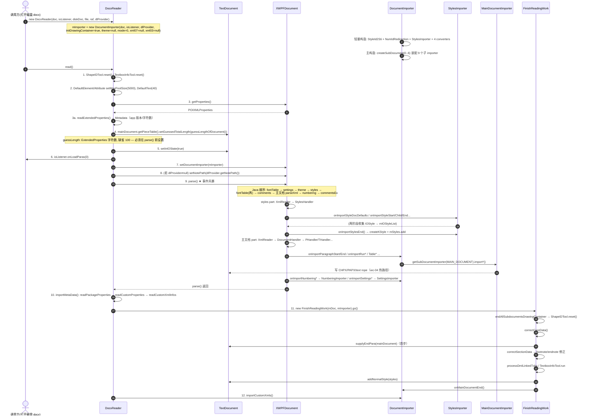
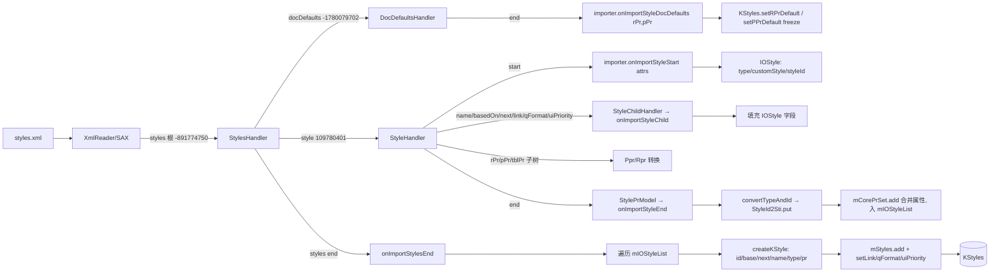

# wc-05-orchestration — 解析编排（类图/流程/依赖/最小改写范围）

> 分析对象：DocxReader + DocumentImporter 接通 XWPF 回调；styles + 收尾
> 数据来源：`libs/word-core/parser/features/wc-05-orchestration/`（README / SEEDS_ANALYSIS / docs/ · seeds.csv · dep_topo.csv）、
> `libs/word-core/parser/rewriting_files_parse_mvp.csv`、Java 源码（docxReader 五类 + 辅助）、Rust 现状（word-core + core-libs wps-io）
> 前置 feature：wc-04-paragraph-import（order 501–509）；前置标准层：wave0-ooxml-standards / parse-wave0-xwpf

---

## 0. Feature 目标与管线位置

| 项 | 值 |
|----|----|
| Feature | `wc-05-orchestration`（parse-MVP batch `parse-05-orchestration`，order **600–619**） |
| depends_on | `wc-04-paragraph-import` → `wc-03-property-convert` → `wc-02-document-model` |
| 种子类 | 5 个：IOStyle(600) · StylesImporter(601) · DocumentImporter(616) · FinishReadingWork(617) · DocxReader(619) |
| 本 batch 附带的非种子类（同 CSV 队列） | num/*（602–609：IOLvl/IOAbstractNum/IONum/IOLvlOverride/NumberingLevelImporter/AbstractNumImporter/NumImporter/AbstractNumIdRedirection）、SettingsImporter(611)、SectionPropsImporter(612)、PackagePropertiesImporter(613)/ExtendedPackagePropertiesImporter(614)/CustomPackagePropertiesImporter(615)、DocxDefaultValue(618) |
| 目标 | DocxReader 作为最外层编排器：构造装配 → `XWPFDocument.parse()` 事件风暴（styles/段落/编号/设置回调经 DocumentImporter 路由）→ FinishReadingWork 收尾 |
| 核心验收 | 简单 docx → parse → 主文档文本 + CHPX/PAPX + styles 与 Java JSON 对照；styles 在正文段落消费 styleId **之前**落入 KStyles（与 Java parse 顺序对齐） |

**本层本质**：「交通警察」。真正写 rope/PropertySet 的实现在 04（SubDocumentImporter/MainDocumentImporter）+ 03（converters）。本层只有三件必做事：
1. `DocxReader.read()` 严格按 Java 顺序编排；
2. `DocumentImporter` 把 IDocumentImporter 回调按 SubDocType / 内容族路由（MAIN_DOCUMENT + Styles 为 must，其它 stub 不炸）；
3. `FinishReadingWork.go()` 收尾（supplyEndPara / addNormalStyle / onMainDocumentEnd）。

**改写顺序**（seeds 依赖序）：IOStyle → StylesImporter → DocumentImporter（Main 路由）→ FinishReadingWork → DocxReader。

---

## 1. 类图

### 1.1 `IOStyle`（order 600，Java ~60 行，Rust `importer/IOStyle.rs` 不存在 → **须新建**）

styles.xml 中**单条样式的草稿对象**：解析期只填充字段，`importStylesEnd` 前不进入 KStyles。

**字段表**：

| 字段 | Java 类型 | 含义 |
|------|-----------|------|
| mType | String | OOXML type（"paragraph"/"character"/"table"/"numbering"） |
| mStyleId | String | w:styleId 属性 |
| mName / mBasedOn / mNext / mLink | String | 显示名 / basedOn / next / link 关系 |
| mQFormat | Boolean | w:qFormat（可 null） |
| mUiPriority | Long | w:uiPriority（可 null） |
| mIsCustom | Boolean | w:customStyle（可 null，null 视为 false） |
| mTblStyleRPrId / mTblStylePPrId / mTblStyleTblPrId | int | 表样式条件格式回填用的属性 id（DocxReaderHelper.setTblStylePrType 写入） |
| mCoreId / mCoreType | int | `convertTypeAndId` 后：sti id + 内核类型（1/2/3/4） |
| mCorePrSet | MutablePropertySet | 合并后的样式属性集（rPr+pPr+tcPr+tblPr），end 时 add 进来，createKStyle 时 freeze |

**方法表**：

| 方法 | 逻辑（1 行） |
|------|-------------|
| `convertTypeAndId(StyleId2Sti)` | `mCoreType=convertStypeType(mType)`；`mCoreId=insertId2StiMap(...)`；**断言 mCoreId ≠ 4095**（"a style always has a valid sti"） |
| `insertId2StiMap(int type, StyleId2Sti)`（private） | `isCustom = mIsCustom!=null?mIsCustom:false`；`styleId=rectifyStyleId()`；mName 非空 → `styleId2Sti.put(styleId,name,type,isCustom)`；否则 `put(styleId)` |
| `rectifyStyleId()` | mStyleId 非空→mStyleId；否则 mName 非 null→mName；否则 `""` |
| `convertStypeType(String)`（private static） | paragraph→1、character→2、table→3、numbering→4；其它 `IOAssert.fail` |

### 1.2 `StylesImporter`（order 601，Java ~237 行，Rust 不存在 → **须新建**）

**核心：两阶段样式收集**——`importStyleStart/Child/End` 期间只累积 `IOStyle` 草稿进 `mIOStyleList`；`importStylesEnd` 时才逐个 `createKStyle` + `mStyles.add`（保证 basedOn/next/link 的 sti 映射此时已全部 put 完毕）。

**字段表**：

| 字段 | 含义 |
|------|------|
| mStyles | 目标 `KStyles`（来自 DocumentImporter 轻量构造） |
| mStyleId2Sti | OOXML styleId → 内核 sti 映射表 |
| mTextDocument | `kStyles.getTextDocument()`（createKStyle 需要） |
| mCurIOStyle | 当前正在解析的草稿 |
| mIOStyleList | `ArrayList<IOStyle>(30)` 全部草稿 |

**方法表**：

| 方法 | 逻辑（1 行） |
|------|-------------|
| `importDocDefaults(rPrSet, pPrSet)` | rPrSet≠null → `mStyles.setRPrDefault(rPrSet.freeze())`；pPrSet≠null → `setPPrDefault(freeze)` |
| `importStyleStart(attributes)` | new IOStyle；读 type / customStyle / styleId |
| `importStyleChild(elementId, attrs)` | switch：-681243704→mQFormat；-332612366→mBasedOn；3321850→mLink；3373707→mName；3377907→mNext；872749144→`ShareConvertHelper.getLong4STDecimalNumber`；971752949→`DocxReaderHelper.setTblStylePrType`（写三个 TblStyle id） |
| `importStyleEnd(StylePrModel)` | `convertTypeAndId`；`mCorePrSet.add(getStylePrSet(model))`；入 list |
| `getStylePrSet(StylePrModel)`（private static） | rPrBaseSet + PPrGeneralSet + correctTcPrSet(tcPrSet) + TblPrBaseSet 合并 |
| `correctTcPrSet`（private static） | tcPrSet 移除 prop 346–351；`correctCellPaddingStype`（prop 355 的 List→数组） |
| `importStylesEnd()` | 遍历 list：createKStyle → `setLink(toSti(mLink))` → setQFormat/setUiPriority（非 null 时）→ `mStyles.add(kStyle)` |
| `createKStyle(IOStyle)`（private） | `id=toSti(rectifyStyleId())`；`base=toBaseSti(mBasedOn,sti,id)`；`next=toNextsSti(mNext,id,sti)`；`name=toDisplayName(mName,id)`；`pr=mCorePrSet.freeze()`；`new KStyle(mTextDocument,id,name,base,next,mCoreType,pr)` |
| `toBaseSti(base, sti, coreSti)`（static） | `toSti(base)`；`baseSti==coreSti → 4095`；**`coreSti==0 → 4095`**（Normal 强制无 base） |
| `toSti(styleId, sti)`（static） | **null → 4095**；`getSti` 查不到 → 4095 |
| `toNextsSti(nextId, sti, sti)`（static） | nextId null → 返回自身 sti；查不到 → 自身 sti；否则映射值 |
| `toDisplayName(name, sti)`（static） | 保留名且保留索引→原名；保留名但非保留索引→`name+"_"+UUID` |
| `importTblStylePrEnd(StylePrModel)` | 表样式条件格式：CFC/CPF/TSP 三个 Value 写回 mCorePrSet（MUST 可延后） |

### 1.3 `DocumentImporter`（order 616，Java ~1285 行，Rust 不存在 → **须新建**）— 总线

`extends ImporterBase implements IDocumentImporter`。自身几乎不写 rope，全部转发。

**字段表**：

| 字段 | 类型 | 说明 |
|------|------|------|
| mDocument | TextDocument | 目标文档 |
| mIoListener / mIDLProvider | IOListener / IDLProvider | 进度回调 / note 路径 |
| mStylesImporter / mSettingsImporter / mFontTableImporter / mNumberingImporter / mThemeImporter | 各 importer | 非正文 Part 的专用 importer |
| mParaPropsConverter / mRunPropsConverter / mTablePropsConverter / mCellPropertyConverter | 各 converter | 属性转换（03 层） |
| mMainDocumentImporter | MainDocumentImporter | **Main 路由目标（wc-04）** |
| mTextboxDocumentImporter / mHdrFtrTextboxDocumentImporter | TextboxDocumentImporter | createSubDocument(5)/(6) |
| mHdrFtrDocumentImporter | HdrFtrDocumentImporter | createSubDocument(2) |
| mCommentsDocumentImporter | CommentsDocumentImporter | createSubDocument(3) |
| mFootnoteDocumentImporter / mEndnoteDocumentImporter | ... | 脚注/尾注（null 时 onMainDocumentEnd 判空跳过） |
| mStyleId2Sti / mNumIdRedirection | 共享表 | `new StyleId2Sti(mDocument.getUUSti())` / `new NumIdRedirection(mDocument.getUUNumberingId())` |
| mCountParagraph / mHasHeaderFooter | int / boolean | 进度节流 / 节首尾标志 |
| mThemeContext | ThemeContext | dml 主题上下文 |
| mMoveRangeImporter / mCurrentRevision | ... | 修订（可延后） |

**构造**（两个重载，都是 must）：
- **轻量** `DocumentImporter(KStyles kStyles, int mode, xml07, xml03)`：`super(mode,...)`；mDocument=kStyles.getTextDocument()；建 StyleId2Sti / NumIdRedirection / StylesImporter / ThemeContext / 四个 converter。
- **主** `DocumentImporter(TextDocument document, IOListener, IDLProvider, initDrawingContainer, ThemeContext, int mode, xml07, xml03)`：
  1. `this(document.getStyles(), mode, xml07, xml03)`（复用轻量构造）
  2. `mainDocument.getLength()==0 → document.setProperty(PropertySet.empty)`
  3. `mainDocument = createSubDocument(0)`；`SettingsImporter` / `FontTableImporter` / `NumberingImporter` / `ThemeImporter` / `MainDocumentImporter(main,...)` / `MainTextboxDocumentImporter(createSubDocument(5))` / `HeaderTextboxDocumentImporter(createSubDocument(6))` / `HdrFtrDocumentImporter(createSubDocument(2))` / `CommentsDocumentImporter(createSubDocument(3))` / `Footnote/EndnoteDocumentImporter`
  4. `mCountParagraph=0; mHasHeaderFooter=false`

**方法表**（按族分组）：

| 方法 | 逻辑（1 行） |
|------|-------------|
| `getSubDocumentImporter(SubDocType)` | switch：MAIN→main / TEXTBOX→textbox / HEADER→hdrFtr / COMMENT→comments / ENDNOTE→endnote / FOOTNOTE→footnote / HEADERTEXTBOX→hdrFtrTextbox；default fail |
| `onImportParagraphStart(subDocType, attrs)` | `getSub(...)`；`paraId=ConvertHelper.getString(attrs,"paraId")`；`importParagraphStart(paraId)`；COMMENT 额外 `putParaId` |
| `onImportParagraphEnd(ParagraphSimple, subDocType, layerTable)` | `getSub(...).importParagraphEnd(...)` → `callback4Progress(entry)`（每 3 段 onLoadParas） |
| `onImportRun(×2 重载)` | `mergeRevisionRunProp` → `getSub(...).importRunTextSimple(...)`；chars 版先 `convertGeoText` |
| `onImportTableStart / HyperlinkBegin\|End / FldSimpleBegin\|End / FldChar / TableCelStart\|End / TableRowStart\|End / RunContent / BookmarkStartEnd / DocFieldStartEnd / BdoDir / Math* / OMath* / Ruby / Pdf` | 同模式：`getSub(...)` → 转发到对应 SubDocumentImporter 方法（COMMENT/脚注尾注特殊分支） |
| `onImportSectProp(mps, sectionProps)` | `mHasHeaderFooter` 时：addNode{Header,Footer}{Even,Odd,First} + parse* → `doImportSectionPropertiesSimple(mps, 6 个节点)`；否则传 6 个 null |
| `onImportStyleDocDefaults / StyleStart / StyleChild / StyleEnd / StylesEnd / StyleTblStylePrEnd` | 直转 `mStylesImporter.*` |
| `onImportNumberingNumStart/Child/End · LevelStart/Child/End · AbstractNumStart/Child/End` | 直转 `mNumberingImporter.*` |
| `onImportSettingsStart(XWPFSettings) / SettingsChild / SettingsEnd` | 直转 `mSettingsImporter.*` |
| `onImportFontStart/Child/End` | 直转 `mFontTableImporter.*` |
| `onImportFontSchemeStart / MajorFontStart / MinorFontStart / ThemeCSFontStart / ThemeEAFontStart / ThemeLatinFontStart / ThemeFontStart` | 直转 `mThemeImporter.*` |
| `convertProp(PropType, mps, ns, elementId, attrs)` | switch TRPR/TBLGRID/TBLPR/TBLPREX/PPR/PPR_GENERAL/SECTPR/TCPR_STYLE → 对应 converter |
| `convertRunProp` / `converTableCellProp` | 转 `mRunPropsConverter` / `mCellPropertyConverter` |
| `correctProps(elementId, mps, originalProp)` | -906275931→sectPr 修正；112148→`correctRrop`；110226→`ParaPropsConverterSimple.correctProp/correctPPrBase`；110154336→TablePropCorrector；3553489→null |
| `onMainDocumentStart(hasHeaderFooter)` | `mHasHeaderFooter = hasHeaderFooter && subdocument(2).getLength()==0`；`IOHelper.addNormalStyle(mDocument.getStyles())` |
| `onMainDocumentEnd()` | `VmlReader.clearShapeTypes(0)`；endnote/footnote importer `clear()`（判 null） |
| `onHeaderDocumentEnd / onFooterDocumentEnd(type)` | `appendParagraphBreak4HeaderFooter()` + `reviseNodeHeader/Footer{Even,Odd,First}` + clearShapeTypes(2) |
| `importCustomXmls()` | metadata.customXmlInfos 经 ICmtCustDatasReader 过滤（可延后） |
| `dumpAllPictures / dumpVbaMacro` | BlipFillInfos / 导出 VBA 到 tmp（可延后） |
| `hasContent()` | `mDocument.getMainDocument().getLength() > 0` |
| `getVmlImporter / getDmlImporter / getDmlTextImporter` | 转 SubDocumentImporter / DmlTextImporter |
| `setThemePackagePart / onImportMedia` | theme part / 音视频图片（可延后） |
| `dispose() / dispose4StyleXml()` | 释放 StyleId2Sti 与子 importer |
| private：`mergeRevisionRunProp / callback4Progress / appendParagraphBreak4HeaderFooter / importDir / importBdo / importAudio / importPicture / ...` | 辅助（MVP 可空实现） |

### 1.4 `FinishReadingWork`（order 617，Java ~279 行，Rust `tools/FinishReadingWork.rs` 不存在 → **须新建**）

字段：`mDoc`(TextDocument)、`mImporter`(IDocumentImporter)。

| 方法 | 逻辑（1 行） |
|------|-------------|
| `go()` | `IOHelper.endAllSubdocumentsDrawingContainer(mDoc)` → `ShapeIDTool.reset()` → `correctCoreData()` → `processDmlLinkedTxbx()` → `TextboxInfoTool.run()` → `IOHelper.addNormalStyle(mDoc.getStyles())` → `mImporter.onMainDocumentEnd()` |
| `correctCoreData()`（private） | **`CoreHelper.supplyEndPara(mainDocument)`（第 1 步）** → `correctShapePropertyId_textNext()` → `setTextIdentifiers()` → `correctSectionData()` → `correctFootnoteDocument()` → `correctEndnoteDocument()` |
| `correctSectionData()` | mainDocument.getPLCSection().get(0) 非 SectionNode → `addSection(0)` + `setPropertySet(createDefaultSectionPropertySet())`（676=PageSetup(11906,16838,1800,1800,1440,1440)、677=0、678=312、682=720、683=720） |
| `correctFootnoteDocument / correctEndnoteDocument` | 移除无效 FootnoteEndnoteTxt 节点；endnote 额外 `supplyEndPara` |
| `processDmlLinkedTxbx()` | 遍历 SubDocType.values()：`mImporter.getDmlImporter(subDocType).buildTxbxChain()`（判 null） |
| `correctShapePropertyId_textNext / setTextIdentifiers`（+ 重载/静态） | textbox 链形状修正（MVP 空实现） |

### 1.5 `DocxReader`（order 619，Java ~161 行，Rust `docxReader/DocxReader.rs` 不存在 → **须新建**）

`implements IDocxReader`（face/IDocxReader.rs 已存在，word-core，已生成）。

**字段表**：

| 字段 | 类型 | 作用 |
|------|------|------|
| mDoc | TextDocument | 目标内存模型 |
| mFile / mRaf | File / RandomAccessFile | 源文件句柄 |
| mXWPFDoc | XWPFDocument | 已打开的 OPC/DOCX（core-libs） |
| mImporter | IDocumentImporter | 实际为 DocumentImporter |
| mIOListener | IOListener | 加载进度 |
| mDlProvider | IDLProvider | note 路径等 |

**方法表**：

| 方法 | 逻辑（1 行） |
|------|-------------|
| `DocxReader(doc, ioListener, diskDoc, file, raf, dlProvider)` | assert doc/ioListener；`mImporter = new DocumentImporter(doc, ioListener, dlProvider, initDrawingContainer=true, themeContext=null, mode=0, xml07=null, xml03=null)` |
| `read()` | 见 §2 时序图（12 步） |
| `guessLengthOfDocument()`（private） | `ExtendedProperties.getNumberCharacters()`，null → **100** |
| `readExtendedProperties()`（private） | ExtendedPackagePropertiesImporter → Metadata |
| `readPackageProperties()`（private） | CoreProperties → PackagePropertiesImporter（带/不带 appVersion） |
| `readCustomProperties()`（private） | CustomProperties → CustomPackagePropertiesImporter |
| `readCustomXmlInfos()`（private） | `Metadata.setCustomXmlInfos(mXWPFDoc.getCustomXmlInfos())` |
| `importMetaData()`（private） | readPackageProperties → readCustomProperties → readCustomXmlInfos（**parse 之后**调用） |
| `dumpAllPictures / dumpVbaMacro / dispose` | 转 importer / close XWPF |

---

## 2. 流程图

### 2.1 `DocxReader.read()` 完整编排时序（mermaid）

### 2.2 `DocumentImporter` 构造与回调路由（mermaid）

```mermaid
flowchart TD
    A[DocumentImporter 构造 KStyles 轻量] --> A1[super mode/xml07/xml03]
    A --> A2[mDocument = kStyles.getTextDocument]
    A --> A3[StyleId2Sti = new StyleId2Sti UUSti]
    A --> A4[NumIdRedirection = new NumIdRedirection UUNumberingId]
    A --> A5[StylesImporter kStyles, styleId2Sti]
    A --> A6[ThemeContext / 4 个 converters]

    B[DocumentImporter 主构造] --> B1[this document.getStyles, mode...]
    B1 --> B2{mainDocument.length==0?}
    B2 -- yes --> B3[document.setProperty PropertySet.empty]
    B2 -- no --> B4[mainDocument = createSubDocument 0]
    B --> B5[SettingsImporter / FontTableImporter / NumberingImporter / ThemeImporter]
    B --> B6[MainDocumentImporter createSubDocument 0]
    B --> B7[MainTextboxDocumentImporter sub5]
    B --> B8[HeaderTextboxDocumentImporter sub6]
    B --> B9[HdrFtrDocumentImporter sub2]
    B --> B10[CommentsDocumentImporter sub3]
    B --> B11[Footnote/EndnoteDocumentImporter]

    C[getSubDocumentImporter SubDocType] --> C0{SubDocType ordinal}
    C0 -- MAIN=0 --> C1[mMainDocumentImporter ★MVP]
    C0 -- FOOTNOTE=1 --> C2[mFootnoteDocumentImporter]
    C0 -- HEADER=2 --> C3[mHdrFtrDocumentImporter]
    C0 -- COMMENT=3 --> C4[mCommentsDocumentImporter]
    C0 -- ENDNOTE=4 --> C5[mEndnoteDocumentImporter]
    C0 -- TEXTBOX=5 --> C6[mTextboxDocumentImporter]
    C0 -- HEADERTEXTBOX=6 --> C7[mHdrFtrTextboxDocumentImporter]

    D[XWPF 回调] --> D1[onImportParagraph* / Run* / Table*]
    D1 --> C
    C --> D2[importParagraphStart/End, importRunTextSimple...]
    D --> D3[onImportStyle* → StylesImporter]
    D --> D4[onImportNumbering* → NumberingImporter]
    D --> D5[onImportSettings* → SettingsImporter]
    D --> D6[onImportFont* → FontTableImporter / Theme* → ThemeImporter]
    D --> D7[convertProp/convertRunProp/correctProps → converters]
```

### 2.3 styles.xml 事件流（两阶段样式收集放大）

---

## 3. 依赖关系

### 3.1 类间依赖表

| 类 | 依赖（Java 源码 import / 字段级） |
|----|----------------------------------|
| DocxReader | DocumentImporter · TextDocument · XWPFDocument · FinishReadingWork · IDocxReader · ShapeIDTool · TextboxInfoTool · ExtendedPackagePropertiesImporter/PackagePropertiesImporter/CustomPackagePropertiesImporter · POIXMLProperties/CustomXmlInfo · IOListener/IDLProvider/IOAssert · Metadata · Xml07Context/Xml03Context |
| DocumentImporter | ImporterBase(mode/xml07/xml03) · KStyles · TextDocument · SubDocument · StyleId2Sti · NumIdRedirection · StylesImporter/SettingsImporter/FontTableImporter/NumberingImporter/ThemeImporter · MainDocumentImporter + 8 个子 importer · ParaProps/RunProps/TablePropertyBase/CellProperty converters · IOHelper（addNormalStyle）· ConvertHelper · StylePrModel · SubDocType · PropertySet/MutablePropertySet · IOListener/IDLProvider |
| StylesImporter | IOStyle · StyleId2Sti · KStyles/KStyle · TextDocument · ConvertHelper（getString/getBoolean）· ShareConvertHelper（getLong4STDecimalNumber）· DocxReaderHelper（setTblStylePrType）· BuildinStyleSheet（isReservedName/isReservedIndex）· StylePrModel · CellMargin/ConditionalCharacterFormatting/ConditionalParagraphFormatting/TableStyleProperties · UUID |
| IOStyle | StyleId2Sti · MutablePropertySet · IOAssert |
| FinishReadingWork | TextDocument · IDocumentImporter · CoreHelper（supplyEndPara）· IOHelper（endAllSubdocumentsDrawingContainer/addNormalStyle）· ShapeIDTool · TextboxInfoTool · PLCSection/PLCFootnoteEndnoteTxt/PLCTextboxText · SubDocType/IDmlImporter · PageSetup |

### 3.2 外部依赖（core-libs wps-io，wave0 批 `已生成`/done）

| 依赖 | Rust 现状（libs/core-libs/io/wps-io/...） | 影响 |
|------|------------------------------------------|------|
| `XWPFDocument`（usermodel/XWPFDocument.rs，264 行） | **`parse()` 未实现**；有 setImporter/getImporter（类型擦除 `Box<dyn Any>`）、setNotePath、getProperties；子 Part 全为 `Option<Box<dyn Any>>` | ⚠️ DocxReader.read() 的 `xwpf.parse()` 在 Rust 端尚不存在 —— 跨 crate 缺口（见 §4 进度） |
| `IDocumentImporter`（xwpf/IDocumentImporter.rs） | trait 已生成，**~80 个方法**，参数全部 `&dyn Any`，方法签名为 `&self` | DocumentImporter.rs 必须实现整个 trait；因 `&self`，内部需 `RefCell`/`Rc` 内可变性 |
| `IImporterBase`（xwpf/IImporterBase.rs） | trait 已生成 | DocumentImporter 的 supertrait |
| `ISubDocumentImporter`（xwpf/ISubDocumentImporter.rs） | trait 已生成 | SubDocumentImporter 系列实现它 |
| XWPF Part 类（XWPFStyles/XWPFNumbering/XWPFSettings/...）与 `element_handler/*`（StylesHandler/DocDefaultsHandler/StyleHandler/StyleChildHandler/DocumentHandler/PHandler/...） | 已生成但 **handler 内大量 `// TODO: call importer.onImport*`（未接线）** | 事件风暴驱动未完成；styles 回调的入站端在 core-libs |
| `StylePrModel`（element_handler/styles/StylePrModel.rs） | 已生成 | StylesImporter.importStyleEnd 的入参 |
| `MutablePropertySet/PropertySet`（core-libs util） | 已生成（dep_topo row 12） | IOStyle.mCorePrSet 等 |
| `SubDocType` | Rust 侧以 **i32 ordinal** 传递（MAIN=0…HEADERTEXTBOX=6），与 createSubDocument(n) 编号一致 | 路由 switch 直接用 int |
| `POIXMLDocument/POIXMLDocumentPart/POIXMLProperties/CustomXmlInfo`（opc） | 已生成 | DocxReader 元数据读取 |

### 3.3 改写状态表（dep_topo.csv 相关行，追加 parse-MVP 队列信息）

`rewrite_status` 列说明：`已生成`=模板已出（多已实现）；`未改写`=Rust 文件不存在；wc-03 使用 `blocked`。

| order | 类 | is_seed | rewrite_status / rs_exists | 归属 batch | 备注 |
|-------|----|---------|---------------------------|-----------|------|
| 1–12 | POIXMLDocumentPart/POIXMLDocument/IImporterBase/IDocumentImporter/ISubDocumentImporter/XWPFDocument/IDocument/Tree/.../MutablePropertySet | no | 已生成 / yes | core-libs（wave0） | XWPFDocument.parse 缺实现（见 3.2） |
| 13 | **IOStyle** | **yes** | 未改写 / no | parse-05-orchestration(600) | mvp-must |
| 17 | KStyles | no | 已生成 / yes | wc-02 | add/setRPrDefault/setPPrDefault/getStyleById 已实现 |
| 19 | TextDocument | no | 已生成 / yes | wc-02 | setInIOState/createSubDocument/getUUSti/getUUNumberingId/getStyles/getMetadata 等已实现 |
| 22 | PLCSection | no | 已生成 / yes | wc-02 | FinishReadingWork.correctSectionData 依赖 |
| 23 | CoreHelper | no | 已生成 / yes | wc-01 | **supplyEndPara 已实现**（CoreHelper.rs L661） |
| 24 | DocxDefaultValue | no | 已生成 / yes | 05(618) | should |
| 25/26 | ConvertHelper / ShareConvertHelper | no | 未改写 / no | wc-03（**blocked**） | StylesImporter/IOStyle 直接依赖 getString/getBoolean/getLong4STDecimalNumber |
| 27/28 | NumberingImporter / NumIdRedirection | no | 未改写 / no | 05(610/602-609) | 最小可延后；NumIdRedirection.rs 已存在且实现 |
| 29 | StyleId2Sti | no | 未改写(但 rs 已实现) / yes | wc-02 | StyleId2Sti.rs 已含 getSti/put×3/nextUserSti（4095 哨兵在调用侧） |
| 33/34 | IOHelper / ImporterBase | no | 已生成 / yes | wc-02/03 | **addNormalStyle/endAllSubdocumentsDrawingContainer 已实现**（IOHelper.rs L567/L386）；ImporterBase(mode) 已实现 |
| 35–37 | SubDocumentImporter / HdrFtrDocumentImporter / MainDocumentImporter | no | 未改写 / no | wc-04（501–503） | DocumentImporter 路由的落点，**未就绪** |
| 38 | SettingsImporter | no | 未改写 / no | 05(611) | 最小可延后 |
| 39 | **DocumentImporter** | **yes** | 未改写 / no | 05(616) | mvp-must；depends 拉入 HdrFtr/Main/Numbering/Settings 等 |
| 40 | **FinishReadingWork** | **yes** | 未改写 / no（tools/ 目录不存在） | 05(617) | mvp-must |
| 41 | **DocxReader** | **yes** | 未改写 / no | 05(619) | mvp-must |
| — | SectionPropsImporter(612) · 三个 *PackagePropertiesImporter(613–615) | no | 未改写 / no | 05 | 可延后（元数据） |

**当前进度（本 feature）**：
- done：无（5 个种子全 pending）
- in_progress：无
- pending：IOStyle、StylesImporter、DocumentImporter、FinishReadingWork、DocxReader（全部 mvp-must）
- blocked：wc-03 converters（ConvertHelper/ShareConvertHelper/RunPropsConverterSimple/ParaPropsConverterSimple 均 blocked，dep_topo wc-03）；wc-04 SubDocumentImporter/MainDocumentImporter/HdrFtrDocumentImporter pending；core-libs `XWPFDocument.parse()` 未实现 + handlers 未接线 importer 回调

---

## 4. 最小 feature-critical 改写范围

### 4.1 Must-write（按依赖序）

1. **`IOStyle.rs`（importer/）** — 全字段 + `convertTypeAndId` / `insertId2StiMap` / `rectifyStyleId` / `convertStypeType`。mCorePrSet 用 `MutablePropertySet`；mQFormat/mIsCustom/mUiPriority 用 `Option`。
2. **`StylesImporter.rs`（importer/）** — 全流程：
   - `importDocDefaults` → `KStyles.setRPrDefault/setPPrDefault`（Rust 已存在）
   - `importStyleStart/Child/End` 两阶段收集（mIOStyleList）
   - `importStylesEnd` → `createKStyle`（用 `KStyle::new__textdocument_int_string_int_int_int_propertyset`）→ `setLink/setQFormat/setUiPriority` → `KStyles.add`
   - 依赖 ConvertHelper（blocked）→ **本 feature 内先内联最小子集**（getString/getBoolean 两个工具函数或直接读 attributes），避免阻塞
3. **`DocumentImporter.rs`（importer/）** — 构造（轻量 + 主）+ `getSubDocumentImporter` 路由 + 转发面：
   - must：MAIN_DOCUMENT 路由、onImportParagraphStart/End、onImportRun×2、onImportTableStart、样式族转发（onImportStyle*/StylesEnd）、convertProp/convertRunProp/correctProps、onMainDocumentStart/End
   - 其余 SubDocType：返回 stub importer（签名完整、方法空实现），禁止 null 解引用
   - 实现 `trait IDocumentImporter` 全部 ~80 方法（type-erased 参数；`&self` → 用 `Rc<RefCell<...>>` 内可变性）
4. **`FinishReadingWork.rs`（tools/，新建目录）** — `go()` 顺序执行：
   - `IOHelper.endAllSubdocumentsDrawingContainer`（已实现）
   - `ShapeIDTool.reset()`
   - `CoreHelper.supplyEndPara(mainDocument)`（已实现）
   - `IOHelper.addNormalStyle(styles)`（已实现）
   - `mImporter.onMainDocumentEnd()`
   - textbox/footnote 链修正：空实现占位（不跳过整个 go()）
5. **`DocxReader.rs`（docxReader/）** — read() 编排壳：12 步顺序照 Java（§2.1）；构造 `DocumentImporter(..., mode=0, ...)`；`setGuessedTotalLength` 前置；metadata 三件套可 stub 但必须保持调用位次。

### 4.2 最小可延后（只保入口不炸）

- **NumberingImporter + num/***：方法面完整、登记 numId 映射即可，lvl 格式后补（无编号纯文本全程空转）
- **SettingsImporter**：`importSettingsStart/SimpleChild/End` 默认 no-op（勿抛异常使整个 parse 失败）
- **其它 SubDocType stub importer**（HdrFtr/Comments/Textbox/Footnote/Endnote）：构造占位 + 路由返回，不写 rope
- **ExtendedPackageProperties/PackageProperties/CustomPackagePropertiesImporter**：metadata 可 stub（保留 read() 位次）
- **DocxDefaultValue、SectionPropsImporter、ThemeImporter/FontTableImporter**：入口 stub

### 4.3 关键不变量（改写时必须钉死）

| 不变量 | 值 | 出处 |
|--------|-----|------|
| `mode=0` 构造参数 | DocxReader 构造 `DocumentImporter(doc,...,true,null,0,null,null)`；`ImporterBase.isDocx()` = `0==mode` | DocxReader.java L50；ImporterBase.rs |
| `StyleId2Sti` 无样式哨兵 | `toSti(null) → 4095`；`toBaseSti` base==self→4095、**coreSti==0→4095**；`IOStyle.convertTypeAndId` 断言 `mCoreId != 4095` | StylesImporter.java L143-181；IOStyle.java L26 |
| 样式内核 type | paragraph=1、character=2、table=3、numbering=4（否则 IOAssert.fail） | IOStyle.java L44-58 |
| SubDocType ordinal = subdoc 编号 | MAIN=0(createSubDocument(0))、FOOTNOTE=1、HEADER=2、COMMENT=3、ENDNOTE=4、TEXTBOX=5(createSubDocument(5))、HEADERTEXTBOX=6(createSubDocument(6)) | SubDocType.java；DocumentImporter.java L174-180 |
| 两阶段样式收集 | 单条样式不入 KStyles，`importStylesEnd` 才 `createKStyle+add` | StylesImporter.java L127-139 |
| addNormalStyle 双调用 | `onMainDocumentStart`（正文前，防 styles.xml 无 Normal）+ `FinishReadingWork.go()`（parse 后兜底）；`getStyleById(0)==null` 才 add，Normal: id=0, type=1, base=next=4095, prop{10:10.5f,193:3} | DocumentImporter.java L189-193；IOHelper.java L297-315 |
| guessedTotalLength 先于 parse | `read()` 第 4 步，parse 第 9 步；缺省 100 | DocxReader.java L74/L77 |
| supplyEndPara 先于其它 correct | `correctCoreData()` 第一步；末段非段标/空文档才 append `'\r'` | FinishReadingWork.java L60-62；CoreHelper.rs L661 |
| IDocumentImporter 接口面 | Rust trait 已生成（type-erased），DocumentImporter 实现必须与之一致，否则 XWPF 回调对不上 | IDocumentImporter.rs |

### 4.4 当前进度（done / in_progress / pending / blocked）

| 类别 | 项 |
|------|----|
| done | 本 feature 种子均未开始；但**依赖侧已就绪**：KStyles.add/setRPrDefault、TextDocument 全 API、CoreHelper.supplyEndPara、IOHelper.addNormalStyle/endAllSubdocumentsDrawingContainer、StyleId2Sti（rs 已实现）、NumIdRedirection.rs、ImporterBase(mode)、face/IDocxReader.rs |
| pending | 5 个种子（IOStyle/StylesImporter/DocumentImporter/FinishReadingWork/DocxReader）+ batch 内 num/*、SettingsImporter、SectionPropsImporter、*PackagePropertiesImporter、DocxDefaultValue |
| blocked | ① wc-03 converters（ConvertHelper/ShareConvertHelper 为 StylesImporter 直接依赖，wc-03 标 blocked）② wc-04 SubDocumentImporter/MainDocumentImporter（DocumentImporter 路由落点）③ core-libs `XWPFDocument.parse()` 未实现 + element_handler 内 `TODO: call importer.*` 未接线（wave0 标 done 但实际事件风暴链路断） |
| 打通路径 | 事件风暴未就绪时，可**手工调 `MainDocumentImporter.import*` + `StylesImporter.importStyle*`** 验证 04+01，不必等完整 `DocxReader.read()`（docs/README §7.2 已声明该旁路） |

---

## 5. 验收口径

对照 `docs/README.md` §5（MVP 验收）+ §6.1 事件时序：

1. **[P0] `read()` 顺序**：guessedLength → setInIOState → setDocumentImporter → parse → importMetaData → FinishReadingWork.go → importCustomXmls，逐步与 Java DocxReader.read() 一致（§2.1 编号 1–12 一一对应）。
2. **[P0] styles 先于正文**：styles.xml 的 `onImportStylesEnd` 执行于主文档段落回调之前；styles 落入 `KStyles`（含 rPr/pPr Default、Normal sti=0）后才允许段落消费 styleId；与 Java parse 顺序（styles part 先于主文档 part）对齐。
3. **[P0] MAIN_DOCUMENT 路由**：`onImportParagraphStart/End`、`onImportRun` 经 `getSubDocumentImporter(MAIN_DOCUMENT)` 落到 MainDocumentImporter（wc-04）；手工调用路径下主文档文本 + CHPX/PAPX 与 Java JSON 对照一致。
4. **[P0] 收尾链路**：`FinishReadingWork.go()` 内 `supplyEndPara`、`addNormalStyle`、`onMainDocumentEnd` 三个必须钩子被调用；空文档/末段非 `\r` 文档被补结束段；`addNormalStyle` 不重复 add（getStyleById(0) 判空）。
5. **[P1] 不炸原则**：无 styles/numbering/settings part、或含 header/footer/comment 的文档，parse 全程不 NPE、不 panic；非 MAIN SubDocType 返回空操作 stub。
6. **[P1] 不变量自检**：mode=0 → `isDocx()==true`；`toSti(null)=4095`；Normal(base=4095, id=0) 成立；样式 type 1/2/3/4 映射正确。
7. **[P2] 跨 crate**：core-libs `XWPFDocument.parse()` + handler→importer 接线补齐后，`DocxReader.read()` 端到端跑通（目前 blocked，走手工旁路）。
