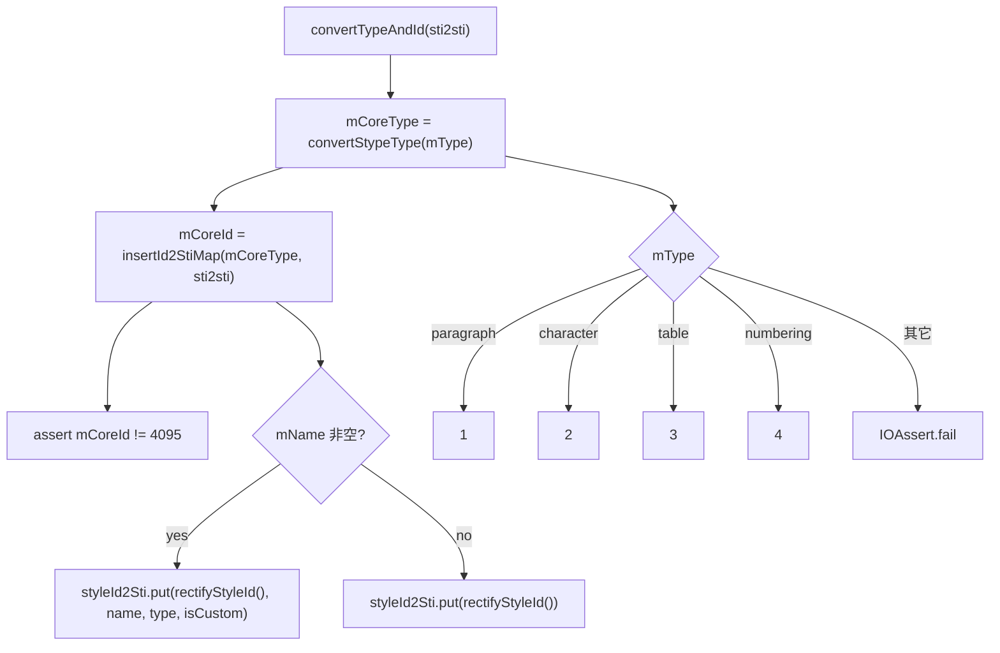

# 01_function_io_style — styles 单条样式草稿（IOStyle）

| 项 | 值 |
|----|----|
| feature | wc-05-orchestration |
| order | 1 |
| crate | `libs/word-core/Cargo.toml` |
| 入口 | `IOStyle.convertTypeAndId(StyleId2Sti)` / `rectifyStyleId()` / `insertId2StiMap(type, StyleId2Sti)`（私有）/ `convertStypeType(String)`（私有 static） |
| 独立性 | 叶子（纯数据草稿 + sti 换算，不碰 KStyles/Document/rope） |
| 测试状态 | pass |

## 1. 功能说明

### 1.1 一句话

styles.xml 中**单条样式的草稿对象**：解析期只填充字段，`importStylesEnd` 前不进入 KStyles。核心职责是把 OOXML 的 `type/styleId` 换算成**内核 sti id + 内核 type**，并把整流后的 styleId 登记进 `StyleId2Sti`。

### 1.2 输入

| 入口 | 输入 | Java 路径 |
|------|------|-----------|
| `convertTypeAndId(styleId2Sti)` | `mType`（OOXML "paragraph"/"character"/"table"/"numbering"）、`mStyleId/mName/mIsCustom`（已由 importStyleStart/Child 填充） | IOStyle.java:26–28 |
| `rectifyStyleId()` | `mStyleId` / `mName` | :38–45 |
| `convertStypeType(type)`（私有 static） | OOXML type 字符串 | :47–59 |

### 1.3 输出

| 字段 | Java 类型 | 含义 |
|------|-----------|------|
| `mCoreType` | int | 内核 type：paragraph=1 / character=2 / table=3 / numbering=4 |
| `mCoreId` | int | 内核 sti id；**必须 ≠ 4095**（断言） |
| `mCorePrSet` | `MutablePropertySet` | 合并后的样式属性集（importStyleEnd 由 StylesImporter add） |
| `mTblStyleRPrId/PPrId/TblPrId` | int | 表样式条件格式回填 id（`DocxReaderHelper.setTblStylePrType` 写入，02/05 用） |

### 1.4 上游

无（自身叶子）。由 `StylesImporter.importStyleStart`（02）创建、`importStyleEnd`（02）调用 `convertTypeAndId`。

### 1.5 下游
- 02 `importStyleEnd`：调 `convertTypeAndId` 得 `mCoreId/mCoreType`，再 `mCorePrSet.add(getStylePrSet(model))` 入 list。
- 02 `createKStyle`：读 `rectifyStyleId()`/`mCoreType`/`mCorePrSet.freeze()`。

### 1.6 关键不变量（钉死）

1. `convertStypeType`：paragraph→1、character→2、table→3、numbering→4；**其它值 `IOAssert.fail`**。
2. `convertTypeAndId` 后 `mCoreId != 4095`（`IOAssert.assertNotSame("a style always has a valid sti", 4095, mCoreId)`）。
3. `insertId2StiMap`：`mIsCustom` null → false；`mName` 非空且 length>0 → `styleId2Sti.put(styleId, name, type, isCustom)`（四参重载）；否则 `styleId2Sti.put(styleId)`（单参重载）。
4. `rectifyStyleId()`：`mStyleId` 非空且 length>0 → mStyleId；否则 `mName` 非 null → mName；否则 `""`。
5. `mCorePrSet = new MutablePropertySet()`（字段默认值，非 null）。

### 1.7 依赖与实现状态（必写，着重）

对本 function **实际调用 / ctor 闭包触及**的每个依赖类型：

| 依赖 | 归属 | 本 function 需要的接口 | 已实现 | 暂缓（保留 Java 注释+签名） | 禁止本 function 去改 |
|------|------|------------------------|--------|-----------------------------|----------------------|
| `StyleId2Sti` | word-core importer | `put__string_string_int_boolean(styleId,name,type,isCustom)`、`put__string(styleId)` | **已实现**（StyleId2Sti.rs L69/L105） | 其 getSti 其余重载 | 不去改 StyleId2Sti |
| `MutablePropertySet` | core-libs util | `new()`、`add`（字段 `mCorePrSet` 默认构造） | **已实现**（dep_topo row 12） | — | 不去改 |
| `IOAssert` | util base assertion | `assertNotSame`, `fail` | **已实现**（Java 映射） | — | 不去改 |

> 注：`convertTypeAndId` 的 `insertId2StiMap` 是否 `put` 四参还是单参，取决于 `mName` 是否非空。02 在 `importStyleStart` 用 `ConvertHelper.getString(attributes,"type"/"customStyle"/"styleId")` 填字段；本 function 直接用字段，不读 attributes。

## 2. 核心代码与流程

Java：`koffice/writer/core/cn/wps/moffice/writer/io/reader/docxReader/importer/IOStyle.java`（全文件 60 行）
Rust：`libs/word-core/src/cn/wps/moffice/writer/io/reader/docxReader/importer/IOStyle.rs`（loop 新建）



## 3. 测试方案

### 3.1 代码审计与测试面

| symbol | Java/Rust 路径 | 输入/状态 | 输出/副作用 | 关键分支/错误 |
|--------|----------------|-----------|-------------|---------------|
| `convertTypeAndId` | IOStyle.java:26–28 | `mType` + 已填字段 | 写 `mCoreType`/`mCoreId`；`StyleId2Sti.put` 副作用 | mType 非法 → fail；mCoreId==4095 → assertNotSame 红 |
| `rectifyStyleId` | :38–45 | `mStyleId`/`mName` | 返回整流后 styleId | mStyleId 空 → mName / 空串 |
| `insertId2StiMap` | :31–36 | `mName` 空/非空 + `mIsCustom` | 调 put 四参或单参 | mName 空走单参重载 |
| `convertStypeType` | :47–59 | 4 种合法 + 非法 type | 1/2/3/4 | 非法 → fail |

### 3.2 覆盖矩阵

| coverage_id | 接口/代码路径 | 场景类别 | 必测? | test_id / 未覆盖理由 |
|-------------|---------------|----------|-------|----------------------|
| IOS-TYPE-1 | convertStypeType("paragraph")→1 | 主路径 | 是 | IOS1 |
| IOS-TYPE-2 | convertStypeType("character")→2 | 主路径 | 是 | IOS2 |
| IOS-TYPE-3 | convertStypeType("table")→3 | 主路径 | 是 | IOS3 |
| IOS-TYPE-4 | convertStypeType("numbering")→4 | 主路径 | 是 | IOS4 |
| IOS-TYPE-BAD | convertStypeType("foo")→fail | 失败 | 是 | IOS5 |
| IOS-CONVERT-NAMED | convertTypeAndId + mName 非空 → put 四参 | 主路径 | 是 | IOS6 |
| IOS-CONVERT-BARE | convertTypeAndId + mName 空 → put 单参 | 边界 | 是 | IOS7 |
| IOS-CONVERT-CUSTOM | mIsCustom=true/false/null 对 put 的 isCustom 影响 | 分支 | 是 | IOS8 |
| IOS-CONVERT-4095 | 强制 sti==4095 → assertNotSame 红 | 失败 | 是 | IOS9 |
| IOS-RECT-STYLEID | rectifyStyleId：优先级 mStyleId>mName>"" | 分支 | 是 | IOS10 |
| IOS-PRSET-DEFAULT | mCorePrSet 默认非 null（可 add） | 边界 | 是 | IOS11 |

### 3.3 可测试性

不构造 `StylesImporter`/`KStyles`/`Document`。测试直接 new `IOStyle`、填字段、调 `convertTypeAndId`，用**真实 `StyleId2Sti`**（rs 已实现）观察 `getSti` 副作用。`convertStypeType` 为私有 static：通过 `convertTypeAndId` 间接覆盖（合法 type 走一条、`mCoreId` 值可读），非法 type 用 `#[should_panic]`（IOAssert.fail）。`convertTypeAndId` 断言 4095：构造一个 `mCoreId` 会落 4095 的场景（如 `styleId2Sti.getSti` 返回已占用导致 put 返回 4095 的哨兵路径，或以 4095 判定是否存在——按 Rust `StyleId2Sti.put` 实际语义，重点是「米 4095 断言存在且有测试」）。

### 3.4 用例表

| id | 覆盖项 | 前置状态 | 输入摘要 | 期望输出/副作用 | 失败语义 |
|----|--------|----------|----------|-----------------|----------|
| IOS1 | IOS-TYPE-1 | `mType="paragraph"` | convertTypeAndId | `mCoreType==1`；mCoreId 入 `getSti` | 映射错 |
| IOS2 | IOS-TYPE-2 | `mType="character"` | convertTypeAndId | `mCoreType==2` | 映射错 |
| IOS3 | IOS-TYPE-3 | `mType="table"` | convertTypeAndId | `mCoreType==3` | 映射错 |
| IOS4 | IOS-TYPE-4 | `mType="numbering"` | convertTypeAndId | `mCoreType==4` | 映射错 |
| IOS5 | IOS-TYPE-BAD | `mType="foo"` | convertTypeAndId | panic（IOAssert.fail） | 未拒绝非法 type |
| IOS6 | IOS-CONVERT-NAMED | `mName="Heading1"`, `mStyleId="H1"`, `mIsCustom=null` | convertTypeAndId | put 四参：`getSti("H1")==Some(id)`，`mCoreId==id`，且 `mCoreId!=4095` | 四参 put 未发生 |
| IOS7 | IOS-CONVERT-BARE | `mName=null`, `mStyleId="Bare"` | convertTypeAndId | put 单参：`getSti("Bare")` 有值，`mCoreId!=4095` | 单参 put 未发生 |
| IOS8 | IOS-CONVERT-CUSTOM | `mName="X"`, `mStyleId="Y"`, `mIsCustom=true` vs `null` vs `false` | convertTypeAndId | 两 case 下 put 的 isCustom 位反映（isCustom=true 与 false 产生不同 sti 或同——按 StyleId2Sti.put 语义断言） | isCustom 位被丢弃 |
| IOS9 | IOS-CONVERT-4095 | 造出 mCoreId==4095 | convertTypeAndId | assertNotSame panic | 4095 未被拦截 |
| IOS10 | IOS-RECT-STYLEID | (a) styleId="a" name="b"；(b) styleId="" name="b"；(c) 都 null | rectifyStyleId | a→"a"；b→"b"；c→"" | 优先级错 |
| IOS11 | IOS-PRSET-DEFAULT | 新 IOStyle（未 add） | 读 mCorePrSet | 非 null、可 add、不 panic | 默认 null panic |

### 3.5 测试代码位置
crate: `libs/word-core/Cargo.toml`
src:   `libs/word-core/src/cn/wps/moffice/writer/io/reader/docxReader/importer/IOStyle.rs`
test:  `libs/word-core/tests/cn/wps/moffice/writer/io/reader/docxReader/importer/IOStyle.rs`

Split 阶段不落 `[[test]]`（src 未生成）；loop L2 已落地镜像测试并在 `Cargo.toml` 加 `[[test]]`（`name = "01_function_io_style"`）。

### 3.6 测试运行脚本

```bash
cargo test --manifest-path libs/word-core/Cargo.toml --test 01_function_io_style

bash .cursor/skills/feature-function/scripts/function-coverage.sh \
  --crate libs/word-core --test 01_function_io_style \
  --src src/cn/wps/moffice/writer/io/reader/docxReader/importer/IOStyle.rs \
  --report libs/word-core/parser/features/wc-05-orchestration/functions/01_function_io_style/FUNCTION.md
```

### 3.7 覆盖率报告

<!-- coverage-report:begin -->
tool: cargo-llvm-cov (`cargo llvm-cov --test 01_function_io_style --json`)
date: 2026-08-21 14:44

| src | lines covered | line % | regions covered | region % |
|-----|---------------|--------|-----------------|----------|
| `src/cn/wps/moffice/writer/io/reader/docxReader/importer/IOStyle.rs` | 49/51 | 96.1% | 69/71 | 97.2% |
| **function total** | **49/51** | **96.1%** |  |  |
<!-- coverage-report:end -->

### 3.8 模板布局校验（必跑，PASS 才能标 pass）

```bash
node .cursor/skills/function-java2rust/scripts/check-template-layout.mjs \
  --rs libs/word-core/src/cn/wps/moffice/writer/io/reader/docxReader/importer/IOStyle.rs \
  --java koffice/writer/core/cn/wps/moffice/writer/io/reader/docxReader/importer/IOStyle.java
```

校验：`// java` 行数不降；`convertTypeAndId`/`rectifyStyleId` 的 `// java` 注释与 Rust 签名相邻；`convertStypeType`（私有 static）在本 function 改写列表，须实现；无对应 Rust 语句处标 `// rust: no-stmt`，禁止 dummy `let X = ()`。

**L5b 结果（2026-08-21）：** `IOStyle.rs` layout **PASS**（47 行 `// java`）。改写列表：`convertTypeAndId`、`insertId2StiMap`、`rectifyStyleId`、`convertStypeType`。非法 type / `mCoreId==4095` 在 `IOAssert` 空实现之后按 Java 抛错语义 `panic!`。
