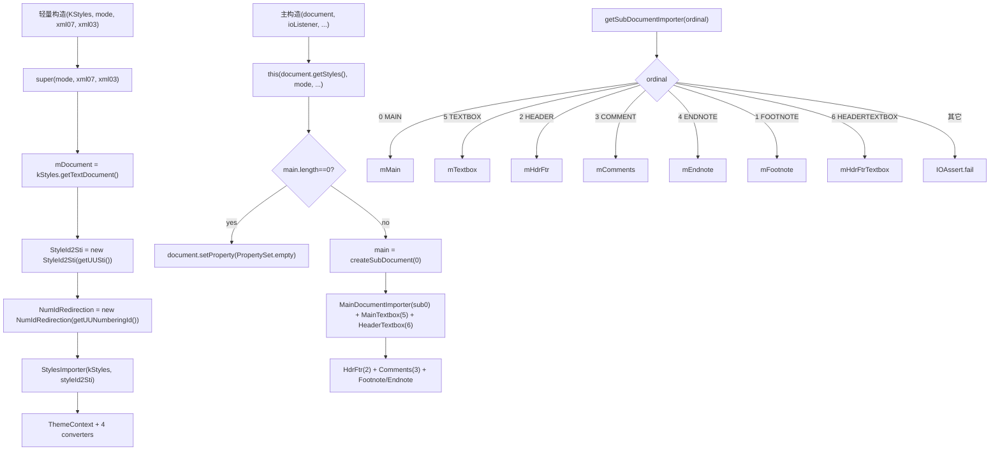

# 03_function_di_construct_route — 总线构造装配 + SubDocType 路由

| 项 | 值 |
|----|----|
| feature | wc-05-orchestration |
| order | 3 |
| crate | `libs/word-core/Cargo.toml` |
| 入口 | `DocumentImporter` 轻量构造 `(KStyles,mode,xml07,xml03)` / 主构造 `(TextDocument,IOListener,IDLProvider,initDrawing,ThemeContext,mode,xml07,xml03)` / `getSubDocumentImporter(ordinal)` / `isLock()` / `hasContent()` / `dispose()` |
| 独立性 | 总线**装配/路由平面**：无正文写入副作用，只决定「哪个 SubDocType 由哪个 importer 服务」 |
| 测试状态 | pass |

## 1. 功能说明

### 1.1 一句话

`DocumentImporter`（implements `IDocumentImporter`）的总线骨架：构造时装配全部子 importer（styles / numbering / settings / fonttable / theme / 9 个 sub-document importer + converters + 共享表），并提供 `getSubDocumentImporter` 把 `SubDocType` ordinal(0–6) 路由到对应 importer。本 function 只管「装配与路由」，不管回调内容转发（那是 04/05）。

> 拆 03/04/05 的理由：`DocumentImporter` 是 ~1285 行、~80 接口方法的单文件总线，I/O 上有三个正交平面——**装配/路由**（无写入副作用，决定服务对象）、**主文档内容转发**（写正文，落点 wc-04）、**非正文族转发+属性转换**（落点专 importer / converter）。拆开让每个水平面的 I/O 契约各有一个独立的覆盖率报告与测试 focus。

### 1.2 输入

| 入口 | 输入 | Java 路径 |
|------|------|-----------|
| 轻量构造 | `KStyles kStyles` + `mode` + `xml07` + `xml03` | DocumentImporter.java:135–152 |
| 主构造 | `TextDocument document` + `IOListener` + `IDLProvider` + `initDrawingContainer` + `ThemeContext` + `mode/xml07/xml03` | :162–184 |
| getSubDocumentImporter | `SubDocType subDocType`（Rust 传 i32 ordinal） | :242–271 |

### 1.3 输出

| 字段/目标 | 含义 |
|-----------|------|
| 轻量构造装配 | super(mode,xml07,xml03) + `mDocument=kStyles.getTextDocument()` + `StyleId2Sti` + `NumIdRedirection` + `StylesImporter` + `ThemeContext` + 4 个 converter |
| 主构造追加装配 | `mainDocument.getLength()==0 → document.setProperty(PropertySet.empty)`；createSubDocument(0..6) 建 `MainDocumentImporter`(0)、`MainTextboxDocumentImporter`(5)、`HeaderTextboxDocumentImporter`(6)、`HdrFtrDocumentImporter`(2)、`CommentsDocumentImporter`(3)、`Footnote/EndnoteDocumentImporter`；mCountParagraph=0；mHasHeaderFooter=false |
| getSubDocumentImporter | MAIN=0→mMain、TEXTBOX=5→mTextbox、HEADER=2→mHdrFtr、COMMENT=3→mComments、ENDNOTE=4→mEndnote、FOOTNOTE=1→mFootnote、HEADERTEXTBOX=6→mHdrFtrTextbox；**其它 → IOAssert.fail** |
| isLock | `mDocument==null→false`；`mainDocument.isLocked()` |
| hasContent | `mDocument.getMainDocument().getLength() > 0` |
| dispose | BlipFillInfos.dispose + StyleId2Sti.dispose + Comments/Main importer dispose + theme=null |

### 1.4 上游

- 02 `StylesImporter`（轻量构造创建）。
- wc-04 `MainDocumentImporter` / `SubDocumentImporter` 系列（主构造 createSubDocument 后 new，rs 已实现）。
- `ImporterBase(mode,xml07,xml03)`（rs 已实现，`mode()/isDocx()`）。
- wc-02 `TextDocument`（`getStyles/getUUSti/getUUNumberingId/createSubDocument/getSubdocument/getMainDocument/getLength`，rs 已实现）、`StyleId2Sti`/`NumIdRedirection`（rs 已实现）。

### 1.5 下游

- 04/05 依赖 `getSubDocumentImporter` seam。
- feature-output：路由契约（MVP 验收 P0「MAIN 落到 MainDocumentImporter」）+ 「其它故事 stub 不 NPE」（P1）。

### 1.6 关键不变量（钉死）

1. SubDocType ordinal = subdoc 编号：**MAIN=0、FOOTNOTE=1、HEADER=2、COMMENT=3、ENDNOTE=4、TEXTBOX=5、HEADERTEXTBOX=6**。
2. `getSubDocumentImporter` 对「已装配但可空的脚注/尾注 importer」：`mEndnoteDocumentImporter`/`mFootnoteDocumentImporter` **可为 null**（构造里 `mEndnoteDocumentImporter=null; mFootnoteDocumentImporter=null` 与后面赋值并存——即主文档路径在 Java 里实际会赋值；Rust 需按模板走，脚注/尾注可 `Option`）。路由返回时若对应 importer 为 None→不 NPE，但未知 ordinal 必须 `IOAssert.fail`。
3. 轻量构造 `mode=0` → `mDocument.getLength()==0`（主构造）才 `setProperty(PropertySet.empty)`。
4. `mDocument = kStyles.getTextDocument()`（轻量构造）；主构造丢 `document` → 复用 `this(document.getStyles(), mode, ...)`。
5. `mainDocument` 用 `createSubDocument(0)` 建，非 `getSubdocument`。
6. `dispose` 依序释放，最后 `mThemeContext=null`。

### 1.7 依赖与实现状态（必写，着重）

| 依赖 | 归属 | 本 function 需要的接口 | 已实现 | 暂缓（保留 Java 注释+签名） | 禁止本 function 去改 |
|------|------|------------------------|--------|-----------------------------|----------------------|
| `ImporterBase` | wc-02/03 | `super(mode,xml07,xml03)`、`mode()` | **已实现**（ImporterBase.rs L20/39） | — | 不去改 |
| `TextDocument` | wc-02 | `getStyles/getUUSti/getUUNumberingId/createSubDocument/getSubdocument/getMainDocument/getLength/setProperty` | **已实现**（TextDocument.rs） | — | 不去改 |
| `KStyles` | wc-02 | ctor 入参 + `getTextDocument` | **已实现** | — | 不去改 |
| `StyleId2Sti` / `NumIdRedirection` | wc-02 | `new(UUSti)` / `new(UUNumberingId)` | **已实现**（rs） | — | 不去改 |
| `StylesImporter` | 02（本 feature） | ctor（轻量构造创建） | loop 先做 02 | — | 依赖 02 |
| `MainDocumentImporter` | wc-04 | `new(subdoc, styleId2Sti, numIdRedirection, ioListener, dlProvider, initDrawing, mode, xml07, xml03)`；`dispose` | **已实现**（wc-04 pass） | — | 不去改 |
| `SubDocumentImporter` 系列（MainTextbox/HeaderTextbox/HdrFtr/Comments/Footnote/Endnote） | wc-04 | 各 ctor + dispose（空方法即可） | Main/HdrFtr/SubDocument 已实现；MainTextbox/HeaderTextbox/Comments/Footnote/Endnote 若未全部实现 → **stub（签名完整，body 空实现，不 NPE）** | 未实现的子类型 stub 承接 | 不新建过多类型 |
| `ParaProps/RunProps/TablePropertyBase/CellPropertyConverter` | wc-03 | ctor(mode,xml07,xml03) | rs 已实现（wc-03） | — | — |
| `ThemeContext` | dmlReader | ctor | core-libs/word-core | — | 不去改 |
| `IDocumentImporter` trait | core-libs | 本类 implements | trait 已生成（`&dyn Any` + `&self`） | — | 不改 trait 签名 |
| `IOListener` / `IDLProvider` | word-core | 存字段、`onLoadParas`（后续用） | 接口已生成 | — | 不去改 |

> 注：03 只验证「装配完成、路由正确、stub 不 NPE」。真实 createSubDocument 落库语义由 wc-02 已测，不重测；本 function 断言「createSubDocument(n) 被以正确编号调用」通过路由后 importer 的 subdoc 类型/长度反查。

## 2. 核心代码与流程

Java：`koffice/writer/core/cn/wps/moffice/writer/io/reader/docxReader/importer/DocumentImporter.java`（构造 + 路由段）
Rust：`libs/word-core/src/cn/wps/moffice/writer/io/reader/docxReader/importer/DocumentImporter.rs`（loop 新建）



## 3. 测试方案

### 3.1 代码审计与测试面

| symbol | Java/Rust 路径 | 输入/状态 | 输出/副作用 | 关键分支/错误 |
|--------|----------------|-----------|-------------|---------------|
| 轻量构造 | :135–152 | KStyles+mode | 装配 StyleId2Sti/NumIdRedirection/StylesImporter/converters；mDocument==kStyles.getTextDocument | kStyles null → 红 |
| 主构造 | :162–184 | TextDocument+IOListener+… | 复用轻量 + SetProperty.empty 条件 + createSubDocument(0..6) 建 importer | ioListener null → 红；main length==0 分支 |
| getSubDocumentImporter | :242–271 | ordinal 0–6 | 返回对应 importer | 未知 ordinal → fail |
| isLock | :1273–1280 | mDocument/main null | false / mainDocument.isLocked() | null 短路 |
| hasContent | :968–971 | main length | bool | length==0 |
| dispose | :128–135 | — | 释放各 importer + theme=null | 不二次释放 panic |

### 3.2 覆盖矩阵

| coverage_id | 接口/代码路径 | 场景类别 | 必测? | test_id / 未覆盖理由 |
|-------------|---------------|----------|-------|----------------------|
| DI-LIGHT | 轻量构造装配完整 | 主路径 | 是 | D3-1 |
| DI-LIGHT-NULL | kStyles null → 红 | 失败 | 是 | D3-2 |
| DI-MAIN-EMPTY | 主构造 main length==0 → setProperty(empty) | 边界 | 是 | D3-3 |
| DI-MAIN-NOTEMPTY | main length!=0 → 不 setProperty empty | 分支 | 是 | D3-4 |
| DI-MAIN-ASSEMBLE | 主构造 createSubDocument(0..6) 建 9 importer | 主路径 | 是 | D3-5 |
| DI-ROUTE-MAIN | ordinal 0 → MainDocumentImporter | 主路径 | 是 | D3-6 |
| DI-ROUTE-TEXTBOX | ordinal 5 → Textbox | 分支 | 是 | D3-7 |
| DI-ROUTE-HEADER | ordinal 2 → HdrFtr | 分支 | 是 | D3-8 |
| DI-ROUTE-COMMENT | ordinal 3 → Comments | 分支 | 是 | D3-9 |
| DI-ROUTE-ENDNOTE | ordinal 4 → Endnote | 分支 | 是 | D3-10 |
| DI-ROUTE-FOOTNOTE | ordinal 1 → Footnote | 分支 | 是 | D3-11 |
| DI-ROUTE-HEADERTBX | ordinal 6 → HdrFtrTextbox | 分支 | 是 | D3-12 |
| DI-ROUTE-BAD | ordinal 7/未知 → fail | 失败 | 是 | D3-13 |
| DI-ISLOCK-NULL | mDocument null → false | 边界 | 是 | D3-14 |
| DI-ISLOCK | main.isLocked 传播 | 主路径 | 是 | D3-15 |
| DI-HASCONTENT | main length>0 / ==0 | 主路径/边界 | 是 | D3-16 |
| DI-DISPOSE | dispose 释放不 panic | 状态 | 是 | D3-17 |

### 3.3 可测试性

不开 docx。用真实 `TextDocument`（wc-02 已实现，可 createSubDocument）+ 真实/假 `IOListener`/`IDLProvider`。假 `IOListener` 记录 `onLoadParas` 调用。路由后**通过子 importer 的 subdoc 类型/长度反查**验证装配：`getSubDocumentImporter(MAIN)` 的 subdoc.type==0 且 subdoc 是 main。未知 ordinal 用 `#[should_panic]`。isLock 需能造 mDocument null 与 locked 两态（TextDocument.setInIOState 或 SubDocument.isLocked 真实 setter 造态）。`dispose` 断言不 panic + 二次调用不 panic（若 Java 不保证，则只断言首调不 panic）。

### 3.4 用例表

| id | 覆盖项 | 前置状态 | 输入摘要 | 期望输出/副作用 | 失败语义 |
|----|--------|----------|----------|-----------------|----------|
| D3-1 | DI-LIGHT | 真实 KStyles+UUSti+UUNumberingId | new 轻量构造(mode=0) | mDocument==getTextDocument；内部 StyleId2Sti/NumIdRedirection 已建（通过 later importStyleEnd 可见） | 装配缺 |
| D3-2 | DI-LIGHT-NULL | kStyles=null | new | panic（assertNotNull） | 未拒绝 null |
| D3-3 | DI-MAIN-EMPTY | 空 TextDocument（main length==0） | 主构造 | `document.getProperty()` 是 empty（被 setProperty(empty)） | 未设 empty |
| D3-4 | DI-MAIN-NOTEMPTY | main 已有内容（appendText 一处） | 主构造 | getProperty 非 empty 覆盖（保持原值） | 误覆盖 |
| D3-5 | DI-MAIN-ASSEMBLE | 真实 TextDocument | 主构造 | getSubDocumentImporter 各 ordinal 返回非 None importer；其 subdoc 类型 0..6 正确 | 装配错 |
| D3-6 | DI-ROUTE-MAIN | 主构造后 | getSub(0) | 返回 MainDocumentImporter（subdoc.type==0） | 路由错 |
| D3-7 | DI-ROUTE-TEXTBOX | 主构造后 | getSub(5) | 返回 Textbox importer（subdoc.type==5） | 路由错 |
| D3-8 | DI-ROUTE-HEADER | 主构造后 | getSub(2) | HdrFtr（subdoc.type==2） | 路由错 |
| D3-9 | DI-ROUTE-COMMENT | 主构造后 | getSub(3) | Comments（subdoc.type==3） | 路由错 |
| D3-10 | DI-ROUTE-ENDNOTE | 主构造后 | getSub(4) | Endnote（subdoc.type==4） | 路由错 |
| D3-11 | DI-ROUTE-FOOTNOTE | 主构造后 | getSub(1) | Footnote（subdoc.type==1） | 路由错 |
| D3-12 | DI-ROUTE-HEADERTBX | 主构造后 | getSub(6) | HdrFtrTextbox（subdoc.type==6） | 路由错 |
| D3-13 | DI-ROUTE-BAD | 主构造后 | getSub(7/999) | panic（IOAssert.fail） | 未知 ordinal 未拒绝 |
| D3-14 | DI-ISLOCK-NULL | mDocument=null（构造逃逸或测试造 null） | isLock() | false | 未短路 |
| D3-15 | DI-ISLOCK | main 被 lock | isLock() | true | 未传播 |
| D3-16 | DI-HASCONTENT | (a) main 空 (b) main 有内容 | hasContent() | a→false b→true | 判定错 |
| D3-17 | DI-DISPOSE | 主构造后 | dispose() | 无 panic；theme=null | 释放 panic |

### 3.5 测试代码位置
crate: `libs/word-core/Cargo.toml`
src:   `libs/word-core/src/cn/wps/moffice/writer/io/reader/docxReader/importer/DocumentImporter.rs`
test:  `libs/word-core/tests/cn/wps/moffice/writer/io/reader/docxReader/importer/DocumentImporter.rs`

Split 阶段不落 `[[test]]`（src 未生成）；loop L2 已落地镜像测试并在 `Cargo.toml` 加 `[[test]]`（`name = "03_function_di_construct_route"`）。04/05 与 03 共用同一个 src `DocumentImporter.rs`，测试镜像文件用后缀 `DocumentImporterContent.rs` / `DocumentImporterForward.rs` 隔离。

### 3.6 测试运行脚本

```bash
cargo test --manifest-path libs/word-core/Cargo.toml --test 03_function_di_construct_route

bash .cursor/skills/feature-function/scripts/function-coverage.sh \
  --crate libs/word-core --test 03_function_di_construct_route \
  --src src/cn/wps/moffice/writer/io/reader/docxReader/importer/DocumentImporter.rs \
  --report libs/word-core/parser/features/wc-05-orchestration/functions/03_function_di_construct_route/FUNCTION.md
```

### 3.7 覆盖率报告

<!-- coverage-report:begin -->
tool: cargo-llvm-cov (`cargo llvm-cov --test 03_function_di_construct_route --json`)
date: 2026-08-21 17:35

| src | lines covered | line % | regions covered | region % |
|-----|---------------|--------|-----------------|----------|
| `src/cn/wps/moffice/writer/io/reader/docxReader/importer/DocumentImporter.rs` | 223/435 | 51.3% | 304/519 | 58.6% |
| **function total** | **223/435** | **51.3%** |  |  |
<!-- coverage-report:end -->

### 3.8 模板布局校验（必跑，PASS 才能标 pass）

```bash
node .cursor/skills/function-java2rust/scripts/check-template-layout.mjs \
  --rs libs/word-core/src/cn/wps/moffice/writer/io/reader/docxReader/importer/DocumentImporter.rs \
  --java koffice/writer/core/cn/wps/moffice/writer/io/reader/docxReader/importer/DocumentImporter.java
```

校验：`// java` 行数不降；构造与 `getSubDocumentImporter` 的 `// java` 注释与 Rust 签名相邻；`switch` 的 7 个 case 注释保留；未在改写列表的族方法（如 MATH/注释/媒体等，见 §1.7）停车模版体（`todo!("DEFERRED_NON_FUNCTION")` + `/** DEFERRED_NON_FUNCTION … **/`），禁止删注释或 dummy `let X = ()`。Java 无对应语句处标 `// rust: no-stmt`。

**结果（2026-08-21）：PASS**（919 `// java` 行，method comments covered）。
