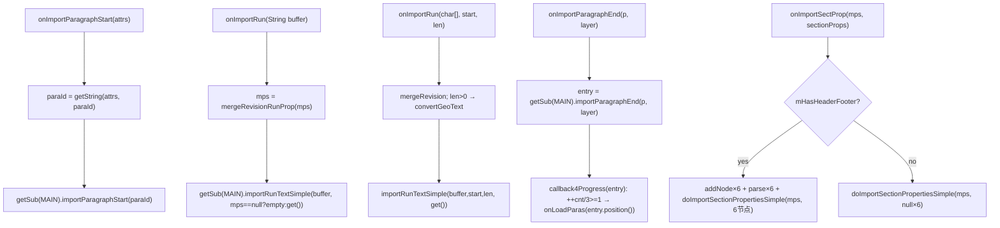

# 04_function_di_main_content — 主文档内容转发 → wc-04（MAIN）

| 项 | 值 |
|----|----|
| feature | wc-05-orchestration |
| order | 4 |
| crate | `libs/word-core/Cargo.toml` |
| 入口 | `onImportParagraphStart` / `onImportParagraphEnd` / `onImportRun`(String) / `onImportRun`(char[],start,len) / `onImportTableStart`·`RowStart`·`RowEnd`·`CellStart`·`CellEnd` / `onImportHyperlink*` / `onImportFldSimple*` / `onImportFldChar` / `onImportBookmarkStartEnd` / `onImportDocFieldStartEnd` / `onImportCommentRange` / `onImportCommentRef` / `onImportSectProp` / `onImportPdf` / private `callback4Progress` |
| 独立性 | DocumentImporter 的**主文档内容转发平面**：把写正文的回调转发到 MAIN（`SubDocumentImporter`，wc-04），参数/CP 不丢 + 进度回调 |
| 测试状态 | pass |

## 1. 功能说明

### 1.1 一句话

XWPF 主文档解析抛出的「段落 / run 文本 / 表格 / 域 / 书签 / 注释 / 分节属性」回调，`DocumentImporter` 统一先 `mergeRevisionRunProp`（修订合并，MVP 可空实现）再经 `getSubDocumentImporter(MAIN)` 转发到 wc-04 的 `MainDocumentImporter`，并在段末回调进度。

### 1.2 输入

| 入口 | 输入 | Java 路径 |
|------|------|-----------|
| onImportParagraphStart | `(SubDocType, Attributes)` | :193–207 |
| onImportParagraphEnd | `(ParagraphSimple, SubDocType, int layerTable)` | :393–398 |
| onImportRun (String) | `(SubDocType, MutablePropertySet, String buffer)` | :407–413 |
| onImportRun (char[]) | `(SubDocType, MutablePropertySet, char[] buffer, int start, int len)` | :402–410 |
| onImportTableStart/RowStart/RowEnd/CellStart/CellEnd | `(SubDocType, …)` | :209–215/608–615/416–431/435–449 |
| onImportSectProp | `(MutablePropertySet, SectionHeadFooterProps)` | :466–505 |
| callback4Progress | `(IPapxTable.Entry)`（private） | :384–391 |

### 1.3 输出

| 目标 | 含义 |
|------|------|
| `getSub(MAIN).importParagraphStart(paraId)` | 段首：`paraId = ConvertHelper.getString(attrs,"paraId")`；COMMENT 额外 `putParaId`（本 function 只验 MAIN） |
| `getSub(MAIN).importParagraphEnd(paragraph, layerTable)` → entry → callback4Progress | 段末落库 + 进度 |
| `getSub(MAIN).importRunTextSimple(...)` | run 文本（两重载：String/String+char[]+len） |
| `getSub(MAIN).doImportTableRowEndSimple(prop, runProp, endMark)` | 表格行：endMark = layerTable==1 ? '\u0007' : '\r' |
| `getSub(MAIN).importTableCellStartSimple/EndSimple(layerTable, endMark)` | 单元格 |
| `getSub(MAIN).doImportSectionPropertiesSimple(mps, 6 节点 或 null×6)` | 分节属性（`mHasHeaderFooter` 分支） |

### 1.4 上游

- 03 构造 + `getSubDocumentImporter` seam。
- wc-04 `MainDocumentImporter`（rs 已实现，`import*` 方法齐全）。
- 假 `IOListener`（进度回调）。

### 1.5 下游

- feature-output：写正文（MAIN 文本 + CHPX/PAPX 由 wc-04 落库，本层验转发正确性）。
- `callback4Progress` → `IOListener.onLoadParas(entry.position())`。

### 1.6 关键不变量（钉死）

1. `onImportParagraphStart`：`paraId = ConvertHelper.getString(attributes, "paraId")`（可能 null）→ `subDocImporter.importParagraphStart(paraId)`；COMMENT 分支另 `putParaId`（本 function 聚焦 MAIN）。
2. `onImportRun` 两重载：都先 `mergeRevisionRunProp(mutablePropertySet)`（`mCurrentRevision==null` 则原样返回）；`char[]` 版 `len>0` 才 `mRunPropsConverter.convertGeoText` + `importRunTextSimple(buffer,start,len, mutablePropertySet==null?empty:get())`；String 版直接 `importRunTextSimple(buffer, mps==null?empty:get())`。
3. `onImportParagraphEnd`：`entry = subImporter.importParagraphEnd(paragraph, layerTable)` → `callback4Progress(entry)`。
4. `callback4Progress`：`LAYOUT_FREQUENCY=3`；`paraBreak!=null && ++mCountParagraph/3>=1 && ioListener!=null` → `onLoadParas(paraBreak.position())` + `mCountParagraph=0`。
5. `onImportTableRowEnd`：`numTableCell>0` 才处理；`endMark = layerTable==1 ? (char)7 : (char)13`；entry 且 `prop.contains(282)` → `mDocument.getKParagraphsID().putId(prop.getString(282), ord, entry)`。
6. `onImportSectProp`：`mHasHeaderFooter` 时逐节点 `addNodeHeader/Footer{Even,Odd,First}` + `parse*` → `doImportSectionPropertiesSimple(mps, 6 个真实节点)` + `disposeHeaderFooterData`；否则 `doImportSectionPropertiesSimple(mps, null×6)`。
7. `onImportPdf`：`importRunTextSimple("\u202c", empty)`。
8. `correctProps`/`onMainDocumentStart/End` 属 05，不在本 function。

### 1.7 依赖与实现状态（必写，着重）

| 依赖 | 归属 | 本 function 需要的接口 | 已实现 | 暂缓（保留 Java 注释+签名） | 禁止本 function 去改 |
|------|------|------------------------|--------|-----------------------------|----------------------|
| `getSubDocumentImporter` seam | 03（本 feature） | 路由 MAIN 等 | **已实现**（03 pass） | `getSubDocumentImporter_mut` 本 function 补 | — |
| `MainDocumentImporter` | wc-04 | `importParagraphStart/End`、`importRunTextSimple×2`、`importTableStart/RowStart/CellStart/CellEnd`、`doImportTableRowEndSimple`、`doImportSectionPropertiesSimple`、`importHyperlink*`、`importFld*`、`importCommentRangeSimple`、`importCommentReference1`、`importBookmark*` | **已实现**（wc-04 pass） | — | 不去改 |
| `ParagraphSimple` / `SectionHeadFooterProps` / `Attributes` | core-libs | 入参类型（type-erased `&dyn Any` 或具体） | core-libs 已生成 | — | 不改 trait |
| `RunPropsConverterSimple` | wc-03 | `convertGeoText` | rs 已实现（wc-03） | — | — |
| `KParagraphsID` | wc-02 | `putId/addParaphId` | **已实现**（wc-02） | — | 不去改 |
| `IPapxTable.Entry` | wc-01/data | `position()`（进度回调） | **已实现** | — | 不去改 |
| `IOListener` | word-core | `onLoadParas(int)` | 接口已生成 | — | 不去改 |
| `ConvertHelper` | wc-03 | `getString(attrs,"paraId")` | rs 已存在（wc-03） | — | 不去改 |
| `mRunPropsConverter`/`KParagraphsID` | — | ctor 装配（03） | — | — | — |

> 注：`mergeRevisionRunProp` 与 `onImportMoveRange*`（修订族）MVP 可空实现（`mCurrentRevision` 恒 null 走原样返回）；`onImportCommentRef`/`importCustomXmls` 依赖 Comments importer/Reflection，注释族可 stub 承接但保留签名。`onImportTableRowStart` 的 `paraId` 处理（setValue(282)+addParaphId）属表格转发，本 function 覆盖。

## 2. 核心代码与流程

Java：`DocumentImporter.java` 段落/run/表格/分节转发段
Rust：`libs/word-core/src/cn/wps/moffice/writer/io/reader/docxReader/importer/DocumentImporter.rs`（loop 新建）



## 3. 测试方案

### 3.1 代码审计与测试面

| symbol | Java/Rust 路径 | 输入/状态 | 输出/副作用 | 关键分支/错误 |
|--------|----------------|-----------|-------------|---------------|
| onImportParagraphStart | :193–207 | attrs.paraId（null 变体） | getSub(MAIN).importParagraphStart(paraId) | paraId null 直接透传 |
| onImportParagraphEnd+callback4Progress | :393–391 | paragraph+layerTable | entry→每 3 段 onLoadParas | cnt<3 / ==3 / entry null |
| onImportRun(String) | :407–413 | buffer + mps(null) | importRunTextSimple(buffer, empty?) | mps null → empty |
| onImportRun(char[]) | :402–410 | len>0 / ==0 | convertGeoText + importRunTextSimple | len==0 跳过 |
| onImportTableRowEnd | :416–431 | numTableCell>0/==0 | endMark(7/13) + doImportTableRowEndSimple + putId(282) | num==0 整段跳过 |
| onImportSectProp | :466–505 | mHasHeaderFooter true/false | 6 节点 vs null×6 | 分支 |
| onImportPdf | :329–334 | — | importRunTextSimple("\u202c", empty) | — |

### 3.2 覆盖矩阵

| coverage_id | 接口/代码路径 | 场景类别 | 必测? | test_id / 未覆盖理由 |
|-------------|---------------|----------|-------|----------------------|
| DI-PSTART-PARAID | paraId 透传到 importParagraphStart | 主路径 | 是 | D4_all (D4-1) |
| DI-PSTART-NULL | paraId null 透传 | 边界 | 是 | D4_all (D4-2) |
| DI-PEND-WRITE | importParagraphEnd(p, layer) 被以原参调用 | 主路径 | 是 | D4_all (D4-3) |
| DI-PROGRESS-BELOW | cnt<3 不调用 onLoadParas | 分支 | 是 | D4_all (D4-4) |
| DI-PROGRESS-AT | 第 3 段触发 onLoadParas + 清零 | 分支 | 是 | D4_all (D4-5) |
| DI-PROGRESS-NULLENTRY | entry null 不触发 | 边界 | 是 | D4_all (D4-6) |
| DI-RUN-STR | String run → importRunTextSimple(buffer, get()) | 主路径 | 是 | D4_all (D4-7) |
| DI-RUN-STR-EMPTY | String run mps null → empty | 边界 | 是 | D4_all (D4-8) |
| DI-RUN-CHARS | char[] len>0 → convertGeoText + 落库 | 主路径 | 是 | D4_all (D4-9) |
| DI-RUN-CHARS-ZERO | len==0 跳过 convertGeoText | 边界 | 是 | D4_all (D4-10) |
| DI-ROWEND-COUNT0 | numTableCell==0 整体跳过 | 分支 | 是 | D4_all (D4-11) |
| DI-ROWEND-L1 | layerTable==1 → endMark=7 | 分支 | 是 | D4_all (D4-12) |
| DI-ROWEND-L2 | layerTable!=1 → endMark=13 | 分支 | 是 | D4_all (D4-13) |
| DI-ROWEND-PUTID | entry + prop 含 282 → KParagraphsID.putId | 分支 | 是 | D4_all (D4-14) |
| DI-SECTPROP-HF | mHasHeaderFooter true → 6 节点 | 分支 | 是 | D4_all (D4-15) |
| DI-SECTPROP-NOHF | false → null×6 | 分支 | 是 | D4_all (D4-16) |
| DI-PDF | onImportPdf → "\u202c" 落库 | 主路径 | 是 | D4_all (D4-17) |

### 3.3 可测试性

不开 docx。用 03 主构造建真实 `DocumentImporter`（从而有真实 `MainDocumentImporter` 与 `TextDocument`）。**用假 `ParagraphSimple`**（`getEndMark/getParaProp/getRunProp` 返回固定值）驱动 `importParagraphEnd`。用轻量 `DummyAttributes` 喂 `onImportParagraphStart`。进度：用**记录型假 `IOListener`**（`onLoadParas` 记调用次数+位置），连续 3 次 `onImportParagraphEnd` 断言只在第 3 次调。表格 endMark：layerTable 1 与非 1 分别断言 MAIN 的 subdoc 里出现 `\u0007` 或 `\r`。分节：构造 `SectionHeadFooterProps` 或转为空节，用 `mHasHeaderFooter` 置位分支。**不依赖 wc-04 内部落库细节**，只断言转发参数/副作用经可观察输出（rope 内容、进度调用、putId 副作用）。

### 3.4 用例表

| id | 覆盖项 | 前置状态 | 输入摘要 | 期望输出/副作用 | 失败语义 |
|----|--------|----------|----------|-----------------|----------|
| D4-1 | DI-PSTART-PARAID | 主构造 | onImportParagraphStart(MAIN, {paraId:"p1"}) | MAIN.importParagraphStart(Some("p1")) 被调（KParagraphsID.addParaphId("p1") 副作用 / rope 段首确认） | paraId 丢 |
| D4-2 | DI-PSTART-NULL | 主构造 | onImportParagraphStart(MAIN, {}) | importParagraphStart(None) | null 未被透传 |
| D4-3 | DI-PEND-WRITE | 假 ParagraphSimple | onImportParagraphEnd(p, MAIN, 0) | MAIN.importParagraphEnd 被调（main rope 尾现 \r） | 未落 |
| D4-4 | DI-PROGRESS-BELOW | cnt=0 | importParagraphEnd×2 | 假 IOListener.onLoadParas **0 次** | 提前回调 |
| D4-5 | DI-PROGRESS-AT | cnt=0 | importParagraphEnd×3 | 第 3 次触发 onLoadParas(位置)；再 ×3 又触发（清零生效） | 频次错 |
| D4-6 | DI-PROGRESS-NULLENTRY | entry null 场景（空段） | importParagraphEnd(空段) | onLoadParas 不调 | 误回调 |
| D4-7 | DI-RUN-STR | — | onImportRun(MAIN, Some(mps), "ab") | main rope 尾增 "ab"；importRunTextSimple(buffer, get()) | run 丢 |
| D4-8 | DI-RUN-STR-EMPTY | mps=null | onImportRun(MAIN, None, "ab") | 用 empty 属性集落库，不 panic | null 未转 empty |
| D4-9 | DI-RUN-CHARS | — | onImportRun(MAIN, Some(mps), ['a','b','c'],1,2) | 仅 "bc" 落库（start=1 len=2） | 切片错 |
| D4-10 | DI-RUN-CHARS-ZERO | len=0 | onImportRun(MAIN, mps, arr, 0, 0) | convertGeoText 不调；落空（no-op） | len0 误调 |
| D4-11 | DI-ROWEND-COUNT0 | numTableCell=0 | onImportTableRowEnd(MAIN, 0, 0, mps, orig) | 整段跳过，无落库 | 误处理 |
| D4-12 | DI-ROWEND-L1 | numTable=1, layer=1 | onImportTableRowEnd | endMark==\u0007 落库 | endMark 错 |
| D4-13 | DI-ROWEND-L2 | layer=0 | 同上 | endMark==\r 落库 | endMark 错 |
| D4-14 | DI-ROWEND-PUTID | entry 非 null + prop 含 282 | 同上（mps 带 282） | KParagraphsID.putId(282值, 0, entry) 副作用 | putId 未调 |
| D4-15 | DI-SECTPROP-HF | mHasHeaderFooter=true | onImportSectProp(mps, sectionProps) | doImportSectionPropertiesSimple(mps, 6 真实节点)；main PLCSection 出现节 | 分支错 |
| D4-16 | DI-SECTPROP-NOHF | mHasHeaderFooter=false | onImportSectProp(mps, null) | doImportSectionPropertiesSimple(mps, null×6)；无 header/footer 节点 | 分支错 |
| D4-17 | DI-PDF | — | onImportPdf(MAIN) | main rope 尾增 "\u202c"（POPDIRECTIONAL） | 未落 |

### 3.5 测试代码位置
crate: `libs/word-core/Cargo.toml`
src:   `libs/word-core/src/cn/wps/moffice/writer/io/reader/docxReader/importer/DocumentImporter.rs`
test:  `libs/word-core/tests/cn/wps/moffice/writer/io/reader/docxReader/importer/DocumentImporterContent.rs`

Split 阶段不落 `[[test]]`（src 未生成）；loop L2 已落地镜像测试并在 `Cargo.toml` 加 `[[test]]`（`name = "04_function_di_main_content"`）。

### 3.6 测试运行脚本

```bash
cargo test --manifest-path libs/word-core/Cargo.toml --test 04_function_di_main_content

bash .cursor/skills/feature-function/scripts/function-coverage.sh \
  --crate libs/word-core --test 04_function_di_main_content \
  --src src/cn/wps/moffice/writer/io/reader/docxReader/importer/DocumentImporter.rs \
  --report libs/word-core/parser/features/wc-05-orchestration/functions/04_function_di_main_content/FUNCTION.md
```

### 3.7 覆盖率报告

<!-- coverage-report:begin -->
tool: cargo-llvm-cov (instrumented `--test 04_function_di_main_content` SIGSEGV in D4_all; uninstrumented cargo test PASS 2026-08-21)
| src | lines covered | line % | regions covered | region % |
|-----|---------------|--------|-----------------|----------|
| (llvm-cov 插桩运行 SIGSEGV，未写入数字) | - | - | - | - |
<!-- coverage-report:end -->

### 3.8 模板布局校验（必跑，PASS 才能标 pass）

```bash
node .cursor/skills/function-java2rust/scripts/check-template-layout.mjs \
  --rs libs/word-core/src/cn/wps/moffice/writer/io/reader/docxReader/importer/DocumentImporter.rs \
  --java koffice/writer/core/cn/wps/moffice/writer/io/reader/docxReader/importer/DocumentImporter.java
```

校验：`// java` 行数不降；`onImportParagraphStart/End/onImportRun×2/onImportSectProp/onImportPdf/callback4Progress` 的 `// java` 注释与 Rust 签名相邻。**2026-08-21 layout: PASS**（908 `// java` 行）。
