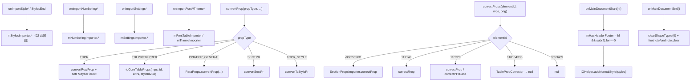

# 05_function_di_meta_forward — 非正文族转发 + 属性转换 + 进度

| 项 | 值 |
|----|----|
| feature | wc-05-orchestration |
| order | 5 |
| crate | `libs/word-core/Cargo.toml` |
| 入口 | `onMainDocumentStart/End`、样式族（`onImportStyle*`/`StylesEnd`/`StyleTblStylePrEnd`/`convertStyleTcStylePr`）、编号族（`onImportNumbering*`）、设置族（`onImportSettings*`）、字体族（`onImportFont*`/`onImportFontScheme*`/`onImportTheme*`）、`convertProp`/`convertRunProp`/`correctProps`/`converTableCellProp`/`setFMaybeFitText`、`importCustomXmls` |
| 独立性 | DocumentImporter 的**非正文族转发 + 属性转换 + 生命周期**平面：落点是专用 importer / wc-03 converter，不写正文 rope |
| 测试状态 | pass |

## 1. 功能说明

### 1.1 一句话

除「主文档段落/run」之外的 `DocumentImporter` 转发面：把样式 / 编号 / 设置 / 字体 / 主题回调直转各自专用 importer（styles→StylesImporter、numbering→NumberingImporter…），把 `convertProp/correctProps` 按 propType/elementId dispatch 到 converter，并在 `onMainDocumentStart/End` 维护 `mHasHeaderFooter` + `addNormalStyle`。

### 1.2 输入

| 族 | 入口 | Java 路径 |
|----|------|-----------|
| 生命周期 | `onMainDocumentStart(boolean hasHeaderFooter)` | :188–195 |
| 生命周期 | `onMainDocumentEnd()` | :228–239 |
| 样式 | `onImportStyleDocDefaults`/`Start`/`Child`/`End`/`StylesEnd`/`StyleTblStylePrEnd` | :768–800 |
| 编号 | `onImportNumbering*`（NumStart/Child/End、LevelStart/Child/End、AbstractNumStart/Child/End） | :805–850 |
| 设置 | `onImportSettingsStart/Child/End` | :707–717 |
| 字体/主题 | `onImportFont*`、`onImportFontScheme*`、`onImportMajor/MinorFontStart`、`onImportTheme*FontStart` | :687–1005 |
| 属性转换 | `convertProp(PropType,...)` / `convertRunProp` / `correctProps(elementId,...)` / `converTableCellProp` | :523/573/850–901 |
| 收尾 | `importCustomXmls()` | :729–749 |

### 1.3 输出

| 目标 | 含义 |
|------|------|
| `mHasHeaderFooter` | `onMainDocumentStart` 设：`hasHeaderFooter && subdocument(2).getLength()==0` |
| `IOHelper.addNormalStyle(mStyles)` | `onMainDocumentStart` 内调用（正文前防缺 Normal） |
| 样式族 | 直转 `mStylesImporter.*`（02） |
| 编号/设置/字体/主题族 | 直转各专 importer |
| `convertProp` | 按 PropType dispatch：TRPR→RowProp+FmtText、TBLGRID→TableGrid、TBLPR/TBLPREX→toCoreTableProps、PPR/PPR_GENERAL→ParaProps.convertProp、SECTPR→convertSectPr、TCPR_STYLE→convertTcStylePr |
| `correctProps` | 按 elementId：-906275931→sectPr、112148→correctRrop、110226→ParaProps.correctProp/correctPPrBase、110154336→TablePropCorrector.correctTblPrBaseProp、3553489→null |
| `onMainDocumentEnd` | `VmlReader.clearShapeTypes(0)` + endnote/footnote importer `clear()`（判 null） |
| `importCustomXmls` | 经 Reflection/ICmtCustDatasReader 过滤 customXmlInfos（MVP 可空实现，保留调用位次） |

### 1.4 上游

- 02 `StylesImporter`（样式族落点）、03 构造（各专 importer / converter 装配）。
- wc-03 converters（`ParaPropsConverterSimple`/`RunPropsConverterSimple`/`TablePropertyBaseConverterSimple`/`CellPropertyConverterSimple`）。
- wc-02 `KStyles`（addNormalStyle 入参）、wc-02/03 `IOHelper.addNormalStyle`（rs 已实现）。

### 1.5 下游

- feature-output：styles/编号/设置/字体/主题落入各自的模型；`mHasHeaderFooter` 影响 04 的 `onImportSectProp` 分支（跨 function 状态耦合）。
- 06 的 `addNormalStyle` 兜底与 05 的 `onMainDocumentStart` 内 addNormalStyle 构成双调用不变量。

### 1.6 关键不变量（钉死）

1. `onMainDocumentStart(hasHeaderFooter)`：`mHasHeaderFooter = hasHeaderFooter && mDocument.getSubdocument(2).getLength()==0`；随后 `IOHelper.addNormalStyle(mDocument.getStyles())`（**正文前**）。
2. `onMainDocumentEnd`：`VmlReader.clearShapeTypes(0)`；`mEndnoteDocumentImporter!=null → clear()`；`mFootnoteDocumentImporter!=null → clear()`。
3. `correctProps` elementId：**-906275931**→`mMainDocumentImporter.getSectionPropsImporter().correctProp`；**112148**→`mergeRevisionRunProp` + `mRunPropsConverter.correctRrop`（须 originalProp!=null）；**110226**→`originalProp!=null?ParaPropsConverterSimple.correctProp : correctPPrBase`；**110154336**→`TablePropCorrector.correctTblPrBaseProp` 返回 null；**3553489**→返回 null；未知 → `IOAssert.fail`。
4. `convertProp` PropType：TRPR/TBLGRID/TBLPR/TBLPREX/PPR/PPR_GENERAL/SECTPR/TCPR_STYLE 各 dispatch；`mutablePropertySet` 与 `propType` 均 `assertNotNull`。
5. `setFMaybeFitText`：`getValue(305)>0 && !document.getProperty().getBoolean(643,false)` → `document.setProperty(mp with 643=true)`。
6. `convertRunProp`：`isNormalProperty = mRunPropsConverter.convertRunPropsBase(...)`；非 normal → `convertMathRunProps`。
7. `importCustomXmls`：metadata null / customXmlInfos null 都短路；每 info：`mPathItem!=null` 才经 reader 过滤；`reader.read(pathItem)==false` → 保留（newInfos.add）；最终 `metadata.setCustomXmlInfos(newInfos)`。

### 1.7 依赖与实现状态（必写，着重）

| 依赖 | 归属 | 本 function 需要的接口 | 已实现 | 暂缓（保留 Java 注释+签名） | 禁止本 function 去改 |
|------|------|------------------------|--------|-----------------------------|----------------------|
| `StylesImporter` | 02 | `importDocDefaults/importStyleStart/Child/End/importStylesEnd/importTblStylePrEnd` | loop 先做 02 | — | 依赖 02 |
| `NumberingImporter` / `SettingsImporter` / `FontTableImporter` / `ThemeImporter` | 05 batch（未改写） | `importNumbering*`/`importSettings*`/`importFont*`/`importTheme*` | **未改写 → stub**（签名完整，body 空实现，不 NPE；§1 可延后） | 若 loop 未改这些 importer，转发方法停车（`todo!(DEFERRED_NON_FUNCTION)`+注释） | 不在本 function 新建 |
| `ParaPropsConverterSimple`/`RunPropsConverterSimple`/`TablePropertyBaseConverterSimple`/`CellPropertyConverterSimple` | wc-03 | `convertProp`/`convertRunPropsBase`/`correctRrop`/`correctProp`/`correctPPrBase`/`convertRowProp`/`convertTableGrid`/`toCoreTableProps`/`getTableRowRunProp`/`toTableProp`/`convertCellPropBase`/`convertTcStylePr` | rs 已实现（wc-03） | — | 不去改 |
| `MainDocumentImporter` | wc-04 | `getSectionPropsImporter().correctProp`、`convertSectPr` | **已实现**（wc-04） | — | 不去改 |
| `TablePropCorrector` | word-core helper | `correctTblPrBaseProp` | rs 已存在 | — | 不去改 |
| `IOHelper` | wc-02/03 | `addNormalStyle` | **已实现**（IOHelper.rs L19） | — | 不去改 |
| `VmlReader` | vmlReader | `clearShapeTypes` | rs 已存在（可 stub） | — | 不去改 |
| `ICmtCustDatasReader` / `ReflectionHelper` / `CustomXmlInfo` | word-core / opc | `importCustomXmls` | 未全部改写 → **importCustomXmls 可 stub（保留签名+调用位次）** | 停车模版体或空实现 | 不在本 function 新建 |
| `Metadata` | word-core | `getCustomXmlInfos/setCustomXmlInfos/getCustomMetadata` | rs 已存在 | — | 不去改 |

> 注：`importCustomXmls`、`onImportFootnoteEndnoteStart`（注释族）、`onImportMedia`/音频图片类属 MVP 可延后；若 loop 不改，停车模版体（保留 `// java` 注释 + 签名）。`onImportBugCommentExStart`/`onImportMoveRange*`（修订/注释）同理可延后。

## 2. 核心代码与流程

Java：`DocumentImporter.java` 样式族/编号族/convertProp/correctProps/生命周期段
Rust：`libs/word-core/src/cn/wps/moffice/writer/io/reader/docxReader/importer/DocumentImporter.rs`（loop 新建）



## 3. 测试方案

### 3.1 代码审计与测试面

| symbol | Java/Rust 路径 | 输入/状态 | 输出/副作用 | 关键分支/错误 |
|--------|----------------|-----------|-------------|---------------|
| onMainDocumentStart | :188–195 | hasHeaderFooter + sub(2) len | mHasHeaderFooter + addNormalStyle | 两条件 AND；styles 已含 Normal 时 add 为 no-op |
| onMainDocumentEnd | :228–239 | footnote/endnote null 变体 | clearShapeTypes(0) + clear() | 判 null |
| onImportStyle*（5 个转发） | :768–800 | 各事件 | 直转 mStylesImporter | importer null → 红 |
| onImportNumbering*（9 个转发） | :805–850 | 各事件 | 直转 mNumberingImporter | importer null → 红 |
| convertProp | :850–880 | 8 种 PropType | dispatch | assertNotNull mps/propType |
| convertRunProp | :895–900 | normal / non-normal | convertRunPropsBase / convertMathRunProps | isNormalProperty 分支 |
| correctProps | :557–578 | 5 种 elementId + null orig | 各 dispatch / null | 未知 fail |
| setFMaybeFitText | :885–889 | 305 值 + 643 flag | 可能写 doc property | 分支 |
| importCustomXmls | :729–749 | metadata/customXmlInfos null | 过滤保留 | 短路 |

### 3.2 覆盖矩阵

| coverage_id | 接口/代码路径 | 场景类别 | 必测? | test_id / 未覆盖理由 |
|-------------|---------------|----------|-------|----------------------|
| DI-START-HF | mHasHeaderFooter = hf && sub2.len==0 | 主路径 | 是 | D5-1 |
| DI-START-NONORMAL | addNormalStyle 在 styles 无 Normal 时 add | 分支 | 是 | D5-2 |
| DI-START-HASNORMAL | addNormalStyle 在已有 Normal 时 no-op | 边界 | 是 | D5-3 |
| DI-END-NULL | footnote/endnote null → 判空跳过不 panic | 边界 | 是 | D5-4 |
| DI-END-CLEAR | 两者非 null → clear 被调 | 主路径 | 是 | D5-5 |
| DI-STYLE-FWD | 5 个样式族转发到 mStylesImporter | 主路径 | 是 | D5-6 |
| DI-STYLE-FWD-NULL | mStylesImporter null → 红 | 失败 | 是 | D5-7 |
| DI-NUM-FWD | 编号族转发到 mNumberingImporter | 主路径 | 是 | D5-8 |
| DI-SETTINGS-FWD | 设置族转发 | 主路径 | 是 | D5-9 |
| DI-FONT-THEME-FWD | 字体/主题族转发 | 主路径 | 是 | D5-10 |
| DI-CONVERT-TRPR | convertProp TRPR → convertRowProp+FmtText | 分支 | 是 | D5-11 |
| DI-CONVERT-TBLPR | TBLPR → toCoreTableProps | 分支 | 是 | D5-12 |
| DI-CONVERT-PPR | PPR → ParaProps.convertProp | 分支 | 是 | D5-13 |
| DI-CONVERT-SECTPR | SECTPR → convertSectPr | 分支 | 是 | D5-14 |
| DI-CONVERT-TCPR | TCPR_STYLE → convertTcStylePr | 分支 | 是 | D5-15 |
| DI-CONVERT-NULLTYPE | propType null → 红 | 失败 | 是 | D5-16 |
| DI-CONVERTRUN-NORM | normal → convertRunPropsBase | 分支 | 是 | D5-17 |
| DI-CONVERTRUN-MATH | non-normal → convertMathRunProps | 分支 | 是 | D5-18 |
| DI-CORRECT-SECTPR | correctProps(-906275931) → sectPr correctProp | 分支 | 是 | D5-19 |
| DI-CORRECT-RROP | correctProps(112148) → correctRrop | 分支 | 是 | D5-20 |
| DI-CORRECT-PARA | correctProps(110226) → correctProp/correctPPrBase | 分支 | 是 | D5-21 |
| DI-CORRECT-TBL | correctProps(110154336) → TablePropCorrector → null | 分支 | 是 | D5-22 |
| DI-CORRECT-NONE | correctProps(3553489) → null | 边界 | 是 | D5-23 |
| DI-CORRECT-BAD | 未知 elementId → fail | 失败 | 是 | D5-24 |
| DI-SETFMT-NEED | 305>0 且非 643 → 写 doc property 643 | 分支 | 是 | D5-25 |
| DI-SETFMT-SKIP | 已含 643 或 305<=0 → 不写 | 分支 | 是 | D5-26 |
| DI-CUSTOMXML-NULL | metadata/customXmlInfos null → 短路 | 边界 | 是 | D5-27 |
| DI-CUSTOMXML-FILTER | mPathItem!=null 且 read→false → 保留 | 主路径（可 stub） | 否* | D5-28（若 importCustomXmls 延后为 stub，则标 spec 缺口，状态不 pass） |

> 注：`importCustomXmls` / 注释族 / 修订族 MVP 可延后为 stub；若 stub，D5-28 等矩阵项 `#[ignore = "spec: 延后"]`，状态最多 `wired`，不得 `pass`。

### 3.3 可测试性

不开 docx。用 03 主构造建真实 `DocumentImporter`。样式族转发用**真实 `StylesImporter`**（02 已做）+ 轻量 `DummyAttributes`/`StylePrModel`，断言 KStyles 变化。编号/设置/字体/主题族因对应 importer stub：断言「调用不 panic、不 NPE」（转发到 stub）。`correctProps` 各 elementId 用真实 converter（wc-03 已实现）断言返回的 propertySet 变化或 null。`onMainDocumentStart` 的 addNormalStyle：空 styles 与预置 Normal 两态。`setFMaybeFitText`：构造 prop 带 305 值 + 643 flag 分支。**不跑完整 parse**；必要时用记录型 `IOListener` 与假 attributes。

### 3.4 用例表

| id | 覆盖项 | 前置状态 | 输入摘要 | 期望输出/副作用 | 失败语义 |
|----|--------|----------|----------|-----------------|----------|
| D5-1 | DI-START-HF | 空 TextDocument（sub2.len==0） | onMainDocumentStart(true) | mHasHeaderFooter==true；styles 出现 Normal(0) | 分支/未 add |
| D5-2 | DI-START-NONORMAL | styles 无 Normal | onMainDocumentStart(any) | addNormalStyle add 了 Normal（getStyleById(0)!=None） | 未 add |
| D5-3 | DI-START-HASNORMAL | styles 已含 Normal（先 addNormalStyle） | onMainDocumentStart(any) | getStyleById(0) 仍是同一 Normal（不重复） | 重复 add |
| D5-4 | DI-END-NULL | footnote/endnote 为 null（构造时未建） | onMainDocumentEnd() | 不 panic，跳过 clear | NPE |
| D5-5 | DI-END-CLEAR | 两者非 null | onMainDocumentEnd() | clearShapeTypes(0) 调用副作用；clear 被调 | 未调 |
| D5-6 | DI-STYLE-FWD | 02 StylesImporter 就绪 | onImportStyleDocDefaults(rPr,pPr) / Start/Child/End / StylesEnd | KStyles 相应变化（见 02） | 未转发 |
| D5-7 | DI-STYLE-FWD-NULL | mStylesImporter=null（逃逸） | onImportStyleStart | panic（assertNotNull） | 未拒绝 |
| D5-8 | DI-NUM-FWD | NumberingImporter stub | onImportNumberingNumStart(...) 等 9 个 | 不 panic；转发到 stub | NPE |
| D5-9 | DI-SETTINGS-FWD | SettingsImporter stub | onImportSettingsStart/Child/End | 不 panic | NPE |
| D5-10 | DI-FONT-THEME-FWD | FontTable/ThemeImporter stub | onImportFont* / onImportTheme* | 不 panic | NPE |
| D5-11 | DI-CONVERT-TRPR | 真实 mps | convertProp(TRPR, mps, ns, id, attrs) | mps 反映 RowProp 转换；可能写 doc 643（见 FMT） | 未 dispatch |
| D5-12 | DI-CONVERT-TBLPR | 真实 mps+styleId2Sti | convertProp(TBLPR, ...) | mps 反映 toCoreTableProps | 未 dispatch |
| D5-13 | DI-CONVERT-PPR | 真实 mps | convertProp(PPR, ...) | ParaProps.convertProp 副作用 | 未 dispatch |
| D5-14 | DI-CONVERT-SECTPR | 真实 mps | convertProp(SECTPR, ...) | convertSectPr 副作用 | 未 dispatch |
| D5-15 | DI-CONVERT-TCPR | 真实 mps | convertProp(TCPR_STYLE, ...) | convertTcStylePr 副作用 | 未 dispatch |
| D5-16 | DI-CONVERT-NULLTYPE | propType null | convertProp(null, mps, ...) | panic | 未拒绝 |
| D5-17 | DI-CONVERTRUN-NORM | normal 属性 | convertRunProp(mps, ns, id, attrs) | convertRunPropsBase 被调（isNormal==true） | 分支错 |
| D5-18 | DI-CONVERTRUN-MATH | non-normal 属性 | convertRunProp(mps, ns, id, attrs) | convertMathRunProps 被调 | 分支错 |
| D5-19 | DI-CORRECT-SECTPR | 真实 mps+orig | correctProps(-906275931, mps, orig) | SectionPropsImporter.correctProp 副作用 | 未 dispatch |
| D5-20 | DI-CORRECT-RROP | 真实 mps+orig | correctProps(112148, mps, orig) | correctRrop 副作用；orig null 分支跳过 | 未 dispatch |
| D5-21 | DI-CORRECT-PARA | mps+orig / orig null | correctProps(110226, mps, orig) | correctProp 或 correctPPrBase 分支 | 分支错 |
| D5-22 | DI-CORRECT-TBL | 真实 mps | correctProps(110154336, mps, orig) | 返回 null；TablePropCorrector 副作用 | 未 dispatch |
| D5-23 | DI-CORRECT-NONE | — | correctProps(3553489, mps, orig) | 返回 null | 返回非 null |
| D5-24 | DI-CORRECT-BAD | 未知 id | correctProps(1, mps, orig) | panic（IOAssert.fail） | 未拒绝 |
| D5-25 | DI-SETFMT-NEED | prop 含 305=5，doc 无 643 | convertProp(TRPR, ...) | document.getProperty().getBoolean(643)==true | 未写 |
| D5-26 | DI-SETFMT-SKIP | doc 已含 643=true | convertProp(TRPR, ...) | 不重复写 | 误写 |
| D5-27 | DI-CUSTOMXML-NULL | metadata null / customXml null | importCustomXmls() | 短路不 panic | NPE |
| D5-28 | DI-CUSTOMXML-FILTER | 有 pathItem 且 read→false | importCustomXmls() | info 保留在 customXmlInfos | 过滤错（若 stub 则 ignore） |

### 3.5 测试代码位置
crate: `libs/word-core/Cargo.toml`
src:   `libs/word-core/src/cn/wps/moffice/writer/io/reader/docxReader/importer/DocumentImporter.rs`
test:  `libs/word-core/tests/cn/wps/moffice/writer/io/reader/docxReader/importer/DocumentImporterForward.rs`

Split 阶段不落 `[[test]]`（src 未生成）；loop L2 已落地镜像测试并在 `Cargo.toml` 加 `[[test]]`（`name = "05_function_di_meta_forward"`）。

### 3.6 测试运行脚本

```bash
cargo test --manifest-path libs/word-core/Cargo.toml --test 05_function_di_meta_forward

bash .cursor/skills/feature-function/scripts/function-coverage.sh \
  --crate libs/word-core --test 05_function_di_meta_forward \
  --src src/cn/wps/moffice/writer/io/reader/docxReader/importer/DocumentImporter.rs \
  --report libs/word-core/parser/features/wc-05-orchestration/functions/05_function_di_meta_forward/FUNCTION.md
```

### 3.7 覆盖率报告

<!-- coverage-report:begin -->
tool: cargo-llvm-cov (`cargo llvm-cov --test 05_function_di_meta_forward --json`)
date: 2026-08-21 18:29

| src | lines covered | line % | regions covered | region % |
|-----|---------------|--------|-----------------|----------|
| `src/cn/wps/moffice/writer/io/reader/docxReader/importer/DocumentImporter.rs` | 416/795 | 52.3% | 784/1401 | 56.0% |
| **function total** | **416/795** | **52.3%** |  |  |
<!-- coverage-report:end -->

### 3.8 模板布局校验（必跑，PASS 才能标 pass）

```bash
node .cursor/skills/function-java2rust/scripts/check-template-layout.mjs \
  --rs libs/word-core/src/cn/wps/moffice/writer/io/reader/docxReader/importer/DocumentImporter.rs \
  --java koffice/writer/core/cn/wps/moffice/writer/io/reader/docxReader/importer/DocumentImporter.java
```

校验：`// java` 行数不降；`onMainDocumentStart/End`、样式/编号/设置/字体/主题族、`convertProp/convertRunProp/correctProps/setFMaybeFitText` 的 `// java` 注释与 Rust 签名相邻。**2026-08-21 loop：`PASS`（865 `// java` 行）。** `importCustomXmls` 仅短路（D5-28 延后，未纳入必测）。
