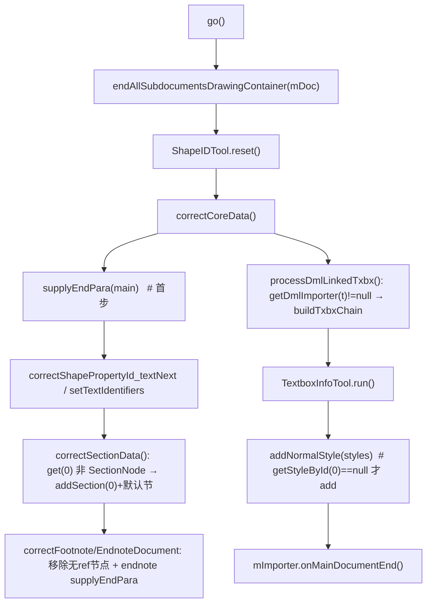

# 06_function_finish_work — parse 后一致性收尾（FinishReadingWork）

| 项 | 值 |
|----|----|
| feature | wc-05-orchestration |
| order | 6 |
| crate | `libs/word-core/Cargo.toml` |
| 入口 | `FinishReadingWork(doc, importer)` 构造 / `go()` / private `correctCoreData`·`correctSectionData`·`correctFootnoteDocument`·`correctEndnoteDocument`·`processDmlLinkedTxbx`·`removeInvalidFootnoteEndnoteTxt` / `createDefaultSectionPropertySet` |
| 独立性 | parse 后一致性收尾：输入是「已完成的 TextDocument + 可回调的 IDocumentImporter」，不接收事件；输出是修补后的文档不变量 |
| 测试状态 | pass |

## 1. 功能说明

### 1.1 一句话

`DocxReader.read()` 在 `xwpf.parse()` 之后运行的收尾器：依序补结束段（`CoreHelper.supplyEndPara`）、补默认节、清理 foot/endnote 无效节点、补 Normal 样式，最后回调 `onMainDocumentEnd`。它把「读入的文档」修补成「满足一致性的内存模型」。

### 1.2 输入

| 入口 | 输入 | Java 路径 |
|------|------|-----------|
| 构造 | `TextDocument doc` + `IDocumentImporter importer` | FinishReadingWork.java:31–39 |
| `go()` | （无参，读 doc/importer 状态） | :35–42 |

### 1.3 输出/副作用（顺序钉死）

`go()` 依序：
1. `IOHelper.endAllSubdocumentsDrawingContainer(mDoc)`（**Rust 缺口 D**，见 §1.7）
2. `ShapeIDTool.reset()`
3. `correctCoreData()`：
   - **首步** `CoreHelper.supplyEndPara(mDoc.getMainDocument())`
   - `correctShapePropertyId_textNext()`（textbox 链，MVP 空实现可延后）
   - `setTextIdentifiers()`
   - `correctSectionData()`：`main.getPLCSection().get(0)` 非 `SectionNode` → `addSection(0)` + `setPropertySet(createDefaultSectionPropertySet())`
   - `correctFootnoteDocument()` / `correctEndnoteDocument()`：移除无 ref 的 `FootnoteEndnoteTxtNode`；endnote 额外 `supplyEndPara`
4. `processDmlLinkedTxbx()`：遍历 `SubDocType.values()`，`importer.getDmlImporter(t)!=null → buildTxbxChain()`
5. `TextboxInfoTool.run()`
6. `IOHelper.addNormalStyle(mDoc.getStyles())`
7. `mImporter.onMainDocumentEnd()`

`createDefaultSectionPropertySet()`：`setInt(678,312)`、`setInt(677,0)`、`setInt(682,720)`、`setInt(683,720)`、`setValue(676, new PageSetup(11906,16838,1800,1800,1440,1440))`，`freeze()`。

### 1.4 上游

- 03/05 `DocumentImporter`（`mImporter`）+ wc-01 `CoreHelper.supplyEndPara`（rs 已实现）。
- wc-02 `TextDocument`（`getMainDocument/getSubdocument/getStyles`）+ `PLCSection`（`get(0)/addSection/setPropertySet`）+ `PageSetup`。

### 1.5 下游

- feature-output：收尾不变量（MVP 验收 P0「supplyEndPara + onMainDocumentEnd 被调用」）。
- 07 `DocxReader.read()` 在 parse 后调 `(new FinishReadingWork(doc, importer)).go()`。

### 1.6 关键不变量（钉死）

1. `correctCoreData()` 首步一定是 `supplyEndPara(mainDocument)`。
2. `supplyEndPara`：末段非段标/空文档才 append `'\r'`（wc-01 已实现，rs L195）。
3. `correctSectionData`：`plcSection.get(0)` 非 `SectionNode` → `addSection(0)` + 默认节 PropertySet（678/677/682/683/676）。
4. `correctFootnote/EndnoteDocument`：subdoc 非 null 且 length!=0 才处理；移除 `getFootnoteEndnoteRef()==null` 的节点；endnote 额外 `supplyEndPara(endnote)`。
5. `addNormalStyle` 在 `getStyleById(0)==null` 才 add（不重复）。
6. `go()` 末两钩子顺序：`addNormalStyle(styles)` **然后** `mImporter.onMainDocumentEnd()`。
7. `processDmlLinkedTxbx`：`getDmlImporter(t)==null → 跳过`（不 NPE）。

### 1.7 依赖与实现状态（必写，着重）

| 依赖 | 归属 | 本 function 需要的接口 | 已实现 | 暂缓（保留 Java 注释+签名） | 禁止本 function 去改 |
|------|------|------------------------|--------|-----------------------------|----------------------|
| `CoreHelper.supplyEndPara` | wc-01 | `supplyEndPara(Option<&mut dyn Document>)` | **已实现**（CoreHelper.rs L195） | — | 不去改 |
| `IOHelper.addNormalStyle` | wc-02/03 | `addNormalStyle(&mut KStyles)` | **已实现**（IOHelper.rs L19） | — | 不去改 |
| `IOHelper.endAllSubdocumentsDrawingContainer` | wc-02/03 | static；语义：`assertNotNull(doc)`，loop i 0..6 `createSubDocument(i)` 非 null 则 `getDrawingContainer().endRead()` | **缺口 D → 本 function 补充实现**：loop 在 `IOHelper.rs` 补该 fn（Java IOHelper.java L191–201；点名依赖，L5/L5b 声明并纳入 §3.6 覆盖率与 §3.8 布局校验） | 不 stub 该步 | — |
| `TextDocument` | wc-02 | `getMainDocument/getSubdocument(n)/getStyles` | **已实现** | — | 不去改 |
| `PLCSection` | wc-02 | `get(0)->PLC.Node`、`addSection(0)`、节点 `setPropertySet` | **已实现**（wc-02） | — | 不去改 |
| `PageSetup` | wc-02/value | `new(i32×6)` | rs 已存在 | — | 不去改 |
| `IDocumentImporter` | core-libs | `onMainDocumentEnd()`、`getDmlImporter(ordinal)` | trait 已生成 | — | 不改 trait |
| `PLCFootnoteEndnoteTxt` / `ShapeIDTool` / `TextboxInfoTool` / `PLCTextboxText` | word-core | foot/endnote 清理 + textbox 链 | 部分已实现；textbox/foot 链 MVP 可空实现 | `correctShapePropertyId_textNext`/`setTextIdentifiers`/`processDmlLinkedTxbx`/`TextboxInfoTool.run` 可延后为 stub（保留签名+位次，停车模版体） | 不新建过多类型 |

> 注：核心三钩子（`supplyEndPara`、`addNormalStyle`、`onMainDocumentEnd`）与默认节、foot/endnote 清理是 MVP 必做；textbox/shape 链修正（`correctShapePropertyId_textNext`/`setTextIdentifiers`/`processDmlLinkedTxbx`）属 P1 可延后 stub。

## 2. 核心代码与流程

Java：`koffice/writer/core/cn/wps/moffice/writer/io/reader/tools/FinishReadingWork.java`（279 行）
Rust：`libs/word-core/src/cn/wps/moffice/writer/io/reader/tools/FinishReadingWork.rs`（loop 新建 tools/ 目录 + 建 mod）



## 3. 测试方案

### 3.1 代码审计与测试面

| symbol | Java/Rust 路径 | 输入/状态 | 输出/副作用 | 关键分支/错误 |
|--------|----------------|-----------|-------------|---------------|
| 构造 | :31–39 | doc+importer | 存字段 | — |
| go() 顺序 | :35–42 | 完整 doc | 依序 7 步 | 每步在正确时序被调（用假 importer 记录回调序） |
| correctCoreData 首步 | :59–66 | main 空 / 末段非 `\r` | supplyEndPara append `\r` | 空文档 / 已有段标 no-op |
| correctSectionData | :99–113 | get(0) SectionNode / 非 | addSection(0)+默认节 | 分支 |
| correctFootnote/Endnote | :68–83 | subdoc null/length0/有无效节点 | removeInvalid + endnote supplyEndPara | 分支 |
| processDmlLinkedTxbx | :48–60 | 假 importer 返回 null/非 null | buildTxbxChain 调用 | 判 null |
| addNormalStyle 兜底 | :41 | styles 无/有 Normal | addNormalStyle | 不重复 |
| createDefaultSectionPropertySet | :269–278 | — | 678/677/682/683/676 | 常量值 |
| endAllSubdocumentsDrawingContainer（本 function 补进 IOHelper） | IOHelper.java:191–201 | TextDocument（子文档 0–6 可创建） | 每个非 null 子文档 `getDrawingContainer().endRead()` | doc null → 红；空子文档 → getDrawingContainer None 跳过 |

### 3.2 覆盖矩阵

| coverage_id | 接口/代码路径 | 场景类别 | 必测? | test_id / 未覆盖理由 |
|-------------|---------------|----------|-------|----------------------|
| FRW-GO-CORE1ST | supplyEndPara 是 correctCoreData 首步 | 主路径 | 是 | FRW1 |
| FRW-GO-ORDER | go() 内钩子顺序（endAll→…→addNormalStyle→onMainDocumentEnd） | 主路径 | 是 | FRW2 |
| FRW-SUPPLY-EMPTY | 空 main → supplyEndPara 补 `\r` | 边界 | 是 | FRW3 |
| FRW-SUPPLY-HASEND | 末段已有段标 → no-op（不重复 `\r`） | 分支 | 是 | FRW4 |
| FRW-SECTION-ADDS | get(0) 非 SectionNode → addSection(0)+默认节 | 主路径 | 是 | FRW5 |
| FRW-SECTION-EXIST | get(0) 已是 SectionNode → 跳过 | 分支 | 是 | FRW6 |
| FRW-DEFAULT-PS | 默认节 PropertySet 常量（678/677/682/683/676） | 主路径 | 是 | FRW7 |
| FRW-FOOT-NULL | footnote subdoc null/length0 → skip | 边界 | 是 | FRW8 |
| FRW-FOOT-REMOVE | 有无效（无 ref）节点 → 移除 | 主路径 | 是 | FRW9 |
| FRW-ENDNOTE-SUPPLY | endnote 额外 supplyEndPara | 分支 | 是 | FRW10 |
| FRW-DML-NULL | getDmlImporter(t)==null → 跳过 | 分支 | 是 | FRW11 |
| FRW-DML-CHAIN | 非 null → buildTxbxChain 被调 | 主路径 | 是 | FRW12 |
| FRW-NORMAL-ADD | styles 无 Normal → addNormalStyle add | 分支 | 是 | FRW13 |
| FRW-NORMAL-NOREPEAT | styles 已有 Normal → 不重复 | 边界 | 是 | FRW14 |
| FRW-OMA-END | onMainDocumentEnd 被调 | 主路径 | 是 | FRW15 |
| FRW-ENDALL | endAllSubdocumentsDrawingContainer：7 子文档遍历 + endRead + doc null 红 | 资源语义 | 是 | FRW16 |

### 3.3 可测试性

不开 docx。用真实 `TextDocument`（`CoreHelper.appendText/appendParagraph` 造内容）+ **假 `IDocumentImporter`**（记录 `onMainDocumentEnd`/`getDmlImporter` 调用序）。`go()` 顺序用假 importer 的调用日志断言。`supplyEndPara` 效果：空文档 → main rope 尾补 `\r`；已段标 → 无重复。默认节：`main.getPLCSection().get(0)` 是否 SectionNode 两态，断言 `addSection` 后 section 属性含 678=312 等。foot/endnote：用 `SubDocument.appendText` 造 foot/endnote 内容 + 无效节点场景（若 foot/endnote PLC 难造，用 `#[ignore = "spec: …"]` 标缺口但保留真实断言）。`processDmlLinkedTxbx`：假 importer 对某些 ordinal 返回 None、对某 ordinal 返回记录型 DmlImporter stub。`addNormalStyle` 不重复用预设 Normal。

> 注：`endAllSubdocumentsDrawingContainer` 若按 §1.7 在 IOHelper 补实，则 `go()` 首步可测；若只 stub，则该步相关断言 `#[ignore = "spec: 缺口D"]`，状态不 `pass`。

### 3.4 用例表

| id | 覆盖项 | 前置状态 | 输入摘要 | 期望输出/副作用 | 失败语义 |
|----|--------|----------|----------|-----------------|----------|
| FRW1 | FRW-GO-CORE1ST | 有内容 main | go() | main 被 supplyEndPara 修补（末段 `\r`）在其它 correct 之前 | 首步错序 |
| FRW2 | FRW-GO-ORDER | 假 importer | go() | 假 importer 日志：onMainDocumentEnd 在所有钩子后；endAll→…→addNormalStyle→outEnd | 顺序错 |
| FRW3 | FRW-SUPPLY-EMPTY | 空 main | go() | main rope 尾出现 `\r` | 未补段标 |
| FRW4 | FRW-SUPPLY-HASEND | main 末段 `\r` | go() | 不重复 append 第二个 `\r` | 重复段标 |
| FRW5 | FRW-SECTION-ADDS | main get(0) 非 SectionNode | go() | PLCSection 出现 SectionNode(0) 且 property 含 678=312/677=0/682=720/683=720/676=PageSetup | 未建节 |
| FRW6 | FRW-SECTION-EXIST | get(0) 已 SectionNode | go() | 不加第二个节点 | 重复建节 |
| FRW7 | FRW-DEFAULT-PS | — | createDefaultSectionPropertySet（via go） | 常量值精确匹配 | 常量错 |
| FRW8 | FRW-FOOT-NULL | footnote 空 | go() | 跳过不 panic | NPE |
| FRW9 | FRW-FOOT-REMOVE | footnote 有无效节点 | go() | 无效（无 ref）节点被移除 | 未清理 |
| FRW10 | FRW-ENDNOTE-SUPPLY | endnote 有内容 | go() | endnote 被 supplyEndPara（尾 `\r`） | 未补 |
| FRW11 | FRW-DML-NULL | 假 importer 全 ordinal 返回 None | go() | 不 panic，buildTxbxChain 不被调 | 误调 |
| FRW12 | FRW-DML-CHAIN | 某 ordinal 返回 stub | go() | 该 ordinal buildTxbxChain 被调 | 未调 |
| FRW13 | FRW-NORMAL-ADD | styles 无 Normal | go() | addNormalStyle added Normal（getStyleById(0)!=None） | 未补 |
| FRW14 | FRW-NORMAL-NOREPEAT | styles 已含 Normal | go() | getStyleById(0) 仍同一 Normal | 重复 add |
| FRW15 | FRW-OMA-END | 假 importer | go() | 假 importer.onMainDocumentEnd 被调 1 次 | 未调 |
| FRW16 | FRW-ENDALL | 真实 TextDocument | IOHelper.endAllSubdocumentsDrawingContainer(&mut doc)（经 go() 或直调） | 不 panic；7 个子文档被创建/遍历，每个 `getDrawingContainer()` 存在时 `endRead()` 被调；doc=null → panic（assertNotNull）；重复调用不 panic | 遍历/清理错 |

### 3.5 测试代码位置
crate: `libs/word-core/Cargo.toml`
src:   `libs/word-core/src/cn/wps/moffice/writer/io/reader/tools/FinishReadingWork.rs`（loop 需新建 tools/ 目录与 mod 接线）
       点名依赖（本 function 补实现）：`libs/word-core/src/cn/wps/moffice/writer/io/reader/helper/IOHelper.rs`（+`endAllSubdocumentsDrawingContainer`）
test:  `libs/word-core/tests/cn/wps/moffice/writer/io/reader/tools/FinishReadingWork.rs`

Split 阶段不落 `[[test]]`（src 未生成）；loop L2 已落地镜像测试并在 `Cargo.toml` 加 `[[test]]`（`name = "06_function_finish_work"`）。

### 3.6 测试运行脚本

```bash
cargo test --manifest-path libs/word-core/Cargo.toml --test 06_function_finish_work

bash .cursor/skills/feature-function/scripts/function-coverage.sh \
  --crate libs/word-core --test 06_function_finish_work \
  --src src/cn/wps/moffice/writer/io/reader/tools/FinishReadingWork.rs \
  --src src/cn/wps/moffice/writer/io/reader/helper/IOHelper.rs \
  --report libs/word-core/parser/features/wc-05-orchestration/functions/06_function_finish_work/FUNCTION.md
```

### 3.7 覆盖率报告

<!-- coverage-report:begin -->
tool: cargo-llvm-cov (`cargo llvm-cov --test 06_function_finish_work --json`)
date: 2026-08-21 18:40

| src | lines covered | line % | regions covered | region % |
|-----|---------------|--------|-----------------|----------|
| `src/cn/wps/moffice/writer/io/reader/helper/IOHelper.rs` | 34/127 | 26.8% | 65/250 | 26.0% |
| `src/cn/wps/moffice/writer/io/reader/tools/FinishReadingWork.rs` | 97/129 | 75.2% | 143/182 | 78.6% |
| **function total** | **131/256** | **51.2%** |  |  |
<!-- coverage-report:end -->

### 3.8 模板布局校验（必跑，PASS 才能标 pass）

```bash
node .cursor/skills/function-java2rust/scripts/check-template-layout.mjs \
  --rs libs/word-core/src/cn/wps/moffice/writer/io/reader/tools/FinishReadingWork.rs \
  --java koffice/writer/core/cn/wps/moffice/writer/io/reader/tools/FinishReadingWork.java
# 本 function 点名依赖 IOHelper.rs（本轮补 endAllSubdocumentsDrawingContainer）必须同检：
node .cursor/skills/function-java2rust/scripts/check-template-layout.mjs \
  --rs libs/word-core/src/cn/wps/moffice/writer/io/reader/helper/IOHelper.rs \
  --java koffice/writer/core/cn/wps/moffice/writer/io/reader/helper/IOHelper.java
```

校验：`// java` 行数不降；`go()`/`correctCoreData`/`correctSectionData`/`correctFootnoteDocument`/`correctEndnoteDocument` 的 `// java` 注释与 Rust 签名相邻；`createDefaultSectionPropertySet` 常量注释保留；textbox/shape 链族（`correctShapePropertyId_textNext`/`setTextIdentifiers`/`processDmlLinkedTxbx`/`TextboxInfoTool.run`）若在改写列表外，停车模版体（`todo!("DEFERRED_NON_FUNCTION")` + `/** DEFERRED_NON_FUNCTION … **/`），禁止删注释或 dummy `let X = ()`。
