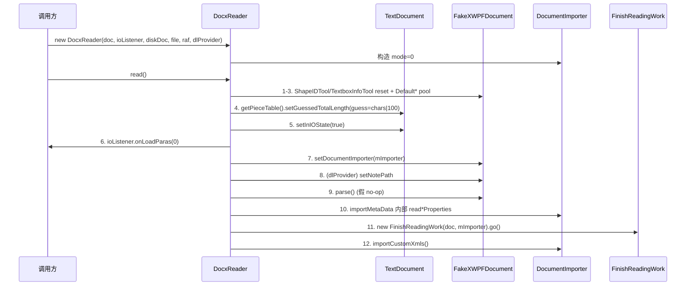

# 07_function_docx_read — 最外层 read() 编排（DocxReader）

| 项 | 值 |
|----|----|
| feature | wc-05-orchestration |
| order | 7 |
| crate | `libs/word-core/Cargo.toml` |
| 入口 | `DocxReader(doc, ioListener, diskDoc, file, raf, dlProvider)` 构造 / `read()` / `guessLengthOfDocument()`(private) / `readExtendedProperties`·`readPackageProperties`·`readCustomProperties`·`readCustomXmlInfos`·`importMetaData`(private) / `dispose()` |
| 独立性 | 最外层编排器：把「装配 → 前置 → parse → 元数据 → 收尾」的各阶段按 Java 顺序钉死；本 function 是 feature 验收 seam |
| 测试状态 | pass |

## 1. 功能说明

### 1.1 一句话

`DocxReader`（implements `IDocxReader`）打开一个磁盘 docx，装配 `DocumentImporter(mode=0)`，按**严格顺序**执行 `read()`：置 guessLength → setInIOState → 挂 importer → `XWPFDocument.parse()` → 元数据 → `FinishReadingWork.go()` → `importCustomXmls()`。它自己不写 rope，只锁顺序。

### 1.2 输入

| 入口 | 输入 | Java 路径 |
|------|------|-----------|
| 构造 | `TextDocument doc` + `IOListener` + `XWPFDocument diskDoc` + `File` + `RandomAccessFile` + `IDLProvider` | DocxReader.java:45–55 |
| `read()` | （无参，用字段） | :65–84 |

### 1.3 输出/副作用（顺序钉死）

`read()` 依序：
1. `ShapeIDTool.reset()` / `TextboxInfoTool.reset()`
2. `Default* setMaxPoolSize(5000/40)`
3. `readExtendedProperties()` → `Metadata`（app 版本/字符数）
4. `mDoc.getMainDocument().getPieceTable().setGuessedTotalLength(guessLengthOfDocument())` — **parse 前**
5. `mDoc.setInIOState(true)`
6. `mIOListener.onLoadParas(0)`
7. `mXWPFDoc.setDocumentImporter(mImporter)`
8. `mDlProvider!=null → mXWPFDoc.setNotePath(mDlProvider.getNotePath())`
9. `mXWPFDoc.parse()`（★ 事件风暴，跨 crate 缺口 C）
10. `importMetaData()`：`readPackageProperties` → `readCustomProperties` → `readCustomXmlInfos`
11. `(new FinishReadingWork(mDoc, mImporter)).go()`
12. `mImporter.importCustomXmls()`

`guessLengthOfDocument()`：`mXWPFDoc.getProperties().getExtendedProperties().getNumberCharacters()`，null → **100**。

### 1.4 上游

- 03/05 `DocumentImporter`（构造装配 + importCustomXmls/dispose）。
- 06 `FinishReadingWork`（go()）。
- core-libs `XWPFDocument`（setDocumentImporter/setNotePath/getProperties/close；**`parse` 未实现=缺口 C**）。
- `IDocxReader` trait（face/IDocxReader.rs，已生成，仅 dispose）。

### 1.5 下游

- feature-output：端到端 read() 顺序（MVP 验收 P0）。
- 跨 crate：等 core-libs `XWPFDocument.parse()` 补齐后真正端到端跑通（P2）。

### 1.6 关键不变量（钉死）

1. **顺序**：guess(4) → inIOState(5) → onLoadParas(6) → setImporter(7) → parse(9) → meta(10) → finish(11) → importCustomXmls(12)。`guessLength` 必须在 `parse` 前。
2. `guessLengthOfDocument()`：getNumberCharacters() null → **100**（BOGUS_LENGTH_DOCUMENT）。
3. 构造断言：`doc != null`、`ioListener != null`（IOAssert）。
4. `mImporter = new DocumentImporter(doc, ioListener, dlProvider, true, null, 0, null, null)`（`mode=0`，`isDocx()`）。
5. `mDlProvider != null` 才 setNotePath。
6. `importMetaData()` 在 `parse()` **之后**调用（Java 顺序）。
7. `dispose()`：`mImporter.dispose()` + `mXWPFDoc.close()`（null 判）。
8. `readExtendedProperties` 仅 `getExtendedProperties()!=null` 才 importer。

### 1.7 依赖与实现状态（必写，着重）

| 依赖 | 归属 | 本 function 需要的接口 | 已实现 | 暂缓（保留 Java 注释+签名） | 禁止本 function 去改 |
|------|------|------------------------|--------|-----------------------------|----------------------|
| `DocumentImporter` | 03/05（本 feature） | 主构造、`importCustomXmls`、`dispose` | loop 先做 03/05 | — | 依赖 03/05 |
| `FinishReadingWork` | 06（本 feature） | `go()` | loop 先做 06 | — | 依赖 06 |
| `XWPFDocument` | core-libs（wave0） | `setDocumentImporter/setNotePath/getProperties/close`、`parse()` | **`parse()` 已实现**（XWPFDocument.rs L310：styles.xml + 主文档 Part 经 XmlReader + handler）；`setImporter`（`Rc<dyn IDocumentImporter>`）已接线 | `parse` 内 **styles 子链缺口**（StyleHandler/DocDefaultsHandler 空壳 + StyleChildHandler 等 TODO）→ e2e 样式收不到；正文链（PHandler→onImportParagraph*) 已接线 | 不跨 crate 改 XWPFDocument/handler |
| `POIXMLProperties`/`ExtendedProperties`/`CoreProperties`/`CustomProperties`/`CustomXmlInfo` | core-libs opc | 元数据读取 | 已生成 | — | 不去改 |
| `ExtendedPackagePropertiesImporter` / `PackagePropertiesImporter` / `CustomPackagePropertiesImporter` | 05 batch（未改写） | `importerProperties` | **未改写 → stub**（保位次） | 元数据可 stub/停车 | 不新建 |
| `TextDocument` | wc-02 | `getMainDocument/getPieceTable/getMetadata/getAppVersion` | **已实现** | — | 不去改 |
| `IDocxReader` trait | face | `read/dispose` 等 | trait 已生成（仅 dispose） | — | 不改 trait |
| `Metadata` / `CustomMetadata` | wc-02 | `setCustomXmlInfos/getCustomMetadata` | 已实现 | — | 不去改 |
| `ShapeIDTool`/`TextboxInfoTool` | word-core | `reset` | rs 已存在 | — | 不去改 |

> 注：**缺口 C（跨 crate，2026-08-21 复核；已安排 wave0 15_function_styles_handler_chain 承接）**：core-libs `XWPFDocument.parse()` **已实现**（L310），主文档段落链已接线（PHandler→onImportParagraphStart/End、DocumentBodyHandler→onMainDocumentStart/End、RprChildHandler→convertRunProp、StylesHandler(end)→onImportStylesEnd）；**但 styles 子链未接线**：`element_handler/styles/StyleHandler.rs` + `DocDefaultsHandler.rs` 是空壳（仅 struct+ctor），`StyleChildHandler.rs` 等仍 `// TODO: call importer.*` → e2e 下 `mIOStyleList` 为空、KStyles 收集不到样式（07 用真实 XWPFDocument + fixture docx 时该缺陷会红，属 spec 门闩；wave0 15 `pass` 后解除）。07 的 read() 顺序位次仍可用记录型 XWPFDocument / fixture docx 验证；正文内容语义交给 04（手工调 MainDocumentImporter 旁路，docs/README §7.2）。

## 2. 核心代码与流程

Java：`koffice/writer/core/cn/wps/moffice/writer/io/reader/docxReader/DocxReader.java`（161 行）
Rust：`libs/word-core/src/cn/wps/moffice/writer/io/reader/docxReader/DocxReader.rs`（loop 新建）



## 3. 测试方案

### 3.1 代码审计与测试面

| symbol | Java/Rust 路径 | 输入/状态 | 输出/副作用 | 关键分支/错误 |
|--------|----------------|-----------|-------------|---------------|
| 构造 | :45–55 | doc/ioListener | 断言 + mImporter(mode=0) | null → 红 |
| read() 顺序 | :65–84 | 假 XWPF | 12 步调用序 | guess 在 parse 前；meta 在 parse 后 |
| guessLengthOfDocument | :97–101 | getNumberCharacters null / 值 | 100 / 值 | null → 100 |
| importMetaData | :106–108 | — | 3 步顺序 | — |
| readExtended/Package/CustomProperties | :118–160 | props null 分支 | importer 调用 | null 短路 |
| dispose | :57–64 | XWPF 非 null/null | importer.dispose + close | null 判 |

### 3.2 覆盖矩阵

| coverage_id | 接口/代码路径 | 场景类别 | 必测? | test_id / 未覆盖理由 |
|-------------|---------------|----------|-------|----------------------|
| DR-CTOR-ASSERT | 构造 doc/ioListener null → 红 | 失败 | 是 | DR1 |
| DR-CTOR-MODE0 | 构造 mImporter mode=0（isDocx） | 主路径 | 是 | DR2 |
| DR-ORDER-PRE | guess(4)→inIOState(5)→onLoadParas(6)→setImporter(7) 顺序 | 主路径 | 是 | DR3 |
| DR-ORDER-PARSE-META | parse(9) 在 meta(10) 前 | 主路径 | 是 | DR4 |
| DR-ORDER-FINISH-XML | finish(11)→importCustomXmls(12) 顺序 | 主路径 | 是 | DR5 |
| DR-GUESS-DEFAULT | getNumberCharacters null → 100 | 边界 | 是 | DR6 |
| DR-GUESS-VALUE | 有值 → 用该值 | 主路径 | 是 | DR7 |
| DR-META-NULLPROPS | getProperties null → 短路不 panic | 失败 | 是 | DR8 |
| DR-NOTEPATH-SET | dlProvider!=null → setNotePath | 分支 | 是 | DR9 |
| DR-NOTEPATH-NULL | dlProvider null → 不 setNotePath | 分支 | 是 | DR10 |
| DR-DISPOSE-CLOSE | dispose → importer.dispose + xwpf.close | 状态 | 是 | DR11 |
| DR-DISPOSE-NULL | xwpf null → close 跳过 | 边界 | 是 | DR12 |

> 端到端真实 docx（带 styles 的 fixture 断言 KStyles 非空）依赖跨 crate 缺口 C（styles 子链未接线）→ 该断言 `#[ignore = "spec: 缺口C"]` 保留；正文链 e2e（main rope 有文本）属必测非 ignore。

### 3.3 可测试性

优先**真实 `XWPFDocument` + fixture docx**（内存 zip/docx 字节，见 §3.5 fixtures）：`parse()` 已实现，read() 的正文链（PHandler→onImportParagraphStart/End）可真实跑通；**styles 链缺口 C 会在此现形**（KStyles 空）——把「fixture 带 styles 时 KStyles 有 Normal」标 `#[ignore = "spec: 缺口C 跨crate样式链"]` 保留真实断言，不删矩阵项。同时**记录型 XWPFDocument**（记录 setDocumentImporter/setNotePath/getProperties/close 调用，parse 可注入记录）用于纯顺序验证，两者互补：记录型断言 12 步顺序位次；真实型断言正文链落库（main rope 有文本）并暴露缺口 C。`guessLengthOfDocument` 通过 getProperties→getExtendedProperties→getNumberCharacters 的 null/有值两态驱动。元数据 importer（stub）：断言「被创建/importerProperties 被调」位次即可。`dispose` 断言 importer.dispose + xwpf.close 被调。**本 function 是验收 seam，断言顺序 + 正文链落库，不断言正文细节**（那是 04）。

### 3.4 用例表

| id | 覆盖项 | 前置状态 | 输入摘要 | 期望输出/副作用 | 失败语义 |
|----|--------|----------|----------|-----------------|----------|
| DR1 | DR-CTOR-ASSERT | doc=null / ioListener=null | new DocxReader | panic（assertNotNull） | 未拒绝 null |
| DR2 | DR-CTOR-MODE0 | 真实 doc+假 XWPF | new DocxReader | mImporter 构造成功且 mode()==0（isDocx()==true）；若 mode 可查则断言 | 装配/模式错 |
| DR3 | DR-ORDER-PRE | 记录型 IOListener + 假 XWPF | read() | 假 XWPF.setDocumentImporter 在 onLoadParas(0) 之后；guess 设置发生在 parse 前 | 前置顺序错 |
| DR4 | DR-ORDER-PARSE-META | 假 XWPF记录 parse | read() | 假 XWPF.parse() 在 元数据 importer 之前 | parse/meta 错序 |
| DR5 | DR-ORDER-FINISH-XML | 假 XWPF + 假 DI（或用真实 DI） | read() | FinishReadingWork.go 在 finish（元数据后）；importCustomXmls 最后 | 收尾错序 |
| DR6 | DR-GUESS-DEFAULT | 假 XWPF extended chars=null | read() | pieceTable.setGuessedTotalLength(100) | 缺省非 100 |
| DR7 | DR-GUESS-VALUE | 假 XWPF chars=42 | read() | setGuessedTotalLength(42) | 未用值 |
| DR8 | DR-META-NULLPROPS | 假 XWPF getProperties=null | read() | 元数据短路不 panic | NPE |
| DR9 | DR-NOTEPATH-SET | dlProvider 非 null | read() | 假 XWPF.setNotePath(path) 被调 | 未调 |
| DR10 | DR-NOTEPATH-NULL | dlProvider=null | read() | setNotePath 不被调 | 误调 |
| DR11 | DR-DISPOSE-CLOSE | xwpf 非 null | dispose() | 假 XWPF.close() 被调 + importer.dispose 被调 | 未释放 |
| DR12 | DR-DISPOSE-NULL | xwpf=null | dispose() | close 跳过，不 panic | NPE |

### 3.5 测试代码位置
crate: `libs/word-core/Cargo.toml`
src:   `libs/word-core/src/cn/wps/moffice/writer/io/reader/docxReader/DocxReader.rs`
test:  `libs/word-core/tests/cn/wps/moffice/writer/io/reader/docxReader/DocxReader.rs`

Split 阶段不落 `[[test]]`（src 未生成）；loop L2 已落地镜像测试并在 `Cargo.toml` 加 `[[test]]`（`name = "07_function_docx_read"`）。

### 3.6 测试运行脚本

```bash
cargo test --manifest-path libs/word-core/Cargo.toml --test 07_function_docx_read

bash .cursor/skills/feature-function/scripts/function-coverage.sh \
  --crate libs/word-core --test 07_function_docx_read \
  --src src/cn/wps/moffice/writer/io/reader/docxReader/DocxReader.rs \
  --report libs/word-core/parser/features/wc-05-orchestration/functions/07_function_docx_read/FUNCTION.md
```

### 3.7 覆盖率报告

<!-- coverage-report:begin -->
tool: cargo-llvm-cov (`cargo llvm-cov --test 07_function_docx_read --json`)
date: 2026-08-21 18:44

| src | lines covered | line % | regions covered | region % |
|-----|---------------|--------|-----------------|----------|
| `src/cn/wps/moffice/writer/io/reader/docxReader/DocxReader.rs` | 161/182 | 88.5% | 214/247 | 86.6% |
| **function total** | **161/182** | **88.5%** |  |  |
<!-- coverage-report:end -->

### 3.8 模板布局校验（必跑，PASS 才能标 pass）

```bash
node .cursor/skills/function-java2rust/scripts/check-template-layout.mjs \
  --rs libs/word-core/src/cn/wps/moffice/writer/io/reader/docxReader/DocxReader.rs \
  --java koffice/writer/core/cn/wps/moffice/writer/io/reader/docxReader/DocxReader.java
```

校验：`// java` 行数不降；`read()`/`guessLengthOfDocument`/`importMetaData`/`readExtendedProperties`/`readPackageProperties`/`readCustomProperties`/`readCustomXmlInfos`/`dispose` 的 `// java` 注释与 Rust 签名相邻；`read()` 的 12 步 `// java` 注释顺序保留（每步原位相邻）；元数据 stub 请保留签名+位次，禁止删注释或 dummy `let X = ()`。
