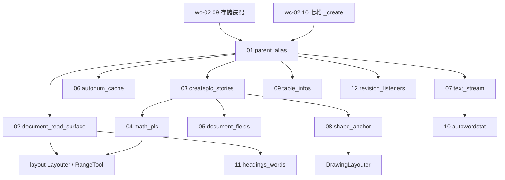

# wc-10-subdocument-pipeline — Function 组合图

> 切分依据：**I/O 边界**，顺序 = 管线依赖 × 影响面（parse 写入谁 → layout/render 读谁）。**不按类切**，不重做 wc-02 `09_function_subdocument_own`（rope/CHPX/PAPX/CPieceTable/type0 `PLCSection`）。
> 上游：`wc-02` 09/10（对象图已能 `new SubDocument`）；`wc-01` 存储表；`wc-09` 页眉故事。
> 下游：layout `ParaLayouter` / `MainLayouter` / `RangeTool` / `DrawingLayouter` / `GridSizeLayouter` 经 `&dyn Document`（实现类 **`SubDocument`**）取值。
> Java 权威：`koffice/writer/core/.../SubDocument.java`（basename **必须** `SubDocument.java` ↔ `SubDocument.rs`）。
> Rust 入口：`libs/word-core/src/cn/wps/moffice/writer/core/SubDocument.rs`
> trait 门面：`.../core/Document.rs`（Java `interface Document`）

本文件只锁 **function 顺序与 Java↔Rust 门面对表**。每个 function 的 §3.6–§3.11 在 `loop <id>` 时才写 `functions/<id>/FUNCTION.md`。

---

## 0. 一句话管线

```text
parse:  TextDocument._create → SubDocument(parent, type) → createPLC + ctor 后段 PLC/流/编号
layout: LayoutState.document: &dyn Document  → getChpxTable / getPapxTable / getTextRope /
        getLength / getPLCField / getPLCSection / getTextDocument / getMainDocument
render: 同一 Document 上的节/域/图形锚点（本 feature 不验绘制指令）
```

**热路径（产品，不是测试旁路）**

```text
DocumentImporter / *DocumentImporter
  → (*SubDocument).getPLCField / getFootnoteTxt_mut / getPLCHeader_mut / getTextboxText
LayoutState / ParaPropEnv / MainLayouter / RangeTool
  → document.getChpxTable().seek
  → document.getPapxTable().seek
  → document.getPLCField().getContainingField
  → document.getTextRope()
  → document.getTextDocument()          ← ★ 现指向 KStyle::TextDocument 壳
  → document.getOMathStarts() / getPLCMathFunction()   ← RangeTool 数学选区
```

**已由其它 function 拥有、本 feature 禁止重写语义**

| 已有 | 本 feature |
|------|------------|
| wc-02 `09`：ctor 前段 rope/chpx/papx/pieceTable、type0 `PLCSection` | 只消费 |
| wc-02 `10`：`createAllSubDocument` 七槽 | 改 **parent 类型**（`mParent`），不重拆七槽循环 |
| wc-01 表实现、wc-09 hdrftr 故事填充 | 不重写 importer |

---

## 1. Function 清单（按管线依赖 × 影响排序）

`order` = 就绪编号：上游绿才能动下游。`阶段` 是本 function 验收停在哪一段。`影响` = 挡住多少活调用点。

| order | function_id | 阶段 | 影响 | I | O | 上游 | 下游 |
|------:|-------------|------|------|---|---|------|------|
| 1 | `01_function_parent_alias` | parse+layout | **最高** | `new SubDocument(TextDocument, type)` | `mParent` 为真实 `core::TextDocument`；`getTextDocument()`/`getMainDocument()`/`getStyles()`/`start`/`commit` 可达顶层 | wc-02 09/10 | 全部后续 |
| 2 | `02_function_document_read_surface` | layout | **最高** | `&dyn Document`（主故事） | 热路径 getter 与 Java 同名且非空：`getLength` `getTextRope` `getChpxTable` `getPapxTable` `getPLCSection` `getPLCField` `getStyles` | 01 | layout 各 Layouter |
| 3 | `03_function_createplc_stories` | parse | 高 | `createPLC` type 1/2/4/5/6 | 对应故事挂上真实 `PLCField` + FootnoteTxt / PLCHeader / TextboxText（已有真实模块，去掉 Copy 影子） | 01; wc-09 | 脚注/页眉 layout |
| 4 | `04_function_math_plc` | layout | 高 | `createPLCOMath` / `createPLCMath` | `mOMathStart/End/mPlcMath` = 已登记 `data::PLCMath*`；`Document::getOMathStarts/Ends/getPLCMathFunction` 返回字段指针 | 01 | `RangeTool` 数学选区 |
| 5 | `05_function_document_fields` | parse | 中 | `createPLCOfDocumentFiels` | `mDocumentFieles = PLCDocumentFields(this)`；`getDocumentFileds` 返回同一对象（可空） | 03 | 域导入 / `isEmpty` |
| 6 | `06_function_autonum_cache` | parse+layout | 中 | ctor 后段 `new AutoNumCount/AutoNumFieldCache(this)` | 字段类型 = `data::autonum::AutoNumCount` / `data::field::AutoNumFieldCache`；`Document::getAutoNumCount/Field` 去 `*mut ()` | 01 | wc-08 编号串 |
| 7 | `07_function_text_stream` | parse | 中 | `TextData.createTextStream(this)` | `mTextStream: Option<Box<dyn ITextStream>>`（Java 接口）；`getTextStream` 与 `ITextStream.java` 同名 | 01 | 修订过滤 / 写入 |
| 8 | `08_function_shape_anchor` | layout | 中 | `createPLC` 收尾 `new PLCShapeAnchor(this)` | 去掉 Copy 影子；`getShapeAnchors` 返回真实模块；`Document` 门面去 `*mut ()` | 03 | `DrawingLayouter` |
| 9 | `09_function_table_infos` | layout | 中 | `InfoFactory.createTableInfos(this)` | `TableInfos`/`InfoFactory` 真实类型（`data/table` 现整体延后 ⇒ 本 function **前置是解开 table 闭包或抽出无 PropertyTool 的叶子**） | 01 | 表格 layout |
| 10 | `10_function_autowordstat` | parse | 低 | `new AutoWordStat(this)` + `mTextStream.setListener` | 真实 `data::autoWordStat::AutoWordStat`；`getAutoWordStat` 去 `*mut ()` | 07 | 字数统计 |
| 11 | `11_function_headings_words` | layout | 低（级联大） | `getHeadings` / `getPLCWords` | 字段 `KPLC_Headings` / `KPLC_Words`（Java 声明），**禁止**继续用 `PLC_Headings` Copy 影子顶替实现类 | 02 | 目录/标题 |
| 12 | `12_function_revision_listeners` | parse | 低 | `add/removeRevisionListener` | `RevisionListener` 真实 trait + `KRevisionChange.RevisionChange/Type`；禁止空 `pub trait RevisionListener {}` | 01 | 修订回调 |

`DebugPropertyDescriptor.init()` 挂在 ctor 上，不是独立 I/O；并进 **01** 的 ctor 副作用（真实 `data/DebugPropertyDescriptor.rs` 须先修编译再登记，禁止为绿改 Java 注释）。

---

## 2. Java ↔ Rust 门面对表（D1：同名文件 / 同名类 / 同名方法）

入口类永远是一对：

| Java | Rust |
|------|------|
| `.../core/SubDocument.java` | `.../core/SubDocument.rs` |
| `.../core/Document.java`（接口） | `.../core/Document.rs`（`trait Document`） |
| `.../core/TextDocument.java` | `.../core/TextDocument.rs`（**禁止**再把 `KStyle.rs` 里的 stand-in 当成这个类） |

### 2.1 ★ 当前就地影子 → 真实模块（basename 已存在则只改 `use`，禁止第二套类型名）

| # | `SubDocument.rs` 就地影子 | Java 权威类型 | 真实 `.rs`（已存在） | `mod` 登记 | 本表归属 function |
|---|---------------------------|---------------|----------------------|------------|-------------------|
| 1 | `use KStyle::TextDocument`（`mParent`） | `core.TextDocument` | `core/TextDocument.rs` | 已登记 | **01** |
| 2 | `pub struct PLCMathStart` Copy | `data.PLCMathStart` | `data/PLCMathStart.rs` | **已登记** | **04** |
| 3 | `pub struct PLCMathEnd` Copy | `data.PLCMathEnd` | `data/PLCMathEnd.rs` | **已登记** | **04** |
| 4 | `pub struct PLCMathFunction` Copy | `data.PLCMathFunction` | `data/PLCMathFunction.rs` | **已登记** | **04** |
| 5 | `pub struct PLCDocumentFields` + 假 `isEmpty→true` | `data.PLCDocumentFields` | `data/PLCDocumentFields.rs` | **已登记** | **05** |
| 6 | `pub struct AutoNumFieldCache` | `data.field.AutoNumFieldCache` | `data/field/AutoNumFieldCache.rs` | `pub mod field` 已登记 | **06** |
| 7 | `pub struct AutoNumCount` | `data.autonum.AutoNumCount` | `data/autonum/AutoNumCount.rs` | autonum **内联块未声明** | **06** |
| 8 | `pub struct ITextStream` + `TextData`/`InfoFactory` 空壳 | `data.ITextStream` / `TextData` | `data/ITextStream.rs` · `data/TextData.rs`（依赖 `KTextStream`） | 未登记 | **07** |
| 9 | `pub struct PLCShapeAnchor` Copy | `data.PLCShapeAnchor` | `data/PLCShapeAnchor.rs` | 未登记 | **08** |
| 10 | `pub struct TableInfos` | `data.table.TableInfos` | `data/table/TableInfos.rs` | `data/table` **整体延后** | **09** |
| 11 | `pub struct AutoWordStat` | `data.autoWordStat.AutoWordStat` | `data/autoWordStat/AutoWordStat.rs` | 未登记 | **10** |
| 12 | `pub struct PLC_Headings` Copy（字段 Java 是 **`KPLC_Headings`**） | `core.heading.KPLC_Headings` | `core/heading/KPLC_Headings.rs` | heading **未登记**（45 错） | **11** |
| 13 | `pub struct KPLC_Words` / `IPLC_Words` | `core.words.KPLC_Words` / `data.IPLC_Words` | `core/words/KPLC_Words.rs` · `data/IPLC_Words.rs` | 未登记 | **11** |
| 14 | `pub trait RevisionListener {}` 空 | `core.RevisionListener` | `core/RevisionListener.rs`（依赖 `KRevisionChange`） | 未登记 | **12** |

### 2.2 Document trait 门面（Java 方法 → 现状 → 目标）

布局读的是 **trait**，固有方法必须委托到同一语义，禁止 `Document::getX` 返回 `*mut ()` 而固有方法返回真类型却从不被调用。

| Java `Document` / `SubDocument` | Rust trait 现状 | Rust 固有方法现状 | 目标（与 Java 引用语义） |
|---------------------------------|-----------------|-------------------|--------------------------|
| `getTextDocument()` | `Option<&dyn SoftTextDocument>`，真实 `TextDocument` impl 返回 **`None`** | `*mut KStyle::TextDocument` | `Some(self.mParent as &dyn SoftTextDocument)` 且 `impl SoftTextDocument for core::TextDocument` |
| `getMainDocument()` | `Option<&dyn Document>` | **`Some(self)`**（非主故事也错） | `mParent.getMainDocument()` → 槽 0 |
| `getStyles()` | `Option<*mut KStyles>` | 经假 parent | 经真实 `TextDocument.getStyles()` |
| `getChpxTable` / `getPapxTable` / `getTextRope` / `getLength` | 已是真类型指针 | 已接线 | **02 只验收**，不改语义 |
| `getPLCField` / `getPLCSection` / `getPLCHeader` | 已是真类型 | 已有字段 | **02/03 验收** |
| `getOMathStarts/Ends` `getPLCMathFunction` | 已是 `*mut PLCMath*`，默认 `None` | 固有 `todo!` + 字段是 **Copy 影子** | **04**：`create*` 真 `new`；getter 返回字段指针 |
| `getDocumentFileds` | 已是 `*mut PLCDocumentFields` | 固有返回 **`PLCDocumentFields::default()` 假对象** | **05**：`Option`/`*mut` 与字段同一实例 |
| `getAutoNumCount` / `getTableInfos` / `getTextStream` / `getShapeAnchors` / `getHeadings` / `getPLCWords` / `getAutoWordStat` | 仍 `Option<*mut ()>` | Copy 影子或 `todo!` | 对应 06–11：trait 与 Java 返回类型对齐 |

重载后缀保持仓库既有规则（`getRange__int_int` 等）；**不得**为影子另起 `SoftPLCMathStart` 之类生产名。

---

## 3. 编译面

| 项 | 值 |
|----|----|
| CRATE_DIR | `libs/word-core` |
| 入口 src | `src/cn/wps/moffice/writer/core/SubDocument.rs` |
| 伴随门面 | `src/cn/wps/moffice/writer/core/Document.rs` · `TextDocument.rs` |
| 测试镜像 | `tests/cn/wps/moffice/writer/core/SubDocument.rs`（loop 时按 function 加 `[[test]]`） |
| `cargo test --test <function_id>` | loop 时写入各 `FUNCTION.md` §3.6 |

---

## 4. 串联



---

## 5. 验收顺序

1. **01** 不过：layout 的 `getTextDocument()` / 页眉 `start`/`commit` / `getStyles` 都仍是壳。
2. **02** 不过：排版热路径即便字段在，trait 擦除也会让调用方无法用。
3. **04** 可与 **03** 并行（数学 PLC 已登记，只是 SubDocument 被本地 Copy 类型挡住）。
4. **09** 不得抢在解开 `data/table` 之前「为编译再写一套 TableInfos」。
5. **11** 依赖 `PLC_Headings` 接口补全 + `PLC.Node` 建模，单开批次。

标 `pass` 必须：逻辑（同一 `.docx` 到本阶段）绿 + §3.8 `--java` 语句完整 + §3.9 basename `SubDocument`/`Document`/`TextDocument` 对齐 + 产品走 `&dyn Document`，禁止第二套只给测试用的 Document。

---

## 6. 类级对照（不是切分依据）

| Java 类 | Rust 文件 | 本 feature 角色 |
|---------|-----------|-----------------|
| `SubDocument` | `core/SubDocument.rs` | 入口；删就地影子、改 `use` |
| `Document` | `core/Document.rs` | trait 返回类型与 Java 一致 |
| `TextDocument` | `core/TextDocument.rs` | **01** parent；`impl SoftTextDocument` 从 `KStyle.rs` 迁走 |
| `PLCMathStart/End/Function` | `data/PLCMath*.rs` | **04** 已登记模块 |
| `PLCDocumentFields` | `data/PLCDocumentFields.rs` | **05** |
| `AutoNumCount` / `AutoNumFieldCache` | `autonum/` · `field/` | **06** |
| `ITextStream` / `TextData` / `KTextStream` | `data/` | **07** |
| `PLCShapeAnchor` | `data/PLCShapeAnchor.rs` | **08** |
| `TableInfos` / `InfoFactory` | `data/table/` | **09** |
| `AutoWordStat` | `data/autoWordStat/` | **10** |
| `KPLC_Headings` / `KPLC_Words` | `core/heading/` · `core/words/` | **11** |
| `RevisionListener` / `KRevisionChange` | `core/` | **12** |
