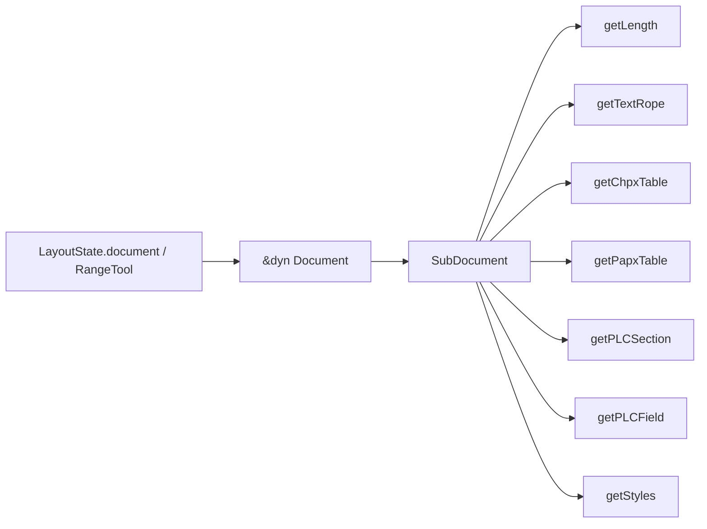

# 02_function_document_read_surface — layout 热路径 Document getter

| 项 | 值 |
|----|----|
| feature | wc-10-subdocument-pipeline |
| order | 2 |
| crate | `libs/word-core/Cargo.toml` |
| 入口 | `Document::{getLength,getTextRope,getChpxTable,getPapxTable,getPLCSection,getPLCField,getStyles}` 在 `SubDocument` 上 |
| 独立性 | 叶子：只验收门面非空与 Java 同名直读；不改 wc-01 表语义、不改 wc-02-09 rope/CHPX/PAPX 装配 |
| 测试状态 | pass（DR1–DR10；§3.8 Document+SubDocument PASS；§3.9 overall PASS） |
| 阶段 | layout（读 `&dyn Document`） |

**本 function 按 I/O 切，不按类切。** 不要全叶改写 `Document.java` / `SubDocument.java`。不要重写 `IChpxTable`/`IPapxTable`/`PLCSection` 内部。

## 1. 功能说明

### 1.1 一句话

layout 经 `&dyn Document`（实现类 **`SubDocument`**）读到的热路径 getter 与 Java 同名、同字段、非空（`getLength` 为 rope 长度，可 0）。

### 1.2 输入

已 `_create` 的主故事（type 0）`&dyn Document`。产品：`LayoutState.document`、`RangeTool` 静态方法形参。

### 1.3 输出

| Java | 期望（主故事 ctor 后） |
|------|------------------------|
| `getLength()` | `mTextRope.length()`，与固有方法相同 |
| `getTextRope()` | 非空，即 `mTextRope` / `mNotifyTextRope` |
| `getChpxTable()` | 非空 `mChpxTable` |
| `getPapxTable()` | 非空 `mPapxTable` |
| `getPLCSection()` | 非空 `mSections`（仅 type 0） |
| `getPLCField()` | 非空 `mFields`（type 0 的 `createPLC`） |
| `getStyles()` | 非空，委托 `getTextDocument().getStyles()` |

type 2 页眉：`getPLCSection()` 为 null（Java 不建 `mSections`）；`getPLCField` 与 CHPX/PAPX/rope 仍非空。

不在本 function 测：`seek` 语义、域节点内容、页眉 PLCHeader（03）、数学 PLC（04）。

### 1.4 上游

`01_function_parent_alias`；wc-02 `09`（rope/表/type0 PLCSection）。

### 1.5 下游

`RangeTool` / `ParaLayouter` / `LayoutState` / `FontStyleCacheFactory` 经 `document.getChpxTable()` 等。

### 1.6 硬约束

| 允许 | 禁止 |
|------|------|
| `Document` trait 在 `SubDocument` 上委托固有 getter | 发明第二套 `getChpxTable_real` |
| 缺实现时补 trait 委托（保留 `// java`） | 改 CHPX/PAPX/PLCSection 表算法 |
| 页眉故事 `getPLCSection()==None` | 把 type2 也造 `PLCSection` 来绿测 |
| | 删/改 `// java` 方法体注释 |

**函数改写列表（本文件 / 本轮）**

- `Document.rs`：上列 7 个 trait 方法签名保持 Java 名；默认体可空，**实现类必须覆盖**
- `SubDocument.rs`：`impl Document` 与固有 `getLength`/`getTextRope`/`getChpxTable`/`getPapxTable`/`getPLCSection`/`getPLCField`/`getStyles` 对齐 Java 字段直读
- 不在列表：`getHeadings`/`getPLCWords`/`getShapeAnchors`/`getTextStream`/`getTableInfos`（后续 function）；表 `seek`/`insert`

### 1.7 依赖与实现状态（着重）

**本 function 入口（leaf）**

| 类型 | 02 需要的接口 | 实现情况 |
|------|----------------|----------|
| `Document` trait | 7 getter 与 Java 同名 | 签名已有。`getLength` 无默认；其余默认 `None`/0，**SubDocument 必须覆盖** |
| `SubDocument` | 固有 + `impl Document` 同字段 | 09 已装 rope/表/PLCSection；`createPLC` type0 写 `mFields` |

**已实现、02 只调用**

| 依赖 | 归属 | 需要 | 禁止 02 去做 |
|------|------|------|----------------|
| rope/CHPX/PAPX | wc-02 **09** | getter 非空 | 改表实现 |
| type0 `PLCSection` | wc-02 **09** | `getPLCSection` Some | 改 PLC 语义 |
| `mParent` / `getStyles` | **01** | 样式指针 | 换 parent 类型 |
| `IChpxTable`/`IPapxTable` | wc-01 | 对象存在即可 | `seek` 行为 |

### 1.7.1 Java 有、本 function 不实现（编号）

| # | Java | Rust 现状 | 替代 | owner |
|---|------|-----------|------|-------|
| 1 | `getTextStream` / `getShapeAnchors` / `getTableInfos` 等 | 默认 `None` 或 DEFERRED | 03/07/08/09 | 后续 function |
| 2 | `getChpxTable().seek(cp)` | 真实表，本轮不断言 entry | 测非空即可 | wc-01 / layout |
| 3 | `TextDocument` 不是 Java `writer.core.Document` | Rust 额外 `impl Document` 已委托 length/rope/表/section/styles；**不**要求 `getPLCField`（Java 类无此方法） | 64 已覆盖委托 | 不扩面 |

## 2. 核心代码与流程



Java：`Document.java` 接口；`SubDocument.java` `getTextRope`/`getChpxTable`/`getPapxTable`/`getLength`/`getStyles`/`getPLCField`/`getPLCSection` 字段直读。

## 3. 测试方案

### 3.1 代码审计与测试面

Java：`koffice/writer/core/.../Document.java` 接口；`SubDocument.java` 上列 getter + `createPLC` type 0/2  
Rust：`libs/word-core/src/cn/wps/moffice/writer/core/{Document,SubDocument}.rs`  
产品：`RangeTool::{getParagraphLength,isBeginOfSubDocumentsPLCNode,getHeaderFooterRangeContainsCp}`；`LayoutState.document.getChpxTable()`

| symbol | 输入/状态 | 输出/副作用 | 关键分支 |
|--------|-----------|-------------|----------|
| `Document::getLength` | 空主故事 | 0（与 09 SD2 / Java rope） | 与固有相同 |
| `getTextRope` trait | ctor 后 | Some 非空指针 | 默认 trait None |
| `getChpxTable`/`getPapxTable` | ctor 后 | Some | |
| `getPLCSection` type0 | ctor 后 | Some | type2 None |
| `getPLCField` type0/2 | `createPLC` | Some | 不得走 trait 默认 None |
| `getStyles` | 01 后 | Some | |
| 管线 | 同一 docx parse | 主故事 7 项可达；产品 `RangeTool` 读 `getLength` | |

### 3.2 覆盖矩阵

| coverage_id | 接口/代码路径 | 场景类别 | 必测? | test_id |
|-------------|---------------|----------|-------|---------|
| C-LEN | trait `getLength` == 固有；空文档 0 | 主路径 | 是 | DR1 |
| C-ROPE | trait `getTextRope` Some | 主路径 | 是 | DR2 |
| C-CHPX | trait `getChpxTable` Some | 主路径 | 是 | DR3 |
| C-PAPX | trait `getPapxTable` Some | 主路径 | 是 | DR4 |
| C-SEC0 | type0 `getPLCSection` Some | 主路径 | 是 | DR5 |
| C-FLD | type0 `getPLCField` Some；与固有同址 | 主路径 | 是 | DR6 |
| C-STY | `getStyles` Some | 主路径 | 是 | DR7 |
| C-HDR | type2 section None、field/tables Some | 分支 | 是 | DR8 |
| C-MOCK | mock 无槽 | 边界 | 是 | DR9 |
| C-PIPE | hello-world parse + `RangeTool` | 管线 | 是 | DR10 |

### 3.3 可测试性 / 管线测试

单元：`TextDocument::new()` 取槽 0/2，经 `&dyn Document`。  
管线：`open_text_document` 读 `tests/fixtures/p1_layout_document/hello-world.docx`（sha256 `69063664483d139c76647e6a5b29754c79158e14bc5c480c5fef85bad5dda98e`）。阶段 **layout 读门面**（parse 真实）。步骤：parse → 主故事 7 getter → `RangeTool::isBeginOfSubDocumentsPLCNode(doc, 0)`（产品调用 `getType`/`getLength` 路径）。禁止另造 Document 替身。

### 3.4 用例表

| id | 覆盖项 | 前置 | 输入摘要 | 期望 | 失败语义 |
|----|--------|------|----------|------|----------|
| DR1 | C-LEN | `TextDocument::new()` 槽 0 | `&dyn Document` | `getLength()==0` 且 == 固有 | trait 未覆盖 / 假长度 |
| DR2 | C-ROPE | DR1 | trait rope | Some 且非空 | 走默认 None |
| DR3 | C-CHPX | DR1 | trait chpx | Some | |
| DR4 | C-PAPX | DR1 | trait papx | Some | |
| DR5 | C-SEC0 | DR1 | trait section | Some | |
| DR6 | C-FLD | DR1 | trait field | Some；指针 == 固有 `getPLCField` | 默认 None |
| DR7 | C-STY | DR1 | trait styles | Some | |
| DR8 | C-HDR | 槽 2 | type2 | section None；field/rope/chpx/papx Some | 页眉误建 section 或 field 空 |
| DR9 | C-MOCK | `TextDocument(true)` | 无槽 | `getSubdocument(0)` None | mock `_create` |
| DR10 | C-PIPE | hello-world.docx | `open_text_document` | 主故事 7 项 Some；`getLength()>0`；`RangeTool::isBeginOfSubDocumentsPLCNode(..., 0)==true` | 产品链仍空 |

### 3.5 测试代码位置

crate: `libs/word-core`  
src:   `libs/word-core/src/cn/wps/moffice/writer/core/Document.rs`  
src:   `libs/word-core/src/cn/wps/moffice/writer/core/SubDocument.rs`  
test:  `libs/word-core/tests/cn/wps/moffice/writer/core/02_function_document_read_surface.rs`  
（`tests/.../Document.rs` 已被 `01_function_document_types` 占用。）

### 3.6 测试运行脚本

```bash
cargo test --manifest-path libs/word-core/Cargo.toml --test 02_function_document_read_surface

bash .cursor/skills/feature-function/scripts/function-coverage.sh \
  --crate libs/word-core --test 02_function_document_read_surface \
  --src src/cn/wps/moffice/writer/core/Document.rs \
  --src src/cn/wps/moffice/writer/core/SubDocument.rs \
  --report libs/word-core/parser/features/wc-10-subdocument-pipeline/functions/02_function_document_read_surface/FUNCTION.md
```

### 3.7 覆盖率报告

<!-- coverage-report:begin -->
tool: cargo-llvm-cov (`cargo llvm-cov --test 02_function_document_read_surface --json`)
date: 2026-09-30 15:03

| src | lines covered | line % | regions covered | region % |
|-----|---------------|--------|-----------------|----------|
| `src/cn/wps/moffice/writer/core/Document.rs` | 8/253 | 3.2% | 6/269 | 2.2% |
| `src/cn/wps/moffice/writer/core/SubDocument.rs` | 249/585 | 42.6% | 264/665 | 39.7% |
| **function total** | **257/838** | **30.7%** |  |  |
<!-- coverage-report:end -->

### 3.8 模板布局校验（必跑，PASS 才能标 pass）

```bash
node .cursor/skills/function-java2rust/scripts/check-template-layout.mjs \
  --rs libs/word-core/src/cn/wps/moffice/writer/core/Document.rs \
  --java koffice/writer/core/cn/wps/moffice/writer/core/Document.java

node .cursor/skills/function-java2rust/scripts/check-template-layout.mjs \
  --rs libs/word-core/src/cn/wps/moffice/writer/core/SubDocument.rs \
  --java koffice/writer/core/cn/wps/moffice/writer/core/SubDocument.java
```

### 3.9 Java↔Rust 门面对齐报告

```bash
node .cursor/skills/feature-function/scripts/java-rust-align-report.mjs \
  --java koffice/writer/core/cn/wps/moffice/writer/core/Document.java \
  --rs libs/word-core/src/cn/wps/moffice/writer/core/Document.rs \
  --java koffice/writer/core/cn/wps/moffice/writer/core/SubDocument.java \
  --rs libs/word-core/src/cn/wps/moffice/writer/core/SubDocument.rs \
  --report libs/word-core/parser/features/wc-10-subdocument-pipeline/functions/02_function_document_read_surface/FUNCTION.md
```

<!-- java-rust-align:begin -->
tool: java-rust-align-report.mjs
date: 2026-09-30 07:02

| Java class | Java file | Rust file | layout (`// java`) | implemented | `todo!("DEFERRED_NON_FUNCTION")` | missing in Rust | result |
|---|---|---|---|---|---|---|---|
| `Document` | `koffice/writer/core/cn/wps/moffice/writer/core/Document.java` | `libs/word-core/src/cn/wps/moffice/writer/core/Document.rs` | **PASS** | — | — | — | **PASS** |
| `SubDocument` | `koffice/writer/core/cn/wps/moffice/writer/core/SubDocument.java` | `libs/word-core/src/cn/wps/moffice/writer/core/SubDocument.rs` | **PASS** | `SubDocument`, `getDocumentFileds`, `getType`, `getMainDocument`, `getTextDocument`, `getPieceTable`, `getDrawingContainer`, `getTextRope`, `getChpxTable`, `getPapxTable`, `getName`, `charAt`, `getLength`, `getStyles`, `getTextboxText`, `getPLCField`, `getPLCSection`, `getPLCHeader`, `getFootnoteRef`, `getFootnoteTxt`, `getEndnoteRef`, `getEndnoteTxt`, `writeLock`, `getMax`, `getLastParaStart`, `isLocked`, `getErrorCollector` | `getContentThumb`, `dispose`, `createPLCOfBookmark`, `createPLCOfDocumentFiels`, `addTextListener`, `removeTextListener`, `getCommentStarts`, `getCommentEnds`, `getCommentRef`, `getBookmarkStarts`, `getBookmarkEnds`, `getTextboxDocument`, `copy`, `copyTextbox`, `insertTextboxNode`, `getTextStream`, `getRange`, `getTableRange`, `getParagraphRange`, `getAutoNumCount`, `getText`, `getDispatcher`, `getShapeAnchors`, `getCommentTxt`, `start`, `submit`, `commit`, `getTableInfos`, `fireDocumentUpdate`, `toString`, `type_to_name`, `checkValid`, `readLockAll`, `readLock`, `tryReadLock`, `tryWriteLock`, `readLockMainDocument`, `writeLockMainDocument`, `getHeadings`, `getPLCWords`, `getRangeLock`, `getOMathStarts`, `getOMathEnds`, `getPLCMathFunction`, `createPLCMath`, `createPLCOMath`, `isContainMathEquations`, `hashCode`, `getAutoNumField`, `addRevisionListener`, `removeRevisionListener`, `getDocumentCorrector`, `getAutoWordStat`, `exchangFootEndnoteTxt`, `exchangFootEndnoteRef`, `getShapes`, `hasHeadings`, `getDocParaIds` | — | **PASS** |

**overall: PASS** — basename aligned; every Java class has layout PASS and a Rust counterpart for each public method.
<!-- java-rust-align:end -->

### 3.10 Java↔Rust 管线对比（逻辑 + 产品接线）

| 步 | Java | Rust | 产品接线 |
|----|------|------|----------|
| 1 | `SubDocument.getChpxTable()` → `mChpxTable` | `Document::getChpxTable` | `RangeTool` / `LayoutState` |
| 2 | `getPapxTable()` → `mPapxTable` | 同 | `RangeTool.getParagraphLength` |
| 3 | `getTextRope()` / `getLength()` | 同 | `RangeTool` `cp <= getLength()` |
| 4 | `getPLCField()` / `getPLCSection()` | 同 | `RangeTool` field_mut；节 |
| 5 | `getStyles()` | 01 委托 parent | CHPX 样式引用 |

### 3.11 管线阶段对齐报告

| 项 | 内容 |
|----|------|
| 阶段（parse / layout / render） | layout（读门面；parse 真实） |
| 原始文档（同一份，sha256） | `tests/fixtures/p1_layout_document/hello-world.docx` `69063664483d139c76647e6a5b29754c79158e14bc5c480c5fef85bad5dda98e` |
| 步骤对照 | 见 §3.10 |
| 产品接线 | `RangeTool::isBeginOfSubDocumentsPLCNode(&dyn Document, 0)` |
| 关键路径真实实现 | pass（trait 委托 `SubDocument` 字段；非 stub） |
| 管线测试 test_id | DR10 |
| 测试结果符合预期 | pass |
| 判定 | pass |
