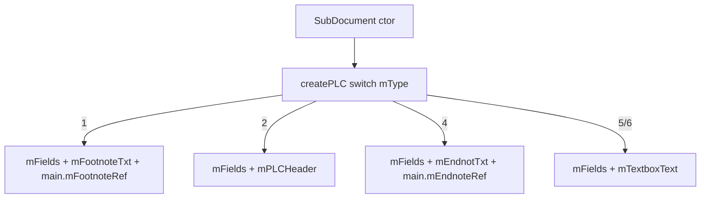

# 03_function_createplc_stories — createPLC type 1/2/4/5/6

| 项 | 值 |
|----|----|
| feature | wc-10-subdocument-pipeline |
| order | 3 |
| crate | `libs/word-core/Cargo.toml` |
| 入口 | `SubDocument::createPLC` case 1/2/4/5/6；`Document::{getPLCField,getPLCHeader,getFootnoteTxt,getEndnoteTxt,getTextboxText}` |
| 独立性 | 不改 type0 `PLCSection`（09）；不改 `PLCShapeAnchor`（08）；不改 bookmark/documentFields（05） |
| 测试状态 | pass（CP1–CP6；§3.8 SubDocument+TextDocument PASS；§3.9 overall PASS） |
| 阶段 | parse |

**按 I/O 切。** 不要全叶改写 `SubDocument.java`。

## 1. 功能说明

### 1.1 一句话

`createPLC()` 在故事 type 1/2/4/5/6 上挂上真实 `PLCField` 以及对应的 FootnoteTxt / PLCHeader / EndnoteTxt / TextboxText；type1/4 还在**主故事**上建立 `mFootnoteRef` / `mEndnoteRef`。

### 1.2 输入

`SubDocument` ctor 已设 `mType`，随后 `createPLC()`。

### 1.3 输出

| type | Java | 期望 |
|------|------|------|
| 1 | `mFields` + `mFootnoteTxt`；`createPLCOfFootnote` → 主故事 `mFootnoteRef` | 均非空 |
| 2 | `mFields` + `mPLCHeader` | `Document::getPLCHeader` Some；`getPLCSection` None |
| 4 | `mFields` + `mEndnotTxt`；主故事 `mEndnoteRef` | 均非空 |
| 5/6 | `mFields` + `mTextboxText` | `Document::getTextboxText` Some |

不测：type 3 comment；`mShapeAnchors`；`createPLCOfBookmark` / `createPLCOfDocumentFiels`；`mPLC.add` 监听循环。

### 1.4 上游

01 parent；wc-09 页眉故事填充消费 `PLCHeader`。

### 1.5 下游

`HdrFtrDocumentImporter` / `HelperHeaderFooter.getPLCHeader`；脚注 importer `getFootnoteTxt_mut`。

### 1.6 硬约束

| 允许 | 禁止 |
|------|------|
| 调用并实现 `createPLCOfFootnote/Endnote` 的字段写入 | 发明第二套 PLC 类型名 |
| `Document::getPLCHeader` 覆盖默认 None | 删 `// java` |
| 固有 `getTextboxText` 返回字段 | 改 type0 PLCSection |

**函数改写列表**

- `SubDocument.rs`：`createPLC` case 1/2/4/5/6 赋值；`createPLCOfFootnote` / `createPLCOfEndnote`；`getTextboxText`；`Document::getPLCHeader`
- `TextDocument.rs`：`createAllSubDocument` 按 Java 立刻写入 `mSubdocuments[i]`
- `Document.rs`：不改签名
- 不在列表：`createPLCOfComment`、shape/bookmark/fields、`doAddTextListener`

### 1.7 依赖与实现状态

| 类型 | 03 需要 | 情况 |
|------|---------|------|
| `PLCField` | `new(this)` | 已有 `PLCField::PLCField` |
| `PLCHeader` | `new(this)` | `PLCHeader::new` |
| `PLCFootnoteEndnoteTxt` | `new(this)` | 已有 |
| `PLCTextboxText` | `new(this)` | 已有 |
| `PLCFootnoteEndnoteRef` | 写在主故事 | `PLCFootnoteEndnoteRef::PLCFootnoteEndnoteRef` |

### 1.7.1 Java 有、本 function 不实现

| # | Java | 替代 | owner |
|---|------|------|-------|
| 1 | `mFootnoteRef.setTransaction` / `doAddTextListener` | 只写字段 | 事务/rope listener |
| 2 | `mPLC.add` + `doAddTextListener` 循环 | size 可 0 | 后续 |
| 3 | `new PLCShapeAnchor` / bookmark / documentFields | Copy 影子或 DEFERRED | 05/08 |
| 4 | type 3 `PLCCommentTxt` | 不测 | comment function |

## 2. 流程



Java：`SubDocument.java:738-782`、`createPLCOfFootnote/Endnote:419-431`。

## 3. 测试方案

### 3.1 审计

Java `createPLC` / getters；Rust 同方法；产品 `HdrFtrDocumentImporter`、`HelperHeaderFooter`。

### 3.2 覆盖矩阵

| coverage_id | 路径 | 必测 | test_id |
|-------------|------|------|---------|
| C-T1 | type1 field+txt；main footnoteRef | 是 | CP1 |
| C-T2 | type2 header；trait getPLCHeader；section None | 是 | CP2 |
| C-T4 | type4 endnote txt；main endnoteRef | 是 | CP3 |
| C-T5 | type5/6 textbox trait+固有 | 是 | CP4 |
| C-T0 | type0 仍有 section+field（回归） | 是 | CP5 |
| C-PIPE | hello-world 槽 2 getPLCHeader | 是 | CP6 |

### 3.3 管线

`open_text_document` + 同一 hello-world.docx。阶段 **parse**。

### 3.4 用例表

| id | 覆盖 | 期望 | 失败 |
|----|------|------|------|
| CP1 | C-T1 | field/txt Some；main `getFootnoteRef` Some | 未调 createPLCOfFootnote |
| CP2 | C-T2 | `Document::getPLCHeader` Some；section None | trait 默认 None |
| CP3 | C-T4 | endnote txt；main endnoteRef | |
| CP4 | C-T5 | type5 与 type6 textbox Some；固有与 trait 同址 | inherent todo |
| CP5 | C-T0 | type0 section+field Some | 回归 09 |
| CP6 | C-PIPE | parse 后槽 2 `getPLCHeader` Some | 产品页眉链空 |

### 3.5 测试位置

crate: `libs/word-core`  
src: `libs/word-core/src/cn/wps/moffice/writer/core/SubDocument.rs`  
src: `libs/word-core/src/cn/wps/moffice/writer/core/TextDocument.rs`（`createAllSubDocument` 逐槽写入，供 type1/4 `getMainDocument`）  
test: `tests/.../core/03_function_createplc_stories.rs`

### 3.6 运行脚本

```bash
cargo test --manifest-path libs/word-core/Cargo.toml --test 03_function_createplc_stories

bash .cursor/skills/feature-function/scripts/function-coverage.sh \
  --crate libs/word-core --test 03_function_createplc_stories \
  --src src/cn/wps/moffice/writer/core/SubDocument.rs \
  --src src/cn/wps/moffice/writer/core/TextDocument.rs \
  --report libs/word-core/parser/features/wc-10-subdocument-pipeline/functions/03_function_createplc_stories/FUNCTION.md
```

### 3.7 覆盖率报告

<!-- coverage-report:begin -->
tool: cargo-llvm-cov (`cargo llvm-cov --test 03_function_createplc_stories --json`)
date: 2026-09-30 15:08

| src | lines covered | line % | regions covered | region % |
|-----|---------------|--------|-----------------|----------|
| `src/cn/wps/moffice/writer/core/SubDocument.rs` | 307/612 | 50.2% | 341/697 | 48.9% |
| `src/cn/wps/moffice/writer/core/TextDocument.rs` | 227/1177 | 19.3% | 301/1401 | 21.5% |
| **function total** | **534/1789** | **29.8%** |  |  |
<!-- coverage-report:end -->

### 3.8 模板布局

```bash
node .cursor/skills/function-java2rust/scripts/check-template-layout.mjs \
  --rs libs/word-core/src/cn/wps/moffice/writer/core/SubDocument.rs \
  --java koffice/writer/core/cn/wps/moffice/writer/core/SubDocument.java

node .cursor/skills/function-java2rust/scripts/check-template-layout.mjs \
  --rs libs/word-core/src/cn/wps/moffice/writer/core/TextDocument.rs \
  --java koffice/writer/core/cn/wps/moffice/writer/core/TextDocument.java
```

### 3.9 门面对齐

```bash
node .cursor/skills/feature-function/scripts/java-rust-align-report.mjs \
  --java koffice/writer/core/cn/wps/moffice/writer/core/SubDocument.java \
  --rs libs/word-core/src/cn/wps/moffice/writer/core/SubDocument.rs \
  --java koffice/writer/core/cn/wps/moffice/writer/core/TextDocument.java \
  --rs libs/word-core/src/cn/wps/moffice/writer/core/TextDocument.rs \
  --report libs/word-core/parser/features/wc-10-subdocument-pipeline/functions/03_function_createplc_stories/FUNCTION.md
```

<!-- java-rust-align:begin -->
tool: java-rust-align-report.mjs
date: 2026-09-30 07:08

| Java class | Java file | Rust file | layout (`// java`) | implemented | `todo!("DEFERRED_NON_FUNCTION")` | missing in Rust | result |
|---|---|---|---|---|---|---|---|
| `SubDocument` | `koffice/writer/core/cn/wps/moffice/writer/core/SubDocument.java` | `libs/word-core/src/cn/wps/moffice/writer/core/SubDocument.rs` | **PASS** | `SubDocument`, `getDocumentFileds`, `getType`, `getMainDocument`, `getTextDocument`, `getPieceTable`, `getDrawingContainer`, `getTextRope`, `getChpxTable`, `getPapxTable`, `getName`, `charAt`, `getLength`, `getStyles`, `getTextboxText`, `getPLCField`, `getPLCSection`, `getPLCHeader`, `getFootnoteRef`, `getFootnoteTxt`, `getEndnoteRef`, `getEndnoteTxt`, `writeLock`, `getMax`, `getLastParaStart`, `isLocked`, `getErrorCollector` | `getContentThumb`, `dispose`, `createPLCOfBookmark`, `createPLCOfDocumentFiels`, `addTextListener`, `removeTextListener`, `getCommentStarts`, `getCommentEnds`, `getCommentRef`, `getBookmarkStarts`, `getBookmarkEnds`, `getTextboxDocument`, `copy`, `copyTextbox`, `insertTextboxNode`, `getTextStream`, `getRange`, `getTableRange`, `getParagraphRange`, `getAutoNumCount`, `getText`, `getDispatcher`, `getShapeAnchors`, `getCommentTxt`, `start`, `submit`, `commit`, `getTableInfos`, `fireDocumentUpdate`, `toString`, `type_to_name`, `checkValid`, `readLockAll`, `readLock`, `tryReadLock`, `tryWriteLock`, `readLockMainDocument`, `writeLockMainDocument`, `getHeadings`, `getPLCWords`, `getRangeLock`, `getOMathStarts`, `getOMathEnds`, `getPLCMathFunction`, `createPLCMath`, `createPLCOMath`, `isContainMathEquations`, `hashCode`, `getAutoNumField`, `addRevisionListener`, `removeRevisionListener`, `getDocumentCorrector`, `getAutoWordStat`, `exchangFootEndnoteTxt`, `exchangFootEndnoteRef`, `getShapes`, `hasHeadings`, `getDocParaIds` | — | **PASS** |
| `TextDocument` | `koffice/writer/core/cn/wps/moffice/writer/core/TextDocument.java` | `libs/word-core/src/cn/wps/moffice/writer/core/TextDocument.rs` | **PASS** | `TextDocument`, `getSubdocument`, `createSubDocument`, `correctReadonlyTrackchanges`, `setProperty`, `setInIOState`, `isInIOState`, `getAutoNumTable`, `getName`, `getPath`, `getMetadata`, `getMainDocument`, `getProperty`, `getStyles`, `getFontTable`, `getTheme`, `getAsiaTypography`, `getCharBuffer`, `getTextPool`, `getLength`, `getRange`, `getTrackChange`, `getUUSti`, `getUUNumberingId`, `getUULsid`, `hasDocField`, `getCompatibilityMode`, `type`, `getKParagraphsID` | `setStatAnalytics`, `getStatAnalytics`, `setDocumentCallback`, `getTmpRootDir`, `getFileManager`, `dispose`, `getShapeIDAlloc`, `getMediaLib`, `getOleManager`, `getCoreDataAcceptor`, `newDocumentFromTemplate`, `newDocumentFromAutoSave`, `startLoading`, `onStartLoad`, `liteExchangeDocument`, `charCount`, `getGlobalInkUserID`, `setGloabalInkUserID`, `cryptInfo`, `isFinishDumpObjects`, `setIoError`, `getIoError`, `isInUserAction`, `isLegal`, `getRtfReader`, `openDocument`, `isEncryption`, `isProEncryption`, `insertBefore`, `insertAfter`, `isLoadSuccess`, `setLoadSuccess`, `getListTemplates`, `getLists`, `getListParagraphs`, `getRaf`, `save`, `saveAs`, `saveFile`, `setSaveSuccessedListener`, `onSaveSuccessed`, `onEvidenceSuccessd`, `exportSecurityFile`, `backUp`, `qingSaveBackup`, `getFileFormat`, `saveToSrcFileFlag`, `close`, `setOnModifiedListener`, `setOnModifiedListener4Stat`, `addWriterOpenEventListener`, `removeWriterOpenEventListener`, `isModified`, `isAutoSave`, `setModified`, `getEvidenceData`, `setEvidenceData`, `getAppVersion`, `setAppVersion`, `updateDocument`, `getContentThumb`, `addBuiltinStyles`, `getRsids`, `addTransactionListener`, `removeTransactionListener`, `start`, `submit`, `commit`, `update`, `startInner`, `getInterruptNext`, `setInterruptNext`, `rollback`, `clearRedo`, `canExecuteUndoOrRedo`, `undo`, `dumpForException`, `redo`, `canUndo`, `canRedo`, `clearUndoRedo`, `getViews`, `getPassword`, `hasReadPassword`, `setPasswd`, `getEncryptType`, `getDigest`, `getSections`, `isEmbedBalloonMode`, `setIsEmbedBalloonMode`, `setTrackChange`, `hasComments`, `hasRevisions`, `getRevisionsAuthor`, `setRevisionsAuthor`, `getUnknownDataMap`, `getVBAPath`, `setVBAPath`, `getUUCommentId`, `getUUPropertySetRegistryId`, `addBuiltinTableStyle`, `getSSClassLoader`, `getDrawingRIDMap`, `getShapeId2DrawingRID`, `getDiagramShapeId`, `isDisplayBackground`, `requestUpdateBkShape`, `getImmutableBkShape`, `getBackground`, `setBackground`, `setStopUpdateTextDocment`, `isStopUpdateTextDocment`, `onFinishDumpObjects`, `waitFinishDumpObjects`, `setIoThreadIdToRangeLock`, `setChartShapes`, `getChartShapes`, `beforeSectionChanged`, `afterSectionChanged`, `getEncoding`, `setEncoding`, `setLoadListener`, `isContainMathEquations`, `hasMainDocumentShape`, `setFileTime`, `recoverFileTime`, `updateCore4Save`, `getDocumentVariables`, `getDocumentProtection`, `getOnlineSecurityTool`, `getFirstPageFontList`, `hasAudioComment`, `isDirty`, `isSecurityFile`, `setSlimDirty`, `open`, `isEmptySlides`, `setWritePassword`, `hasWritePassword`, `getDocProtection`, `getBookProtection`, `getShareObjIndexdMap`, `getFootnoteEndnoteExchange`, `getFootnoteEndnote`, `getSectionProperty`, `getSTHostApp`, `addOle`, `getKCustomIcv`, `isProtectOn_readOnly`, `isProtectOn_TrackChangeCtrl`, `isProtectOn`, `isThrowDocumentProtectionException`, `beginSectionChange`, `endSectionChange`, `createDefaultPageSetup`, `setPageSetup`, `getPageSetup`, `setPageOrientation`, `exportAsArray`, `advanceGVmlOffset`, `setGridResizeRequest`, `getGridResizeRequest`, `getSaveAccelerator`, `setDebugger`, `isDebugging`, `onDebug`, `collectOpenedDocumentInfo`, `hasHeadings`, `initPaperRecognition`, `isPaper`, `setScrolling`, `isOpenIdleScroll`, `getParaText`, `getSubDocParaIds` | — | **PASS** |
| `PapxTableListener` | `koffice/writer/core/cn/wps/moffice/writer/core/TextDocument.java` | `libs/word-core/src/cn/wps/moffice/writer/core/TextDocument.rs` | **PASS** | — | `PapxTableListener`, `beforeAddEntry`, `afterAddEntry`, `beforeRemoveEntry`, `afterRemoveEntry`, `beforeDataChange`, `afterDataChange` | — | **PASS** |
| `ChpxTableListener` | `koffice/writer/core/cn/wps/moffice/writer/core/TextDocument.java` | `libs/word-core/src/cn/wps/moffice/writer/core/TextDocument.rs` | **PASS** | — | `ChpxTableListener`, `beforeAddEntry`, `afterAddEntry`, `beforeRemoveEntry`, `afterRemoveEntry`, `beforeDataChange`, `afterDataChange` | — | **PASS** |
| `UUNumberingId` | `koffice/writer/core/cn/wps/moffice/writer/core/TextDocument.java` | `libs/word-core/src/cn/wps/moffice/writer/core/TextDocument.rs` | **PASS** | `getNextId`, `getCurrentId` | — | — | **PASS** |
| `UULsid` | `koffice/writer/core/cn/wps/moffice/writer/core/TextDocument.java` | `libs/word-core/src/cn/wps/moffice/writer/core/TextDocument.rs` | **PASS** | `getNextId`, `getCurrentId` | — | — | **PASS** |

**overall: PASS** — basename aligned; every Java class has layout PASS and a Rust counterpart for each public method.
<!-- java-rust-align:end -->

### 3.10 管线对比

| 步 | Java | Rust | 产品 |
|----|------|------|------|
| 1 | createPLC type2 `new PLCHeader(this)` | `PLCHeader::new` | HdrFtr importer |
| 2 | type1 `createPLCOfFootnote` | 写 main.mFootnoteRef | 脚注 importer |
| 3 | type5 `new PLCTextboxText` | 字段 + trait getter | RangeTool |

### 3.11 管线阶段对齐报告

| 项 | 内容 |
|----|------|
| 阶段 | parse |
| 原始文档 | hello-world.docx `69063664483d139c76647e6a5b29754c79158e14bc5c480c5fef85bad5dda98e` |
| 步骤对照 | §3.10 |
| 产品接线 | `Document::getPLCHeader` on header story |
| 关键路径真实实现 | pass（createPLC 写真实模块；type1/4 写主故事 Ref；`getPLCHeader` 覆盖 trait 默认） |
| 管线测试 test_id | CP6 |
| 测试结果符合预期 | pass |
| 判定 | pass |
