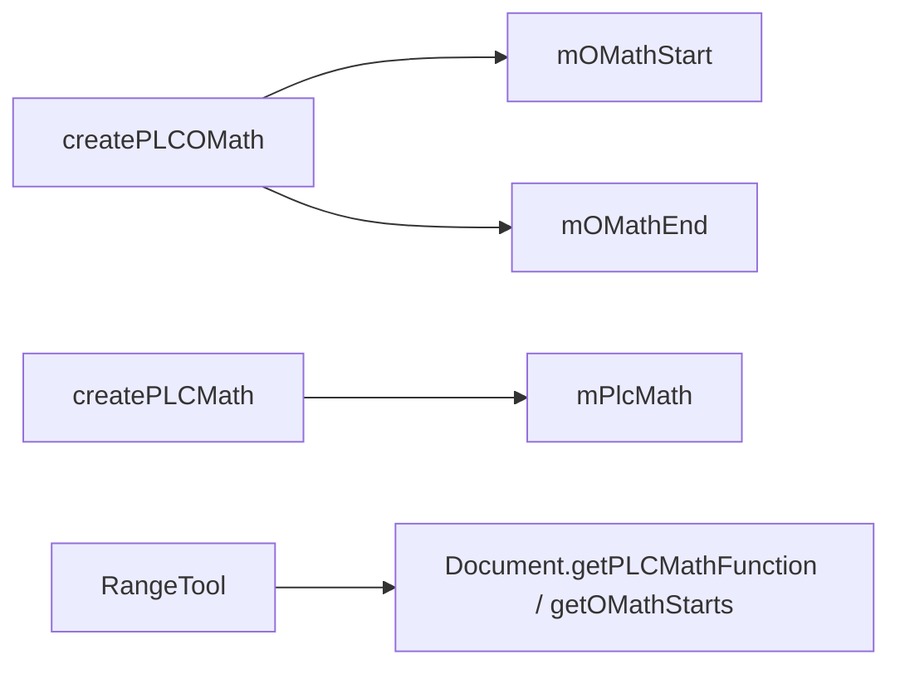

# 04_function_math_plc — createPLCOMath / createPLCMath

| 项 | 值 |
|----|----|
| feature | wc-10-subdocument-pipeline |
| order | 4 |
| crate | `libs/word-core/Cargo.toml` |
| 入口 | `SubDocument::{createPLCOMath,createPLCMath,getOMathStarts,getOMathEnds,getPLCMathFunction,isContainMathEquations}` |
| 独立性 | 不改 RangeTool 选区算法；不改 MathImporter 导入循环 |
| 测试状态 | pass（MP1–MP7；§3.8 PASS；§3.9 overall PASS） |
| 阶段 | layout（读门面；create 在 parse/importer） |

**按 I/O 切。** 真实模块已登记 `data/PLCMath*.rs`。去掉 `SubDocument.rs` 就地 Copy 影子。

## 1. 功能说明

### 1.1 一句话

`createPLCOMath()` / `createPLCMath()` 在空字段上 `new` 真实 `PLCMathStart`/`PLCMathEnd`/`PLCMathFunction`，`Document` getter 返回同一实例指针；`RangeTool` 读这些指针。

### 1.2 输入

已装配的 `SubDocument`（通常主故事）。Java 在字段为 null 时才创建。

### 1.3 输出

| Java | 期望 |
|------|------|
| `createPLCOMath` | `mOMathStart`/`mOMathEnd` 非空；二次调用不换对象 |
| `createPLCMath` | `mPlcMath` 非空；二次调用不换对象 |
| `getOMathStarts/Ends` / `getPLCMathFunction` | 与字段同一引用（可空） |
| `isContainMathEquations` | 两端非空且 `!mOMathStart.isEmpty() && !mOMathStart.isEmpty()`（Java 原文两处都是 start） |

不测：`addTextListener`（仍 DEFERRED）；节点 `addOMathStart`/`findClose` 语义。

### 1.4 上游

01 parent。模块 `data/PLCMathStart.rs` 等已登记。

### 1.5 下游

`RangeTool::{expandToSelectMathFunction,expandToSelectOMath}`；`MathTool`；`MathImporter.createPLCOMath`。

### 1.6 硬约束

| 允许 | 禁止 |
|------|------|
| 删 Copy 影子，`use data::PLCMath*` | 第二套 `SoftPLCMathStart` |
| getter `Option<&T>` + trait `*mut T` | 改 RangeTool 选区逻辑 |
| create 跳过 `addTextListener` | 删 `// java` |

**函数改写列表**

- `SubDocument.rs`：去掉 Copy 影子；上列 6 个方法；`impl Document` 覆盖 create/get/isContain
- `PLCMathStart.rs` / `PLCMathEnd.rs` / `PLCMathFunction.rs`：只调用 ctor/`setTransaction`/`isEmpty`，不改表语义
- 不在列表：`addTextListener` 体；MathImporter 循环

### 1.7 依赖

| 类型 | 需要 | 情况 |
|------|------|------|
| `PLCMathStart` | `new(this)` + `PLC.setTransaction` + `isEmpty` | 已有 |
| `PLCMathEnd` | 同上（经 `PLC_CP.super_`） | 已有 |
| `PLCMathFunction` | 同上（经 `PLC_Char.super_`） | 已有 |
| `Atom.writeLockAtom` | create 开头 | 已有 |
| `addTextListener` | Java 调用 | DEFERRED，§1.7.1 |

### 1.7.1 本 function 不实现

| # | Java | 替代 | owner |
|---|------|------|-------|
| 1 | `addTextListener(plc)` | 只 `new` + `setTransaction` | rope listener |
| 2 | `PLCMath*.isEmpty` 在 End 上 | Java `isContain` 两次都是 **Start** | 保持原文 |

## 2. 流程



Java：`SubDocument.java:1014-1057`。

## 3. 测试方案

### 3.1 审计

Java create/get/isContain；Rust 同方法；产品 `RangeTool::expandToSelectMathFunction`。

### 3.2 覆盖矩阵

| coverage_id | 路径 | 必测 | test_id |
|-------------|------|------|---------|
| C-OMATH | createPLCOMath 两端 Some | 是 | MP1 |
| C-IDEMP | 二次 create 指针不变 | 是 | MP2 |
| C-MATHFN | createPLCMath Some | 是 | MP3 |
| C-TRAIT | trait 与固有同址 | 是 | MP4 |
| C-EMPTY | 未 create getter None；create 后 isContain false（空 PLC） | 是 | MP5 |
| C-PROD | RangeTool 无 function → false | 是 | MP6 |
| C-PIPE | parse 后 createPLCOMath 可达 | 是 | MP7 |

### 3.3 管线

同一 hello-world.docx。阶段 **layout 读**。步骤：parse → 主故事 `createPLCOMath` → getter Some。产品 `RangeTool` 在未 create function 时返回 false。

### 3.4 用例表

| id | 覆盖 | 期望 | 失败 |
|----|------|------|------|
| MP1 | C-OMATH | start/end Some | 仍 Copy/None |
| MP2 | C-IDEMP | 二次 create 同指针 | 每次 new |
| MP3 | C-MATHFN | function Some | |
| MP4 | C-TRAIT | trait ptr == 固有 | 未覆盖 trait |
| MP5 | C-EMPTY | 前 None；后 isContain false | 误报有公式 |
| MP6 | C-PROD | `expandToSelectMathFunction` false | trait 假面非空 |
| MP7 | C-PIPE | parse 后 create 成功 | 产品链 panic |

### 3.5 测试位置

crate: `libs/word-core`  
src: `.../core/SubDocument.rs`  
src: `.../data/PLCMathStart.rs` `PLCMathEnd.rs` `PLCMathFunction.rs`（只读调用）  
test: `tests/.../core/04_function_math_plc.rs`

### 3.6 运行脚本

```bash
cargo test --manifest-path libs/word-core/Cargo.toml --test 04_function_math_plc

bash .cursor/skills/feature-function/scripts/function-coverage.sh \
  --crate libs/word-core --test 04_function_math_plc \
  --src src/cn/wps/moffice/writer/core/SubDocument.rs \
  --src src/cn/wps/moffice/writer/data/PLCMathStart.rs \
  --src src/cn/wps/moffice/writer/data/PLCMathEnd.rs \
  --src src/cn/wps/moffice/writer/data/PLCMathFunction.rs \
  --report libs/word-core/parser/features/wc-10-subdocument-pipeline/functions/04_function_math_plc/FUNCTION.md
```

### 3.7 覆盖率报告

<!-- coverage-report:begin -->
tool: cargo-llvm-cov (`cargo llvm-cov --test 04_function_math_plc --json`)
date: 2026-09-30 15:59

| src | lines covered | line % | regions covered | region % |
|-----|---------------|--------|-----------------|----------|
| `src/cn/wps/moffice/writer/core/SubDocument.rs` | 339/677 | 50.1% | 384/782 | 49.1% |
| `src/cn/wps/moffice/writer/data/PLCMathEnd.rs` | 3/68 | 4.4% | 3/78 | 3.8% |
| `src/cn/wps/moffice/writer/data/PLCMathFunction.rs` | 3/170 | 1.8% | 3/243 | 1.2% |
| `src/cn/wps/moffice/writer/data/PLCMathStart.rs` | 3/158 | 1.9% | 3/271 | 1.1% |
| **function total** | **348/1073** | **32.4%** |  |  |
<!-- coverage-report:end -->

### 3.8 模板布局

```bash
node .cursor/skills/function-java2rust/scripts/check-template-layout.mjs \
  --rs libs/word-core/src/cn/wps/moffice/writer/core/SubDocument.rs \
  --java koffice/writer/core/cn/wps/moffice/writer/core/SubDocument.java

node .cursor/skills/function-java2rust/scripts/check-template-layout.mjs \
  --rs libs/word-core/src/cn/wps/moffice/writer/data/PLCMathStart.rs \
  --java koffice/writer/core/cn/wps/moffice/writer/data/PLCMathStart.java

node .cursor/skills/function-java2rust/scripts/check-template-layout.mjs \
  --rs libs/word-core/src/cn/wps/moffice/writer/data/PLCMathEnd.rs \
  --java koffice/writer/core/cn/wps/moffice/writer/data/PLCMathEnd.java

node .cursor/skills/function-java2rust/scripts/check-template-layout.mjs \
  --rs libs/word-core/src/cn/wps/moffice/writer/data/PLCMathFunction.rs \
  --java koffice/writer/core/cn/wps/moffice/writer/data/PLCMathFunction.java
```

### 3.9 门面对齐

```bash
node .cursor/skills/feature-function/scripts/java-rust-align-report.mjs \
  --java koffice/writer/core/cn/wps/moffice/writer/core/SubDocument.java \
  --rs libs/word-core/src/cn/wps/moffice/writer/core/SubDocument.rs \
  --java koffice/writer/core/cn/wps/moffice/writer/data/PLCMathStart.java \
  --rs libs/word-core/src/cn/wps/moffice/writer/data/PLCMathStart.rs \
  --java koffice/writer/core/cn/wps/moffice/writer/data/PLCMathEnd.java \
  --rs libs/word-core/src/cn/wps/moffice/writer/data/PLCMathEnd.rs \
  --java koffice/writer/core/cn/wps/moffice/writer/data/PLCMathFunction.java \
  --rs libs/word-core/src/cn/wps/moffice/writer/data/PLCMathFunction.rs \
  --report libs/word-core/parser/features/wc-10-subdocument-pipeline/functions/04_function_math_plc/FUNCTION.md
```

<!-- java-rust-align:begin -->
tool: java-rust-align-report.mjs
date: 2026-09-30 07:59

| Java class | Java file | Rust file | layout (`// java`) | implemented | `todo!("DEFERRED_NON_FUNCTION")` | missing in Rust | result |
|---|---|---|---|---|---|---|---|
| `SubDocument` | `koffice/writer/core/cn/wps/moffice/writer/core/SubDocument.java` | `libs/word-core/src/cn/wps/moffice/writer/core/SubDocument.rs` | **PASS** | `SubDocument`, `getDocumentFileds`, `getType`, `getMainDocument`, `getTextDocument`, `getPieceTable`, `getDrawingContainer`, `getTextRope`, `getChpxTable`, `getPapxTable`, `getName`, `charAt`, `getLength`, `getStyles`, `getTextboxText`, `getPLCField`, `getPLCSection`, `getPLCHeader`, `getFootnoteRef`, `getFootnoteTxt`, `getEndnoteRef`, `getEndnoteTxt`, `writeLock`, `getMax`, `getLastParaStart`, `getOMathStarts`, `getOMathEnds`, `getPLCMathFunction`, `createPLCMath`, `createPLCOMath`, `isContainMathEquations`, `isLocked`, `getErrorCollector` | `getContentThumb`, `dispose`, `createPLCOfBookmark`, `createPLCOfDocumentFiels`, `addTextListener`, `removeTextListener`, `getCommentStarts`, `getCommentEnds`, `getCommentRef`, `getBookmarkStarts`, `getBookmarkEnds`, `getTextboxDocument`, `copy`, `copyTextbox`, `insertTextboxNode`, `getTextStream`, `getRange`, `getTableRange`, `getParagraphRange`, `getAutoNumCount`, `getText`, `getDispatcher`, `getShapeAnchors`, `getCommentTxt`, `start`, `submit`, `commit`, `getTableInfos`, `fireDocumentUpdate`, `toString`, `type_to_name`, `checkValid`, `readLockAll`, `readLock`, `tryReadLock`, `tryWriteLock`, `readLockMainDocument`, `writeLockMainDocument`, `getHeadings`, `getPLCWords`, `getRangeLock`, `hashCode`, `getAutoNumField`, `addRevisionListener`, `removeRevisionListener`, `getDocumentCorrector`, `getAutoWordStat`, `exchangFootEndnoteTxt`, `exchangFootEndnoteRef`, `getShapes`, `hasHeadings`, `getDocParaIds` | — | **PASS** |
| `PLCMathStart` | `koffice/writer/core/cn/wps/moffice/writer/data/PLCMathStart.java` | `libs/word-core/src/cn/wps/moffice/writer/data/PLCMathStart.rs` | **PASS** | `PLCMathStart`, `findStartByCP`, `addOMathStart`, `doOnInsertText`, `doOnRemoveText`, `removeOMathStart`, `findClose`, `expandRange` | — | — | **PASS** |
| `OMathStartNode` | `koffice/writer/core/cn/wps/moffice/writer/data/PLCMathStart.java` | `libs/word-core/src/cn/wps/moffice/writer/data/PLCMathStart.rs` | **PASS** | `getEnd`, `setEnd`, `isInOMathPara`, `createOMathPara`, `setOMathParaPr`, `hasOMathParaPr`, `getOMathParaPrJc` | — | — | **PASS** |
| `PLCMathEnd` | `koffice/writer/core/cn/wps/moffice/writer/data/PLCMathEnd.java` | `libs/word-core/src/cn/wps/moffice/writer/data/PLCMathEnd.rs` | **PASS** | `PLCMathEnd`, `findEndByCP`, `addOMathEnd`, `removeOMathEnd`, `isEncloseInsertedChar`, `setEncloseInsertedChar`, `doOnInsertText` | — | — | **PASS** |
| `OMathEndNode` | `koffice/writer/core/cn/wps/moffice/writer/data/PLCMathEnd.java` | `libs/word-core/src/cn/wps/moffice/writer/data/PLCMathEnd.rs` | **PASS** | `getStart`, `setStart` | — | — | **PASS** |
| `PLCMathFunction` | `koffice/writer/core/cn/wps/moffice/writer/data/PLCMathFunction.java` | `libs/word-core/src/cn/wps/moffice/writer/data/PLCMathFunction.rs` | **PASS** | `PLCMathFunction`, `addMathEndNode`, `addMathStartNode`, `findMathStartNodeByCP`, `findMathEndNodeByCP` | — | — | **PASS** |

**overall: PASS** — basename aligned; every Java class has layout PASS and a Rust counterpart for each public method.
<!-- java-rust-align:end -->

### 3.10 管线对比

| 步 | Java | Rust | 产品 |
|----|------|------|------|
| 1 | `new PLCMathStart(this)` | `PLCMathStart::PLCMathStart` | MathImporter |
| 2 | getter 字段引用 | trait `*mut` | RangeTool / MathTool |
| 3 | `getPLCMathFunction()==null` | `is_none` | `expandToSelectMathFunction` |

### 3.11 管线阶段对齐报告

| 项 | 内容 |
|----|------|
| 阶段 | layout（读）；create 为 parse importer 入口 |
| 原始文档 | hello-world.docx `69063664483d139c76647e6a5b29754c79158e14bc5c480c5fef85bad5dda98e` |
| 步骤对照 | §3.10 |
| 产品接线 | `RangeTool::expandToSelectMathFunction` |
| 关键路径真实实现 | pass（真实 `data::PLCMath*`；trait getter 返回字段指针） |
| 管线测试 test_id | MP6 MP7 |
| 测试结果符合预期 | pass |
| 判定 | pass |
