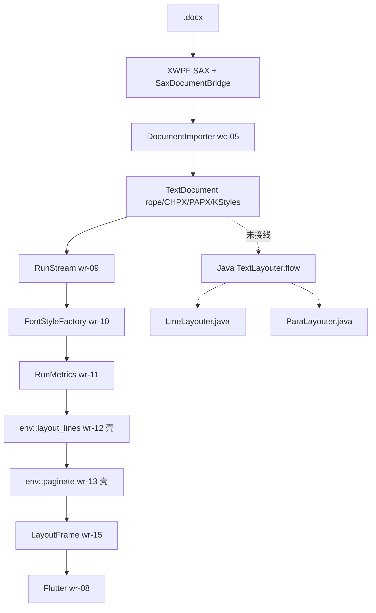

# word-core 已实现管线盘点（parser + layout）

> 快照：2026-09-03。function 状态以各 feature `functions.csv` 为准。`layout/features/manifest.csv` 已把 wr-09..20 标 **pass**，wr-21..28 为 **spec**。

## 0. 一句话

Parse MVP（wc-01..05）与 layout 两波（wr-01..08 可画字捷径；wr-09..16 行级算法叶子；wr-17..20 命中/会话/选区/编辑）**function 级已绿**。产品 `layout_document` 已走 SAX → `TextDocument` → `RunStream` → env 壳 `LineLayout`/`paginate`，**不是** Java `TextLayouter.flow`。`LineLayouter.rs` 仍是带 `j2r_ty` 本地桩的交错模板，**未接入产品**。因此「能画 sample2、PAPX jc 能进桶」≠「分页/断行/段距与 Java 像素级行框一致」。

```text
.docx
  → [S01–S06 parse ✓]  wave0 XWPF + wc-01..05 DocumentImporter
  → [S07 装配 △]       ViewParams A4；无 LayoutManager / CoreThread
  → [S08 度量 ✓叶子]    FontHost + FontStyleFactory（wr-03/10/11）
  → [S09–S11 排版 △]   产品 env LineLayout + paginate；Java TextLayouter 未接线
  → [S12 快照 △]       Typo* 结构在；产品 IR 仍是 LayoutFrame
  → [S13–S19 ✓叶子]    hit / session / selection / edit / Flutter painter
```



## 1. Parser（`libs/word-core/parser/features`）

| feature | status | I → O | 缺口（相对 Java 全文管线） |
|---------|--------|-------|---------------------------|
| wave0-ooxml-standards | ready | 术语 / XWPF | — |
| wc-01-storage-write | ready / 7 function pass | append* → rope+CHPX+PAPX+PLC | — |
| wc-02-document-model | ready / 10 pass | TextDocument 7 槽 + KStyles | numbering 仅 redirection，无 lvl 应用 |
| wc-03-property-convert | ready / 7 pass | rPr/pPr → PropertySet | converter 叶子绿；**SAX 是否把每个 sprm 送到 convertProp** 曾缺 jc（已修 pPr handler） |
| wc-04-paragraph-import | ready / 7 pass | 段状态机 + 表 cell 落库 + 域控制字 + sectPr | 表**布局**不在本层；页眉故事不排 |
| wc-05-orchestration | ready / 7 pass | DocxReader / DI 回调 | 测试 `DocxReader` 仍 RecXwpf；产品走 SAX 桥 |

**Parse 对 L2 仍敏感的洞：**

1. Stage1 **实文档** vs Java dump 未做门闩（sample2 类：191/193/197/208/210/212/214/217/220）。
2. `ind` 的 firstLine/hanging/left/right（208–213）与 spacing（214/217/220）若未进 PAPX，下游行宽/行高必漂。
3. numbering.xml → 自动编号串 / 悬挂缩进：wc-02 有 numId 映射，**layout 无 AutoNumLayouter**。
4. 页眉页脚 SubDocument 槽在，故事未填满、不排（本波 out，见 wc-09）。

## 2. Layout（`libs/word-core/layout/features`）

### 2.1 MVP 可画（wr-01..08）

function pass = **捷径可编译可画**。wr-04 `Wrap.rs` 贪心空格、wr-05 高度累加 **禁止再堆 Java 语义**（LINE_PARITY_PLAN §5）。

### 2.2 行级叶子（wr-09..16）+ 交互（wr-17..20）

| feature | functions.csv | 产品是否吃它 |
|---------|---------------|----------------|
| wr-09 run-stream | 4 pass | 是 |
| wr-10 font-style | 5 pass | 是 |
| wr-11 run-metrics | pass | 是 |
| wr-12 line-layouter | 5 pass | **吃 env `LineLayout`/`LineWrap`，不是 `layout/base/line/LineLayouter.rs`** |
| wr-13 page-layouter | 3 pass | **吃 env `paginate`，不是 `TextLayouter.processPagination`** |
| wr-14 typo-stage2 | pass | 金文件/比较器；产品主 IR 仍 LayoutFrame |
| wr-15 style-commands | pass | 是（DrawText size/bold/font_id） |
| wr-16 line-golden | 3 pass | **预导出 JSON 比较器**；不跑 `layout_document` 对 Java |
| wr-17 hit-test | 3 pass | session caret 用 |
| wr-18..20 | pass | 产品编辑环 |

wr-16「pass」只证明：**给定两份 Stage2 JSON，比较器与五类 fixture 编排绿**。不证明当前 `layout_document` 对同一 `.docx` 排出与 Java 相同的 `start_cp/end_cp/page_index`。

### 2.3 Java 热路径对照（S07–S12）

| Java | Rust 现状 | 本波 |
|------|-----------|------|
| `ParaLayouter.onStart`：217/214 段距塌缩、220 行距、208–213 缩进、193 jc、197 寡妇 | `para_papx_from` 读 193/208/217/214/197；**不读 210/212 左右缩进**；无 Java 塌缩规则 | wr-21 + wc-07 |
| `TextLayouter.flow` → `doFlowLine` → `flowTextLine` / table / textFrame | `LayoutDocument` 手写循环 | wr-22 |
| `MainLayouter` / `PageViewLayouter` MODE_PAGE=0 | 无 | wr-23 |
| `LineLayouter` + `SubLineLayouter.rollback` | env `LineWrap` 最小集；Java 类模板未接线 | wr-22 接线；kinsoku=wr-26 |
| `LineCompressTool` | 无 | wr-25 |
| `TableLayouter` / `DrawingLayouter` | 明确 out → wr-27 / wr-28 | 后波 |

## 3. 验收口径（钉死，与 LINE_PARITY_PLAN §1 一致并收紧执行）

| 字段 | 必须与 Java 相等 | 容差 |
|------|------------------|------|
| `page_index` / 页内 `line_index` | 是 | 精确 |
| `start_cp` / `end_cp` | 是 | 精确 |
| 行框 `x,y,width,height`（twip） | 是 | Stage2 ±0.01px |
| 行内 `xpos[i]` | **否** | 允许像素级差 |
| L3 截图 / AA / hinting | **否** | 不做 CI |

「像素级对齐」在本仓库 = **L2 行框与换页点对齐**；行内字形原点允许差几个像素。禁止用 Flutter `TextPainter` 二次测宽/断行去「修」几何。

## 4. 不在本波

表跨页、图绕排、文本框、页眉页脚排版、两端对齐、tab、bidi、主题字体、CoreThread、Android 截图 CI。
