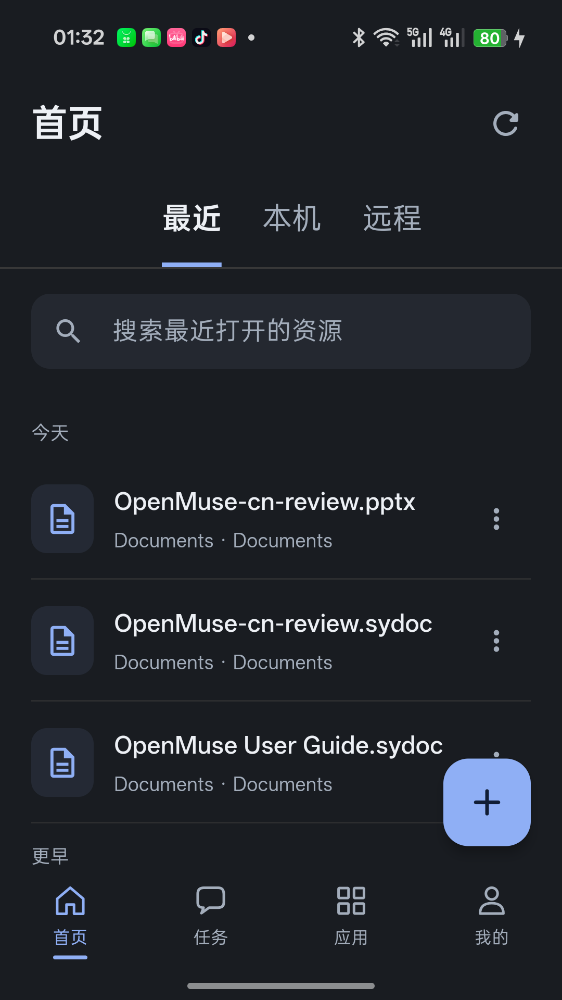
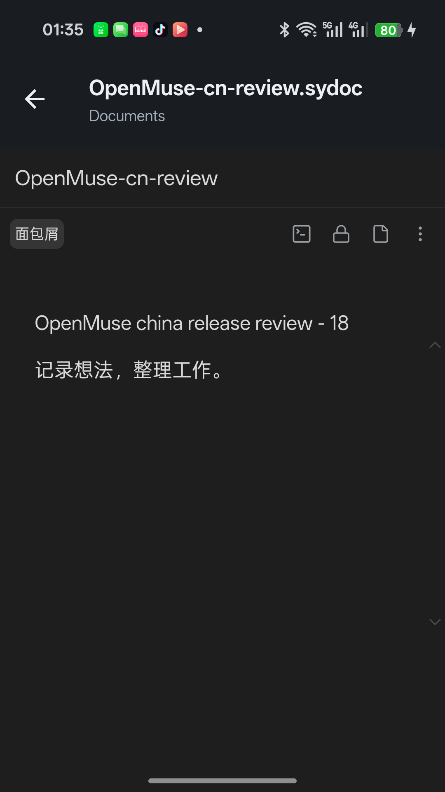
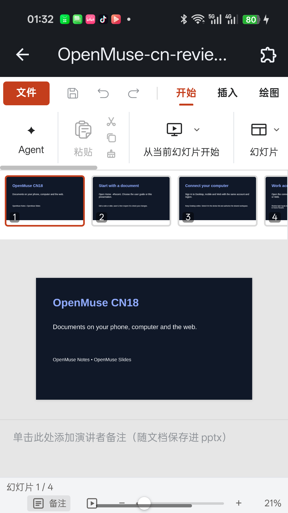

# OpenMuse 国内版使用指南

本指南适用于选择“中国服务地区”的 OpenMuse。Android 示例截图来自正式签名版本 1.0.1（18）的真实设备。请使用自己的账户和有权处理的资料。

## 1. 选择中国服务地区

首次启动时选择中国服务地区，阅读[用户协议](https://openmuseai.com/zh/terms)和[隐私政策](https://openmuseai.com/zh/privacy)。登录后的国内账户与其他服务地区分别管理。切换界面语言不会切换服务地区。

## 2. 首页与本地资料

首页可打开最近使用的资料。未登录时的本地资料属于独立本地空间，登录不会自动把它们上传或迁入账户。请先保存自己的更改。

## 3. 创建和打开文档

在首页使用新建或导入入口。选择文档后进入对应编辑器；文件格式或设备不支持编辑时，可能仅能预览。原始文件、导入件与共享快照应分别识别。

## 4. Notes 图文笔记

Notes 支持原生文档中的段落、图片和超链接。若顶部显示锁定，先确认你有编辑权，再切换编辑状态。修改后返回并重新打开，可检查内容是否保留。

## 5. Slides 演示文稿

在 Slides 中选择对象后编辑文字。完成输入后点击画布空白处结束编辑，再使用保存；等待“已保存”后返回。重新打开检查结果。出现版本冲突时先保留自己的内容，不要覆盖他人的新版本。

## 6. 图片与链接

本指南中的截图已嵌入文档，无需远程图片服务。轻点[中文官方网站](https://openmuseai.com/zh)等链接会打开外部页面；外部页面的访问由系统浏览器处理。不要向未知网站提交账号或密钥。

## 7. 登录国内账户

选择中国服务地区后，从“我的”进入登录。使用自己的账户邮箱与密码。审核或协作设备须使用同一服务地区；不要把美区账户的登录入口当成国内入口。登录问题可见[支持页面](https://openmuseai.com/zh/support)。

## 8. 连接自己的 Desktop

Desktop 是运行在你授权电脑上的 OpenMuse。先在该电脑登录同一中国服务地区和账户，保持应用在线，再从移动端 Desktop 入口连接。电脑离线、授权失效或网络中断时，请恢复连接后重试。

## 9. 模型由用户配置

OpenMuse 不随应用提供统一模型服务或预置付费模型额度。需要 AI 时，由用户在授权 Desktop 上选择并配置自己的模型服务。供应商、地址和使用条款以用户实际配置为准；不要把 API 密钥粘贴到聊天正文、截图或共享文档。更多说明见[隐私政策](https://openmuseai.com/zh/privacy)。

## 10. AI 结果与标识

AI 结果可能不准确，请核对后使用。AI 回复应显示生成标识。将结果复制、导出或再发布时，遵守适用规则及实际发布目的地的标识要求。涉及个人、财务或其他重要决定时请自行审核原始依据。

## 11. 资料授权与发送

只有在明确选择和授权后，才把需要的资料交给 Desktop 或自己配置的模型服务。使用境外供应商可能涉及境外处理，先阅读对应提示并确认接收方。详情见[隐私政策](https://openmuseai.com/zh/privacy)和[用户协议](https://openmuseai.com/zh/terms)。

## 12. 本地语音输入

语音输入使用设备本地识别，需要先下载公开语音模型。在首次录音前会说明用途并请求麦克风权限。拒绝后可继续使用其他功能；本指南不表示已授权录音。遇到下载问题可查看[支持页面](https://openmuseai.com/zh/support)。

## 13. 任务和权限

任务可能需要在线 Desktop、用户确认或相应文件权限。只授权自己拥有权限的资料。不要将陌生人发来的文档、网页或插件说明视为执行高风险操作的授权。

## 14. 内容反馈与问题报告

如遇不当 AI 内容，使用应用内可见的反馈入口，提供必要上下文并避免附带密钥或无关个人资料。其他使用问题可通过[支持页面](https://openmuseai.com/zh/support)联系，或发送邮件至[developer@openmuseai.com](mailto:developer@openmuseai.com)。

## 15. 账户注销

“我的”账户设置提供注销说明和确认步骤。注销可能永久删除账户与相关云端资料，请先导出需要保留的内容。完整说明见[账户注销页面](https://openmuseai.com/zh/account-deletion)，也可阅读[隐私政策](https://openmuseai.com/zh/privacy)。

## 16. 版本、备案与帮助

在“我的”查看实际安装版本和备案信息。国内 APP 备案号为粤ICP备2024331713号-5A。最新公开介绍见[中文官网](https://openmuseai.com/zh)，政策以[用户协议](https://openmuseai.com/zh/terms)与[隐私政策](https://openmuseai.com/zh/privacy)为准。
